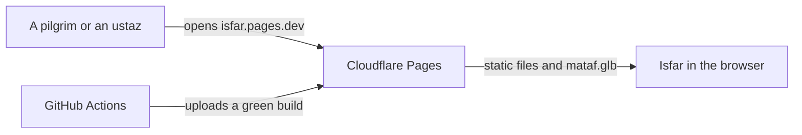
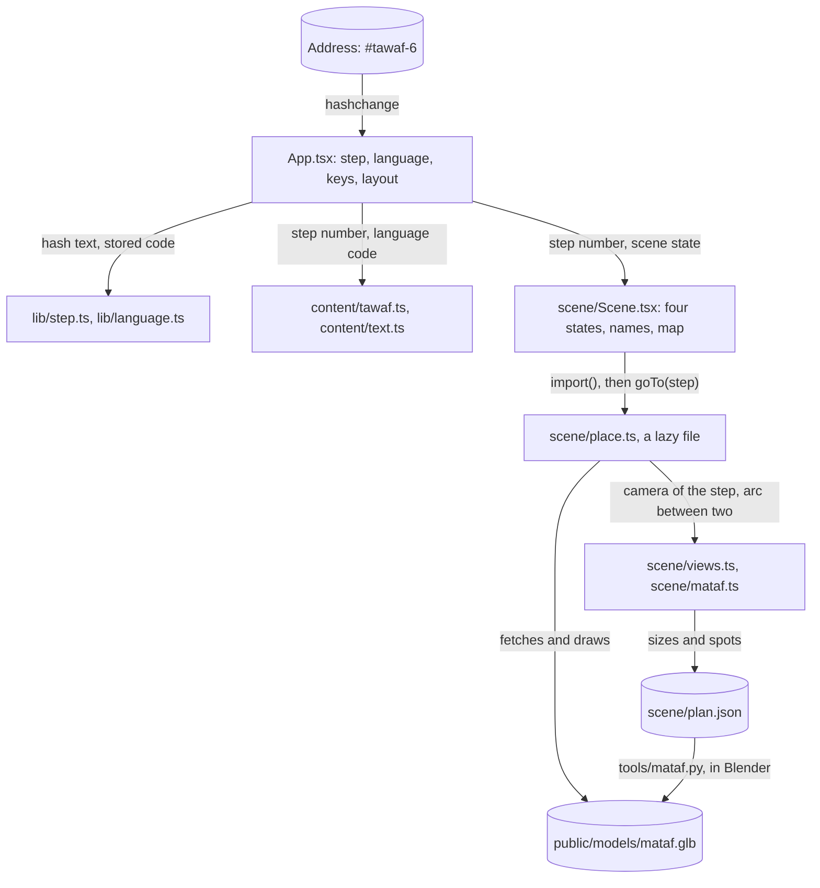

# Virtual Hajj · architecture

**Status:** Active · **Updated:** 2026-11-23 by /ship tawaf-walk

## Context

## Components

| Component | Folder | What it does |
| --------- | ------ | ------------ |
| App | `src/App.tsx` | Holds the step from the address, picks the language, listens to the keys and lays out the screen. |
| Rules | `src/lib/` | Reads the step from `#tawaf-N`, and picks the stored language, else the device language, else Malay. |
| Step text | `src/content/` | Holds every word on the screen, and the 15 steps of tawaf, in Malay and English. |
| Components | `src/components/` | The top bar, step panel, beads, Arabic block, note, Back and Next, notices, cards and the top-view map. |
| Scene | `src/scene/` | Checks for WebGL 2, loads the 3D place, moves the camera and the names, and shows the map when 3D cannot show. |
| Plan | `src/scene/plan.json` | The sizes of the tawaf place, read by the map, the camera and the Blender script. |
| Model | `tools/mataf.py`, `public/models/` | A Blender script that builds the Kaabah, the mataf and the arcades as one `.glb` file. |
| CI | `.github/workflows/ci.yml` | Tests each push, and deploys only a green build to Cloudflare Pages. |
