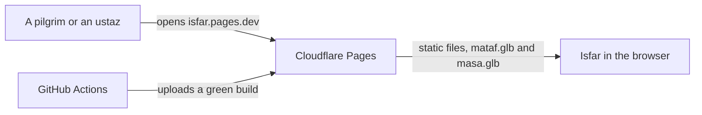
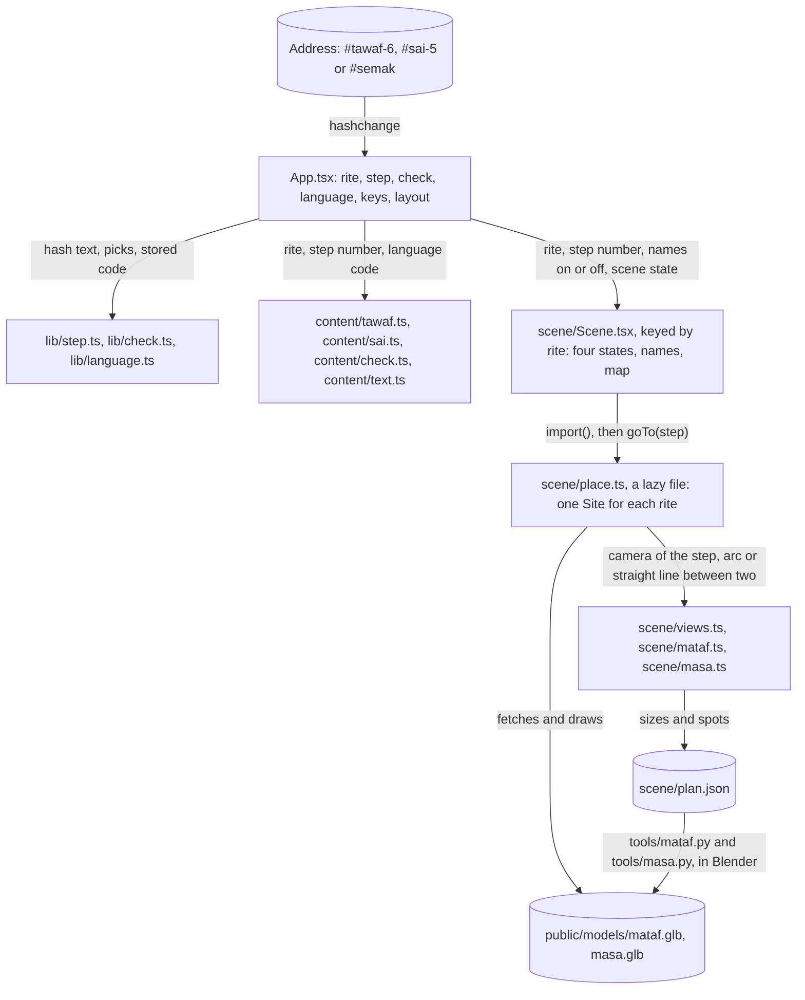

# Virtual Hajj · architecture

**Status:** Active · **Updated:** 2026-11-25 by /ship sai-check

## Context

## Components

| Component | Folder | What it does |
| --------- | ------ | ------------ |
| App | `src/App.tsx` | Holds the rite and the step, or the check, from the address, and the question and the picks of the check. Picks the language, listens to the keys and lays out the screen. |
| Rules | `src/lib/` | Reads the rite and the step from `#tawaf-N` or `#sai-N` and the check of each rite from `#semak` or `#semak-sai`, counts the right picks and the missed steps, and picks the stored language, else the device language, else Malay. |
| Step text | `src/content/` | Holds every word on the screen, the 15 steps of tawaf, the 13 steps of sa'i and the seven questions of each rite's check, in Malay and English. |
| Components | `src/components/` | The top bar with the rite switch, step panel, beads, Arabic block, note, Back and Next, notices, cards and the top-view maps of the mataf and the mas'a. The check adds its side column, the question, the answer option and the result. |
| Scene | `src/scene/` | Checks for WebGL 2, loads the 3D place of the rite on screen, moves the camera and the names, hides the names until a check answer, and shows the map when 3D cannot show. |
| Plan | `src/scene/plan.json` | The sizes of the tawaf place and the mas'a, read by the map, the camera and the Blender script. |
| Model | `tools/mataf.py`, `tools/masa.py`, `public/models/` | Two Blender scripts. One builds the Kaabah, the mataf and the arcades as `mataf.glb`, and one builds the mas'a, its hills, its green lights and the barrier between its two lanes as `masa.glb`. |
| CI | `.github/workflows/ci.yml` | Tests each push, and deploys only a green build to Cloudflare Pages. |
