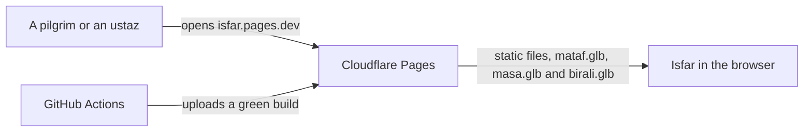
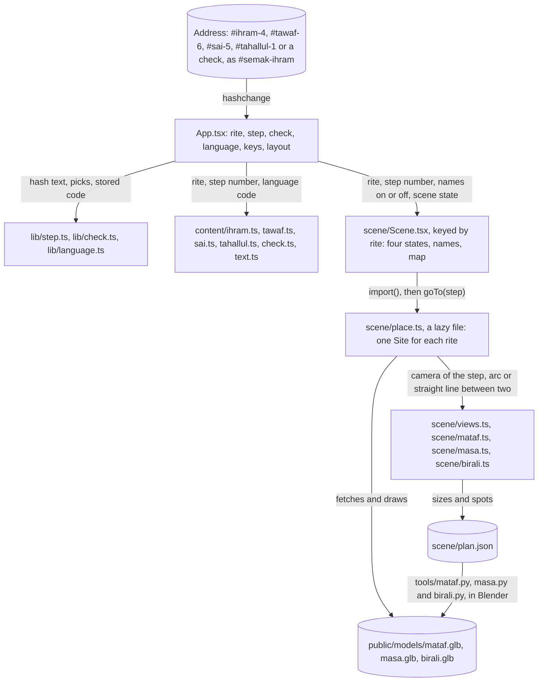

# Virtual Hajj · architecture

**Status:** Active · **Updated:** 2026-11-27 by /ship full-umrah

## Context

## Components

| Component | Folder | What it does |
| --------- | ------ | ------------ |
| App | `src/App.tsx` | Holds the rite and the step, or the check, from the address, and the question and the picks of the check. One walk table gives each rite its steps, beads, label, check, the address after its last step and, for ihram, tawaf and sa'i, the next part of the umrah. That next part is a quiet button on the last step and the gold button on the check result. Picks the language, listens to the keys and lays out the screen. |
| Rules | `src/lib/` | Reads the rite and the step from `#ihram-N`, `#tawaf-N`, `#sai-N` or `#tahallul-N`, with ihram step 1 for any other address, and the check of each rite from `#semak-ihram`, `#semak` or `#semak-sai`, counts the right picks and the missed steps, and picks the stored language, else the device language, else Malay. |
| Step text | `src/content/` | Holds every word on the screen, the 8 steps of ihram, the 16 steps of tawaf, the 13 steps of sa'i, the 2 steps of tahallul and the seven questions of each rite's check, in Malay and English. |
| Components | `src/components/` | The top bar with the language switch and the rite switch, step panel, beads, Arabic block, note, Back and Next, notices, cards and the top-view maps of the mataf, the mas'a and Bir Ali. The check adds its side column, the question, the answer option and the result. |
| Scene | `src/scene/` | Checks for WebGL 2, loads the 3D place of the rite on screen (tahallul uses the mas'a), moves the camera and the names, hides the names until a check answer, and shows the map when 3D cannot show. |
| Plan | `src/scene/plan.json` | The sizes of the tawaf place, the mas'a and Bir Ali, read by the map, the camera and the Blender scripts. |
| Model | `tools/mataf.py`, `tools/masa.py`, `tools/birali.py`, `public/models/` | Three Blender scripts. They build the Kaabah, the mataf and the arcades as `mataf.glb`; the mas'a, its hills, its green lights and the barrier between its two lanes, with open floor past Marwah for tahallul, as `masa.glb`; and the Bir Ali mosque with no roof, its courtyard, minaret, washrooms and bus park as `birali.glb`. |
| CI | `.github/workflows/ci.yml` | Tests each push, and deploys only a green build to Cloudflare Pages. |
