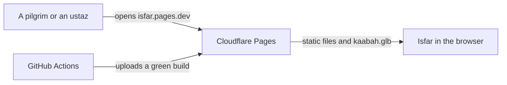
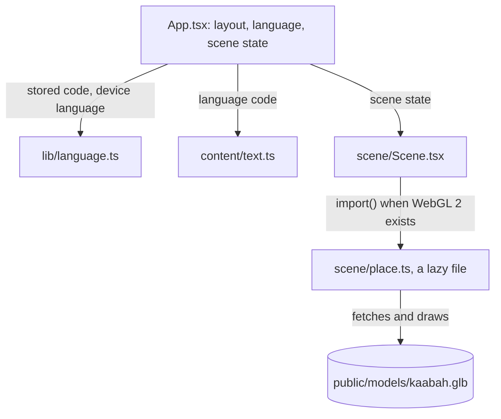

# Virtual Hajj · architecture

**Status:** Active · **Updated:** 2026-11-23 by /ship walking-skeleton

## Context

## Components

| Component | Folder | What it does |
| --------- | ------ | ------------ |
| App | `src/App.tsx` | Picks the language, holds the scene state and lays out the screen. |
| Language rule | `src/lib/` | Uses the stored choice, else the device language, else Malay. |
| Step text | `src/content/` | Holds every word on the screen, in Malay and English. |
| Components | `src/components/` | The top bar, step panel, notices, loading card, message card and still picture. |
| Scene | `src/scene/` | Checks for WebGL 2, loads the 3D file, and shows loading, shown, unsupported or failed. |
| Model | `tools/kaabah.py`, `public/models/` | A Blender script that builds the Kaabah and the mataf as one `.glb` file. |
| CI | `.github/workflows/ci.yml` | Tests each push, and deploys only a green build to Cloudflare Pages. |
