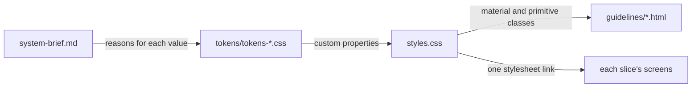

# Virtual Hajj design system

The one design system for Virtual Hajj. The reasons for each value are in `docs/design/system-brief.md`.

## What it commits to

- **Friendly, simple, encouraging.** Never preachy, heavy or old-fashioned.
- **Materials from the pilgrimage.** Marble is the ground. Ihram cloth is each panel. The kiswah, with one flat gold band, holds the panel header and the recitation.
- **Gold means "act here".** The main button, the current bead, the switch that is on.
- **Progress is seven counter beads.** Tawaf and sa'i each count seven.
- **Large text.** 18px body, 16px at the smallest, 48px touch targets. Text passes WCAG AA in light and dark.
- **Light is the default.** Dark is near-black and gold.
- **Tier 2 motion.** Transform and opacity only, and a reduced-motion path for each move.

## How to use it

Link `styles.css` once. It imports the tokens and holds the material and primitive classes.

```html
<link rel="stylesheet" href="styles.css">
<body class="vh-marble">
  <article class="vh-panel vh-cloth">…</article>
</body>
```

Light and dark follow the device. Put `data-theme="light"` or `data-theme="dark"` on an element to force one.

Use `var(--vh-*)` for each colour, size and duration. Do not write a raw value in a screen.

Put Arabic in its own block, with `lang="ar" dir="rtl"`, in the `vh-arabic` block.

## Where things are



The brief explains the tokens, `styles.css` turns them into classes, and the guideline pages and each screen use those classes.

| Path | Holds |
| --- | --- |
| `tokens/tokens-color.css` | Colours and the three material patterns, light and dark |
| `tokens/tokens-type.css` | Fonts, sizes and the text styles |
| `tokens/tokens-space.css` | Space, sizes and corners |
| `tokens/tokens-motion.css` | Durations, the curve, and the reduced-motion values |
| `tokens/fonts.css` | The `@font-face` rules for the files in `fonts/` |
| `fonts/` | Nunito 500 and 800, Amiri 400, and their licences. The site ships them, and sends no request to Google (D21). |
| `styles.css` | Materials and primitives: button, step panel, beads, language switch, Arabic block, note, notice, answer option, scene card |
| `guidelines/` | One small page for each foundation, and one for the primitives |

## Not here yet

- **A component library.** The primitives are CSS classes. The site wraps the ones it uses in React components in `src/components/`.
- **3D tokens.** The 3D scene is content. Its budget belongs to the `walking-skeleton` spec.

## Glossary

- **Token** — a named design value, such as a colour or a size, that each screen reuses.
- **Primitive** — a basic building block of the interface, such as a button.
- **Kiswah** — the black cloth that covers the Kaabah. A band of gold writing runs around it.
- **Lip** — a thick darker edge under a control, which makes it look raised and pressable.
- **Counter beads** — a short string of seven beads that a pilgrim moves to count the circuits.
- **WCAG AA** — the common accessibility standard. Body text needs 4.5:1 contrast with its background.
