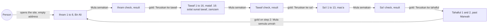

# Full umrah

**Version:** v1 · **Status:** Draft · **Type:** Feature · **Project type:** Web UI

**Shape doc:** docs/specs/virtual-hajj/shape.md
**Depends on:** `ihram-check`, `sai-check`, `tawaf-check`

The walk starts with ihram and ends with tahallul, so a person walks one whole umrah from the first step to the last.
Each check opens at the end of its rite, and its result then goes on to the next part.

## Problem

The site teaches ihram, tawaf and sa'i, but as three walks with gaps between them.
Tawaf step 15 and sa'i step 13 both end with "That part of the site comes later", so the solat sunat tawaf, the zamzam and tahallul have no step.
A first-timer who opens the site lands on tawaf step 1, not on ihram, which comes first on the day.
After a check, the result offers only "Cuba semula" and "Keluar", so the person must find the next rite in the top bar.
Tahallul ends the umrah. A pilgrim who skips it, or cuts too little hair, stays in ihram without knowing it.

## Slice test

| Check                         | Result |
| ----------------------------- | ------ |
| Cuts every layer it needs     | Yes. The step text in Malay and English, the plan sizes, the mas'a model, the 3D scene and the top-view maps, the address, the rite switch, the check result, the browser test and the deploy. |
| One e2e test walks it         | Yes. `e2e/umrah.spec.ts` walks from an empty address through the four parts and three checks to "Umrah selesai", then runs scenarios 2 to 5. |
| Worth shipping alone          | Yes. A first-timer walks one whole umrah in the order of the day, and an ustaz teaches a full umrah class from one link with a clicker. |
| Fits (≤5 scenarios, ≤2 areas) | Yes. 5 scenarios. Two areas: the join of the parts (the address, the walks in `App.tsx`, the check result, and tawaf step 16 in the mataf, with no model change), and tahallul in the mas'a, with its exit past Marwah. |

**Path:** full. The slice adds a fourth part, a new step in tawaf, a change to the mas'a and a new path through the checks.

## User story

As a first-time pilgrim, I want to walk one whole umrah from ihram to tahallul, so that I know each step in the order of the day before the trip.

## Flow



The person walks each part, takes its check, and the gold button on each result opens the next part, until tahallul ends the umrah.
On the last step of ihram, tawaf and sa'i, a quiet button in the panel skips the check and opens the next part (O8).

## Acceptance criteria

```gherkin
Scenario: Aminah walks one whole umrah on her phone
  Given Aminah's phone is set to Malay, and the screen is 360x800, upright
  When she opens "https://isfar-57q.pages.dev/" with no address after it
  Then the address ends with "#ihram-1", and the label says "Ihram · Langkah 1 daripada 8"
  When she walks to ihram step 8, taps "Mula semakan" and answers the seven questions
  Then the result shows, and the gold button says "Teruskan ke tawaf"
  And "Cuba semula" sits in the result panel, and "Keluar" stays on the left of the bar
  When she taps "Teruskan ke tawaf"
  Then the address ends with "#tawaf-1", and the mataf loads
  When she walks to tawaf step 15 and taps "Seterusnya"
  Then the label says "Langkah 16 daripada 16", and the title is "Solat sunat tawaf dan zamzam"
  And the gold marker stands behind Maqam Ibrahim, and its name shows
  And "Teruskan ke sa'i" and "Mula semula" sit in the panel as quiet buttons
  When she takes the tawaf check from step 16
  Then the gold button on the result says "Teruskan ke sa'i", and it opens "#sai-1"
  When she walks to sa'i step 13 and takes the sa'i check
  Then the gold button on the result says "Teruskan ke tahallul"
  When she taps it
  Then the address ends with "#tahallul-1", the label says "Tahallul · Langkah 1 daripada 2", and the mas'a shows
  When she taps "Seterusnya"
  Then step 2 shows the title "Umrah selesai", and the gold button says "Mula semula umrah"
  When she taps "Mula semula umrah"
  Then the address ends with "#ihram-1"
  And the same holds at 960x540, at 1280x720 and at 1920x1080

Scenario: Ustaz Hafiz takes a class from one rite to the next with a clicker
  Given the projector shows the site at 1920x1080, in English
  And Ustaz Hafiz is on the result of the tawaf check
  When he presses Page Down
  Then the address ends with "#sai-1", and step 1 of sa'i shows
  When he opens an old link to "#tawaf-15" and presses Page Down
  Then tawaf step 16 shows, and the address is "#tawaf-16"
  When he reloads the page
  Then tawaf step 16 still shows
  When he presses Page Down
  Then question 1 of the tawaf check shows

Scenario: Aminah learns tahallul past Marwah
  Given Aminah is on "#tahallul-1" in Malay, on her 360x800 phone
  Then the title is "Bercukur atau bergunting"
  And the text says that men shave or cut the hair, and women cut a fingertip length from the end of the hair
  And a note says how much hair the Shafi'i, Hanafi, Maliki and Hanbali schools each require
  And the gold marker stands past Marwah, at the end of the mas'a
  And the rite switch shows Ihram, Tawaf, Sa'i and Tahallul, with "Tahallul" as the current part
  And the page does not scroll sideways
  When she taps "Seterusnya"
  Then step 2 says that the rules of ihram end, and her umrah is complete
  When she presses Page Down on a keyboard
  Then the address ends with "#ihram-1"

Scenario: Aminah sees the new steps on the top-view map when 3D cannot show
  Given 3D drawing is off in the browser on Aminah's phone
  When she opens "#tawaf-16" in Malay
  Then the top-view map of the mataf shows the marker behind Maqam Ibrahim
  When she taps "Tahallul" in the rite switch
  Then the top-view map of the mas'a shows the marker past Marwah
  And the message card says the device cannot show the 3D place

Scenario: Old and wrong addresses still open a step
  Given Aminah has a link to "#tahallul-5"
  When she opens it
  Then step 1 of tahallul shows
  And "#tawaf-17" opens tawaf step 1, and "#semak" still opens the tawaf check
  And an address the site does not know, as "#umrah", opens ihram step 1
```

Rules that hold for each scenario:

- Claude drafts the words of tawaf step 16 and the two tahallul steps at pause 2, and the user corrects them (D24).
- Each step text has 40 words or fewer, in Malay and in English, in the Shafi'i school (shape O2).
- Where the act is for men only, the text says "for men" (D23).
- Tawaf step 15 and sa'i step 13 say what comes next, and drop "That part of the site comes later".
- Tawaf step 16 keeps seven beads done, as step 15 does. Tahallul shows no beads, as ihram does (D97).
- The three checks keep their questions (O11). The tawaf check now opens from tawaf step 16.
- On a check result, Page Down and the Right arrow key open the next part, as the gold button does. Page Up does nothing there.
- Tahallul and the whole umrah get no check (O9).
- The 3D download stays under 500 KB compressed (D16).
- The site stays hidden from search engines (shape O22).

| Part | Step | Title | Where the marker stands | What it teaches |
| ---- | ---- | ----- | ----------------------- | --------------- |
| Tawaf | 16 | Solat sunat tawaf and zamzam | Behind Maqam Ibrahim | Two rakaat behind Maqam Ibrahim, or anywhere in the mosque when it is full. Then drink zamzam. Next comes sa'i. |
| Tahallul | 1 | Shave or cut | On the open floor past the Marwah exit (O10) | Men shave the whole head, or cut it. Women cut a fingertip length. A note on how much each school requires. |
| Tahallul | 2 | Umrah is complete | The mas'a from above | The rules of ihram end. The umrah is complete. |

## Scope

**In:**

- Tawaf step 16 in Malay and English, in the 3D mataf and on its map, with the marker behind Maqam Ibrahim.
- Two tahallul steps in Malay and English, in the 3D mas'a and on its map, with the marker past Marwah.
- "Tahallul" in the rite switch, after "Sa'i", and the addresses `#tahallul-1` and `#tahallul-2`.
- On each check result, a gold button that opens step 1 of the next part, and "Cuba semula" as a quiet button in the panel.
- On tawaf step 16 and sa'i step 13, a quiet button in the panel that opens the next part, as on ihram step 8.
- On tahallul step 2, the gold "Mula semula umrah", which opens `#ihram-1`.
- An exit in the Marwah end wall of the mas'a model, with a strip of open floor past it.
- An empty or unknown address opens ihram step 1.
- New last lines for tawaf step 15 and sa'i step 13.
- A new D-entry that supersedes D14: the site stays hidden until a qualified person reviews the content (shape O22).

**Out:**

| Left out | Picked up by |
| --- | --- |
| The text for a man or a woman alone | `pilgrim-choice`, the next slice |
| A pilgrim figure that walks on Next, and a softer look | The /shape pass of D46 |
| A listing in search engines | No slice. It waits for a qualified review (shape O1, O22). |
| A check on tahallul, or one check for the whole umrah | No slice (O9) |
| A question on step 16 in the tawaf check | No slice (O11) |
| A 3D place of its own for zamzam or for the barbers | No slice. Zamzam is a line of step 16, and the barbers are a spot past Marwah. |
| Hajj | Its own shape, after umrah ships (shape O7) |

## Decisions to record

Drafted at pause 1. They go into `DECISIONS.md` when pause 2 is approved.

```markdown
## D106 · 2026-11-26 · The umrah has four parts, and tawaf gains step 16 for the solat sunat tawaf and zamzam

Why: the walk follows the order of the day: ihram, tawaf, sa'i, tahallul. The two
rakaat behind Maqam Ibrahim and the zamzam come between tawaf and sa'i, and the mataf
already has Maqam Ibrahim, so step 16 needs no new model. The seven beads stay done on
step 16. The rest of D22 stands: three steps before, circuit 1 in full, one step for
each later circuit, and one to close at step 15.
Rejected: Solat and zamzam as a part of its own (a fifth button in the rite switch for
one step), No new step (the walk skips an act of the day between tawaf and sa'i).
Supersedes: D22
Source: specs/full-umrah.md
Status: active

## D107 · 2026-11-26 · The gold button on a check result opens the next part, and "Cuba semula" moves into the panel

Why: each check opens at the end of its rite (D58, D84, D103), and its result then goes
on to step 1 of the next part, so the person walks one umrah. One gold act on each
screen (D3), as on step 15 (D58). Page Down on the result opens the next part, so an
ustaz goes on with the clicker. "Keluar" stays on the left of the bar.
Rejected: Next goes on, and the check is a quiet button (a person skips each check),
Both checks at the end of the umrah (the questions come long after the walk),
"Cuba semula" in the place of "Keluar" (two ways out of the check change at once).
Source: specs/full-umrah.md
Status: active

## D108 · 2026-11-26 · Tahallul is two steps in the 3D mas'a, with the marker at an exit past Marwah

Why: tahallul comes straight after sa'i ends at Marwah (D68), and the barbers stand
outside the Marwah end. Step 1 is the shave or the cut, with a note on each school.
Step 2 says the umrah is complete. The mas'a model gains a gap in the Marwah end wall
and a strip of floor past it.
Rejected: One step (the end of the umrah has no step of its own), Three steps (the
third repeats the rules of ihram), No scene (the only part with no place), A top-view
map of Makkah (a new place for one spot), The marker on top of Marwah (it shows nothing
of where to go after sa'i).
Source: specs/full-umrah.md
Status: active

## D109 · 2026-11-26 · The site stays hidden from search engines until a qualified person reviews the content

Why: the step text and the check text are Claude's draft (D24, D55), and no qualified
person has reviewed them (shape O1). A whole umrah on the site does not make the text
right. The noindex tag and the X-Robots-Tag header stay until that review, whichever
slice it comes in.
Rejected: List it in full-umrah (search engines list text that nobody has reviewed),
The review is done (it is not).
Supersedes: D14
Source: specs/full-umrah.md
Status: active

## D110 · 2026-11-26 · On tahallul step 2, the gold "Mula semula umrah" opens ihram step 1

Why: tahallul has no check, so step 2 has no check to open. A start at ihram lets an
ustaz begin the next class with the clicker, and Page Down does the same.
Rejected: "Mula semula" to tahallul step 1 (two steps to walk again, not the umrah), No
gold button (the walk stops, and the screen has no main act).
Source: specs/full-umrah.md
Status: active

## D111 · 2026-11-26 · The last step of ihram, tawaf and sa'i has a quiet button to the next part

Why: an ustaz in a short class skips a check, as "Teruskan ke tawaf" lets him on ihram
step 8 (D103). Tawaf step 16 gets "Teruskan ke sa'i", and sa'i step 13 gets "Teruskan
ke tahallul", beside "Mula semula".
Rejected: No skip, and ihram step 8 drops its button (the only way on is through each
check).
Source: specs/full-umrah.md
Status: active

## D112 · 2026-11-26 · Tahallul and the whole umrah get no check

Why: tahallul is two steps, and the checks of ihram, tawaf and sa'i cover each place of
the umrah. The slice stays at two areas.
Rejected: One check for the whole umrah in a later slice (it asks again what the three
checks ask), A tahallul check in a later slice (seven questions on two steps).
Source: specs/full-umrah.md
Status: active

## D113 · 2026-11-26 · The tawaf check keeps its seven questions, and opens from step 16

Why: the seven questions cover the places of the circuit (D48), and the seven beads fit
seven. Step 16 is the last step, so "Mula semakan" and Page Down move there from step
15.
Rejected: Swap one question for step 16 (a place of the circuit goes unchecked).
Source: specs/full-umrah.md
Status: active
```

## Open items

| ID  | What | Type | Raised at | Owner | Status | Answer |
| --- | ---- | ---- | --------- | ----- | ------ | ------ |
| O1  | Which parts does the one walk have? (from shape O18) | question | shape | user | Resolved | Ihram, tawaf, sa'i, tahallul. Tawaf gains step 16: solat sunat tawaf behind Maqam Ibrahim, and zamzam. This supersedes D22. "Solat and zamzam as a part of its own" and "no new step" were rejected. 2026-11-25 |
| O2  | Where do the tawaf check and the sa'i check open? (from shape O19) | question | shape | user | Resolved | At the end of its rite, as D58 and D84 have it. The result gains a gold button to the next part. "Next goes on, and the check is a quiet button" and "both checks at the end" were rejected. 2026-11-25 |
| O3  | How many tahallul steps follow sa'i, and where? (from shape O20) | question | shape | user | Resolved | Two, in the 3D mas'a, with the marker past Marwah: shave or cut, with a note on each school, then umrah is complete. "One" and "three" were rejected. "No scene" and "a top-view map of Makkah" were rejected. 2026-11-25 |
| O4  | Does the rite switch stay? (from shape O21) | question | shape | user | Resolved | Yes, with four parts: Ihram, Tawaf, Sa'i, Tahallul (D94). "No switch" and "a list of parts on step 1" were rejected. 2026-11-25 |
| O5  | D14 hides the site from search engines until `full-umrah`. O1 of the shape wants a qualified review before a public launch. (from shape O22) | question | shape | user | Resolved | The site stays hidden until a qualified person reviews the content, whichever slice that is. A new entry supersedes D14. "List it in full-umrah" and "the review is done" were rejected. 2026-11-25 |
| O6  | Tahallul step 2 ends the umrah, and tahallul has no check. What does the gold button on step 2 do? | question | spec p1 | user | Resolved | The gold "Mula semula umrah" opens `#ihram-1`, and Page Down does the same. "Mula semula" to `#tahallul-1` and "no gold button" were rejected. 2026-11-26 |
| O7  | The gold place on a check result holds "Cuba semula" today. Where does "Cuba semula" go when the gold button opens the next part? | question | spec p1 | user | Resolved | "Cuba semula" becomes a quiet button in the result panel, as "Mula semula" did on step 15 (D58). "Keluar" stays on the left of the bar. "Cuba semula in the place of Keluar" was rejected. 2026-11-26 |
| O8  | Ihram step 8 has a quiet "Teruskan ke tawaf" in its panel, so a person can skip the check. Do tawaf step 16 and sa'i step 13 get the same? | question | spec p1 | user | Resolved | Yes. Tawaf step 16 gets a quiet "Teruskan ke sa'i", and sa'i step 13 a quiet "Teruskan ke tahallul", beside "Mula semula". "No skip, and ihram step 8 drops its button" was rejected. 2026-11-26 |
| O9  | `ihram-check` gave "a check for the whole umrah" to this slice. Does tahallul or the whole umrah get a check? | question | spec p1 | user | Resolved | Neither. Tahallul is two steps, and the three checks cover the places. "A whole-umrah check in a later slice" and "a tahallul check in a later slice" were rejected. 2026-11-26 |
| O10 | Shape O20 puts the tahallul marker past Marwah. The mas'a model ends at a wall behind Marwah, so no floor lies past it. | question | spec p1 | user | Resolved | An exit past Marwah: a gap in the Marwah end wall and a strip of open floor outside it, with the marker there. `tools/masa.py` changes. "The marker on top of Marwah, with no model change" was rejected. 2026-11-26 |
| O11 | Does the tawaf check gain a question on step 16? | question | spec p1 | user | Resolved | No. The tawaf check keeps its seven questions (D48), and opens from step 16. "Swap one question for step 16" was rejected. 2026-11-26 |

_Never delete this section or its rows. See references/ledger.md._

## Glossary

- **Tahallul** — the shave or cut of the hair that ends ihram, after sa'i.
- **Solat sunat tawaf** — two rakaat of prayer after tawaf, behind Maqam Ibrahim when there is room.
- **Maqam Ibrahim** — the stone with the footprints of Prophet Ibrahim, in a glass and gold case near the Kaabah.
- **Zamzam** — the well water of Masjidil Haram, which the pilgrim drinks after the solat sunat tawaf.
- **Marwah** — the hill at the end of sa'i. The exits to the barbers are at this end.
- **Rite switch** — the row of buttons in the top bar that opens step 1 of each part.
- **Ustaz** — a male religious teacher.
- **Presenter clicker** — a small remote for slides. It sends the Page Up and Page Down keys.
- **e2e** — end-to-end: one browser test that walks the whole slice as a person would.
- **D14, D22** — numbered entries in `DECISIONS.md`, the record of each choice.
