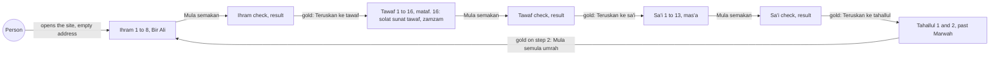
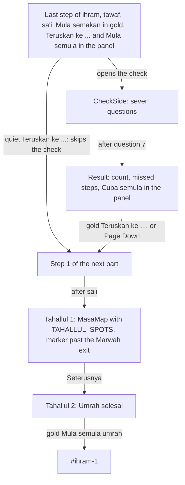
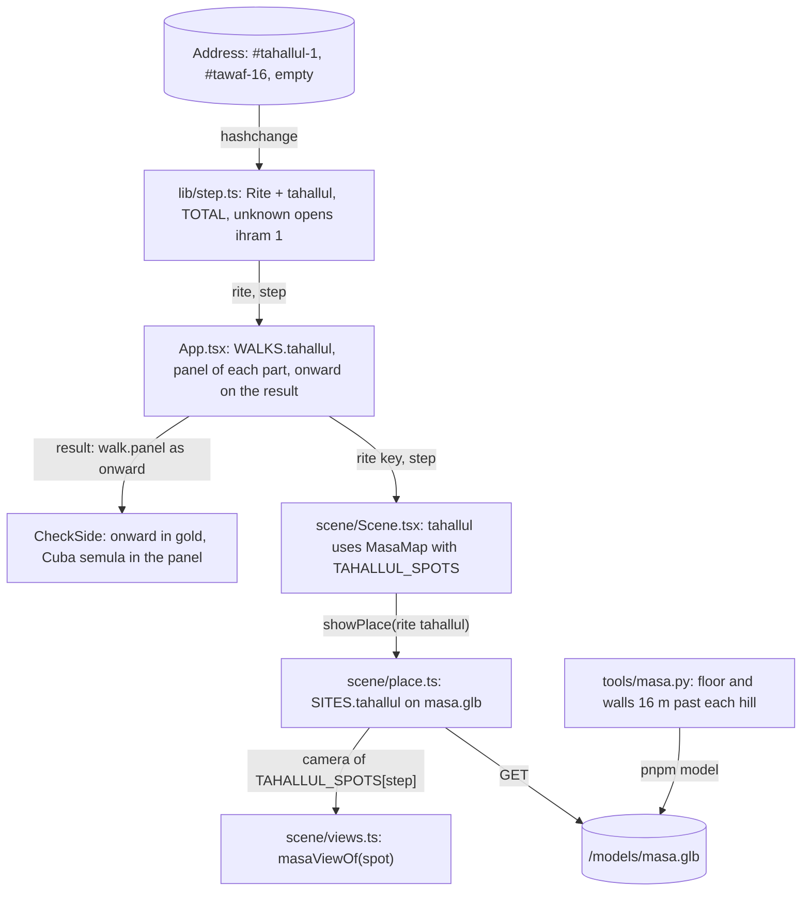
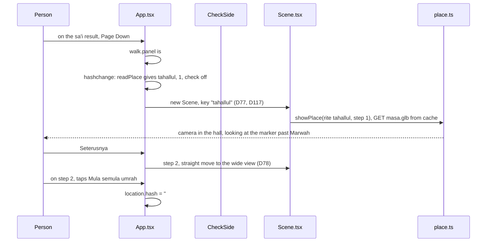

# Full umrah

**Version:** v1 · **Status:** Built · **Type:** Feature · **Project type:** Web UI

**Shape doc:** docs/specs/virtual-hajj/shape.md
**Depends on:** `ihram-check`, `sai-check`, `tawaf-check`

The walk starts with ihram and ends with tahallul, so a person walks one whole umrah from the first step to the last.
Each check opens at the end of its rite, and its result then goes on to the next part.

## Problem

The site teaches ihram, tawaf and sa'i, but as three walks with gaps between them.
Tawaf step 15 and sa'i step 13 both end with "That part of the site comes later", so the solat sunat tawaf, the zamzam and tahallul have no step.
A first-timer who opens the site lands on tawaf step 1, not on ihram, which comes first on the day.
After a check, the result offers only "Cuba semula" and "Keluar", so the person must find the next rite in the top bar.
Tahallul ends the umrah. A pilgrim who skips it, or cuts too little hair, stays in ihram without knowing it.

## Slice test

| Check                         | Result |
| ----------------------------- | ------ |
| Cuts every layer it needs     | Yes. The step text in Malay and English, the plan sizes, the mas'a model, the 3D scene and the top-view maps, the address, the rite switch, the check result, the browser test and the deploy. |
| One e2e test walks it         | Yes. `e2e/umrah.spec.ts` walks from an empty address through the four parts and three checks to "Umrah selesai", then runs scenarios 2 to 5. |
| Worth shipping alone          | Yes. A first-timer walks one whole umrah in the order of the day, and an ustaz teaches a full umrah class from one link with a clicker. |
| Fits (≤5 scenarios, ≤2 areas) | Yes. 5 scenarios. Two areas: the join of the parts (the address, the walks in `App.tsx`, the check result, and tawaf step 16 in the mataf, with no model change), and tahallul in the mas'a, with its exit past Marwah. |

**Path:** full. The slice adds a fourth part, a new step in tawaf, a change to the mas'a and a new path through the checks.

## User story

As a first-time pilgrim, I want to walk one whole umrah from ihram to tahallul, so that I know each step in the order of the day before the trip.

## Flow



The person walks each part, takes its check, and the gold button on each result opens the next part, until tahallul ends the umrah.
On the last step of ihram, tawaf and sa'i, a quiet button in the panel skips the check and opens the next part (O8).

## Acceptance criteria

```gherkin
Scenario: Aminah walks one whole umrah on her phone
  Given Aminah's phone is set to Malay, and the screen is 360x800, upright
  When she opens "https://isfar-57q.pages.dev/" with no address after it
  Then the label says "Ihram · Langkah 1 daripada 8"
  When she walks to ihram step 8, taps "Mula semakan" and answers the seven questions
  Then the result shows, and the gold button says "Teruskan ke tawaf"
  And "Cuba semula" sits in the result panel, and "Keluar" stays on the left of the bar
  When she taps "Teruskan ke tawaf"
  Then the address ends with "#tawaf-1", and the mataf loads
  When she walks to tawaf step 15 and taps "Seterusnya"
  Then the label says "Tawaf · Langkah 16 daripada 16", and the title is "Solat sunat tawaf dan zamzam"
  And the gold marker stands behind Maqam Ibrahim, and its name shows
  And "Teruskan ke sa'i" and "Mula semula" sit in the panel as quiet buttons
  When she takes the tawaf check from step 16
  Then the gold button on the result says "Teruskan ke sa'i", and it opens "#sai-1"
  When she walks to sa'i step 13 and takes the sa'i check
  Then the gold button on the result says "Teruskan ke tahallul"
  When she taps it
  Then the address ends with "#tahallul-1", the label says "Tahallul · Langkah 1 daripada 2", and the mas'a shows
  When she taps "Seterusnya"
  Then step 2 shows the title "Umrah selesai", and the gold button says "Mula semula umrah"
  When she taps "Mula semula umrah"
  Then the address ends with "#ihram-1"
  And the same holds at 960x540, at 1280x720 and at 1920x1080

Scenario: Ustaz Hafiz takes a class from one rite to the next with a clicker
  Given the projector shows the site at 1920x1080, in English
  And Ustaz Hafiz is on the result of the tawaf check
  When he presses Page Down
  Then the address ends with "#sai-1", and step 1 of sa'i shows
  When he opens an old link to "#tawaf-15" and presses Page Down
  Then tawaf step 16 shows, and the address is "#tawaf-16"
  When he reloads the page
  Then tawaf step 16 still shows
  When he presses Page Down
  Then question 1 of the tawaf check shows

Scenario: Aminah learns tahallul past Marwah
  Given Aminah is on "#tahallul-1" in Malay, on her 360x800 phone
  Then the title is "Bercukur atau bergunting"
  And the text says that men shave or cut the hair, and women cut a fingertip length from the end of the hair
  And a note says how much hair the Shafi'i, Hanafi, Maliki and Hanbali schools each require
  And the gold marker stands past Marwah, at the end of the mas'a
  And the rite switch shows Ihram, Tawaf, Sa'i and Tahallul, with "Tahallul" as the current part
  And the page does not scroll sideways
  When she taps "Seterusnya"
  Then step 2 says that the rules of ihram end, and her umrah is complete
  When she presses Page Down on a keyboard
  Then the address ends with "#ihram-1"

Scenario: Aminah sees the new steps on the top-view map when 3D cannot show
  Given 3D drawing is off in the browser on Aminah's phone
  When she opens "#tawaf-16" in Malay
  Then the top-view map of the mataf shows the marker behind Maqam Ibrahim
  When she taps "Tahallul" in the rite switch
  Then the top-view map of the mas'a shows the marker past Marwah
  And the message card says the device cannot show the 3D place

Scenario: Old and wrong addresses still open a step
  Given Aminah has a link to "#tahallul-5"
  When she opens it
  Then step 1 of tahallul shows
  And "#tawaf-17" opens tawaf step 1, and "#semak" still opens the tawaf check
  And an address the site does not know, as "#umrah", opens ihram step 1
```

Rules that hold for each scenario:

- Claude drafts the words of tawaf step 16 and the two tahallul steps at pause 2, and the user corrects them (D24).
- Each step text has 40 words or fewer, in Malay and in English, in the Shafi'i school (shape O2).
- Where the act is for men only, the text says "for men" (D23).
- Tawaf step 15 and sa'i step 13 say what comes next, and drop "That part of the site comes later".
- Tawaf step 16 keeps seven beads done, as step 15 does. Tahallul shows no beads, as ihram does (D97).
- The three checks keep their questions (O11). The tawaf check now opens from tawaf step 16.
- On a check result, Page Down and the Right arrow key open the next part, as the gold button does. Page Up does nothing there.
- Tahallul and the whole umrah get no check (O9).
- The 3D download stays under 500 KB compressed (D16).
- The site stays hidden from search engines (shape O22).

| Part | Step | Title | Where the marker stands | What it teaches |
| ---- | ---- | ----- | ----------------------- | --------------- |
| Tawaf | 16 | Solat sunat tawaf and zamzam | Behind Maqam Ibrahim | Two rakaat behind Maqam Ibrahim, or anywhere in the mosque when it is full. Then drink zamzam. Next comes sa'i. |
| Tahallul | 1 | Shave or cut | On the open floor past the Marwah exit (O10) | Men shave the whole head, or cut it. Women cut a fingertip length. A note on how much each school requires. |
| Tahallul | 2 | Umrah is complete | The mas'a from above | The rules of ihram end. The umrah is complete. |

## Scope

**In:**

- Tawaf step 16 in Malay and English, in the 3D mataf and on its map, with the marker behind Maqam Ibrahim.
- Two tahallul steps in Malay and English, in the 3D mas'a and on its map, with the marker past Marwah.
- "Tahallul" in the rite switch, after "Sa'i", and the addresses `#tahallul-1` and `#tahallul-2`.
- On each check result, a gold button that opens step 1 of the next part, and "Cuba semula" as a quiet button in the panel.
- On tawaf step 16 and sa'i step 13, a quiet button in the panel that opens the next part, as on ihram step 8.
- On tahallul step 2, the gold "Mula semula umrah", which opens `#ihram-1`.
- An exit in the Marwah end wall of the mas'a model, with a strip of open floor past it.
- An empty or unknown address opens ihram step 1.
- New last lines for tawaf step 15 and sa'i step 13.
- A new D-entry that supersedes D14: the site stays hidden until a qualified person reviews the content (shape O22).

**Out:**

| Left out | Picked up by |
| --- | --- |
| The text for a man or a woman alone | `pilgrim-choice`, the next slice |
| A pilgrim figure that walks on Next, and a softer look | The /shape pass of D46 |
| A listing in search engines | No slice. It waits for a qualified review (shape O1, O22). |
| A check on tahallul, or one check for the whole umrah | No slice (O9) |
| A question on step 16 in the tawaf check | No slice (O11) |
| A 3D place of its own for zamzam or for the barbers | No slice. Zamzam is a line of step 16, and the barbers are a spot past Marwah. |
| Hajj | Its own shape, after umrah ships (shape O7) |

## Interface

The walk and check screens of the other parts, built only from the kiswah and marble design system in `docs/design/design-system/`. Tahallul uses the mas'a and its map, with an exit past Marwah.



Each check result hands on to the next part, the last step of each part can skip its check, and tahallul ends on a button back to ihram step 1.

**Screens**

| Screen | Header | Body | Actions bar |
| --- | --- | --- | --- |
| Tawaf step 15 | "Langkah 15 daripada 16", seven beads done | The new last line: the two rakaat and zamzam come next | "Kembali", "Seterusnya" |
| Tawaf step 16 | "Langkah 16 daripada 16", seven beads done | Title, text, the note on the schools, then two quiet buttons: "Teruskan ke sa'i", then "Mula semula" | "Kembali", and "Mula semakan" in gold |
| Sa'i step 13 | "Sa'i · Langkah 13 daripada 13", seven beads done | The new last line: leave by the Marwah exit, then "Teruskan ke tahallul" and "Mula semula" | "Kembali", and "Mula semakan" in gold |
| Check result, each rite | "Semakan · Selesai", seven beads done | The count, the missed steps, then "Cuba semula" as a quiet button | "Keluar", and "Teruskan ke tawaf", "Teruskan ke sa'i" or "Teruskan ke tahallul" in gold |
| Tahallul step 1 | "Tahallul · Langkah 1 daripada 2", no beads | Title, text, the note on the schools | "Seterusnya" in gold |
| Tahallul step 2 | "Tahallul · Langkah 2 daripada 2", no beads | Title, text, then "Mula semula" as a quiet button | "Kembali", and "Mula semula umrah" in gold |
| Top bar, under 800 px | Row 2 holds four equal buttons: Ihram, Tawaf, Sa'i, Tahallul. Each is 76 px wide at 360 px, and the page does not scroll sideways. | | |

**States of the scene**

| State | Tawaf step 16 | Tahallul |
| --- | --- | --- |
| Loading | "Memuatkan Kaabah" | "Memuatkan mas'a" |
| Shown | The 3D mataf, from behind the marker, looking at the Kaabah, with the name of Maqam Ibrahim | The 3D mas'a, with the marker past the Marwah exit. Step 1 names Marwah. Step 2 is the wide view with the three names. |
| Unsupported | `MatafMap` with the marker behind Maqam Ibrahim, and the no-3D card | `MasaMap` with `TAHALLUL_SPOTS`, and the no-3D card |
| Failed | The same map, and "Cuba lagi" | The same map, and "Cuba lagi" |

The mas'a map now reaches 14 m past the Marwah end, so the exit and its marker fit. It keeps its 3 to 1 shape, so each map of sa'i draws a little smaller.

**Motion tier:** 2, as in the other walks and checks (O12). The step text fades in over 320 ms, and the camera moves to the next spot. Under reduced motion, the camera cuts.

**Components used:** `TopBar`, `StepPanel`, `StepActions`, `Beads`, `Note`, `Notice`, `MessageCard`, `LoadingCard`, `CheckSide`, `CheckResult`, `MatafMap`, `MasaMap`, `BirAliMap`. No new component and no new token. `CheckSide` gains an `onward` prop. `MasaMap` gains a `spots` prop, and draws the exit with the `map__hall` and `map__bay` classes it has.

**Preview:** `http://localhost:5199/preview/full-umrah.html`, after `pnpm dev --port 5199`. It lists 15 frames from the real components, with the top-view maps in place of the 3D places. The link "Open tawaf step 16 with the real 3D mataf" shows the real place. Open it in Firefox on this machine.

**Built in this pause, for /build to keep:** tawaf step 16 and the new step 15 line in `src/content/tawaf.ts`, the new step 13 line in `src/content/sai.ts`, `src/content/tahallul.ts`, the five new words in `src/content/text.ts`, `exit` in `src/scene/plan.json`, `EXIT` and `TAHALLUL_SPOTS` in `src/scene/masa.ts`, spot 16 in `src/scene/mataf.ts`, the exit and `spots` in `MasaMap`, `onward` in `CheckSide`, and the tests in `src/content/tawaf.test.ts` and `src/content/tahallul.test.ts`.
**For the preview only:** `preview/full-umrah.html` and `src/preview/`. No build ships them.

**Checks:** The static drift check passes on 10 files. The rendered drift check passes on 5 screens (tawaf step 16, the tawaf result, sa'i step 13, tahallul steps 1 and 2), in light and dark. `pnpm typecheck` passes, and `pnpm test` passes 102 tests. The `design-taste-frontend` skill is not installed, so its inspector did not run.
Named reference: Duolingo, as for the checks: after the result, one clear button goes on to the next lesson. Generic-model test: the screens come from the kiswah and marble system and the real maps, so a one-line prompt would not land here.

### Text of the new steps

This is a draft in the Shafi'i school (D24). The user corrects it here.

| Step | Malay | English |
| --- | --- | --- |
| Tawaf 15, new last line | Selepas ini ialah solat sunat tawaf dua rakaat di belakang Maqam Ibrahim, dan minum air zamzam. | Next come the two rakaat of solat sunat tawaf behind Maqam Ibrahim, and a drink of zamzam. |
| Tawaf 16, Solat sunat tawaf dan zamzam | Solat sunat tawaf dua rakaat di belakang Maqam Ibrahim. Jika di situ penuh, solat di mana-mana dalam masjid. Kemudian minum air zamzam dan berdoa. Selepas ini ialah sa'i. *Note:* Syafi'i dan Hanbali: dua rakaat ini sunat. Hanafi: wajib. Maliki: wajib selepas tawaf yang wajib, seperti tawaf umrah. | Pray two rakaat of solat sunat tawaf behind Maqam Ibrahim. When it is full there, pray anywhere in the mosque. Then drink zamzam and make doa. Next comes sa'i. *Note:* Shafi'i and Hanbali: the two rakaat are sunat. Hanafi: they are wajib. Maliki: they are wajib after a tawaf that is wajib, as the tawaf of umrah. |
| Sa'i 13, new last line | Selepas ini ialah tahallul: keluar melalui pintu Marwah, kemudian bercukur atau menggunting rambut. | Next comes tahallul: leave by the Marwah exit, then shave or cut the hair. |
| Tahallul 1, Bercukur atau bergunting | Selepas keluar melalui pintu Marwah, lelaki mencukur seluruh kepala, dan ini yang terbaik, atau menggunting rambut. Wanita menggunting rambut sepanjang satu ruas jari dari hujungnya. *Note:* Syafi'i: sekurang-kurangnya tiga helai rambut. Hanafi: suku kepala. Maliki dan Hanbali: seluruh kepala, atau sebahagian besarnya. | Past the Marwah exit, men shave the whole head, which is best, or cut the hair. Women cut the length of a fingertip from the ends of the hair. *Note:* Shafi'i: at least three hairs. Hanafi: a quarter of the head. Maliki and Hanbali: the whole head, or most of it. |
| Tahallul 2, Umrah selesai | Dengan tahallul, larangan ihram tamat, dan anda boleh memakai pakaian biasa semula. Umrah anda selesai. Semoga Allah menerimanya. | With tahallul, the rules of ihram end, and you may wear your usual clothes again. Your umrah is complete. May Allah accept it. |

**New words**

| Key | Malay | English |
| --- | --- | --- |
| `riteTahallul` | Tahallul | Tahallul |
| `tahallulProgress` | Tahallul · Langkah {n} daripada {total} | Tahallul · Step {n} of {total} |
| `goSai` | Teruskan ke sa'i | Go on to sa'i |
| `goTahallul` | Teruskan ke tahallul | Go on to tahallul |
| `umrahAgain` | Mula semula umrah | Start the umrah again |

## Technical plan

### Approach

Tahallul becomes a fourth rite, as ihram did. `step.ts` reads `#tahallul-2`, `App.tsx` gives it a walk with no check, and `place.ts` shows it on `masa.glb` with its own spots (D117).
Each walk's `panel` already names the next part, so the check result reuses it as its gold button, and Page Down on the result follows it (D107). Tawaf gains step 16 by growing `TOTAL.tawaf` to 16, as the content and spot are already built.
`tools/masa.py` runs the floor and side walls 16 m past each hill, so the tahallul marker stands on flat floor past the Marwah rock (D116). An empty or unknown address now opens ihram step 1.

Relies on: D16, D19, D24, D30, D31, D40, D43, D53, D58, D71, D76, D77, D78, D84, D94, D95, D97, D103, D106, D107, D109, D110, D111, D112, D113, D114, D115, D116, D117, D118



The address picks the rite, `App.tsx` picks its walk and the next part, and the scene draws tahallul on the same mas'a model as sa'i.



The sa'i result hands over to tahallul through the address, the scene starts again on the mas'a, and step 2 hands back to ihram.

No data crosses a trust boundary. The only new input is the address, which `readPlace` matches against a fixed pattern.

### Changes

| File | What changes | Why |
| --- | --- | --- |
| `src/lib/step.ts:3-19` | `Rite` gains `"tahallul"`. `TOTAL` is `{ ihram: 8, tawaf: 16, sai: 13, tahallul: 2 }`. `PLACE` reads `tahallul`. An address that does not match opens `ihram` step 1, not tawaf. The top comment says so. | Scenarios 1 and 5, D106 |
| `src/lib/step.ts:25-31` | `CHECK_HASH` keeps three rites: its type becomes `Record<Exclude<Rite, "tahallul">, string>`. `RITES` and `isCheck` read its keys, as today. | D112 |
| `src/App.tsx:32-66` | `check` is nullable again. `WALKS.tawaf.panel` is `#sai-1` with `goSai`, `WALKS.sai.panel` is `#tahallul-1` with `goTahallul` (D111). `WALKS.tahallul`: `TAHALLUL`, no beads, `tahallulProgress`, `after` is `#ihram-1` with `umrahAgain` (D110), no panel, no check. | Scenarios 1 and 3 |
| `src/App.tsx:108-126` | In the check, on the result, a forward key opens `walk.panel.hash` when it is there (D107). | Scenario 2 |
| `src/App.tsx:158-188` | The rite switch lists Tahallul fourth. `CheckSide` gets `onward` from `walk.panel`. | Scenarios 1 and 3, D94 |
| `src/scene/Scene.tsx:16-19,93-95` | `PART_WORDS`, `PART_LISTS` and `LOADING` gain tahallul, from the sa'i ones. With no 3D, tahallul shows `MasaMap` with `spots={TAHALLUL_SPOTS}`. | Scenarios 3 and 4 |
| `src/scene/place.ts:156-201` | `SITES.tahallul`: `masa.glb`, no path line, the marker, names and push from `TAHALLUL_SPOTS`, the view `masaViewOf`, and `alongHall`. `SITES.sai` reads its view through `masaViewOf` too. | Scenario 3, D117 |
| `src/scene/views.ts:79-89` | `saiViewOf(step)` becomes `masaViewOf(spot)`, which takes the spot and not the step, so sa'i and tahallul share it. | Scenario 3 |
| `src/scene/masa.ts` | `PAST_MARWAH` moves to `[LENGTH/2 + EXIT.depth - 1, 0]`, x = 71, on flat floor past the rock. Tahallul step 1 takes the view `"marwah"`, so the camera stands in the hall and looks at the marker. | Scenario 3, D116 |
| `tools/masa.py:22` | `END` goes from `LENGTH / 2 + 10` to `LENGTH / 2 + 16`. The floor, the side walls and the arches follow it. | D116 |
| `public/models/masa.glb` | Built by `pnpm model`. Put back `mataf.glb` and `birali.glb` if they come out with no change. | D19 |
| `src/lib/step.test.ts` | `#tahallul-1`, `#tahallul-2`, `#tahallul-0`, `#tahallul-5`, `#tawaf-16`, `#tawaf-17`, an empty address and `#umrah` read as the scenarios say. `#semak-tahallul` is not a check. | Scenario 5 |
| `src/scene/views.test.ts` | For tawaf step 16 and the two tahallul steps: the marker is on screen at aspect 1 and 1.5, and the camera clears the walls. The move from tahallul step 1 to step 2 stays above the walls. | Scenario 3 |
| `src/scene/masa.test.ts` | `PAST_MARWAH` stands past the rock, where `groundAt` gives 0, and inside the floor that `masa.py` builds. | D116 |
| `e2e/umrah.spec.ts` (new) | The five scenarios, at the four sizes. | All |
| `e2e/walk.spec.ts:31,166,226,240,280` | `page.goto("/")` becomes `page.goto("/#tawaf-1")`. Step 15 is "Langkah 15 daripada 16". The last step is 16. | Scenario 5 |
| `e2e/check.spec.ts:31,102,116,141` | The check opens from `#tawaf-16`, and "Keluar" goes to `#tawaf-16`. "Cuba semula" is a quiet button in the result panel. | D107, D113 |
| `e2e/sai-check.spec.ts`, `e2e/ihram-check.spec.ts` | On the result, "Cuba semula" sits in the panel, and the gold button opens the next part. | D107 |
| `e2e/sai.spec.ts` | Sa'i step 13 shows "Teruskan ke tahallul" in the panel. | D111 |
| `preview/`, `src/preview/` (deleted) | The preview goes when `e2e/umrah.spec.ts` passes, in a commit of its own. | Nothing ships them |
| `CHANGELOG.md` | One "Added" line. | The repo's rule |

Kept from pause 2: tawaf step 16 and the new last lines, `content/tahallul.ts`, the new words, `exit` in `plan.json`, `EXIT` and `TAHALLUL_SPOTS`, spot 16 in `mataf.ts`, the exit and `spots` in `MasaMap`, and `onward` in `CheckSide`.

Not changed: `index.html` and `public/_headers` keep `noindex` (D109).

Reusing: `alongHall`, `viewOf` with its `"approach"` view for step 16, `groundAt`, `CheckSide`, `missedSteps`, the `hashchange` and key listeners in `App.tsx`, and `SIZES`, `answerTo`, `expectCamera`, `expectNotices`, `markerAt`, `modelParts`, `names`, `noWebGL`, `MODEL` and `MASA_MODEL` in `e2e/helpers.ts`.

### Earn-it

| Added | Triggered by |
| --- | --- |
| `"tahallul"` in `Rite` | Scenarios 3 and 5: its own address and label |
| `SITES.tahallul` and `masaViewOf` | Scenario 3: the tahallul spots on the mas'a, with one camera rule for both rites |
| 6 m more floor in `masa.py` | Scenario 3 and D116: a marker on flat floor past the Marwah rock |
| `e2e/umrah.spec.ts` | Scenarios 1 to 5 |

Cut: a scene keyed by model file (O16), a whole-umrah check (D112), a feature flag (D118), and a wall with a gap at the Marwah end (O15).

### Non-functionals

|                      |     |
| -------------------- | --- |
| **Load**             | As before: a few visits a day, static files on Cloudflare's network. |
| **Breaks first**     | The 3D download. `masa.glb` grows by a few hundred bytes for 12 m more floor and walls. The tahallul text adds about 2 KB of script. `pnpm size` fails the build over 500 KB (D16). |
| **Security surface** | No change. Anyone with the link. The new input is the address, matched by a fixed pattern. No secret, and nothing stored but the language (D12). The site stays out of search engines (D109). |
| **Proof it works**   | CI runs `e2e/umrah.spec.ts` against the build before the deploy, and the smoke step prints `smoke: https://isfar-57q.pages.dev ok`. On `#tahallul-1`, Seterusnya prints `[isfar] camera at step 2: …` on the live site. |
| **Rollout**          | No flag (D118). Full umrah shows when the PR merges. Rollback: "Rollback to this deployment" in the Cloudflare dashboard, or `git revert` and a push. |

### Test plan

| Scenario | Test | Command |
| -------- | ---- | ------- |
| 1. Aminah walks one whole umrah | `e2e/umrah.spec.ts` at four sizes: empty address to `#ihram-1`, each check to its result, each gold button to the next part, tawaf step 16 with the marker behind Maqam Ibrahim, tahallul to "Umrah selesai" and back to `#ihram-1` | `pnpm e2e --project=firefox` here, `pnpm e2e --project=chromium` in CI |
| 2. Ustaz Hafiz with a clicker | `e2e/umrah.spec.ts` at 1920x1080: Page Down on the tawaf result, `#tawaf-15` to `#tawaf-16`, a reload, Page Down to the check | `pnpm e2e --project=firefox` |
| 3. Tahallul past Marwah | `e2e/umrah.spec.ts`: the title, the note, the marker in `masa.glb` past x = 67, four switch buttons with no sideways scroll at 360 px, Page Down on step 2. `views.test.ts`, `masa.test.ts`, `tahallul.test.ts` | `pnpm e2e --project=firefox`, `pnpm test` |
| 4. The top-view maps | `e2e/umrah.spec.ts` with `noWebGL`: the marker behind Maqam Ibrahim on `#tawaf-16`, and past Marwah on tahallul | `pnpm e2e --project=firefox` |
| 5. Old and wrong addresses | `step.test.ts`, and `e2e/umrah.spec.ts` for `#tahallul-5`, `#tawaf-17`, `#semak` and `#umrah` | `pnpm test`, `pnpm e2e --project=firefox` |
| Rule: the three checks keep their questions | `src/content/check.test.ts`, `e2e/check.spec.ts`, `e2e/sai-check.spec.ts`, `e2e/ihram-check.spec.ts` | `pnpm test`, `pnpm e2e --project=firefox` |
| Rule: the 3D download stays under 500 KB | `scripts/check-size.mjs` | `pnpm build && pnpm size` |

**E2E:** `e2e/umrah.spec.ts` walks the five scenarios. The Playwright setup exists, and CI on `main` is green with it.

The other commands: `pnpm typecheck` and `pnpm model`. Put back `mataf.glb` and `birali.glb` if `pnpm model` rebuilt them with no change (lesson `keep-unchanged-models`). Stop the `pnpm dev` server on port 5199 before `pnpm e2e` (lesson `stop-preview-before-e2e`). Prove the 3D half in Firefox here (lesson `local-chromium-loses-3d`). Fit the tahallul views at aspect 1 and 1.5, and screenshot them after the sight test passes (lessons `fit-the-view-at-the-narrowest-scene`, `look-at-the-view-after-the-sight-test`). Point unknown addresses back at tawaf once, and watch the tests fail (lesson `break-the-guarded-code`).

### Chunks

Single chunk. `step.ts`, `App.tsx` and the browser tests all read the new rite, and the old browser tests change with it.

Order inside the chunk:

1. `step.ts` and its test.
2. `tools/masa.py`, `pnpm model`, `masa.ts`, `masaViewOf` with its tests, then `SITES.tahallul`.
3. `Scene.tsx` and `App.tsx`. Then the old browser tests, then `e2e/umrah.spec.ts`.
4. Delete the preview, in a commit of its own (lesson `commit-the-preview-deletion-alone`).

### Risks

| Risk | Mitigation |
| ---- | ---------- |
| The empty address now opens ihram. Old links to the bare site land on ihram, and five tests in `walk.spec.ts` expect tawaf. | The tests move to `/#tawaf-1`. Shared links with `#tawaf-…` keep working (D95). |
| Page Down on a check result now leaves the check. An ustaz who pressed it there to no effect now moves on. | That is the point of D107. "Keluar" and the Back button still return. |
| The sa'i to tahallul change shows the loading card for a moment (O16). | Accepted. The model comes from the browser cache. |
| The text has a mistake in a ruling (O14). | Accepted risk. The "not yet reviewed" notice stays, and the site stays hidden from search engines (D109). |
| The 3D views of tahallul hide the marker behind the Marwah rock. | The views test checks the line from the camera to the marker. The camera stands in the hall, above the rock. |

### Decisions to record

Recorded as D116, D117, D118.

## Decisions

Recorded as D106 to D115 at pause 2. D116 to D118 at /build.

## Open items

| ID  | What | Type | Raised at | Owner | Status | Answer |
| --- | ---- | ---- | --------- | ----- | ------ | ------ |
| O1  | Which parts does the one walk have? (from shape O18) | question | shape | user | Resolved | Ihram, tawaf, sa'i, tahallul. Tawaf gains step 16: solat sunat tawaf behind Maqam Ibrahim, and zamzam. This supersedes D22. "Solat and zamzam as a part of its own" and "no new step" were rejected. 2026-11-25 |
| O2  | Where do the tawaf check and the sa'i check open? (from shape O19) | question | shape | user | Resolved | At the end of its rite, as D58 and D84 have it. The result gains a gold button to the next part. "Next goes on, and the check is a quiet button" and "both checks at the end" were rejected. 2026-11-25 |
| O3  | How many tahallul steps follow sa'i, and where? (from shape O20) | question | shape | user | Resolved | Two, in the 3D mas'a, with the marker past Marwah: shave or cut, with a note on each school, then umrah is complete. "One" and "three" were rejected. "No scene" and "a top-view map of Makkah" were rejected. 2026-11-25 |
| O4  | Does the rite switch stay? (from shape O21) | question | shape | user | Resolved | Yes, with four parts: Ihram, Tawaf, Sa'i, Tahallul (D94). "No switch" and "a list of parts on step 1" were rejected. 2026-11-25 |
| O5  | D14 hides the site from search engines until `full-umrah`. O1 of the shape wants a qualified review before a public launch. (from shape O22) | question | shape | user | Resolved | The site stays hidden until a qualified person reviews the content, whichever slice that is. A new entry supersedes D14. "List it in full-umrah" and "the review is done" were rejected. 2026-11-25 |
| O6  | Tahallul step 2 ends the umrah, and tahallul has no check. What does the gold button on step 2 do? | question | spec p1 | user | Resolved | The gold "Mula semula umrah" opens `#ihram-1`, and Page Down does the same. "Mula semula" to `#tahallul-1` and "no gold button" were rejected. 2026-11-26 |
| O7  | The gold place on a check result holds "Cuba semula" today. Where does "Cuba semula" go when the gold button opens the next part? | question | spec p1 | user | Resolved | "Cuba semula" becomes a quiet button in the result panel, as "Mula semula" did on step 15 (D58). "Keluar" stays on the left of the bar. "Cuba semula in the place of Keluar" was rejected. 2026-11-26 |
| O8  | Ihram step 8 has a quiet "Teruskan ke tawaf" in its panel, so a person can skip the check. Do tawaf step 16 and sa'i step 13 get the same? | question | spec p1 | user | Resolved | Yes. Tawaf step 16 gets a quiet "Teruskan ke sa'i", and sa'i step 13 a quiet "Teruskan ke tahallul", beside "Mula semula". "No skip, and ihram step 8 drops its button" was rejected. 2026-11-26 |
| O9  | `ihram-check` gave "a check for the whole umrah" to this slice. Does tahallul or the whole umrah get a check? | question | spec p1 | user | Resolved | Neither. Tahallul is two steps, and the three checks cover the places. "A whole-umrah check in a later slice" and "a tahallul check in a later slice" were rejected. 2026-11-26 |
| O10 | Shape O20 puts the tahallul marker past Marwah. The mas'a model ends at a wall behind Marwah, so no floor lies past it. | question | spec p1 | user | Resolved | An exit past Marwah: a gap in the Marwah end wall and a strip of open floor outside it, with the marker there. `tools/masa.py` changes. "The marker on top of Marwah, with no model change" was rejected. 2026-11-26 |
| O11 | Does the tawaf check gain a question on step 16? | question | spec p1 | user | Resolved | No. The tawaf check keeps its seven questions (D48), and opens from step 16. "Swap one question for step 16" was rejected. 2026-11-26 |
| O12 | Which motion tier do tawaf step 16, tahallul and the result buttons use? | question | spec p2 | user | Resolved | Tier 2, as the other walks and checks (D114). Tier 1 was rejected. 2026-11-26 |
| O13 | The tawaf check result shows the camera of the last tawaf step. That is now step 16: the marker behind Maqam Ibrahim, not the wide view of step 15. | question | spec p2 | user | Resolved | The step 16 view. The result shows the camera of the last step of its rite, as today (D115). "The wide view of step 15" was rejected. 2026-11-26 |
| O14 | Is the draft text of tawaf step 16, tahallul and the two new last lines right? It is Claude's draft (D24), and nobody has checked the school notes against a source. | flag | spec p2 | user | Accepted risk | Ship the draft, as for tawaf, sa'i and ihram (D24). The "not yet reviewed" notice stays, and the user corrects the content files against the course notes. "Correct it before approval" was rejected. 2026-11-26 |
| O15 | O10 assumed an end wall behind Marwah. The 3D mas'a has none: its floor and side walls run 10 m past each hill, and the Marwah rock covers 7 m of that. | flag | spec p3 | user | Resolved | `tools/masa.py` runs the floor and walls 16 m past each hill, and the marker stands at x = 71 on flat floor (D116, supersedes D108). "No model change, marker at x = 68.5" and "a wall with a gap" were rejected. 2026-11-26 |
| O16 | D77 starts the scene again on a rite change, so the sa'i result to tahallul loads `masa.glb` again from the cache. | question | spec p3 | user | Resolved | Accept the reload (D117). "Key the scene by its model file" was rejected. 2026-11-26 |
| O17 | Does full-umrah ship behind a feature flag? | question | spec p3 | user | Resolved | No flag (D118). "A flag in the address" was rejected. 2026-11-26 |
| O18 | Scenario 1 said "Then the address ends with "#ihram-1"" for an empty address. The site reads an empty address as ihram step 1 but leaves the address bar empty, as it did for tawaf. | flag | build | user | Decided alone | Chose: the scenario checks the label "Ihram · Langkah 1 daripada 8" and not the address. Other: write `#ihram-1` into the address on load with `history.replaceState`. Undo: add that call in `App.tsx`, and put back the address line in scenario 1. 2026-11-26 |
| O19 | On tahallul step 1, the camera stood 18 m behind the marker, as in sa'i, and the name of Marwah fell under the view. The plan did not name this change. | flag | build | user | Decided alone | Chose: past the end of the hall, the walk camera and the wide camera stand 30 m further back (`src/scene/views.ts`). A views test checks the names. Other: show no name on tahallul step 1. Undo: `git revert 820e95f`, and set the names of tahallul step 1 to `[]`. 2026-11-26 |

_Never delete this section or its rows. See references/ledger.md._

## Glossary

- **Tahallul** — the shave or cut of the hair that ends ihram, after sa'i.
- **Solat sunat tawaf** — two rakaat of prayer after tawaf, behind Maqam Ibrahim when there is room.
- **Maqam Ibrahim** — the stone with the footprints of Prophet Ibrahim, in a glass and gold case near the Kaabah.
- **Zamzam** — the well water of Masjidil Haram, which the pilgrim drinks after the solat sunat tawaf.
- **Marwah** — the hill at the end of sa'i. The exits to the barbers are at this end.
- **Rite switch** — the row of buttons in the top bar that opens step 1 of each part.
- **Ustaz** — a male religious teacher.
- **Presenter clicker** — a small remote for slides. It sends the Page Up and Page Down keys.
- **e2e** — end-to-end: one browser test that walks the whole slice as a person would.
- **D14, D22** — numbered entries in `DECISIONS.md`, the record of each choice.
