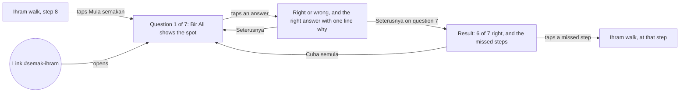
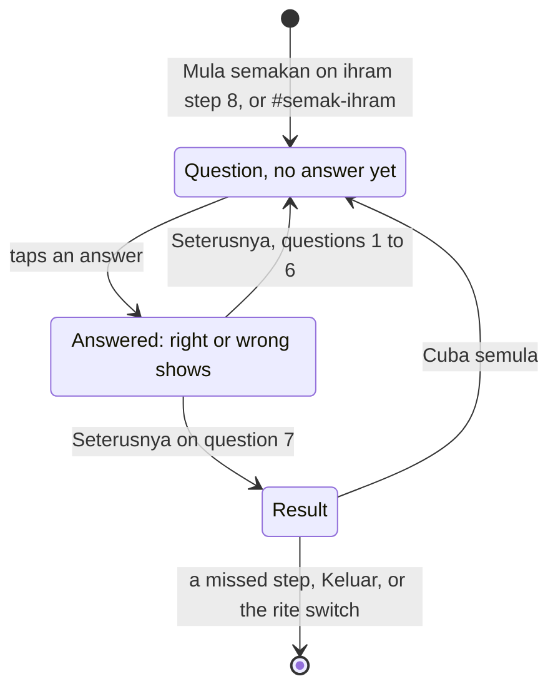
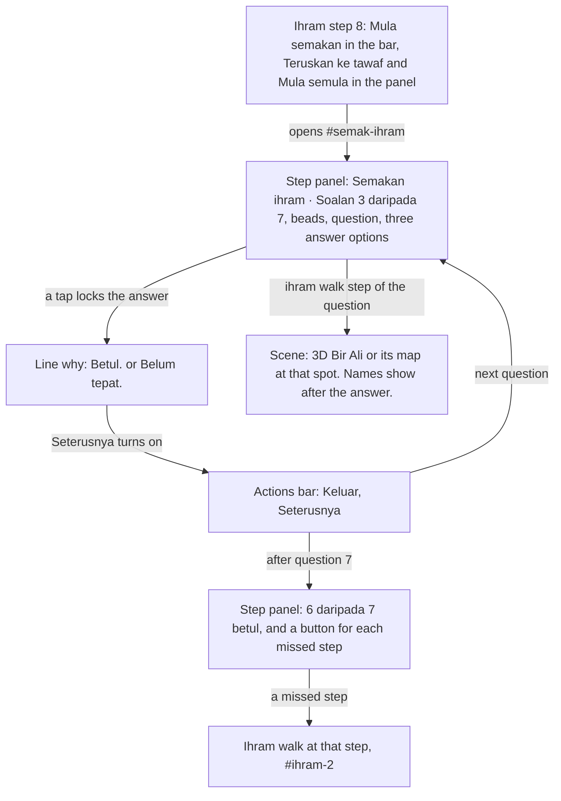
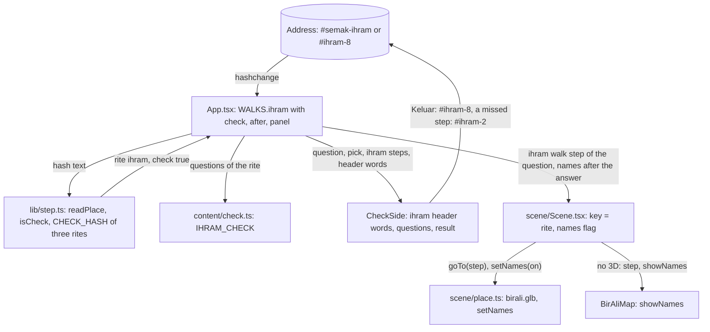
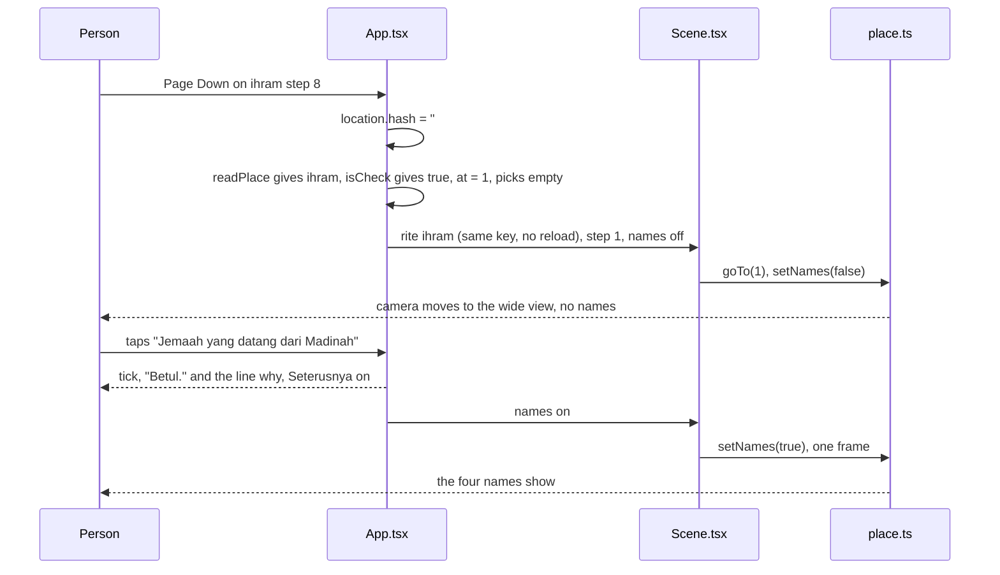

# Ihram check

**Version:** v1 · **Status:** Refined · **Type:** Feature · **Project type:** Web UI

**Shape doc:** docs/specs/virtual-hajj/shape.md
**Depends on:** `ihram`, `sai-check`

After the ihram walk, the person answers seven questions on where each step of ihram happens at Bir Ali and what to do there, and the result shows on screen.
It checks ihram before `full-umrah` joins the walks, and it reuses the check of tawaf and sa'i (D92).

## Problem

The ihram walk shows each step at Bir Ali, but nothing tells the person if they learned it.
A first-timer finishes step 8 and does not know which acts of ihram they still mix up.
Common mistakes are scent on the ihram cloth, a sewn garment for a man, and the belief that ihram starts with the clothes and not with the niat.
A mistake at the miqat carries into the whole umrah, and nobody on the bus corrects it.

## Slice test

| Check                         | Result |
| ----------------------------- | ------ |
| Cuts every layer it needs     | Yes. A button on ihram step 8, the check screen for a third rite, the question text files, the 3D Bir Ali or its map at each question, the address, CI and the deploy. |
| One e2e test walks it         | Yes. One browser test goes from ihram step 8 through seven questions to the result, then runs scenarios 2 to 4. |
| Worth shipping alone          | Yes. A first-timer sees which acts of ihram they still mix up, and goes back to those steps before the trip. An ustaz checks a class on ihram from the projector. |
| Fits (≤5 scenarios, ≤2 areas) | Yes. 4 scenarios. Two areas: the check screen, which now serves three rites, and the ihram check text. Bir Ali and its map are reused with no change to the model. |

**Path:** full. The slice adds a third check with new text in two languages, and it changes the last step of the ihram walk.

## User story

As a first-time pilgrim, I want to answer where each step of ihram happens at Bir Ali and what I do there, so that I know what I still mix up before the bus stops at the miqat.

## Flow



The person goes from ihram step 8 or a link to seven questions, sees right or wrong after each answer, and ends on a result that opens the ihram steps they missed.

## States



The states are the states of the tawaf and sa'i checks. The answers live only in the open page, and a reload starts again at question 1 (D53).

## Acceptance criteria

The words of each question come at pause 2, in "Text of the check". Claude drafts them, and the user corrects them (D55).

```gherkin
Scenario: Aminah finishes the ihram walk and checks what she learned
  Given Aminah's phone is set to Malay, and the screen is 360x800, upright
  And she is on ihram step 8, "Ke Makkah"
  Then a "Mula semakan" button takes the gold place in the bar
  And "Teruskan ke tawaf" and "Mula semula" sit in the step panel
  When she taps "Mula semakan"
  Then the address ends with "#semak-ihram", and "Semakan ihram · Soalan 1 daripada 7" shows
  And the rite switch shows "Ihram" as the current rite
  And the 3D place shows Bir Ali from above, and no name of a place shows
  And the question asks who enters ihram at Bir Ali, with three answers, and the "Seterusnya" button is off
  When she taps the answer for a pilgrim who comes from Madinah
  Then the answer shows as right, with "Betul." and one line why
  And the names of the prayer hall, the minaret, the washrooms and the bus park show
  And the "Seterusnya" button is on
  When she answers questions 2 to 7, with a wrong answer on question 2 only
  Then the result shows "6 daripada 7 betul"
  And "Langkah 2 · Sebelum ihram" shows under "Ulang kaji langkah ini:"
  When she taps it
  Then the address ends with "#ihram-2", and ihram step 2 shows, with the title "Sebelum ihram"
  And the same holds at 960x540, at 1280x720 and at 1920x1080

Scenario: Aminah puts the scent on the cloth
  Given Aminah is on question 2 of the ihram check, in Malay
  And the question asks where the scent goes after the bath
  When she taps the answer "on the ihram cloth"
  Then her answer shows as wrong, with a cross and the words "Belum tepat."
  And the right answer "on the body only" shows as right
  And one line says that scent goes on the body before the niat, and never on the ihram cloth
  And the colour is never the only sign: each mark has an icon and words

Scenario: Ustaz Hafiz runs the ihram check for a class on a projector
  Given Ustaz Hafiz's laptop is set to English, at 1920x1080
  And he is on ihram step 8
  When he presses Page Down on his clicker
  Then the address ends with "#semak-ihram", and question 1 of 7 of the ihram check shows in English, with the 3D Bir Ali
  When he presses Page Down before an answer
  Then question 1 stays on screen
  When he taps the answer that the class calls out
  And he presses Page Down
  Then question 2 shows
  When he reloads the page
  Then question 1 of the ihram check shows, and no answer is chosen
  When he opens "https://isfar-57q.pages.dev/#semak-sai"
  Then question 1 of the sa'i check shows, with the 3D mas'a

Scenario: The ihram check still works when the 3D place cannot show
  Given 3D drawing is off in the browser on Aminah's phone
  When she opens "#semak-ihram" in Malay
  Then the top-view map of Bir Ali shows, with no marker and no names
  And the message "Peranti ini tidak dapat memaparkan tempat 3D." shows under the question
  When she answers question 1 and taps "Seterusnya"
  Then the marker on the map stands at the washrooms, the spot of question 2
  And she can finish all seven questions and see the result
```

Rules that hold for each scenario:

- GitHub Actions runs scenarios 1 to 4 on each push, at 360x800, 960x540, 1280x720 and 1920x1080.
- The rules of the tawaf check hold: seven questions in walk order, three answers in a fixed order with one right (D54), no change after the tap, Next only after an answer (D52), names hidden until the answer (D57), a plain count with no points (D50), and nothing kept (D53).
- The seven beads count the questions, as in the other checks (D56). The ihram walk itself still shows no beads (D97).
- "Keluar" goes to ihram step 8 (D59). A missed step opens that step of the ihram walk.
- On ihram step 8, the Right arrow key and Page Down open the ihram check, as on tawaf step 15 and sa'i step 13 (D58, D84). "Teruskan ke tawaf" in the panel still opens `#tawaf-1`.
- In the ihram check, the rite switch shows "Ihram". A tap on "Tawaf" opens tawaf step 1 and drops the answers (D71).
- A language change keeps the question and the answer, and the 3D Bir Ali does not load again.
- Question 5 shows the courtyard, which has no name, so no name shows after the answer, as on walk step 5 (`ihram` O23).
- A question on an act for men says "lelaki" or "men" (D23).
- Two missed questions on one step give one button on the result.
- Both notices of the walk show on each question and on the result.
- Each question and each line why is 40 words or fewer.
- The tawaf check and the sa'i check do not change. `#semak` and `#semak-sai` still open them.

### Questions in this slice

Each question shows Bir Ali from the camera of one ihram walk step.

| # | Shows the place of | Asks | Right answer, in short |
| --- | --- | --- | --- |
| 1 | Step 1, Bir Ali from above | Who enters ihram at Bir Ali | A pilgrim who comes from Madinah |
| 2 | Step 2, the washrooms | Where the scent goes after the bath | On the body only, not on the ihram cloth |
| 3 | Step 3, the washrooms | What men wear in ihram | Two white cloths with no seams, and the head bare |
| 4 | Step 4, the prayer hall | What you do in the prayer hall before the niat | Two rakaat of solat sunat ihram |
| 5 | Step 5, the courtyard | When your ihram starts | With the niat |
| 6 | Step 6, the bus park | What you say often from here to Makkah | The talbiyah |
| 7 | Step 7, the bus park | Which act is not allowed in ihram | A cut of the hair or the nails |

Left out: the plane line of step 5, and the end of the talbiyah on step 8. Neither one happens at a place in Bir Ali (O2).

## Scope

**In:**

- A "Mula semakan" button in the gold place on ihram step 8, with "Teruskan ke tawaf" and "Mula semula" in the panel.
- The ihram check at the address `#semak-ihram`, in Malay and English.
- Seven questions, each with three answers, a mark for right or wrong, and one line why.
- The 3D Bir Ali, or its map with no 3D, at the spot of each question.
- A result with a plain count, and each missed step with a button that opens it in the ihram walk.
- "Cuba semula" and "Keluar" on the result.
- Next by button, by the Right arrow key and by Page Down, after an answer.

**Out:**

| Left out | Picked up by |
| --- | --- |
| A gold button on the result that goes on to tawaf | `full-umrah` (shape O19) |
| A check for the whole umrah | `full-umrah` |
| A question on the niat on the plane, or on the end of the talbiyah | No slice yet. The result of this slice shows if seven is enough. |
| A saved score, a history of attempts, or a score shared with others | No slice. The site keeps nothing (shape O5). |
| Points, stars, badges, streaks or confetti | No slice. The design brief bans them (D46). |
| Questions or answers in a new order on each try | No slice (D54) |
| Questions on the clothes of women apart from men | `pilgrim-choice` |
| A pilgrim figure and a softer look | The /shape pass of D46 |

## Interface

The ihram check uses the screens of the tawaf and sa'i checks, built only from the kiswah and marble design system in `docs/design/design-system/`. Bir Ali takes the place of the mataf.



Ihram step 8 opens the check, each question sets Bir Ali to the spot of its walk step, and a tap locks the answer and turns on Seterusnya.

**Screens**

| Screen | Header | Body | Actions bar |
| --- | --- | --- | --- |
| Ihram step 8 | "Ihram · Langkah 8 daripada 8", no beads (D97) | Title, text, the note, then two quiet buttons: "Teruskan ke tawaf", then "Mula semula" | "Kembali", and "Mula semakan" in the gold place |
| Question, no answer | "Semakan ihram · Soalan 3 daripada 7". Beads 1 and 2 done, bead 3 current. | The question, three answer options at rest, an empty line why | "Keluar", and "Seterusnya" off |
| Question, answered | The same | The pick shows chosen. The right answer has a tick. A wrong pick has a cross. The line why fills. | "Keluar", and "Seterusnya" on |
| Result | "Semakan ihram · Selesai", seven beads done | "6 daripada 7 betul", then "Ulang kaji langkah ini:" and a quiet button for each missed ihram step. With none missed: "Anda tahu tempat dan amalan setiap langkah." | "Keluar", and "Cuba semula" |

The top bar shows "Ihram" as the current rite on each screen. The header names the rite, so a class on a projector knows which check is on screen.
At 360 px the header wraps to two lines, as the sa'i header does.
Each ihram question is on a step of its own, so each miss gives one button on the result.

**States of the scene**

| State | The scene shows | With the step panel |
| --- | --- | --- |
| Loading | The loading card "Memuatkan Bir Ali" | Nothing more |
| Shown | The 3D Bir Ali at the camera of the question's walk step, with its marker. Question 1 shows the wide view with no marker, as walk step 1. The names hide until the answer (D57). | Nothing more |
| Unsupported | The top-view map of Bir Ali, with the marker. The names hide until the answer. | The no-3D message card, under the step panel |
| Failed | The same map | The failed-download card with "Cuba lagi", above the step panel. "Cuba lagi" reloads, and the check starts again (D53). |

**Motion tier:** 2, as in the other checks (O3, D105).

| Move | Time | Under reduced motion |
| --- | --- | --- |
| A button or an answer presses down | 160 ms | The same |
| A new question fades in and rises 12 px | 320 ms | It fades in 160 ms and does not rise |
| The camera moves to the spot of the next question | About 1 second, on the straight line of D101 | The camera cuts |
| After a tap, the page scrolls the line why into view, clear of the actions bar | The browser's scroll | An instant scroll |

**Components used:** Step panel with its header, Progress beads, Answer option (rest, chosen, right, wrong), Result, Button, quiet Button and Button off, Rite switch, Language switch, Notice, Note, Scene card, and the top-view map of Bir Ali. The React parts are the ones of the other checks: `CheckSide`, `CheckQuestion`, `AnswerOption`, `CheckResult`, `StepPanel`, `StepActions`, `BirAliMap`. No new component, no new token. The two quiet buttons on step 8 use the class of the "Mula semula" button that is there today.

**Access:** As in the other checks. Before the pick, the text of the scene for a screen reader is "Bir Ali. Nama tempat muncul selepas anda menjawab.", so it names no place. It names no marker, because question 1 has none.

**Preview:** `http://localhost:5199/preview/ihram-check.html`, after `pnpm dev --port 5199`. It lists 17 frames, and each frame is a working screen from the real components. The frames show the top-view map, so the page does not open 17 3D views. The link "Open question 1 with the real 3D Bir Ali" shows the real place. Open it in Firefox on this machine.

**Built in this pause, for /build to keep:** `IHRAM_CHECK` in `src/content/check.ts`, and the three ihram check words in `src/content/text.ts`.
**For the preview only:** `preview/ihram-check.html` and `src/preview/`. No build ships them.

**Checks:** The static drift check passes on 5 files. The rendered drift check passes on 5 screens, in light and dark. `pnpm typecheck` passes, and `pnpm test` passes 90 tests. The `design-taste-frontend` skill is not installed, so its inspector did not run.
Named reference: Duolingo, as for the other checks: one question at a time, progress that always shows, and right or wrong just after the tap. Generic-model test: the screens come from the kiswah and marble system and the real Bir Ali map, so a one-line prompt would not land here.

### Text of the check

This is a draft in the Shafi'i school (D55), from the step text of `ihram`. The user corrects it here. The right answer is in bold.

| # | Step | Malay | English |
| --- | --- | --- | --- |
| 1 | 1 | **Siapakah yang berihram di Bir Ali?** Jemaah yang terbang terus ke Jeddah · **Jemaah yang datang dari Madinah** · Jemaah yang sudah tinggal di Makkah. *Why:* Bir Ali, atau Zulhulaifah, ialah miqat bagi jemaah yang datang dari Madinah. Jemaah yang terbang terus ke Jeddah berniat dalam kapal terbang sebelum miqat. | **Who enters ihram at Bir Ali?** Pilgrims who fly straight to Jeddah · **Pilgrims who come from Madinah** · Pilgrims who already stay in Makkah. *Why:* Bir Ali, or Dhul Hulaifah, is the miqat for pilgrims who come from Madinah. Pilgrims who fly straight to Jeddah make the niat on the plane before the miqat. |
| 2 | 2 | **Selepas mandi sunat ihram, di mana anda sapu wangian?** **Pada badan sahaja** · Pada kain ihram · Pada badan dan kain ihram. *Why:* Sapu wangian pada badan sebelum niat, dan jangan sekali-kali pada kain ihram. Selepas niat, jangan memakai wangian lagi. | **After the sunnah bath of ihram, where do you put scent?** **On your body only** · On the ihram cloth · On your body and the ihram cloth. *Why:* Put scent on your body before the niat, and never on the ihram cloth. After the niat, use no more scent. |
| 3 | 3 | **Apa yang lelaki pakai dalam ihram?** Jubah putih yang berjahit dan kopiah · Pakaian biasa yang menutup aurat · **Dua helai kain putih tidak berjahit, dan kepala tidak ditutup**. *Why:* Lelaki memakai dua helai kain putih tidak berjahit: satu di pinggang, satu di atas bahu, dan kepala tidak ditutup. Wanita memakai pakaian biasa yang menutup aurat. | **What do men wear in ihram?** A sewn white robe and a cap · Their usual clothes that cover the aurat · **Two white cloths with no seams, and the head bare**. *Why:* Men wear two white cloths with no seams: one round the waist, one over the shoulder, and the head stays bare. Women wear their usual clothes that cover the aurat. |
| 4 | 4 | **Apa yang anda buat di dewan solat sebelum niat?** **Solat sunat ihram dua rakaat** · Solat sunat tawaf dua rakaat · Mula bertalbiyah dengan suara kuat. *Why:* Solat sunat ihram dua rakaat, kemudian berniat. Solat sunat tawaf datang di Makkah, selepas tawaf. Talbiyah bermula selepas niat. | **What do you do in the prayer hall before the niat?** **Pray two rakaat of solat sunat ihram** · Pray two rakaat of solat sunat tawaf · Start the talbiyah aloud. *Why:* Pray two rakaat of solat sunat ihram, then make the niat. Solat sunat tawaf comes in Makkah, after tawaf. The talbiyah starts after the niat. |
| 5 | 5 | **Bilakah ihram anda bermula?** Apabila anda memakai kain ihram · **Apabila anda berniat umrah** · Apabila bas bertolak dari Bir Ali. *Why:* Ihram bermula dengan niat umrah, bukan dengan pakaian. Jadi berniat sebelum bas meninggalkan miqat. | **When does your ihram start?** When you put on the ihram cloths · **When you make the niat of umrah** · When the bus leaves Bir Ali. *Why:* Ihram starts with the niat of umrah, not with the clothes. So make the niat before the bus leaves the miqat. |
| 6 | 6 | **Dari sini hingga ke Makkah, apa yang anda baca dengan kerap?** Rabbighfir warham · Bismillahi, Allahu Akbar · **Labbaik Allahumma labbaik**. *Why:* Baca talbiyah, “Labbaik Allahumma labbaik”, dengan kerap. Lelaki membacanya dengan suara kuat, dan wanita dengan suara perlahan. | **From here to Makkah, what do you say often?** Rabbighfir warham · Bismillahi, Allahu Akbar · **Labbaik Allahumma labbaik**. *Why:* Say the talbiyah, “Labbaik Allahumma labbaik”, often. Men say it aloud, and women say it quietly. |
| 7 | 7 | **Anda sudah berihram. Yang mana tidak dibenarkan?** **Memotong rambut atau kuku** · Mandi dengan air biasa · Memakai selipar. *Why:* Selagi dalam ihram, jangan memotong rambut atau kuku, dan jangan memakai wangian. Mandi dengan air biasa dan memakai selipar dibenarkan. Larangan ini tamat selepas tahallul. | **You are in ihram now. Which act is not allowed?** **Cut your hair or nails** · Take a bath with plain water · Wear sandals. *Why:* While in ihram, do not cut your hair or nails, and do not use scent. A bath with plain water and sandals are allowed. These rules end after tahallul. |

The right answer moves from place to place: 2, 1, 3, 1, 2, 3, 1 (D54).

**Other words**

| Part | Malay | English |
| --- | --- | --- |
| Header | Semakan ihram · Soalan 3 daripada 7. Semakan ihram · Selesai. | Ihram check · Question 3 of 7. Ihram check · Done. |
| The scene before the pick, for a screen reader | Bir Ali. Nama tempat muncul selepas anda menjawab. | Bir Ali. The name of the place shows after you answer. |
| Every other word | The words of the tawaf check: Mula semakan, Keluar, Cuba semula, Betul., Belum tepat., the result lines. "Teruskan ke tawaf" and "Mula semula" as on step 8 today. | The same, in English |

## Technical plan

### Approach

`readPlace` reads `#semak-ihram` as ihram step 1, as it reads `#semak-sai` as sa'i step 1 today. So `rite` in `App.tsx` is right in the check: the scene keeps Bir Ali, and the rite switch shows "Ihram".
The ihram entry of `WALKS` then gets its check, as the tawaf and sa'i entries have, and its `after` becomes `#semak-ihram`. A new `panel` field holds the quiet "Teruskan ke tawaf" button of step 8.
The check code stays one code path for three rites. No new file downloads, and the models do not change.

Relies on: D30, D31, D40, D47 to D57, D59 to D63, D71, D77, D84, D97, D101, D103, D104, D105



The address names the rite and the check, `App.tsx` picks the ihram questions by the rite, and the scene shows the ihram walk step of each question.



From ihram step 8 the rite stays ihram, so Bir Ali does not load again. A tap locks the pick, and the names show.

No data crosses a trust boundary. The address is the only input. `readPlace` and `isCheck` accept only the exact text `#semak-ihram`, and the picks never leave the page.

### Changes

| File | What changes | Why |
| --- | --- | --- |
| `src/lib/step.ts:11` | `readPlace` gives ihram step 1 for `#semak-ihram`, as it gives sa'i step 1 for `#semak-sai`. | Scenarios 1 and 3 |
| `src/lib/step.ts:25-31` | `Checked` goes. `CHECK_HASH` becomes `Record<Rite, string>` with `ihram: "#semak-ihram"`. `isCheck` matches any one of the three exactly. | Scenario 3, D103 |
| `src/App.tsx:30-37` | `check` is no longer nullable, because each rite has one. `Walk` gains `panel: { hash; label } \| null`, the quiet button beside "Mula semula" on the last step. The comments drop "Ihram has no check yet". | Scenario 1, D103 |
| `src/App.tsx:41` | The ihram entry: `after: { hash: CHECK_HASH.ihram, label: "checkStart" }`, `panel: { hash: "#tawaf-1", label: "goTawaf" }`, and `check: { questions: IHRAM_CHECK, words: { progress: "ihramCheckProgress", done: "ihramCheckDone", where: "ihramCheckWhere" } }`. Tawaf and sa'i get `panel: null`. | Scenario 1, D103 |
| `src/App.tsx:97` | The comment on the keys: the last step of each rite opens its check. The key code does not change, because it reads `walk.after`. | Scenario 3 |
| `src/App.tsx:195-199` | On the last step, the panel shows `walk.panel` as a quiet button before "Mula semula", when it is there. | Scenario 1, D103 |
| `src/lib/step.test.ts:66-76` | `#semak-ihram` reads as ihram step 1, and as a check. `#SEMAK-IHRAM`, `#semak-ihram-2` and `#ihram-semak` are neither. `CHECK_HASH` holds three addresses. | Scenario 3 |
| `src/content/check.test.ts` | The tests of the other checks run on `IHRAM_CHECK`: seven questions, three answers, the steps 1 to 7, no right answer in the same place twice in a row, 40 words or fewer. The answers of scenarios 1 and 2. | Rules, D104 |
| `e2e/ihram.spec.ts:107-114` | Step 8 shows "Mula semakan" in the bar. "Teruskan ke tawaf" in the panel opens `#tawaf-1`. | D103 |
| `e2e/ihram.spec.ts:188-196` | Page Down on step 8 opens `#semak-ihram`, and the Back button goes to step 8. | D103 |
| `e2e/ihram-check.spec.ts` (new) | Scenarios 1 to 4, and the rules below, at four sizes. | Scenarios 1 to 4 |
| `preview/`, `src/preview/` (deleted) | The preview goes when `e2e/ihram-check.spec.ts` passes. | Nothing ships them |
| `CHANGELOG.md` | One "Added" line for the ihram check. | The repo's rule |

Kept from pause 2: `IHRAM_CHECK` in `src/content/check.ts`, and the three ihram check words in `src/content/text.ts`.

Reusing: `CheckSide`, `CheckQuestion`, `CheckResult`, `AnswerOption`, `score` and `missedSteps` in `src/lib/check.ts`, the `hashchange` and key listeners in `src/App.tsx`, `showNames` on `BirAliMap`, `setNames` in `src/scene/place.ts`, and `SIZES`, `answerTo`, `pickOf`, `expectBeads`, `expectCamera`, `expectNotices`, `markerAt`, `names`, `noWebGL` and `BIRALI_MODEL` in `e2e/helpers.ts`.

### Earn-it

| Added | Triggered by |
| --- | --- |
| `panel` on `Walk` | Scenario 1 and D103: ihram step 8 holds a second quiet button, and tawaf and sa'i do not |
| `e2e/ihram-check.spec.ts` | Scenarios 1 to 4 |

Cut: a second check component for ihram, a route or a state for the rite of the check apart from `readPlace`, the question number in the address (D53), a feature flag (D63), a unit test for two misses on one step, because each ihram question has a step of its own.

### Non-functionals

|                      |     |
| -------------------- | --- |
| **Load**             | A few visits a day: the user and a few testers. The site is static files on Cloudflare's network. |
| **Breaks first**     | Nothing at 10 times the visits: the site has no server. The ihram questions add about 3 KB of script and no new download, so the 500 KB ceiling of D16 does not move. `pnpm size` fails the build over the ceiling. |
| **Security surface** | Anyone can open the site. Its inputs are the device language, one stored value and the address. `readPlace` and `isCheck` match only the exact text `#semak-ihram`. The picks are numbers in memory, and React escapes the text. No new secret, and the site stores nothing new. |
| **Proof it works**   | CI runs `e2e/ihram-check.spec.ts` against the build before the deploy. The smoke step prints `smoke: https://isfar-57q.pages.dev ok`. On `#semak-ihram`, Seterusnya on question 1 moves the camera, and the live site prints `[isfar] camera at step 2: …`. No number comes from real visitors (shape O5). |
| **Rollout**          | No flag (D63). The ihram check ships when the PR merges. Rollback: "Rollback to this deployment" in the Cloudflare dashboard, or `git revert` and a push. |

### Test plan

| Scenario | Test | Command |
| -------- | ---- | ------- |
| 1. Aminah finishes the ihram walk and checks what she learned | `e2e/ihram-check.spec.ts`, at four sizes: ihram step 8 to the result, "Mula semakan" in the bar and "Teruskan ke tawaf" in the panel, the rite switch on "Ihram", names hidden then the four names, "Langkah 2 · Sebelum ihram" opens `#ihram-2` | `pnpm e2e --project=firefox` here, `pnpm e2e --project=chromium` in CI |
| 2. Aminah puts the scent on the cloth | `e2e/ihram-check.spec.ts`: the cross and "Belum tepat." on "Pada kain ihram", the tick on "Pada badan sahaja", the line why, `aria-disabled` on each answer, then "Keluar" to step 8 | `pnpm e2e --project=firefox` |
| 3. Ustaz Hafiz runs the ihram check on a projector | `e2e/ihram-check.spec.ts` at 1920x1080: Page Down on step 8, Page Down before and after a pick, one `birali.glb` download after "BM", a reload to question 1, and `#semak-sai` to the sa'i check with `masa.glb`. `src/lib/step.test.ts`: the addresses. | `pnpm e2e --project=firefox`, `pnpm test` |
| 4. The ihram check works with no 3D | `e2e/ihram-check.spec.ts` with `noWebGL`: the map with no marker and no name on question 1, the four names after the pick, the marker of question 2 at the washrooms, all seven questions to the result | `pnpm e2e --project=firefox` |
| Rule: seven questions, three answers, steps 1 to 7, fixed order, 40 words or fewer | `src/content/check.test.ts` | `pnpm test` |
| Rule: question 5 shows no name after the answer | `e2e/ihram-check.spec.ts`, in scenario 1 | `pnpm e2e --project=firefox` |
| Rule: the rite switch in the check opens tawaf step 1 | `e2e/ihram-check.spec.ts`: a tap on "Tawaf" at question 2 gives `#tawaf-1` | `pnpm e2e --project=firefox` |
| Rule: the tawaf and sa'i checks do not change | `e2e/check.spec.ts` and `e2e/sai-check.spec.ts`, as they are | `pnpm e2e --project=firefox` |
| Rule: ihram step 8 still opens tawaf, from the panel | `e2e/ihram.spec.ts` | `pnpm e2e --project=firefox` |

**E2E:** `e2e/ihram-check.spec.ts` walks scenarios 1 to 4. The Playwright setup exists, and CI on `main` is green with it.

The other commands: `pnpm typecheck`, `pnpm build && pnpm size`. Stop the `pnpm dev` server on port 5199 before `pnpm e2e` (lesson `stop-preview-before-e2e`). Prove the 3D half in Firefox here (lesson `local-chromium-loses-3d`). Point `readPlace` at tawaf for `#semak-ihram` once, and watch the tests fail (lesson `break-the-guarded-code`). Delete the preview in a commit of its own, just after `git rm` (lesson `commit-the-preview-deletion-alone`).

### Chunks

Single chunk. `step.ts` and `App.tsx` share the rite of the check, and the one browser test needs both.

Order inside the chunk:

1. `step.ts` and the two unit test files.
2. `App.tsx`: `WALKS.ihram`, `panel` and the step 8 panel. The check works on the map.
3. The step 8 lines of `e2e/ihram.spec.ts`, then `e2e/ihram-check.spec.ts` in full. Delete the preview.

### Risks

| Risk | Mitigation |
| ---- | ---------- |
| Page Down on ihram step 8 now opens the check, not tawaf. An ustaz who taught with the clicker from ihram into tawaf now meets the check. | "Keluar" and the browser's Back button go to step 8 at once, and "Teruskan ke tawaf" sits in the panel. `full-umrah` adds the gold button from the result to tawaf (shape O19). |
| The question text has a mistake in a ruling. | The "not yet reviewed" notice stays, and the site stays hidden from search engines (shape O22). A qualified person reviews it before a public launch (shape O1). |
| Question 1 asks who enters ihram at Bir Ali, and nobody has checked which miqat the Malaysian flights pass (`ihram` O3). | The question asks only about pilgrims from Madinah, and its line why says what a pilgrim on a plane to Jeddah does. It names no airline or route. |

### Decisions to record

None. The plan makes no new choice with a rejected option. D103 to D105 cover the choices of this slice.

## Decisions

Recorded as D103 and D104 at pause 1, and D105 at pause 2.

## Open items

| ID  | What | Type | Raised at | Owner | Status | Answer |
| --- | ---- | ---- | --------- | ----- | ------ | ------ |
| O1  | How does a person reach the ihram check? On ihram step 8, the gold place holds "Teruskan ke tawaf" (D93), and Page Down there opens `#tawaf-1`. The other checks take the gold place on the last step (D58, D84). | question | spec p1 | user | Resolved | From ihram step 8 and the address `#semak-ihram`. "Mula semakan" takes the gold place on step 8, and Page Down opens the check. "Teruskan ke tawaf" and "Mula semula" sit in the panel as quiet buttons. This supersedes D93. "Teruskan ke tawaf stays gold" and "the address only" were rejected. 2026-11-25 |
| O2  | Which seven questions does the ihram check ask? The walk has nine topics that fit a question, and the seven beads fit seven (D56). | question | spec p1 | user | Resolved | One question for each of steps 1 to 7. The plane line of step 5 and the end of the talbiyah on step 8 drop, because neither happens at a place in Bir Ali. "The plane in place of the miqat" and "the plane and the end of the talbiyah in place of the miqat and the solat sunat" were rejected. 2026-11-25 |
| O3  | Which motion tier does the ihram check use? | question | spec p2 | user | Resolved | Tier 2, as in the other checks. Tier 1 was rejected. 2026-11-25 |
| O4  | Is the draft text of the ihram check right? It is Claude's draft (D55), and nobody has checked it against a source. | question | spec p2 | user | Resolved | Right as drafted. The "not yet reviewed" notice stays, and a qualified person reviews the text before a public launch (shape O1). 2026-11-25 |

_Never delete this section or its rows. See references/ledger.md._

## Glossary

- **Ihram** — the state a pilgrim enters at the miqat, with its clothes and its rules.
- **Miqat** — the boundary where a pilgrim must enter ihram, before they reach Makkah.
- **Bir Ali** — the miqat for a pilgrim who comes from Madinah. Its other name is Dhul Hulaifah.
- **Niat** — the intention that starts the umrah, said in the heart.
- **Talbiyah** — the call "Labbaik Allahumma labbaik", said from the miqat until tawaf starts.
- **Solat sunat ihram** — two rakaat of prayer before the niat.
- **Self-check** — a short set of questions after the walk. It shows the person what they know, and keeps nothing.
- **Ustaz** — a male religious teacher.
- **Presenter clicker** — a small remote for slides. It sends the Page Up and Page Down keys.
- **Address** — the text in the browser's address bar. The part after `#` names the screen.
- **e2e** — end-to-end: one browser test that walks the whole slice as a person would.
- **CI** — a service that runs the tests on each push.
- **D58, D93** — numbered entries in `DECISIONS.md`, the record of each choice.
