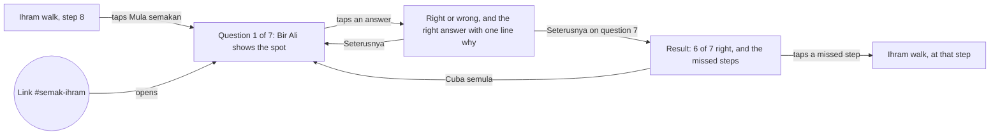
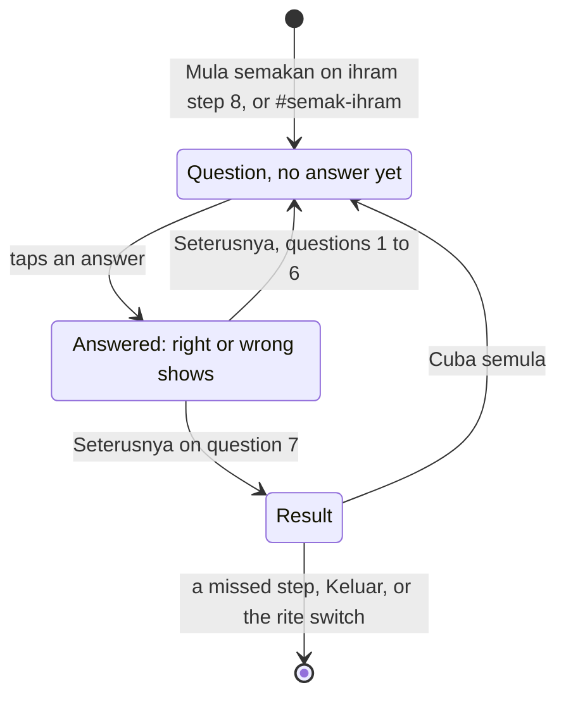

# Ihram check

**Version:** v1 · **Status:** Draft · **Type:** Feature · **Project type:** Web UI

**Shape doc:** docs/specs/virtual-hajj/shape.md
**Depends on:** `ihram`, `sai-check`

After the ihram walk, the person answers seven questions on where each step of ihram happens at Bir Ali and what to do there, and the result shows on screen.
It checks ihram before `full-umrah` joins the walks, and it reuses the check of tawaf and sa'i (D92).

## Problem

The ihram walk shows each step at Bir Ali, but nothing tells the person if they learned it.
A first-timer finishes step 8 and does not know which acts of ihram they still mix up.
Common mistakes are scent on the ihram cloth, a sewn garment for a man, and the belief that ihram starts with the clothes and not with the niat.
A mistake at the miqat carries into the whole umrah, and nobody on the bus corrects it.

## Slice test

| Check                         | Result |
| ----------------------------- | ------ |
| Cuts every layer it needs     | Yes. A button on ihram step 8, the check screen for a third rite, the question text files, the 3D Bir Ali or its map at each question, the address, CI and the deploy. |
| One e2e test walks it         | Yes. One browser test goes from ihram step 8 through seven questions to the result, then runs scenarios 2 to 4. |
| Worth shipping alone          | Yes. A first-timer sees which acts of ihram they still mix up, and goes back to those steps before the trip. An ustaz checks a class on ihram from the projector. |
| Fits (≤5 scenarios, ≤2 areas) | Yes. 4 scenarios. Two areas: the check screen, which now serves three rites, and the ihram check text. Bir Ali and its map are reused with no change to the model. |

**Path:** full. The slice adds a third check with new text in two languages, and it changes the last step of the ihram walk.

## User story

As a first-time pilgrim, I want to answer where each step of ihram happens at Bir Ali and what I do there, so that I know what I still mix up before the bus stops at the miqat.

## Flow



The person goes from ihram step 8 or a link to seven questions, sees right or wrong after each answer, and ends on a result that opens the ihram steps they missed.

## States



The states are the states of the tawaf and sa'i checks. The answers live only in the open page, and a reload starts again at question 1 (D53).

## Acceptance criteria

The words of each question come at pause 2, in "Text of the check". Claude drafts them, and the user corrects them (D55).

```gherkin
Scenario: Aminah finishes the ihram walk and checks what she learned
  Given Aminah's phone is set to Malay, and the screen is 360x800, upright
  And she is on ihram step 8, "Ke Makkah"
  Then a "Mula semakan" button takes the gold place in the bar
  And "Teruskan ke tawaf" and "Mula semula" sit in the step panel
  When she taps "Mula semakan"
  Then the address ends with "#semak-ihram", and "Semakan ihram · Soalan 1 daripada 7" shows
  And the rite switch shows "Ihram" as the current rite
  And the 3D place shows Bir Ali from above, and no name of a place shows
  And the question asks who enters ihram at Bir Ali, with three answers, and the "Seterusnya" button is off
  When she taps the answer for a pilgrim who comes from Madinah
  Then the answer shows as right, with "Betul." and one line why
  And the names of the prayer hall, the minaret, the washrooms and the bus park show
  And the "Seterusnya" button is on
  When she answers questions 2 to 7, with a wrong answer on question 2 only
  Then the result shows "6 daripada 7 betul"
  And "Langkah 2 · Sebelum ihram" shows under "Ulang kaji langkah ini:"
  When she taps it
  Then the address ends with "#ihram-2", and ihram step 2 shows, with the title "Sebelum ihram"
  And the same holds at 960x540, at 1280x720 and at 1920x1080

Scenario: Aminah puts the scent on the cloth
  Given Aminah is on question 2 of the ihram check, in Malay
  And the question asks where the scent goes after the bath
  When she taps the answer "on the ihram cloth"
  Then her answer shows as wrong, with a cross and the words "Belum tepat."
  And the right answer "on the body only" shows as right
  And one line says that scent goes on the body before the niat, and never on the ihram cloth
  And the colour is never the only sign: each mark has an icon and words

Scenario: Ustaz Hafiz runs the ihram check for a class on a projector
  Given Ustaz Hafiz's laptop is set to English, at 1920x1080
  And he is on ihram step 8
  When he presses Page Down on his clicker
  Then the address ends with "#semak-ihram", and question 1 of 7 of the ihram check shows in English, with the 3D Bir Ali
  When he presses Page Down before an answer
  Then question 1 stays on screen
  When he taps the answer that the class calls out
  And he presses Page Down
  Then question 2 shows
  When he reloads the page
  Then question 1 of the ihram check shows, and no answer is chosen
  When he opens "https://isfar-57q.pages.dev/#semak-sai"
  Then question 1 of the sa'i check shows, with the 3D mas'a

Scenario: The ihram check still works when the 3D place cannot show
  Given 3D drawing is off in the browser on Aminah's phone
  When she opens "#semak-ihram" in Malay
  Then the top-view map of Bir Ali shows, with no marker and no names
  And the message "Peranti ini tidak dapat memaparkan tempat 3D." shows under the question
  When she answers question 1 and taps "Seterusnya"
  Then the marker on the map stands at the washrooms, the spot of question 2
  And she can finish all seven questions and see the result
```

Rules that hold for each scenario:

- GitHub Actions runs scenarios 1 to 4 on each push, at 360x800, 960x540, 1280x720 and 1920x1080.
- The rules of the tawaf check hold: seven questions in walk order, three answers in a fixed order with one right (D54), no change after the tap, Next only after an answer (D52), names hidden until the answer (D57), a plain count with no points (D50), and nothing kept (D53).
- The seven beads count the questions, as in the other checks (D56). The ihram walk itself still shows no beads (D97).
- "Keluar" goes to ihram step 8 (D59). A missed step opens that step of the ihram walk.
- On ihram step 8, the Right arrow key and Page Down open the ihram check, as on tawaf step 15 and sa'i step 13 (D58, D84). "Teruskan ke tawaf" in the panel still opens `#tawaf-1`.
- In the ihram check, the rite switch shows "Ihram". A tap on "Tawaf" opens tawaf step 1 and drops the answers (D71).
- A language change keeps the question and the answer, and the 3D Bir Ali does not load again.
- Question 5 shows the courtyard, which has no name, so no name shows after the answer, as on walk step 5 (`ihram` O23).
- A question on an act for men says "lelaki" or "men" (D23).
- Two missed questions on one step give one button on the result.
- Both notices of the walk show on each question and on the result.
- Each question and each line why is 40 words or fewer.
- The tawaf check and the sa'i check do not change. `#semak` and `#semak-sai` still open them.

### Questions in this slice

Each question shows Bir Ali from the camera of one ihram walk step.

| # | Shows the place of | Asks | Right answer, in short |
| --- | --- | --- | --- |
| 1 | Step 1, Bir Ali from above | Who enters ihram at Bir Ali | A pilgrim who comes from Madinah |
| 2 | Step 2, the washrooms | Where the scent goes after the bath | On the body only, not on the ihram cloth |
| 3 | Step 3, the washrooms | What men wear in ihram | Two white cloths with no seams, and the head bare |
| 4 | Step 4, the prayer hall | What you do in the prayer hall before the niat | Two rakaat of solat sunat ihram |
| 5 | Step 5, the courtyard | When your ihram starts | With the niat |
| 6 | Step 6, the bus park | What you say often from here to Makkah | The talbiyah |
| 7 | Step 7, the bus park | Which act is not allowed in ihram | A cut of the hair or the nails |

Left out: the plane line of step 5, and the end of the talbiyah on step 8. Neither one happens at a place in Bir Ali (O2).

## Scope

**In:**

- A "Mula semakan" button in the gold place on ihram step 8, with "Teruskan ke tawaf" and "Mula semula" in the panel.
- The ihram check at the address `#semak-ihram`, in Malay and English.
- Seven questions, each with three answers, a mark for right or wrong, and one line why.
- The 3D Bir Ali, or its map with no 3D, at the spot of each question.
- A result with a plain count, and each missed step with a button that opens it in the ihram walk.
- "Cuba semula" and "Keluar" on the result.
- Next by button, by the Right arrow key and by Page Down, after an answer.

**Out:**

| Left out | Picked up by |
| --- | --- |
| A gold button on the result that goes on to tawaf | `full-umrah` (shape O19) |
| A check for the whole umrah | `full-umrah` |
| A question on the niat on the plane, or on the end of the talbiyah | No slice yet. The result of this slice shows if seven is enough. |
| A saved score, a history of attempts, or a score shared with others | No slice. The site keeps nothing (shape O5). |
| Points, stars, badges, streaks or confetti | No slice. The design brief bans them (D46). |
| Questions or answers in a new order on each try | No slice (D54) |
| Questions on the clothes of women apart from men | `pilgrim-choice` |
| A pilgrim figure and a softer look | The /shape pass of D46 |

## Decisions

Recorded as D103 and D104 at pause 1.

## Open items

| ID  | What | Type | Raised at | Owner | Status | Answer |
| --- | ---- | ---- | --------- | ----- | ------ | ------ |
| O1  | How does a person reach the ihram check? On ihram step 8, the gold place holds "Teruskan ke tawaf" (D93), and Page Down there opens `#tawaf-1`. The other checks take the gold place on the last step (D58, D84). | question | spec p1 | user | Resolved | From ihram step 8 and the address `#semak-ihram`. "Mula semakan" takes the gold place on step 8, and Page Down opens the check. "Teruskan ke tawaf" and "Mula semula" sit in the panel as quiet buttons. This supersedes D93. "Teruskan ke tawaf stays gold" and "the address only" were rejected. 2026-11-25 |
| O2  | Which seven questions does the ihram check ask? The walk has nine topics that fit a question, and the seven beads fit seven (D56). | question | spec p1 | user | Resolved | One question for each of steps 1 to 7. The plane line of step 5 and the end of the talbiyah on step 8 drop, because neither happens at a place in Bir Ali. "The plane in place of the miqat" and "the plane and the end of the talbiyah in place of the miqat and the solat sunat" were rejected. 2026-11-25 |

_Never delete this section or its rows. See references/ledger.md._

## Glossary

- **Ihram** — the state a pilgrim enters at the miqat, with its clothes and its rules.
- **Miqat** — the boundary where a pilgrim must enter ihram, before they reach Makkah.
- **Bir Ali** — the miqat for a pilgrim who comes from Madinah. Its other name is Dhul Hulaifah.
- **Niat** — the intention that starts the umrah, said in the heart.
- **Talbiyah** — the call "Labbaik Allahumma labbaik", said from the miqat until tawaf starts.
- **Solat sunat ihram** — two rakaat of prayer before the niat.
- **Self-check** — a short set of questions after the walk. It shows the person what they know, and keeps nothing.
- **Ustaz** — a male religious teacher.
- **Presenter clicker** — a small remote for slides. It sends the Page Up and Page Down keys.
- **Address** — the text in the browser's address bar. The part after `#` names the screen.
- **e2e** — end-to-end: one browser test that walks the whole slice as a person would.
- **CI** — a service that runs the tests on each push.
- **D58, D93** — numbered entries in `DECISIONS.md`, the record of each choice.
