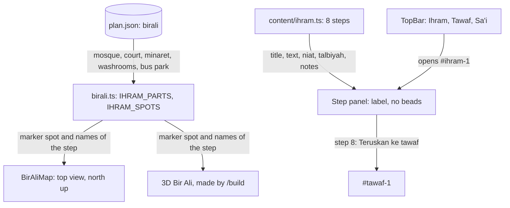
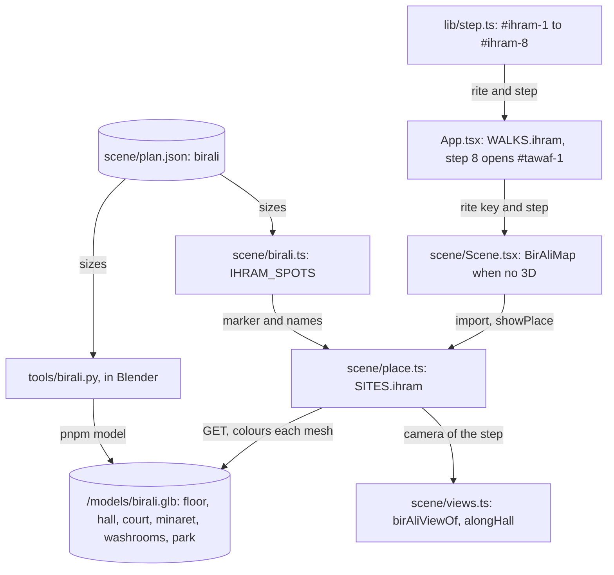
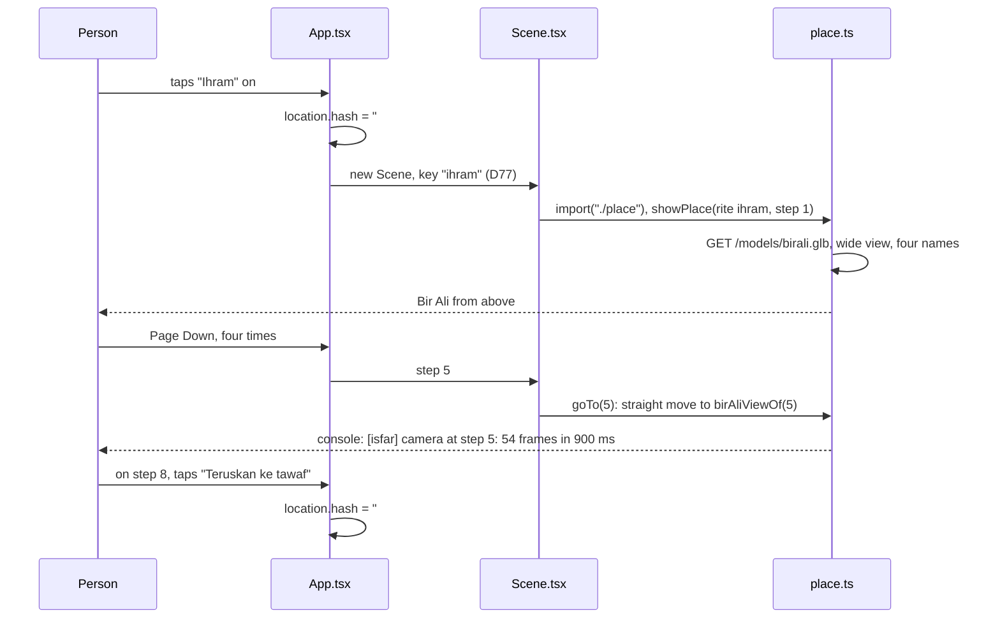

# Ihram

**Version:** v1 · **Status:** Shipped · **Type:** Feature · **Project type:** Web UI

**Shape doc:** docs/specs/virtual-hajj/shape.md
**Depends on:** `sai-walk`

The site leads a person through ihram in 8 steps, in a 3D Bir Ali, from the bath and the clothes to the talbiyah on the bus to Makkah.
Ihram is the first rite a pilgrim does, and the site has nothing on it yet.

## Problem

A first-time pilgrim enters ihram at the miqat, hours before they see the Kaabah.
The site teaches tawaf and sa'i, but it starts at the mataf, so the first rite of the umrah has no picture and no steps.
On the day, the pilgrim gets off the bus at Bir Ali with about an hour to bathe, dress, pray and make the niat.
Mistakes there carry into the whole umrah: a sewn garment, scent on the cloth, or a niat made after the bus has left the miqat.

`full-umrah` was to add ihram, tahallul and the join of the walks in one slice.
A 3D miqat makes that three areas, so ihram comes first, as its own slice (O2).

## Slice test

| Check                         | Result |
| ----------------------------- | ------ |
| Cuts every layer it needs     | Yes. The step text in Malay and English, the plan sizes, a Blender model, the 3D scene, the top-view map, the address, the rite switch, the browser test and the deploy. |
| One e2e test walks it         | Yes. `e2e/ihram.spec.ts` walks the four scenarios below. |
| Worth shipping alone          | Yes. A first-timer learns what to do at the miqat before the trip, and an ustaz teaches ihram on a projector. |
| Fits (≤5 scenarios, ≤2 areas) | Yes. 4 scenarios. Two areas: the ihram place, in 3D and on the map, and the way in, by the rite switch and the address. |

**Path:** full. A new 3D place, a new walk and a change to the top bar touch far more than three files.

## User story

As a first-time pilgrim, I want to walk through ihram in a 3D Bir Ali, so that I know where to bathe, pray and make the niat before the bus leaves.

## Flow

```mermaid
flowchart LR
    P((Person)) -- "taps Ihram in the top bar, or opens #ihram-1" --> S1["1 Bir Ali from above, four names"]
    S1 -- "Next" --> W["2, 3 Washrooms: bath, clothes"]
    W -- "Next" --> H["4 Prayer hall: solat sunat ihram"]
    H -- "Next" --> C["5 Courtyard: niat, the plane note"]
    C -- "Next" --> B["6, 7 Bus park: talbiyah, the rules"]
    B -- "Next" --> E["8 Bir Ali from above: on to Makkah"]
    E -- "Teruskan ke tawaf" --> T["#tawaf-1"]
```



The person walks the eight steps through the parts of Bir Ali in the order of the day, and step 8 opens the tawaf walk.

## Acceptance criteria

```gherkin
Scenario: Aminah walks through ihram in Bir Ali on her phone
  Given Aminah's phone is set to Malay, and the screen is 360x800, upright
  And she is on "#tawaf-3"
  When she taps "Ihram" in the top bar
  Then the address is "#ihram-1", and the label says "Ihram · Langkah 1 daripada 8"
  And the 3D place shows Bir Ali from above, with the names of the prayer hall, the minaret, the washrooms and the bus park
  When she taps "Seterusnya"
  Then step 2 shows, and the gold marker stands at the washrooms
  When she taps "Seterusnya" two times
  Then step 4 shows, and the marker stands in the prayer hall
  When she taps "Seterusnya"
  Then step 5 shows the niat of umrah in Arabic, with its sound and its meaning
  And a note says what to do on a plane that flies straight to Jeddah
  When she taps "Seterusnya"
  Then step 6 shows the talbiyah in Arabic, and the marker stands at the bus park
  When she taps "Seterusnya" two times
  Then step 8 shows Bir Ali from above, and the gold button says "Teruskan ke tawaf"
  When she taps "Teruskan ke tawaf"
  Then the address is "#tawaf-1", and the mataf loads
  And the same holds at 960x540, at 1280x720 and at 1920x1080

Scenario: Ustaz Hafiz teaches ihram on a projector with a clicker
  Given the projector shows the site at 1920x1080, in English
  When Ustaz Hafiz opens a link to "#ihram-4"
  Then step 4 shows, with the title of the solat sunat ihram
  When he presses Page Down
  Then step 5 shows, and the address is "#ihram-5"
  When he reloads the page
  Then step 5 still shows
  When he presses Page Down three times
  Then step 8 shows
  When he presses Page Down
  Then the address is "#tawaf-1"
  When he presses the Back button of the browser
  Then step 8 of ihram shows again

Scenario: Aminah sees the top-view map when the 3D place cannot show
  Given 3D drawing is off in the browser on Aminah's phone
  When she opens "#ihram-2" in Malay
  Then a top-view map of Bir Ali shows the prayer hall, the minaret, the washrooms and the bus park
  And the gold marker is at the washrooms
  And the message card says the device cannot show the 3D place
  When she taps "Seterusnya" two times
  Then step 4 shows, and the marker on the map is in the prayer hall

Scenario: An ihram address outside the walk opens step 1
  Given Aminah has a link to "#ihram-12"
  When she opens it
  Then step 1 of ihram shows, and the label says "Ihram · Langkah 1 daripada 8"
  And "#ihram-0" opens step 1 of ihram too
```

Rules that hold for each scenario:

- The eight steps follow the outline below (O6). Claude drafts the words at pause 2, and the user corrects them (D24).
- Each step text has 40 words or fewer, in Malay and in English, in the Shafi'i school (shape O2).
- Each step notes where the Hanafi, Maliki and Hanbali schools differ, when they differ.
- Where the act is for men only, the text says "for men" (D23). The clothes of step 3 name both.
- The rite switch holds Ihram, Tawaf and Sa'i, in that order, and fits a 360 px phone (O10).
- The 3D download stays under 500 KB compressed (D16). Bir Ali has its own model file (D76).
- The tawaf walk, the sa'i walk and their two checks do not change. An empty address still opens tawaf step 1 until `full-umrah`.

| Step | Title | Where the marker stands | What it teaches |
| ---- | ----- | ----------------------- | --------------- |
| 1 | Bir Ali and its parts | The wide view, with the four names | Bir Ali is the miqat for a pilgrim who comes from Madinah. |
| 2 | Before ihram | The washrooms | Cut the nails, take the bath of ihram, and put scent on the body, not on the cloth. |
| 3 | The ihram clothes | The washrooms | Men wear two white cloths with no seams. Women wear clothes that cover the aurat, with the face and the hands open. |
| 4 | Solat sunat ihram | The prayer hall | Two rakaat. |
| 5 | The niat of umrah | The courtyard | The niat, in Arabic. The note: on a plane that flies straight to Jeddah, do the same on the plane before the miqat, when the crew announces it. |
| 6 | Talbiyah | The bus park | The talbiyah, in Arabic, said often from here. |
| 7 | The rules of ihram | The bus park | What is not allowed until tahallul. |
| 8 | On to Makkah | The wide view | Say the talbiyah until tawaf starts. Next comes tawaf. |

## Scope

**In:**

- Eight ihram steps in Malay and English, with the niat and the talbiyah in Arabic.
- A simple stylised 3D Bir Ali, made for this project (D10, D19): the prayer hall, the minaret, the courtyard, the washrooms and the bus park.
- The names of the four parts in the place (D34).
- A top-view map of Bir Ali with the marker, when 3D cannot show (D13, D29).
- "Ihram" in the rite switch, before "Tawaf" and "Sa'i".
- The addresses `#ihram-1` to `#ihram-8`.
- On step 8, the gold "Teruskan ke tawaf", which opens `#tawaf-1`, and "Mula semula" in the panel.

**Out:**

| Left out | Picked up by |
| --- | --- |
| A self-check for ihram | `ihram-check`, the next slice (O7) |
| Tahallul, the join of the walks, tawaf step 16, the checks that go on to the next rite, and "Tahallul" in the switch | `full-umrah` (shape O17 to O22) |
| An empty address that opens ihram step 1 | `full-umrah` |
| Steps of their own for the plane, or a 3D plane cabin | No slice (O4) |
| The other miqat as 3D places: Qarn al-Manazil, Yalamlam, Juhfah and Dhat Irq | No slice (O3) |
| The text for a man or a woman alone | `pilgrim-choice` |
| A pilgrim figure that walks on Next | The /shape pass of D46 |
| A listing in search engines | Not before a qualified review (shape O22) |

## Interface

The walk screen of tawaf and sa'i, with Bir Ali in the scene and a third part in the rite switch.



The plan holds Bir Ali once, `birali.ts` turns it into the spots, and the map and the 3D place both draw from that.

| Part | What it shows |
| --- | --- |
| Top bar, from 800 px | The mark, "Isfar", then BM and EN, then the rite switch with Ihram, Tawaf and Sa'i, in one row (O24). |
| Top bar, under 800 px | Row 1: the mark, "Isfar" and BM and EN. Row 2: the rite switch, with three equal buttons. The bar is 360 px wide at 360 px (O12). |
| Step panel | "Ihram · Langkah 5 daripada 8", with no beads (O13). The title, the text, the Arabic block on steps 5 and 6, and the note on steps 2, 3, 6 and 8. |
| Step 5 | The line for a pilgrim on a plane is one sentence of the step text (O14). |
| Step 8 | The gold button says "Teruskan ke tawaf". "Mula semula" sits in the panel. |
| Scene, 3D | Bir Ali, with the four names. /build makes it from the plan, as the mas'a. |
| Scene, no 3D | The top-view map: the bus park on the north side, the mosque with its courtyard, the minaret at its north-east corner, the washroom block on the west side (O17). The marker and the names of the step. |
| Loading | The loading card, "Memuatkan Bir Ali". |

**Motion tier:** 2, as the tawaf and sa'i walks (O15). The step text fades in over 320 ms, and the camera flies between the spots. Under reduced motion, the camera cuts.

**Components used:** `TopBar`, `StepPanel`, `StepActions`, `ArabicBlock`, `Note`, `Notice`, `MessageCard`, `LoadingCard`, and the new `BirAliMap`, which uses the map classes of `MasaMap`. No new token. The new map classes in `src/app.css` use `--vh-marble`, `--vh-kiswah`, `--vh-sunken`, `--vh-cloth` and `--vh-edge`.

**Preview:** `http://localhost:5199/preview/ihram.html`, after `pnpm dev --port 5199`. It has 15 frames, and each frame is a working ihram screen. The top-view map stands in for the 3D Bir Ali.

**Built in this pause, for /build to keep:** the `birali` part of `src/scene/plan.json`, `src/scene/birali.ts`, `src/components/BirAliMap.tsx`, the map classes and the two-row top bar in `src/app.css`, `src/content/ihram.ts`, the new words in `src/content/text.ts`, and the list of parts in `TopBar`, with its call in `App.tsx`.
**For the preview only:** `preview/ihram.html` and `src/preview/`. No build ships them.

**Checks:** The static drift check passes on 8 files. The rendered drift check passes on steps 1, 5, 6 and 8, in light and dark. `pnpm typecheck` passes, and `pnpm test` passes 71 tests. The `design-taste-frontend` skill is not installed, so its inspector did not run. The screen is the kiswah and marble system of the walks (D3), so a one-line prompt would not land on it.

## Technical plan

### Approach

Ihram becomes a third rite, as sa'i did. `step.ts` reads `#ihram-5`, `App.tsx` gives the rite its walk, and `Scene.tsx` loads `birali.glb` through the `ihram` entry of `SITES` in `place.ts`.
`tools/birali.py` builds the model from the `birali` part of `plan.json`, so the 3D place, the map and the spots share one set of numbers (D43).
The mosque has no roof (O19), and the camera moves on a straight line between views that stand south-west of each spot (O21).

Relies on: D16, D19, D24, D29, D30, D40, D43, D44, D71, D76, D77, D87, D88, D89, D90, D91, D93, D94, D95, D96, D97, D98, D99, D100, D101, D102



The plan feeds the model and the spots, and `place.ts` draws the model with the marker and the camera of the step.



A tap on the switch starts the scene again with Bir Ali, and step 8 hands over to the mataf in the same way.

No data crosses a trust boundary. The only new input is the address, which `readPlace` matches against a fixed pattern.

### Changes

| File | What changes | Why |
| --- | --- | --- |
| `tools/birali.py` (new) | Builds `birali.glb` from `plan.json` `birali`, as `tools/masa.py` builds the mas'a. Meshes: `floor`, `park`, `bay`, `hall` (the outer walls and the walls round the courtyard, no roof), `hallFloor`, `court`, `minaret`, `washrooms`. It copies the `face`, `box` and `mesh` helpers of `tools/masa.py:26-47`, as each Blender script runs alone. | Scenario 1, D87, O19 |
| `public/models/birali.glb` (new) | Built by `pnpm model`. | D19, D76 |
| `package.json:19` | The `model` script also runs `blender -b -P tools/birali.py`. | D19 |
| `src/lib/step.ts:3-29` | `Rite` gains `"ihram"`, `TOTAL.ihram` is 8, and `PLACE` reads `ihram`. `CHECK_HASH` keeps tawaf and sa'i only. | Scenarios 2 and 4, D95 |
| `src/App.tsx:30-33` | `WALKS.ihram`: the steps of `IHRAM`, no beads (D97), the label `ihramProgress`, no check, and `#tawaf-1` after the last step. Next on step 8 and Page Down open `#tawaf-1` (D93). The switch lists Ihram first (D94). | Scenarios 1 and 2 |
| `src/scene/Scene.tsx:16-17,93-94,107` | `PART_WORDS` and `PART_LISTS` gain ihram. `BirAliMap` shows when 3D cannot show. The loading card says `loadingBirAli`. | Scenarios 1 and 3 |
| `src/scene/place.ts:46-62,148-180` | `COLOURS` gains the Bir Ali meshes. `SITES.ihram`: the model, no joints, no path line, the marker from `IHRAM_SPOTS`, the names, `birAliViewOf` and `alongHall`. | Scenario 1, D76 |
| `src/scene/views.ts` | `birAliViewOf(step)`: a wide view from high in the south-west on steps 1 and 8, else a view south-west of the spot that looks down at it over the walls. `birAliNameAnchor` and `birAliNamePlace`. | Scenario 1, D101 |
| `src/scene/birali.ts` | `IHRAM_NAME_HEIGHT`, the height of each name above its part. | Scenario 1, D44 |
| `src/scene/views.test.ts` | For each ihram step: the camera is above the wall tops, the marker is on screen at aspect 1 and 1.5, and the line from the camera to the marker clears each wall. Each move clears the minaret and the wall tops. | Scenario 1, D101 |
| `src/scene/birali.test.ts` (new) | Each spot stands where its step says: beside the washrooms, in the hall and out of the courtyard, in the courtyard, in the bus park. | Scenarios 1 and 3 |
| `src/content/ihram.test.ts` (new) | 8 steps in each language, 40 words or fewer each, the niat on step 5 and the talbiyah on step 6 only, notes on steps 2, 3, 6 and 8, and the plane line on step 5. | Rules, D89, D90, D98 |
| `src/lib/step.test.ts` | `#ihram-1` to `#ihram-8`, and `#ihram-0`, `#ihram-9`, `#ihram-12` and `#IHRAM-2`. | Scenario 4 |
| `e2e/ihram.spec.ts` (new) | The four scenarios, at the four sizes. | All |
| `e2e/helpers.ts:16-17,73` | `BIRALI_MODEL`, and `modelParts` takes `"birali"`. | Scenario 1 |
| `e2e/speed.spec.ts:7` | A third walk: Bir Ali, `/#ihram-1`, 8 steps. | D39 |
| `preview/`, `src/preview/` (deleted) | The preview goes when the browser test passes, in a commit of its own. | Nothing ships it |
| `CHANGELOG.md` | One "Added" line. | The repo's rule |

Kept from pause 2: the `birali` part of `plan.json`, `birali.ts`, `BirAliMap.tsx`, the map classes and the two-row top bar in `app.css`, `content/ihram.ts`, the words in `text.ts`, and the list of parts in `TopBar`.

Reusing: `alongHall` in `src/scene/views.ts`, `marker()` and `showPlace` in `src/scene/place.ts`, the `face`, `box` and `mesh` shape of `tools/masa.py`, and `noWebGL`, `markerAt`, `modelParts`, `expectCamera`, `expectNotices`, `names` and `expectApart` in `e2e/helpers.ts`.

### Earn-it

| Added | Triggered by |
| --- | --- |
| `tools/birali.py` and `birali.glb` | Scenario 1, D87, D76 |
| `birali.ts` and the `birali` plan | D43: one set of numbers for the model, the map and the spots |
| `BirAliMap` | Scenario 3, D13, D29 |
| `"ihram"` in `Rite` | Scenarios 2 and 4 |
| `birAliViewOf` | Scenario 1: a camera for each spot |

Cut: rows of columns in the halls, the four short minarets, a second washroom block (O17), a bus, and a path line.

### Non-functionals

|                      |     |
| -------------------- | --- |
| **Load**             | As before: a few visits a day, static files on Cloudflare's network. |
| **Breaks first**     | The 3D download. It is near 176 KB today, and Bir Ali adds about 10 KB compressed, as `masa.glb` does. A person loads one model at a time (D76). `pnpm size` fails the build over 500 KB (D16). |
| **Security surface** | No change. Anyone with the link. The new input is the address, matched by a fixed pattern. No secret, and nothing stored but the language (D12). |
| **Proof it works**   | On `#ihram-5`, the live site prints `[isfar] camera at step 5: 54 frames in 900 ms`, and `birali.glb` has a `minaret` part. |
| **Rollout**          | No flag (D102). Ihram shows when the PR merges. Rollback: "Rollback to this deployment" in the Cloudflare dashboard, or `git revert` and a push. |

### Test plan

| Scenario | Test | Command |
| -------- | ---- | ------- |
| 1. Aminah walks through ihram in Bir Ali | `e2e/ihram.spec.ts` at four sizes: the switch, the label, the four names, the marker spots in the model, the Arabic blocks, the note, and "Teruskan ke tawaf". `views.test.ts`, `birali.test.ts`, `ihram.test.ts`. | `pnpm e2e --project=firefox` here, `pnpm e2e --project=chromium` in CI. `pnpm test` |
| 2. Ustaz Hafiz teaches with a clicker | `e2e/ihram.spec.ts` at 1920x1080: the link, Page Down, a reload, step 8 to `#tawaf-1`, and the Back button | `pnpm e2e --project=firefox` |
| 3. The top-view map | `e2e/ihram.spec.ts` with `noWebGL`: the map, the four names, the marker on steps 2 and 4 | `pnpm e2e --project=firefox` |
| 4. An address outside the walk | `step.test.ts`, and `e2e/ihram.spec.ts` for `#ihram-12` | `pnpm test`, `pnpm e2e --project=firefox` |
| Rule: the tawaf and sa'i walks and checks stay | `e2e/walk.spec.ts`, `e2e/sai.spec.ts`, `e2e/check.spec.ts`, `e2e/sai-check.spec.ts`, with the switch now on its own row under 800 px | `pnpm e2e --project=firefox` |
| Rule: the 3D download stays under 500 KB | `scripts/check-size.mjs` | `pnpm build && pnpm size` |

**E2E:** `e2e/ihram.spec.ts` walks the four scenarios.

The other commands: `pnpm typecheck` and `pnpm model`. Put back `mataf.glb` and `masa.glb` if `pnpm model` rebuilt them with no change (lesson `keep-unchanged-models`). Stop the `pnpm dev` server on port 5199 before `pnpm e2e` (lesson `stop-preview-before-e2e`). Prove the 3D half in Firefox here (lesson `local-chromium-loses-3d`). Fit each view at aspect 1 and 1.5 (lesson `fit-the-view-at-the-narrowest-scene`). Break `birAliViewOf` once and watch the tests fail (lesson `break-the-guarded-code`).

### Chunks

Single chunk. The model, the camera and the browser test read the same plan numbers, and `App.tsx` joins them.

Order inside the chunk:

1. `step.ts` and its test, `ihram.test.ts`, `birali.test.ts`.
2. `tools/birali.py`, `pnpm model`, then `views.ts` with its tests, then `SITES.ihram` and `COLOURS`.
3. `Scene.tsx` and `App.tsx`, then `e2e/ihram.spec.ts`, the speed walk, and a run of the four old browser tests.
4. Delete the preview, in a commit of its own (lesson `commit-the-preview-deletion-alone`).

### Risks

| Risk | Mitigation |
| ---- | ---------- |
| The south wall of the hall hides the marker on step 4 from a camera south-west of it. | The views test checks the line from the camera to the marker against each wall. If it fails, the view stands higher or nearer, or the walls go down from 10 m. |
| The 3D Bir Ali drops under 30 frames a second on a phone (O20). | Accepted risk. The cuts stay ready: no antialias on a phone, pixel ratio 1.5. |
| The washroom block stands in the wrong place (O17). | Accepted risk. Four numbers in `plan.json` and `pnpm model` move it. |
| The two-row top bar pushes the 3D place down on a phone, so less of the panel shows. | The old browser tests run at 360x800, and Back and Next stay at the bottom edge. |
| The text has a mistake in a ruling (O18). | Accepted risk. The "not yet reviewed" notice stays, and the user corrects the text. |

### Decisions to record

Recorded as D100, D101, D102.

## Review

2026-11-25 · 8 raw findings, 3 survived, 3 fixed.

- correctness · `src/components/BirAliMap.tsx:14` · move the hall name on the map 30 m east, clear of the step 4 marker · `8c1a65a`
- correctness · `src/app.css:92` · draw the map minaret in ink, so it shows at 3:1 or more in dark mode · `9c34e3a`
- correctness · `src/app.css:82` · put the language switch before the rite switch, so Tab follows the screen under 800 px · `fb36b70`

## Open items

| ID  | What | Type | Raised at | Owner | Status | Answer |
| --- | ---- | ---- | --------- | ----- | ------ | ------ |
| O1  | No 3D place of a miqat exists. What does the scene show on the ihram steps? | question | spec full-umrah p1 | user | Resolved | A new 3D place of one miqat. "A top-view map of the miqat" and "no scene, text only" were rejected. 2026-11-25 |
| O2  | A 3D miqat makes `full-umrah` three areas: a new 3D place, the join of the walks, and tahallul. The limit is two. | flag | spec full-umrah p1 | user | Resolved | Split. `ihram` comes first, with the 3D Bir Ali, and opens from the rite switch, as `sai-walk` did. `full-umrah` then joins the four parts. "full-umrah first" and "one slice with a top-view map" were rejected. 2026-11-25 |
| O3  | Which miqat does the ihram part teach? | question | spec full-umrah p1 | user | Resolved | Both ways: on the plane for a pilgrim who flies straight to Jeddah, and Bir Ali for a pilgrim who goes to Madinah first. "The plane only" and "Bir Ali only" were rejected. Nobody has checked which miqat the Malaysian flights pass. The user checks it against the course notes. 2026-11-25 |
| O4  | The 3D miqat is Bir Ali. How do the steps teach the pilgrim on the plane? | question | spec full-umrah p1 | user | Resolved | A note on step 5: on a plane that flies straight to Jeddah, do the same on the plane before the miqat, when the crew announces it. "Steps of their own with a map" and "a 3D plane cabin" were rejected. 2026-11-25 |
| O5  | Which recitations show in Arabic? | question | spec full-umrah p1 | user | Resolved | Two: the niat of umrah and the talbiyah. Pause 2 settles the exact words. "Talbiyah only" and "three, with the doa after the talbiyah" were rejected. 2026-11-25 |
| O6  | How many ihram steps, and in what order? | question | spec ihram p1 | user | Resolved | Eight, as the outline above. "Six, with steps 2 and 3 merged, and steps 7 and 8 merged" was rejected. 2026-11-25 |
| O7  | Does ihram get a self-check? | question | spec ihram p1 | user | Resolved | Yes, in the new slice `ihram-check`, after `ihram`, as D69 did for sa'i. "No ihram check" and "in this slice" were rejected. 2026-11-25 |
| O8  | On step 8, what does the gold button do, before `full-umrah` joins the walks? | question | spec ihram p1 | user | Resolved | "Teruskan ke tawaf" opens `#tawaf-1`, and "Mula semula" sits in the panel. "Mula semula only" was rejected. 2026-11-25 |
| O9  | Which parts of Bir Ali does the 3D place name? | question | spec ihram p1 | user | Resolved | Four: the prayer hall, the minaret, the washrooms and the bus park. "Three, with no minaret name" and "two, with no bus park" were rejected. 2026-11-25 |
| O10 | How does a person reach ihram, and how does the person jump between the parts? | question | spec full-umrah p1 | user | Resolved | The rite switch in the top bar. It holds Ihram, Tawaf and Sa'i now, and `full-umrah` adds Tahallul. Each button opens step 1 of its part (D71). "No switch" and "a list of parts on step 1" were rejected. 2026-11-25 |
| O11 | What does the progress label count, and what is the address? | question | spec full-umrah p1 | user | Resolved | The steps of the part, as "Ihram · Langkah 5 daripada 8", at `#ihram-5`. Old links as `#tawaf-6` keep working. "One count for the whole umrah, at `#umrah-11`" was rejected. 2026-11-25 |
| O12 | With Ihram, Tawaf and Sa'i, the top bar is 418 px wide on a 360 px phone, so the page scrolls sideways. | flag | spec ihram p2 | user | Resolved | Under 800 px, the rite switch takes its own row, with equal buttons, and "Isfar" shows again in row 1. "Drop the mark and tighten" was rejected: it fits 358 of 360 px, and Tahallul does not fit (D96). 2026-11-25 |
| O13 | Ihram has no count of seven. What sits beside the progress label? | question | spec ihram p2 | user | Resolved | No beads (D97). "Eight step beads" was rejected. 2026-11-25 |
| O14 | Where does the line for a pilgrim on the plane sit? The Note component is for the other schools. | question | spec ihram p2 | user | Resolved | One sentence of the step 5 text (D98). "A second kind of note" was rejected. 2026-11-25 |
| O15 | Which motion tier does the ihram walk use? | question | spec ihram p2 | user | Resolved | Tier 2, as the walks (D99). "Tier 1" was rejected. 2026-11-25 |
| O16 | Which words of the niat show in Arabic? | question | spec ihram p2 | user | Resolved | "Nawaitul 'umrata wa ahramtu biha lillahi ta'ala". "Labbaika Allahumma 'umratan" was rejected. The user checks it against the course notes with the rest of the text. 2026-11-25 |
| O17 | Nothing found shows where the washrooms stand at Bir Ali. The plan puts one block west of the mosque. | assumption | spec ihram p2 | user | Accepted risk | Stylised place. The user checks it against a photo or the course notes. A move is four numbers in `plan.json` and `pnpm model`. "Two blocks, east and west" was rejected. 2026-11-25 |
| O18 | The step text, the notes on the other schools and the meanings are Claude's draft. Nobody has checked the school notes against a source. | flag | spec ihram p2 | user | Accepted risk | Ship the draft, as for tawaf and sa'i (D24). The "not yet reviewed" notice stays, and the user corrects `src/content/ihram.ts` against the course notes. "Correct it before approval" was rejected. 2026-11-25 |
| O19 | Step 4 puts the marker inside the prayer hall, and a camera above a roofed hall cannot see in. | question | spec ihram p3 | user | Resolved | No roof, as the mas'a (D100). "A roof at 45% opacity" and "the camera inside the hall" were rejected. 2026-11-25 |
| O20 | The 3D Bir Ali holds 30 frames a second at phone speed. The dev machine has no graphics chip, so nothing here can measure it. | unproven | spec ihram p3 | user | Accepted risk | As for the mas'a (sai-walk O14). `/poc` was rejected, because the last spike stopped on the software renderer. The cuts stay ready: no antialias on a phone, a pixel ratio of 1.5. The proof comes on a real phone at /ship (D39). 2026-11-25 |
| O21 | How does the camera move between the spots, with a 40 m minaret at the north-east corner? | question | spec ihram p3 | user | Resolved | On a straight line, with each view south-west of its spot and above the walls. A unit test walks each move (D101). "An arc round the mosque" was rejected. 2026-11-25 |
| O22 | Does the ihram walk ship behind a feature flag? | question | spec ihram p3 | user | Resolved | No flag (D102). "A flag in the address" was rejected. 2026-11-25 |
| O23 | The spots gave step 5 the name of the prayer hall. Its camera stands over the south hall, so the name falls behind the camera. | flag | build | user | Decided alone | Chose: step 5 shows no name, in 3D and on the map. The courtyard has no name of its own (D91). Other: move the anchor of the hall name to the north hall, so it shows on step 5. Undo: set the names of step 5 to `["hall"]` in `src/scene/birali.ts`, and move `IHRAM_PARTS.hall`. 2026-11-25 |
| O24 | The top bar from 800 px showed the rite switch before BM and EN. Under 800 px, CSS `order` moved the switch to row 2, so Tab went down to row 2 and then back up to BM and EN. | flag | review | user | Decided alone | Chose: the language switch comes first in the page and on screen at every width, and the rite switch follows it. Other: keep the old wide order and accept a Tab order that does not follow the phone screen. Undo: `git revert` the fix commit. 2026-11-25 |

_Never delete this section or its rows. See references/ledger.md._

## Decisions

Recorded as D87 to D95 at pause 1, D96 to D99 at pause 2, and D100 to D102 at /build.

## Glossary

- **Miqat** — the boundary where a pilgrim must enter ihram, before they reach Makkah.
- **Bir Ali** — the miqat for a pilgrim who comes from Madinah, with a large mosque, washrooms and a bus park. Its other name is Dhul Hulaifah.
- **Ihram** — the state a pilgrim enters at the miqat, with its clothes and its rules.
- **Niat** — the intention, said in the heart, and here also in words, that starts the umrah.
- **Talbiyah** — the call "Labbaik Allahumma labbaik", which the pilgrim says from the miqat until tawaf starts.
- **Solat sunat ihram** — two rakaat of prayer before the niat. It is sunnah, not required.
- **Rules of ihram** — the acts not allowed while in ihram, such as scent, a cut of the hair, and sewn clothes for men.
- **Aurat** — the parts of the body that must stay covered.
- **Tahallul** — the haircut that ends ihram, after sa'i.
- **e2e** — end-to-end: one browser test that walks the whole slice as a person would.
