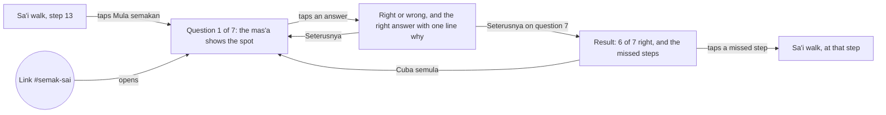
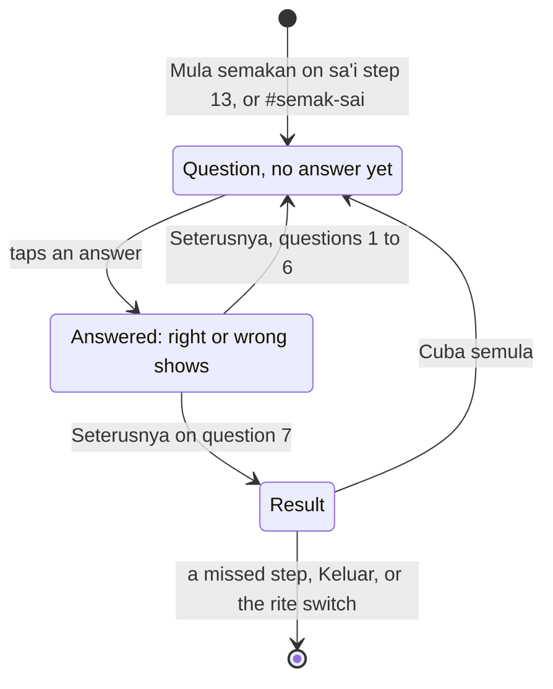
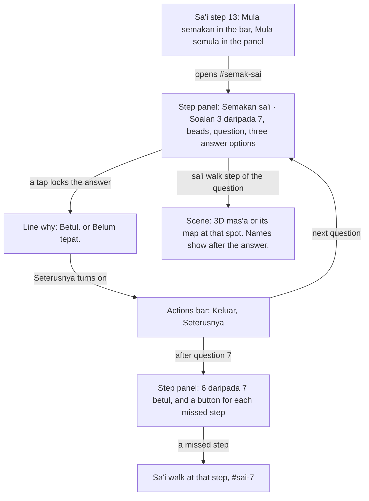

# Sa'i check

**Version:** v1 · **Status:** Draft · **Type:** Feature · **Project type:** Web UI

**Shape doc:** docs/specs/virtual-hajj/shape.md
**Depends on:** `sai-walk`, `tawaf-check`

After the sa'i walk, the person answers seven questions on where each step of sa'i happens and what to do there, and the result shows on screen.
It checks sa'i before `full-umrah` joins the two walks, and it reuses the check of `tawaf-check` (D69).

## Problem

The sa'i walk shows each step, but nothing tells the person if they learned it.
A first-timer finishes step 13 and does not know which places or acts of sa'i they still mix up.
A common mistake is to count Safa to Marwah and back as one walk, and the walk alone does not catch it.

## Slice test

| Check                         | Result |
| ----------------------------- | ------ |
| Cuts every layer it needs     | Yes. A button on sa'i step 13, the check screen for a second rite, the question text files, the 3D mas'a or its map at each question, the address, CI and the deploy. |
| One e2e test walks it         | Yes. One browser test goes from sa'i step 13 through seven questions to the result, then runs scenarios 2 to 4. |
| Worth shipping alone          | Yes. A first-timer sees which steps of sa'i they still mix up, and goes back to those steps. An ustaz checks a class on sa'i from the projector. |
| Fits (≤5 scenarios, ≤2 areas) | Yes. 4 scenarios. Two areas: the check screen, which now serves two rites, and the sa'i check text. The mas'a and its map are reused with no change to the model. |

**Path:** full. The slice adds a second check with new text in two languages, and the check screen must serve two rites.

## User story

As a first-time pilgrim, I want to answer where each step of sa'i happens and what I do there, so that I know what I still mix up before the day.

## Flow



The person goes from sa'i step 13 or a link to seven questions, sees right or wrong after each answer, and ends on a result that opens the sa'i steps they missed.

## States



The states are the states of the tawaf check. The answers live only in the open page, and a reload starts again at question 1 (D53).

## Acceptance criteria

The words of each question come at pause 2, in "Text of the check". Claude drafts them, and the user corrects them (D55).

```gherkin
Scenario: Aminah finishes the sa'i walk and checks what she learned
  Given Aminah's phone is set to Malay, and the screen is 360x800, upright
  And she is on sa'i step 13, "Sa'i selesai"
  Then a "Mula semakan" button takes the place of "Mula semula" in the bar, and "Mula semula" moves into the step panel
  When she taps "Mula semakan"
  Then the address ends with "#semak-sai", and "Soalan 1 daripada 7" shows
  And the rite switch shows "Sa'i" as the current rite
  And the 3D mas'a shows the gold marker on the slope of Safa
  And no name of a place shows over the mas'a
  And the question asks where sa'i starts, with three answers, and the "Seterusnya" button is off
  When she taps "Bukit Safa"
  Then the answer shows as right, with "Betul." and one line why
  And the name "Bukit Safa" shows over the mas'a
  And the "Seterusnya" button is on
  When she answers questions 2 to 7, with a wrong answer on question 6 only
  Then the result shows "6 daripada 7 betul"
  And "Langkah 7 · Perjalanan 2" shows under "Ulang kaji langkah ini:"
  When she taps it
  Then the address ends with "#sai-7", and sa'i step 7 shows, with the title "Perjalanan 2"
  And the same holds at 960x540, at 1280x720 and at 1920x1080

Scenario: Aminah counts a walk wrong
  Given Aminah is on question 6 of the sa'i check, in Malay
  And the question asks how many walks are done when she reaches Safa from Marwah for the first time
  When she taps "Satu"
  Then her answer shows as wrong, with a cross and the words "Belum tepat."
  And the right answer "Dua" shows as right
  And one line says that Safa to Marwah is one walk, and Marwah back to Safa is the second walk
  And the colour is never the only sign: each mark has an icon and words

Scenario: Ustaz Hafiz runs the sa'i check for a class on a projector
  Given Ustaz Hafiz's laptop is set to English, at 1920x1080
  When he opens "https://isfar-57q.pages.dev/#semak-sai"
  Then question 1 of 7 of the sa'i check shows in English, with the 3D mas'a
  When he presses Page Down on his clicker before an answer
  Then question 1 stays on screen
  When he taps the answer that the class calls out
  And he presses Page Down
  Then question 2 shows
  When he reloads the page
  Then question 1 of the sa'i check shows, and no answer is chosen
  When he opens "https://isfar-57q.pages.dev/#semak"
  Then question 1 of the tawaf check shows, with the 3D mataf

Scenario: The sa'i check still works when the 3D place cannot show
  Given 3D drawing is off in the browser on Aminah's phone
  When she opens "#semak-sai" in Malay
  Then the top-view map of the mas'a shows, with the marker on the slope of Safa
  And the message "Peranti ini tidak dapat memaparkan tempat 3D." shows under the question
  When she answers questions 1 and 2
  Then the marker on the map moves to the lane to Marwah, the spot of question 3
  And she can finish all seven questions and see the result
```

Rules that hold for each scenario:

- GitHub Actions runs scenarios 1 to 4 on each push, at 360x800, 960x540, 1280x720 and 1920x1080.
- The rules of the tawaf check hold: seven questions in walk order, three answers in a fixed order with one right (D54), no change after the tap, Next only after an answer (D52), names hidden until the answer (D57), a plain count with no points (D50), and nothing kept (D53).
- The seven beads count the questions, as in the tawaf check (D56).
- "Keluar" goes to sa'i step 13 (D59). A missed step opens that step of the sa'i walk.
- On sa'i step 13, the Right arrow key and Page Down open the sa'i check, as on tawaf step 15 (D58).
- In the sa'i check, the rite switch shows "Sa'i". A tap on "Tawaf" opens tawaf step 1 and drops the answers (D71).
- A language change keeps the question and the answer, and the 3D mas'a does not load again.
- No question or line why names the left or the right side of a lane. Nobody has checked the side of the lane to Marwah yet (`sai-walk` O20).
- Two missed questions on one step give one button on the result.
- Both notices of the walk show on each question and on the result.
- Each question and each line why is 40 words or fewer.
- The tawaf check does not change, and `#semak` still opens it.

### Questions in this slice

Each question shows the mas'a from the camera of one sa'i walk step (O2).

| # | Shows the place of | Asks | Right answer, in short |
| --- | --- | --- | --- |
| 1 | Step 3, the slope of Safa | Where sa'i starts | At Bukit Safa |
| 2 | Step 3, the slope of Safa | What you do on Safa before walk 1 | Make the niat, face the Kaabah, raise both hands, say takbir and make doa |
| 3 | Step 4, the lane to Marwah | Which lane you keep to | The lane to Marwah |
| 4 | Step 5, between the green lights | What men do here | Walk quickly with short steps |
| 5 | Step 5, between the green lights | What you say here | "Rabbighfir warham" |
| 6 | Step 7, back at Safa | How many walks are done | Two |
| 7 | Step 12, at Marwah | Where sa'i ends | At Bukit Marwah, after walk 7 |

Left out: the rule of step 10, "if you are not sure of the count, take the lower number". It is a rule, not a place.

## Scope

**In:**

- A "Mula semakan" button on sa'i step 13.
- The sa'i check at the address `#semak-sai`, in Malay and English.
- Seven questions, each with three answers, a mark for right or wrong, and one line why.
- The 3D mas'a, or its map with no 3D, at the spot of each question.
- A result with a plain count, and each missed step with a button that opens it in the sa'i walk.
- "Cuba semula" and "Keluar" on the result.
- Next by button, by the Right arrow key and by Page Down, after an answer.

**Out:**

| Left out | Picked up by |
| --- | --- |
| A check for the whole umrah, or a link from the tawaf result to the sa'i check | `full-umrah` |
| A question on the rule of the lower count | No slice yet. The result of this slice shows if seven is enough. |
| A question on the side of the lane | No slice, until the user checks `sai-walk` O20 |
| A saved score, a history of attempts, or a score shared with others | No slice. The site keeps nothing (shape O5). |
| Points, stars, badges, streaks or confetti | No slice. The design brief bans them (D46). |
| Questions or answers in a new order on each try | No slice (D54) |
| Text for women apart from men | `pilgrim-choice` |
| A pilgrim figure and a softer look | The /shape pass of D46 |

## Interface

The sa'i check uses the screens of the tawaf check, built only from the kiswah and marble design system in `docs/design/design-system/`. The mas'a takes the place of the mataf.



Sa'i step 13 opens the check, each question sets the mas'a to the spot of its walk step, and a tap locks the answer and turns on Seterusnya.

**Screens**

| Screen | Header | Body | Actions bar |
| --- | --- | --- | --- |
| Sa'i step 13 | "Sa'i · Langkah 13 daripada 13", seven beads done | Title, text, and a quiet "Mula semula" button | "Kembali", and "Mula semakan" in the gold place |
| Question, no answer | "Semakan sa'i · Soalan 3 daripada 7". Beads 1 and 2 done, bead 3 current. | The question, three answer options at rest, an empty line why | "Keluar", and "Seterusnya" off |
| Question, answered | The same | The pick shows chosen. The right answer has a tick. A wrong pick has a cross. The line why fills. | "Keluar", and "Seterusnya" on |
| Result | "Semakan sa'i · Selesai", seven beads done | "6 daripada 7 betul", then "Ulang kaji langkah ini:" and a quiet button for each missed sa'i step. With none missed: "Anda tahu tempat dan amalan setiap langkah." | "Keluar", and "Cuba semula" |

The top bar shows "Sa'i" as the current rite on each screen. The header names the rite, so a class on a projector knows which check is on screen. The tawaf check keeps "Semakan · Soalan 3 daripada 7".
Questions 4 and 5 both show step 5, so a miss on both gives one "Langkah 5 · Antara lampu hijau".

**States of the scene**

| State | The scene shows | With the step panel |
| --- | --- | --- |
| Loading | The loading card "Memuatkan mas'a" | Nothing more |
| Shown | The 3D mas'a at the camera of the question's walk step, with its marker and lane path line. The names hide until the answer (D57). | Nothing more |
| Unsupported | The top-view map of the mas'a, with the marker and the lane path line. The names hide until the answer. | The no-3D message card, under the step panel |
| Failed | The same map | The failed-download card with "Cuba lagi", above the step panel. "Cuba lagi" reloads, and the check starts again (D53). |

The lane path line shows on each question, as in the walk. On question 6 it shows the walk from Marwah back to Safa, which helps the count and does not give it.

**Motion tier:** 2, as in the tawaf check (D61), if O3 agrees.

| Move | Time | Under reduced motion |
| --- | --- | --- |
| A button or an answer presses down | 160 ms | The same |
| A new question fades in and rises 12 px | 320 ms | It fades in 160 ms and does not rise |
| The camera moves along the hall to the spot of the next question | About 1 second, on the straight line of D78 | The camera cuts |
| After a tap, the page scrolls the line why into view, clear of the actions bar | The browser's scroll | An instant scroll |

**Components used:** Step panel with its header, Progress beads, Answer option (rest, chosen, right, wrong), Result, Button, quiet Button and Button off, Rite switch, Language switch, Notice, Scene card, and the top-view map of the mas'a. The React parts are the ones of the tawaf check: `CheckSide`, `CheckQuestion`, `AnswerOption`, `CheckResult`, `StepPanel`, `StepActions`, `MasaMap`. No new component, no new token.

**Access:** As in the tawaf check. Before the pick, the text of the scene for a screen reader is "Penanda emas di mas'a. Nama tempat muncul selepas anda menjawab.", so it names no place.

**Preview:** `http://localhost:5199/preview/sai-check.html`, after `pnpm dev --port 5199`. It lists 16 frames, and each frame is a working sa'i check screen from the real components. The frames show the top-view map, so the page does not open 16 3D views. The link "Open question 1 with the real 3D mas'a" shows the real place. Open it in Firefox on this machine.

**Built in this pause, for /build to keep:** `SAI_CHECK` in `src/content/check.ts`, the three sa'i check words in `src/content/text.ts`, and `showNames` on `src/components/MasaMap.tsx`.
**For the preview only:** `preview/sai-check.html` and `src/preview/`. No build ships them.

**Checks:** The static drift check passes on 6 files. The rendered drift check passes on 5 screens, in light and dark. `pnpm typecheck` and `pnpm test` pass. The `design-taste-frontend` skill is not installed, so its inspector did not run.
Named reference: Duolingo, as for the tawaf check: one question at a time, progress that always shows, and right or wrong just after the tap. Generic-model test: the screens come from the kiswah and marble system and the real mas'a map, so a one-line prompt would not land here.

### Text of the check

This is a draft in the Shafi'i school (D55), from the step text of `sai-walk`. The user corrects it here. The right answer is in bold.

| # | Step | Malay | English |
| --- | --- | --- | --- |
| 1 | 3 | **Di mana sa'i bermula?** Bukit Marwah · **Bukit Safa** · Lampu hijau pertama. *Why:* Sa'i bermula di Bukit Safa, dan perjalanan pertama menuju ke Marwah. | **Where does sa'i start?** Marwah · **Safa** · The first green light. *Why:* Sa'i starts at Safa, and the first walk goes towards Marwah. |
| 2 | 3 | **Apa yang anda buat di Safa sebelum perjalanan pertama?** **Berniat sa'i, hadap ke arah Kaabah, angkat tangan, bertakbir dan berdoa** · Solat sunat dua rakaat · Terus berjalan ke Marwah. *Why:* Di Safa, berniat sa'i, hadap ke arah Kaabah, angkat kedua-dua tangan, bertakbir dan berdoa. Solat dua rakaat datang selepas tawaf, sebelum sa'i. | **What do you do on Safa before the first walk?** **Make the niat of sa'i, face the Kaabah, raise your hands, say takbir and make doa** · Pray two rakaat · Walk straight on to Marwah. *Why:* On Safa, make the niat of sa'i, face the Kaabah, raise both hands, say takbir and make doa. The two rakaat come after tawaf, before sa'i. |
| 3 | 4 | **Anda turun dari Safa. Lorong mana yang anda ikut?** Mana-mana lorong yang kurang sesak · Lorong orang yang kembali ke Safa · **Lorong ke Marwah**. *Why:* Mas'a ada satu lorong untuk setiap arah. Ikut lorong ke Marwah, supaya anda tidak berjalan melawan orang yang kembali ke Safa. | **You come down from Safa. Which lane do you keep to?** Any lane that is less crowded · The lane of the people going back to Safa · **The lane to Marwah**. *Why:* The mas'a has one lane for each way. Keep to the lane to Marwah, so you do not walk against the people going back to Safa. |
| 4 | 5 | **Apa yang lelaki buat di antara dua lampu hijau?** **Berjalan cepat dengan langkah pendek** · Berhenti dan berdoa · Berjalan seperti biasa. *Why:* Di antara dua lampu hijau, lelaki berjalan cepat dengan langkah pendek. Wanita berjalan seperti biasa. | **What do men do between the two green lights?** **Walk quickly with short steps** · Stop and make doa · Walk at a usual pace. *Why:* Between the two green lights, men walk quickly with short steps. Women walk at a usual pace. |
| 5 | 5 | **Apa yang anda baca di antara dua lampu hijau?** Labbaik Allahumma labbaik · **Rabbighfir warham** · Bismillahi, Allahu Akbar. *Why:* Di antara dua lampu hijau, baca “Rabbighfir warham, innaka antal a'azzul akram”. | **What do you say between the two green lights?** Labbaik Allahumma labbaik · **Rabbighfir warham** · Bismillahi, Allahu Akbar. *Why:* Between the two green lights, say “Rabbighfir warham, innaka antal a'azzul akram”. |
| 6 | 7 | **Anda berjalan dari Marwah dan sampai di Safa buat kali pertama. Berapa perjalanan sudah selesai?** Satu · Setengah · **Dua**. *Why:* Safa ke Marwah ialah satu perjalanan, dan Marwah kembali ke Safa ialah perjalanan kedua. | **You walk from Marwah and reach Safa for the first time. How many walks are done?** One · Half of one · **Two**. *Why:* Safa to Marwah is one walk, and Marwah back to Safa is the second walk. |
| 7 | 12 | **Di mana sa'i tamat?** **Di Bukit Marwah, selepas perjalanan ketujuh** · Di Bukit Safa, tempat anda bermula · Di antara dua lampu hijau. *Why:* Perjalanan ketujuh bermula di Safa dan tamat di Marwah, jadi sa'i tamat di Bukit Marwah. | **Where does sa'i end?** **At Marwah, after the seventh walk** · At Safa, where you started · Between the two green lights. *Why:* The seventh walk goes from Safa to Marwah, so sa'i ends at Marwah. |

The right answer moves from place to place: 2, 1, 3, 1, 2, 3, 1 (D54).

**Other words**

| Part | Malay | English |
| --- | --- | --- |
| Header | Semakan sa'i · Soalan 3 daripada 7. Semakan sa'i · Selesai. | Sa'i check · Question 3 of 7. Sa'i check · Done. |
| The scene before the pick, for a screen reader | Penanda emas di mas'a. Nama tempat muncul selepas anda menjawab. | A gold marker in the mas'a. The name of the place shows after you answer. |
| Every other word | The words of the tawaf check: Mula semakan, Keluar, Cuba semula, Betul., Belum tepat., the result lines | The same, in English |

## Decisions

Recorded as D84, D85 at pause 1.

## Open items

| ID  | What | Type | Raised at | Owner | Status | Answer |
| --- | ---- | ---- | --------- | ----- | ------ | ------ |
| O1  | How does a person reach the sa'i check? The tawaf check opens from step 15 and from `#semak` (D51). Sa'i step 13 has "Mula semula" in the gold place today, and Page Down there does nothing. | question | spec p1 | user | Resolved | From sa'i step 13 and the address `#semak-sai`. "Mula semakan" takes the gold place on step 13, "Mula semula" moves into the panel, and Page Down opens the check, as on tawaf step 15. "Step 13 only" and "`#semak-sai` only" were rejected. 2026-11-25 |
| O2  | Which questions does the sa'i check ask? The walk has eight topics that fit a question, and the seven beads fit seven questions (D56). | question | spec p1 | user | Resolved | Seven, on a place and what to do there. The rule of the lower count on step 10 drops. "Drop the doa" and "five questions" were rejected. 2026-11-25 |
| O3  | Which motion tier does the sa'i check use? | question | spec p2 | user | Open | — |
| O4  | Is the draft text of the sa'i check right? | question | spec p2 | user | Open | — |

_Never delete this section or its rows. See references/ledger.md._

## Glossary

- **Sa'i** — seven walks between the hills of Safa and Marwah, after a tawaf.
- **Mas'a** — the long hall between Safa and Marwah, where pilgrims do sa'i.
- **Walk** — one trip between the two hills. Safa to Marwah is one walk, and Marwah back to Safa is the next.
- **Lane** — one side of the mas'a, for one direction of walk.
- **Self-check** — a short set of questions after the walk. It shows the person what they know, and keeps nothing.
- **Niat** — the intention that a person makes before a rite.
- **Ustaz** — a male religious teacher.
- **Presenter clicker** — a small remote for slides. It sends the Page Up and Page Down keys.
- **Address** — the text in the browser's address bar. The part after `#` names the screen.
- **e2e** — end-to-end: one browser test that walks the whole slice as a person would.
- **CI** — a service that runs the tests on each push.
- **D53, D58** — numbered entries in `DECISIONS.md`, the record of each choice.
