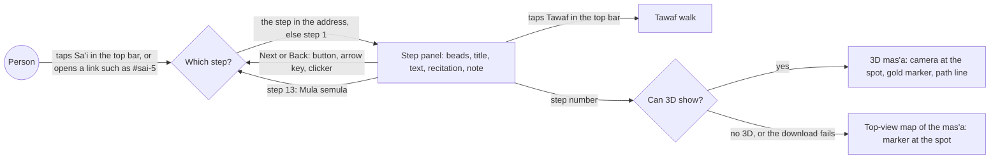
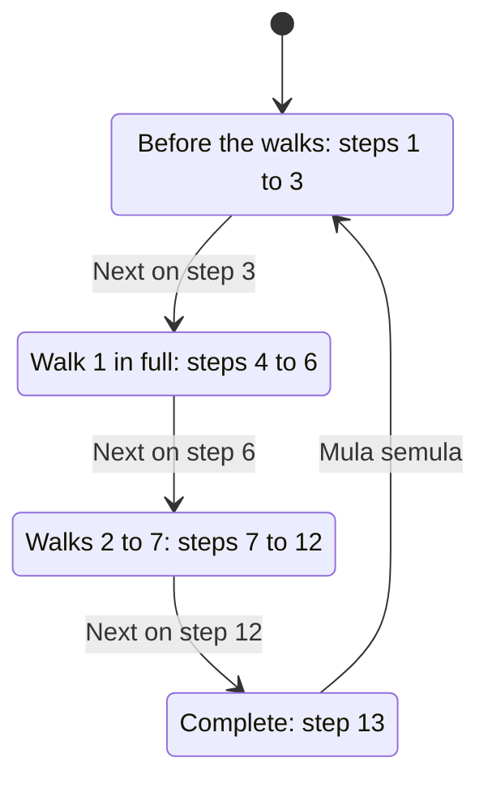
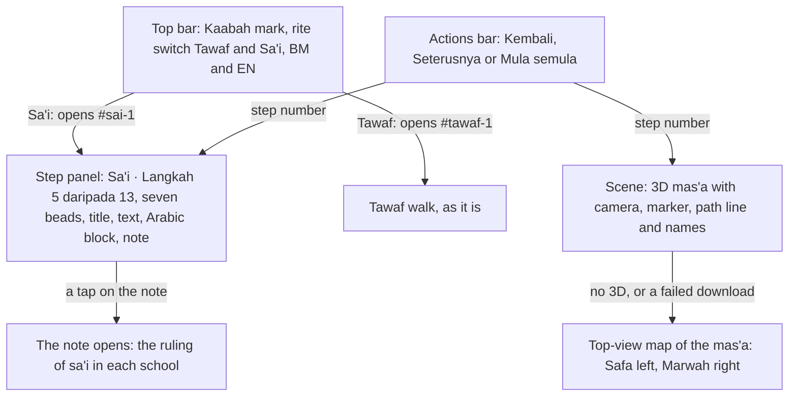
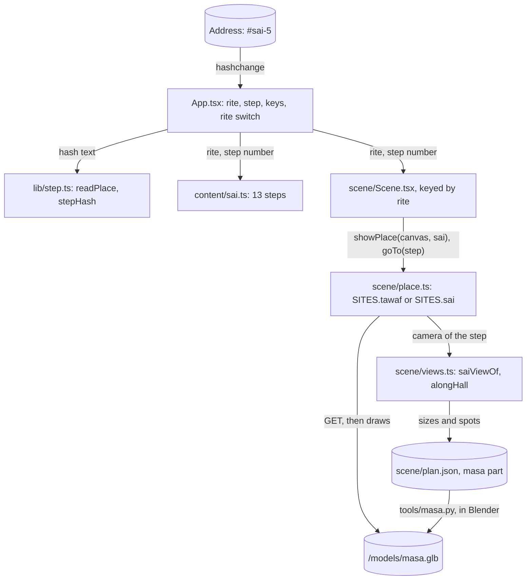
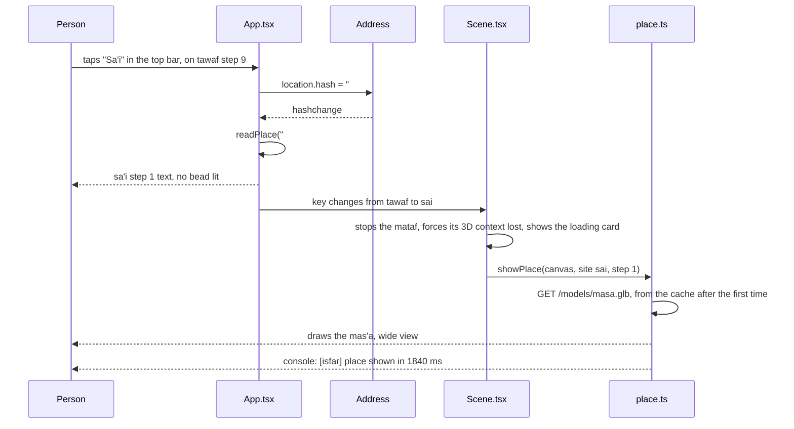

# Sa'i walk

**Version:** v1 · **Status:** Shipped · **Type:** Feature · **Project type:** Web UI

**Shape doc:** docs/specs/virtual-hajj/shape.md
**Depends on:** `tawaf-walk`

The site leads a person through sa'i in 13 steps, in a 3D mas'a, from Safa to the end of walk 7 at Marwah.
Sa'i is the next rite in the real order, and it reuses the guided walk of `tawaf-walk`.

## Problem

The live site teaches tawaf only.
A first-time pilgrim still does not know where Safa and Marwah are, where the green lights start and stop, or how to count seven walks.
An ustaz has nothing to show a class for the second rite of umrah.

## Slice test

| Check                         | Result |
| ----------------------------- | ------ |
| Cuts every layer it needs     | Yes. A rite switch in the top bar, the walk screen for a second rite, the step text files, a new 3D mas'a, its top-view map, the address of each step, CI and the deploy. |
| One e2e test walks it         | Yes. One browser test walks scenarios 1 to 4. Scenario 5 is one measurement on the live site, as in `tawaf-walk`. |
| Worth shipping alone          | Yes. A first-timer walks one whole sa'i and sees where each step happens. An ustaz teaches sa'i from it. |
| Fits (≤5 scenarios, ≤2 areas) | Yes, at the limit. 5 scenarios. Two areas: the walk screen, which gains a second rite, and the 3D place, which gains the mas'a. |

**Path:** full. The slice adds a rite switch, a new 3D place and a new map.

## User story

As a first-time pilgrim, I want the site to lead me through sa'i step by step in the 3D mas'a, so that I know where each step happens and how to count the seven walks before the day.

## Flow



The rite switch or the address opens a sa'i step, the step panel shows its text, and the 3D mas'a or its map shows where the step happens.

## States

The sa'i walk is in one of four parts, and the seven beads follow it.



| Steps | Beads |
| --- | --- |
| 1 to 3 | No bead is lit. |
| 4 to 6 | Bead 1 is the current bead. |
| 7 to 12 | The bead of that walk is the current bead. Each earlier bead is done. |
| 13 | All seven beads are done. |

The 3D place keeps the four states of the skeleton: loading, shown, unsupported and failed.

## Acceptance criteria

```gherkin
Scenario: Aminah walks sa'i from the first step to the last
  Given Aminah's phone is set to Malay, and the screen is 360x800, upright
  And she is on step 1 of the tawaf walk
  When she taps "Sa'i" in the top bar
  Then the address ends with "#sai-1", and "Sa'i · Langkah 1 daripada 13" shows
  And the title is "Mas'a dan bahagiannya"
  And the 3D place shows the mas'a, the hills of Safa and Marwah, and the two green lights
  And no bead is lit, and no "Kembali" button shows
  When she taps "Seterusnya" two times
  Then the address ends with "#sai-3", and the title is "Bukit Safa"
  And the camera is at Safa, and a gold marker stands on the slope of Safa
  When she taps "Seterusnya"
  Then step 4 shows, bead 1 is the current bead, and the path line runs from Safa towards Marwah
  When she taps "Seterusnya" two times
  Then step 6 shows, with the title "Bukit Marwah", and the marker stands on the slope of Marwah
  When she taps "Seterusnya"
  Then step 7 shows, with the title "Perjalanan 2"
  And bead 1 is done, bead 2 is the current bead, and the path line runs from Marwah towards Safa
  When she taps "Seterusnya" six times
  Then step 13 shows, with the title "Sa'i selesai", and all seven beads are done
  And the marker stands at Marwah
  And a "Mula semula" button takes the place of "Seterusnya"
  When she taps "Mula semula"
  Then step 1 of sa'i shows
  And the same holds at 960x540, at 1280x720 and at 1920x1080

Scenario: Ustaz Hafiz opens a sa'i step by its link, and moves between the two rites
  Given Ustaz Hafiz's laptop is set to English, at 1920x1080
  When he opens "https://isfar-57q.pages.dev/#sai-5"
  Then step 5 shows, with the title "Between the green lights", and bead 1 is the current bead
  And the camera is between the two green lights, and "Sa'i" is the chosen rite in the top bar
  When he presses the Right arrow key
  Then step 6 shows
  When he presses the Page Up key
  Then step 5 shows
  When he taps "BM"
  Then step 5 shows in Malay, and the 3D place stays on screen and does not load again
  When he reloads the page
  Then step 5 of sa'i shows in Malay
  When he taps "Tawaf" in the top bar
  Then step 1 of the tawaf walk shows, with the 3D mataf
  When he presses the Back button of the browser
  Then step 5 of sa'i shows, with the 3D mas'a
  And on step 13 the Right arrow key and Page Down do nothing
  And the addresses "#sai-0" and "#sai-99" each open step 1 of sa'i, and "#abc" opens step 1 of tawaf

Scenario: A step shows a recitation and a note on the other schools
  Given Aminah is on step 3, "Bukit Safa", in Malay
  Then the Arabic block shows "إِنَّ الصَّفَا وَالْمَرْوَةَ مِنْ شَعَائِرِ اللَّهِ", and it reads right to left
  And the line "Innas-safa wal-marwata min sha'a'irillah" shows under it
  And the meaning shows in Malay
  When she taps "EN"
  Then the meaning shows in English, and the Arabic and the line under it stay the same
  Given she is on step 5, "Antara lampu hijau", in Malay
  Then the Arabic block shows the doa "Rabbighfir warham"
  And the step text says that men walk quickly here, and women walk at a usual pace
  Given she is on step 2, "Sebelum bermula", in Malay
  Then a closed note "Mazhab lain berbeza di sini" shows under the step text
  When she taps the note
  Then the note opens and shows "Syafi'i, Maliki dan Hanbali: sa'i ialah rukun umrah, dan umrah tidak sah tanpanya. Hanafi: sa'i wajib tetapi bukan rukun. Jika ditinggalkan, umrah sah dan dam dikenakan."
  And step 4, where no school differs, shows no note

Scenario: The sa'i walk still works when the 3D place cannot show
  Given 3D drawing is off in the browser on Aminah's phone
  When she opens "#sai-3" in Malay
  Then the step title "Bukit Safa", the step text, the beads and both notices show
  And a top-view map of the mas'a takes the place of the 3D place
  And the marker on the map is at Safa
  And the message "Peranti ini tidak dapat memaparkan tempat 3D." shows under the step panel
  When she taps "Seterusnya" two times
  Then step 5 shows, and the marker on the map is between the two green lights
  Given 3D drawing is on, and the download of the 3D mas'a fails on step 5
  Then the same map shows, with the message "Tempat 3D tidak dapat dimuatkan." and a "Cuba lagi" button
  When the connection is back and she taps "Cuba lagi"
  Then the page loads again on step 5, and the 3D mas'a shows the camera between the green lights

Scenario: The mas'a runs at old-phone speed
  Given the site is live at "isfar-57q.pages.dev", from a build whose browser test passed in CI
  And a desktop Chrome on a machine with a graphics chip is at 360x800
  And it has an empty cache, a CPU slowed 4 times and the "Fast 4G" network profile
  When the browser opens "#sai-1"
  Then the step text shows before the 3D place
  And the 3D mas'a shows within 5 seconds
  When the test goes from step 1 to step 13, one step each 2 seconds
  Then the 3D place draws 30 frames a second or more, also while the camera moves
```

Rules that hold for each scenario:

- GitHub Actions runs scenarios 1 to 4 on each push, at 360x800, 960x540, 1280x720 and 1920x1080.
- The rite switch shows on each step of both walks and in the tawaf check. It marks the rite on screen. In the check, it marks "Tawaf".
- The camera moves from the spot of one step to the spot of the next. Under reduced motion it cuts, and it does not fly.
- "Seterusnya", the Right arrow key and the Page Down key do the same thing. "Kembali", the Left arrow key and the Page Up key do the same thing.
- Each step change and each rite change adds one entry to the browser history.
- The step text of each step is 40 words or fewer, as the design brief says.
- Both notices of the walk show on each step.
- The 3D download stays under 500 KB compressed (D16), and the site stays hidden from search engines (D14).
- The walk teaches the sa'i of umrah in the Shafi'i school. The text says "for men" where a step is for men only (D23).
- The tawaf walk and the tawaf check do not change, except for the rite switch in the top bar.

### Steps in this slice

Claude drafts the words of each step at pause 2, and the user corrects them there (D24).
A step gets a note only where another school differs. Step 2 has one.

| # | Address | Title, Malay | Title, English | The marker stands | The step also has |
| --- | --- | --- | --- | --- | --- |
| 1 | `#sai-1` | Mas'a dan bahagiannya | The mas'a and its parts | Nowhere. The view is wide. | The names of the parts: Bukit Safa, Bukit Marwah, Lampu hijau |
| 2 | `#sai-2` | Sebelum bermula | Before you start | At the foot of Safa | Sa'i comes after a tawaf. Wuduk is sunat. A note on the ruling of sa'i. |
| 3 | `#sai-3` | Bukit Safa | Safa | On the slope of Safa | Niat. Face the Kaabah, raise the hands and make doa. The recitation "Innas-safa". |
| 4 | `#sai-4` | Ke arah Marwah | Towards Marwah | Between Safa and the first green light | The path line. A usual pace. |
| 5 | `#sai-5` | Antara lampu hijau | Between the green lights | Between the two green lights | Men walk quickly. The recitation "Rabbighfir warham". |
| 6 | `#sai-6` | Bukit Marwah | Marwah | On the slope of Marwah | Walk 1 is done. Face the Kaabah and make doa, as at Safa. |
| 7 | `#sai-7` | Perjalanan 2 | Walk 2 | On the slope of Safa | Marwah back to Safa counts as one walk |
| 8 | `#sai-8` | Perjalanan 3 | Walk 3 | On the slope of Marwah | The green lights again, on each walk |
| 9 | `#sai-9` | Perjalanan 4 | Walk 4 | On the slope of Safa | Doa at each hill |
| 10 | `#sai-10` | Perjalanan 5 | Walk 5 | On the slope of Marwah | What to do when the count is lost |
| 11 | `#sai-11` | Perjalanan 6 | Walk 6 | On the slope of Safa | A rest is allowed. Wuduk is not needed. |
| 12 | `#sai-12` | Perjalanan 7 | Walk 7 | On the slope of Marwah | Sa'i ends at Marwah |
| 13 | `#sai-13` | Sa'i selesai | Sa'i is complete | At Marwah, with a wide view | "Mula semula". Tahallul comes later. |

New words on the controls: "Tawaf" and "Sa'i" on the rite switch, in both languages. The label of the switch for a screen reader, "Ibadah" and "Rite".

## Scope

**In:**

- The 13 steps of the table above, in Malay and English, in the Shafi'i school.
- A rite switch, "Tawaf" and "Sa'i", in the top bar.
- Next and Back, by button, by arrow key and by Page Up and Page Down, as in the tawaf walk.
- The seven beads, which count the walks.
- The step in the address, as `#sai-5`, so a reload and a link keep the step (D30).
- Two recitations in the Arabic block: "Innas-safa" at Safa, and "Rabbighfir warham" between the green lights.
- The note on other schools, closed until the person taps it.
- A 3D mas'a: a long stylised hall, the hills of Safa and Marwah at the two ends, and the two green lights.
- A gold marker at the spot of each step, and a path line with arrows for the walk (D28).
- A camera that moves between the spots, and cuts under reduced motion.
- One top-view map of the mas'a with a marker, for a device that cannot show 3D (D29).
- The speed proof, again, for the mas'a.

**Out:**

| Left out | Picked up by |
| --- | --- |
| A self-check for sa'i | `sai-check`, a new slice after this one (O6) |
| Tahallul | `full-umrah` (O5) |
| The two rakaat, the zamzam, and the way from the mataf to Safa | `full-umrah` |
| The mas'a beside the mataf in one place, so the Kaabah shows from Safa | No slice yet. Rejected on 2026-11-24 (O3). |
| The takbir and tahlil in Arabic at Safa | No slice. Rejected on 2026-11-24 (O4). |
| A button on tawaf step 15 that opens sa'i | No slice. Rejected on 2026-11-24 (O2). `full-umrah` joins the two walks. |
| A pilgrim figure that walks on Next, and a softer look | The /shape pass of D46, for both walks at once (O7) |
| A choice of man or woman, with the text for that person | `pilgrim-choice` (D23) |
| The upper floors, the wheelchair lane and the crowd in the mas'a | No slice. Shape O6. |
| A doa for each walk | No slice. As in `tawaf-walk` (its O6). |
| Sound for the recitations | No slice. Not in the shape. |
| The site listed in search engines | `full-umrah` (D14) |

## Interface

The sa'i walk uses the one walk screen, built only from the kiswah and marble design system in `docs/design/design-system/`.



The rite switch picks the walk, the actions bar sets the step, the step panel shows its words, and the scene shows its place in 3D or on the map.

**What is new on the screen**

| Part | What it shows |
| --- | --- |
| Rite switch | The language switch primitive, a second time: "Tawaf" and "Sa'i", with the rite on screen in gold. It sits beside BM and EN. |
| Header of the step panel | "Sa'i · Langkah 5 daripada 13", and the seven beads. The beads count the walks. For a screen reader: "Perjalanan 2 daripada 7". |
| Scene | The 3D mas'a, or its top-view map. The names "Bukit Safa", "Bukit Marwah" and "Lampu hijau" show for the part in focus. |
| Top-view map | A strip three times as wide as it is high. Safa is on the left and Marwah on the right. Two green bands cross it. The gold path line has arrows towards the hill of that walk. |

Everything else is the tawaf walk as it is: the step panel, the Arabic block, the note, the notices, the cards and the actions bar.
The scene has the same four states as the tawaf walk. The loading card says "Memuatkan mas'a".

**The 3D mas'a, as /build makes it**

| Part | Material |
| --- | --- |
| Floor | Marble, as the mataf floor |
| Walls | The sunken colour, with plain arches along the walls. The hall has no roof (O16). |
| Safa and Marwah | A low mound of rock at each end, in the sunken and edge colours |
| Two green lights | A beam of `--vh-lamp` across the top of the walls, with bands down the walls (O11, O16) |
| Marker and path line | The gold marker and the gold path line of the tawaf walk (D28) |

**Motion tier:** 2, as the tawaf walk (O13). The step text fades in and rises 12 px in 320 ms. The camera flies along the mas'a in about 1 second. Under reduced motion, the text fades in 160 ms, and the camera cuts.

**Components used:** Step panel with its header, Progress beads, Kaabah mark, Language switch (twice), Button and quiet Button, Arabic block, Note, Notice, Scene card (loading and message), and the marble, cloth and kiswah materials.

**New components:** `MasaMap`, the top-view map of the mas'a. It is scene content, as `MatafMap` is, and it uses the map classes and colours that exist.

**Top bar on a phone:** one row with the Kaabah mark, the rite switch and BM and EN. "Isfar" shows from 800 px wide (O9).

**Access:** The rite switch is a group with the label "Ibadah". Each of its buttons says if it is on. The scene carries a text description of each step's view. Each control is 44 px high or more.

**Preview:** `http://localhost:5199/preview/sai-walk.html`, after `pnpm dev --port 5199`. It lists 15 frames, and each frame is a working sa'i screen from the real components. The top-view map stands in for the 3D mas'a.

**Changed in the design system:** `.vh-switch button` in `styles.css` gains side padding (O10). The readme says that `--vh-lamp` lights both rites (O11).

**Built in this pause, for /build to keep:** `src/content/sai.ts`, `src/scene/masa.ts`, the `masa` part of `src/scene/plan.json`, `src/components/MasaMap.tsx`, the rite prop of `src/components/TopBar.tsx`, the new words in `src/content/text.ts`, and the sa'i rules in `src/app.css`.
**For the preview only:** `preview/sai-walk.html` and `src/preview/`. No build ships them.

**Checks:** The static drift check passes on 8 files. The rendered drift check passes on 7 frames, in light and dark. `pnpm typecheck` passes. The `design-taste-frontend` skill is not installed, so its inspector did not run.

### Text of the steps

This is a draft in the Shafi'i school (D24). Its source is `src/content/sai.ts`. The user corrects it here. The longest step has 34 words.

| # | Malay | English |
| --- | --- | --- |
| 1 | **Mas'a dan bahagiannya.** Sa'i ialah tujuh perjalanan antara Bukit Safa dan Bukit Marwah, selepas tawaf. Kenali tiga tempat ini dahulu: Bukit Safa, Bukit Marwah, dan dua lampu hijau di antaranya. | **The mas'a and its parts.** Sa'i is seven walks between the hills of Safa and Marwah, after a tawaf. First learn these three places: Safa, Marwah, and the two green lights between them. |
| 2 | **Sebelum bermula.** Sa'i dilakukan selepas tawaf. Wuduk tidak wajib untuk sa'i, tetapi sunat. Selepas solat sunat tawaf dan minum zamzam, pergi ke Bukit Safa di hujung mas'a. | **Before you start.** Sa'i comes after a tawaf. Wuduk is not required for sa'i, but it is sunat. After the two rakaat and the zamzam, go to Safa at one end of the mas'a. |
| 3 | **Bukit Safa.** Naik sedikit ke Bukit Safa dan berniat sa'i. Hadap ke arah Kaabah, di sebelah masjid, angkat kedua-dua tangan, bertakbir dan berdoa. Pada perjalanan pertama, baca: | **Safa.** Go a little way up Safa and make the niat of sa'i. Face the Kaabah, on the side of the mosque, raise both hands, say takbir and make doa. On the first walk, say: |
| 4 | **Ke arah Marwah.** Turun dari Safa dan berjalan ke arah Marwah seperti biasa. Anda boleh berzikir atau berdoa dalam apa-apa bahasa sepanjang sa'i. | **Towards Marwah.** Come down from Safa and walk towards Marwah at a usual pace. You can make zikir or doa in any language for the whole sa'i. |
| 5 | **Antara lampu hijau.** Di antara dua lampu hijau, lelaki berjalan cepat dengan langkah pendek. Wanita berjalan seperti biasa. Baca doa ini: | **Between the green lights.** Between the two green lights, men walk quickly with short steps. Women walk at a usual pace. Say this doa: |
| 6 | **Bukit Marwah.** Apabila anda sampai di Bukit Marwah, satu perjalanan selesai. Naik sedikit, hadap ke arah Kaabah, dan berdoa seperti di Safa. | **Marwah.** When you reach Marwah, one walk is done. Go a little way up, face the Kaabah, and make doa as at Safa. |
| 7 | **Perjalanan 2.** Dari Marwah, berjalan kembali ke Safa. Perjalanan ini dikira sebagai perjalanan kedua. Lelaki berjalan cepat lagi di antara lampu hijau. | **Walk 2.** From Marwah, walk back to Safa. This counts as the second walk. Men walk quickly again between the green lights. |
| 8 | **Perjalanan 3.** Dari Safa ke Marwah sekali lagi. Pada setiap perjalanan, lelaki berjalan cepat di antara dua lampu hijau, dan semua orang berjalan seperti biasa di bahagian lain. | **Walk 3.** From Safa to Marwah again. On each walk, men walk quickly between the two green lights, and everyone walks at a usual pace elsewhere. |
| 9 | **Perjalanan 4.** Kembali ke Safa. Setiap kali anda sampai di Safa atau Marwah, hadap ke arah Kaabah dan berdoa sebelum meneruskan perjalanan. | **Walk 4.** Back to Safa. Each time you reach Safa or Marwah, face the Kaabah and make doa before you go on. |
| 10 | **Perjalanan 5.** Ke Marwah. Jika anda ragu tentang bilangan perjalanan, ambil bilangan yang lebih sedikit. Contohnya, jika ragu antara lima dan enam, kira sebagai lima. | **Walk 5.** To Marwah. If you are not sure of the count, take the lower number. For example, if you are not sure between five and six, count five. |
| 11 | **Perjalanan 6.** Kembali ke Safa. Jika penat, anda boleh berhenti rehat sebentar dan menyambung semula. Jika wuduk terbatal, sa'i anda tetap sah. | **Walk 6.** Back to Safa. If you are tired, you can stop to rest a little, and then go on. If your wuduk breaks, your sa'i is still valid. |
| 12 | **Perjalanan 7.** Perjalanan terakhir, dari Safa ke Marwah. Sa'i tamat apabila anda sampai di Bukit Marwah. | **Walk 7.** The last walk, from Safa to Marwah. Sa'i ends when you reach Marwah. |
| 13 | **Sa'i selesai.** Anda telah melengkapkan tujuh perjalanan, dan sa'i tamat di Marwah. Selepas ini ialah tahallul: bercukur atau menggunting rambut. Bahagian itu akan datang kemudian. | **Sa'i is complete.** You have completed seven walks, and sa'i ends at Marwah. Next comes tahallul: a shave or a cut of the hair. That part of the site comes later. |

**Recitations**

| Step | Arabic | Sound | Meaning, Malay | Meaning, English |
| --- | --- | --- | --- | --- |
| 3 | إِنَّ الصَّفَا وَالْمَرْوَةَ مِنْ شَعَائِرِ اللَّهِ | Innas-safa wal-marwata min sha'a'irillah | Sesungguhnya Safa dan Marwah ialah sebahagian daripada syiar Allah. | Safa and Marwah are among the signs of Allah. |
| 5 | رَبِّ اغْفِرْ وَارْحَمْ، إِنَّكَ أَنْتَ الْأَعَزُّ الْأَكْرَمُ | Rabbighfir warham, innaka antal a'azzul akram | Wahai Tuhanku, ampunilah dan rahmatilah. Sesungguhnya Engkau Maha Perkasa lagi Maha Pemurah. | My Lord, forgive and have mercy. You are the Most Mighty, the Most Generous. |

**Note on the other schools**

| Step | Malay | English |
| --- | --- | --- |
| 2 | Syafi'i, Maliki dan Hanbali: sa'i ialah rukun umrah, dan umrah tidak sah tanpanya. Hanafi: sa'i wajib tetapi bukan rukun. Jika ditinggalkan, umrah sah dan dam dikenakan. | Shafi'i, Maliki and Hanbali: sa'i is a rukun of umrah, and the umrah is not valid without it. Hanafi: sa'i is required but is not a rukun. If you leave it, the umrah is valid and a dam is due. |

**Other words**

| Part | Malay | English |
| --- | --- | --- |
| Rite switch | Tawaf, Sa'i. For a screen reader: Ibadah. | Tawaf, Sa'i. For a screen reader: Rite. |
| Step count | Sa'i · Langkah 5 daripada 13 | Sa'i · Step 5 of 13 |
| Beads, for a screen reader | Perjalanan 2 daripada 7. Perjalanan belum bermula. Tujuh perjalanan selesai. | Walk 2 of 7. No walk has started. Seven walks are done. |
| Names of the parts | Bukit Safa, Bukit Marwah, Lampu hijau | Safa, Marwah, Green light |
| Map, for a screen reader | Peta mas'a dari atas | Map of the mas'a from above |
| Loading | Memuatkan mas'a | Loading the mas'a |

## Review

2026-11-24 · 7 raw findings, 4 survived, 4 fixed, 1 lead needs validation.

- correctness · `src/scene/masa.ts:56` · on steps 6 to 12 the camera looks towards the next hill, so the path line is in view · `6fdf167`
- correctness · `src/scene/place.ts:115` · the arrows of the walks back towards Safa face up, so they draw · `1823940`
- correctness · `src/lib/step.ts:7` · a sa'i address with no step number opens tawaf step 1 · `09da176`
- coverage · `src/scene/masa.ts:31` · a test for `groundAt`, the height of the marker on the hills · `9acbe78`
- needs validation · `e2e/speed.spec.ts:10` · whether a computer with a graphics chip still holds 30 frames a second in each window when the two speed tests draw at once · on that computer, run `SPEED_URL=https://isfar-57q.pages.dev pnpm e2e:speed`, then the same with `--workers=1`, and compare the "move to step N" rates

## Open items

| ID  | What | Type | Raised at | Owner | Status | Answer |
| --- | ---- | ---- | --------- | ----- | ------ | ------ |
| O1  | How does the sa'i walk show the seven walks? | question | spec p1 | user | Resolved | 13 steps: three before, walk 1 in full, one step for each later walk, one to close. The seven beads count the walks. "Each walk in full" and "one walk, then do six more" were rejected. 2026-11-24 |
| O2  | Until `full-umrah` joins the two walks, how does a person reach sa'i? | question | spec p1 | user | Resolved | A rite switch, "Tawaf" and "Sa'i", in the top bar, and the address `#sai-1`. "A button on tawaf step 15" and "a link only" were rejected. 2026-11-24 |
| O3  | How much does the sa'i 3D place show? | question | spec p1 | user | Resolved | The mas'a alone: a long stylised hall, Safa and Marwah, and the two green lights. The text says where the Kaabah is. "The mas'a beside the mataf in one place" was rejected. 2026-11-24 |
| O4  | Which recitations show in Arabic? | question | spec p1 | user | Resolved | Two: "Innas-safa wal-marwata min sha'a'irillah" at Safa, and "Rabbighfir warham" between the green lights. "Three, with the takbir and tahlil" and "one" were rejected. Pause 2 settles the exact words. 2026-11-24 |
| O5  | Where does the sa'i walk end? | question | spec p1 | user | Resolved | At Marwah, after walk 7, with a last step and "Mula semula". Tahallul stays in `full-umrah`. "A tahallul step" was rejected. 2026-11-24 |
| O6  | Does this slice include a self-check for sa'i? | question | spec p1 | user | Resolved | No. A new slice `sai-check` goes into the shape after `sai-walk`. "In this slice" and "no sa'i check" were rejected. 2026-11-24 |
| O7  | D46 planned a /shape pass after `tawaf-walk` for a pilgrim figure. It has not run. | question | spec p1 | user | Resolved | Spec `sai-walk` now, with the gold marker and the path line. The /shape pass later adds the figure to both walks. "Run the /shape pass first" was rejected. 2026-11-24 |
| O8  | When the person taps the other rite in the top bar, which step opens? | question | spec p1 | user | Resolved | Step 1 of that rite. The Back button of the browser returns to the step the person left. "The last step seen there" was rejected. 2026-11-24 |
| O9  | On a 360 px phone, the top bar is too narrow for the mark, "Isfar", the rite switch and BM and EN in one row. | flag | spec p2 | user | Resolved | A: on a phone, one row with the Kaabah mark, the rite switch and BM and EN. "Isfar" shows from 800 px wide. "The rite switch on a second row" was rejected. 2026-11-24 |
| O10 | The switch buttons have no padding on the sides, so "Tawaf" touches the edge of its button. | flag | spec p2 | user | Resolved | `.vh-switch button` gains `padding-inline: var(--vh-space-3)` in the design system. "Leave it" was rejected. 2026-11-24 |
| O11 | D35 keeps `--vh-lamp` for the green light of the tawaf start only. The sa'i green lights need a green too. | question | spec p2 | user | Resolved | Reuse `--vh-lamp`. D72 supersedes D35: the one green is for the green lights of the place. "A new token" was rejected. 2026-11-24 |
| O12 | O4 named the second recitation "Rabbighfir warham, wa antal a'azzul akram". The form that the books of manasik usually give, from Ibn Mas'ud, says "innaka antal a'azzul akram". I did not check a source. | question | spec p2 | user | Resolved | "Rabbighfir warham, innaka antal a'azzul akram". "wa antal a'azzul akram" was rejected. The user checks it against the course notes with the rest of the text. 2026-11-24 |
| O13 | Which motion tier does the sa'i walk use? | question | spec p2 | user | Resolved | Tier 2, as the tawaf walk. "Tier 1" was rejected. 2026-11-24 |
| O14 | The 3D mas'a holds 30 frames a second at phone speed. The dev machine has no graphics chip, so nothing here can measure it. | unproven | spec p3 | user | Accepted risk | The `/poc` spike could not answer it. Its speed test stopped on this computer's software renderer (SwiftShader), and no computer with a graphics chip is at hand. "Add the number to the spike page and read it on a real phone" was rejected. The cuts stay ready, in order: no antialias on a phone, a pixel ratio of 1.5, fewer arches. The first real proof comes when a person opens the site on a phone. 2026-11-24 |
| O15 | A rite change drops one 3D place and loads the other, with a new 3D context. | flag | spec p3 | user | Resolved | Swap the place: the scene starts again for the new rite, with a short loading card. "Keep both places loaded" was rejected (D77). 2026-11-24 |
| O16 | Pause 2 put the green lights across the ceiling. A camera at about 12 m cannot see under a roof. | question | spec p3 | user | Resolved | No roof. Each green light is a beam across the top of the walls, with bands down them. "A roof, with the camera inside" was rejected (D79). 2026-11-24 |
| O17 | Does the sa'i walk ship behind a feature flag? | question | spec p3 | user | Resolved | No flag. The rollback is the Cloudflare dashboard, or a `git revert`. "A flag in the address" was rejected (D80). 2026-11-24 |
| O18 | The rule "the camera stays inside the ends of the hall" cannot hold for the wide view. With a 40° view, the 120 m hall fits on screen only from about 160 m up, or from behind one of its ends. | flag | build | user | Decided alone | Chose: the wide view of steps 1 and 13 stands 40 m up, 50 m beyond the end behind Safa or Marwah, and looks along the hall. Each view and each move stays above the walls, and each walk view stays inside the ends. Other: a wide view from about 160 m above the middle of the hall, where the hall is a thin strip. Undo: change the wide branch of `saiViewOf` in `src/scene/views.ts` and its test. 2026-11-24 |
| O19 | `e2e/sai.spec.ts` needs `kaabahIsDrawn`, `expectApart` and `modelParts` from `e2e/walk.spec.ts`, which the plan did not name. | flag | build | user | Decided alone | Chose: move the three into `e2e/helpers.ts`, and give `modelParts` the model name. The tawaf tests stay the same. Other: copy them into `e2e/sai.spec.ts`. Undo: move them back into `e2e/walk.spec.ts`. 2026-11-24 |

_Never delete this section or its rows. See references/ledger.md._

## Technical plan

### Approach

The address names the rite and the step, as `#sai-5`. `App.tsx` reads both, picks the sa'i text, and gives the rite and the step to `Scene.tsx`.
`Scene.tsx` starts again on a rite change, and `place.ts` loads the model of that rite: `mataf.glb` or a new `masa.glb`.
A second Blender script builds `masa.glb` from the `masa` part of `plan.json`, the same numbers that the map and the camera read.

Relies on: D5, D13, D16, D18, D19, D20, D28, D29, D30, D31, D40, D43, D44, D64, D65, D66, D71, D72, D75, and the drafted D76 to D80



The address holds the rite and the step, `App.tsx` turns them into words, and `place.ts` draws the model of that rite at the camera of the step.



A rite change goes through the address, the scene starts again for the new rite, and the text shows while the mas'a loads.

No data crosses a trust boundary. The address is the only new input, and `readPlace` accepts only `#tawaf-1` to `#tawaf-15` and `#sai-1` to `#sai-13`.

### Changes

| File | What changes | Why |
| --- | --- | --- |
| `src/lib/step.ts:1-12` | `readStep` becomes `readPlace(hash)`, which gives `{ rite, step }`. `#sai-N` gives sa'i, `#sai-99` gives sa'i step 1, and each other text gives tawaf step 1. `stepHash(rite, step)` writes the address. `CHECK_HASH` and `isCheck` stay. | Scenario 2, D30 |
| `src/App.tsx:19-44` | Holds the rite from `readPlace`. Picks `TAWAF` or `SAI`, `beadsAt` or `saiBeadsAt`, the progress label and the bead words by rite. The check sets the rite to tawaf. | Scenarios 1 and 2 |
| `src/App.tsx:24-26`, `:64-84` | `goTo(step)` writes the address of the rite on screen. On sa'i step 13, the Right arrow key and Page Down do nothing, as on step 15 before the check. | Scenario 2, D31 |
| `src/App.tsx:108` | Passes the `rite` prop to `TopBar`. A tap writes `stepHash(rite, 1)` (D71). | Scenarios 1 and 2, D65 |
| `src/App.tsx:110`, `:142-151` | `<Scene key={rite} rite={rite} …>`. On sa'i step 13, "Mula semula" takes the gold place, with no check button. | Scenario 1, O15 |
| `src/scene/Scene.tsx:10`, `:34-68` | Takes `rite`. Calls `onState("loading")` when it starts, so a swap shows the loading card. Hands `rite` to `showPlace`. Holds the names of the parts of that rite. | Scenarios 2 and 4 |
| `src/scene/Scene.tsx:88-99` | Shows `MasaMap` for sa'i and `MatafMap` for tawaf. The loading card says "Memuatkan mas'a" for sa'i. | Scenario 4 |
| `src/scene/place.ts:21-57` | A `Site` record for each rite: the model path, the colour map, the spots, the camera of a step, the move between two cameras, the name anchors and the path line. `SITES.tawaf` holds what is there now. `SITES.sai` holds the mas'a. | Scenarios 1 and 2, D76 |
| `src/scene/place.ts:65-95` | The path line of the mas'a: dashes along the hall, with arrows towards the hill of the walk. It turns round on each walk. | Scenario 1, D28 |
| `src/scene/place.ts:139-143` | The floor joints stay for tawaf only. The mas'a floor is plain marble. | Scenario 1 |
| `src/scene/place.ts:271-277` | `stop()` also calls `renderer.forceContextLoss()`, so a swap frees the old 3D context at once. | O15 |
| `src/scene/views.ts` | `saiViewOf(step)`: a wide view over the whole hall for steps 1 and 13, and a view from behind and above the marker, towards the next hill, for each other step. `alongHall(from, to, t)` moves the camera on a straight line (D78). `saiNameAnchor(part)` and the name offsets. | Scenarios 1 and 2 |
| `src/scene/masa.ts` | Kept from pause 2. Gains the heights of the names. | Scenario 1 |
| `tools/masa.py` (new) | A Blender script that reads the `masa` part of `plan.json`. It builds the floor, two long walls with arches, a low rock mound at each end, and two green beams across the top of the walls with bands down them (D79). Each mesh has a name, and the file has no materials. | D19, D66, O16 |
| `public/models/masa.glb` (new) | The exported model, committed. | D19 |
| `package.json:19` | `model` runs `tools/mataf.py`, then `tools/masa.py`. | D19 |
| `src/components/TopBar.tsx`, `src/components/MasaMap.tsx`, `src/content/sai.ts`, `src/content/text.ts` | Kept from pause 2. | Scenarios 1 to 4 |
| `e2e/sai.spec.ts` (new) | Scenarios 1 to 4, at four sizes. | Scenarios 1 to 4 |
| `e2e/helpers.ts:15` | `MODEL` becomes `mataf.glb`, and `MASA_MODEL` names `masa.glb`. | Scenario 4 |
| `e2e/speed.spec.ts:23-57` | Runs twice: from `/` through 15 tawaf steps, and from `/#sai-1` through 13 sa'i steps. | Scenario 5 |
| `src/lib/step.test.ts`, `src/content/sai.test.ts` (new), `src/scene/views.test.ts` | Unit tests, listed in the test plan. | Scenarios 1 to 3 |
| `preview/`, `src/preview/` (deleted) | The preview goes when the browser test passes. | Nothing ships it |
| `CHANGELOG.md` | One "Added" line for the sa'i walk. | The repo's rule |

Reusing: `pickLanguage` and `storeLanguage` in `src/lib/language.ts`, `token()` in `src/scene/place.ts:38`, the draw-on-change loop and the name placer in `src/scene/place.ts:163-236`, `canDraw3D` in `src/scene/Scene.tsx:12`, `expectBeads`, `expectCamera`, `lightAt`, `markerAt` and `noWebGL` in `e2e/helpers.ts`, and `scripts/check-size.mjs`, which already counts each file in `dist/models`.

### Earn-it

| Added | Triggered by |
| --- | --- |
| `readPlace` in place of `readStep` | Scenario 2: the address must name the rite as well as the step |
| The `Site` record in `place.ts` | Scenarios 1 and 2: two places with their own model, spots and camera. Two real entries, not a plugin system. |
| `key={rite}` on `Scene` | O15: the simplest swap, with no second scene in memory |
| `forceContextLoss()` in `stop()` | O15: an ustaz who swaps rites often must not run out of 3D contexts |
| `alongHall` | D78: the arc of D45 goes around the Kaabah, and the mas'a has none |
| `tools/masa.py` and `masa.glb` | D19, D76 |
| `e2e/sai.spec.ts` | Scenarios 1 to 4 |

Cut: a router, a state library, a second `Scene` component, one model file for both places, a cache of loaded places, a feature flag.

### Non-functionals

|                      |     |
| -------------------- | --- |
| **Load**             | A few visits a day: the user and a few testers. The site is static files on Cloudflare's network. |
| **Breaks first**     | Nothing at 10 times the visits: the site has no server. The nearest limit is the 500 KB ceiling of D16. Today the 3D download is 165.5 KB, and `masa.glb` should add under 15 KB, as `mataf.glb` is 13.2 KB compressed. `pnpm size` fails the build over the ceiling. |
| **Security surface** | Anyone can open the site. The inputs are the device language, one stored value and the address. `readPlace` accepts only the two step patterns, and the page never writes the address into its HTML. React escapes the step text. No new secret, and the site stores nothing new. |
| **Proof it works**   | The smoke step prints `smoke: https://isfar-57q.pages.dev ok`. On `#sai-1` the console prints `[isfar] place shown in 1840 ms`, and `[isfar] camera at step 5: 54 frames in 900 ms` after each move. No number comes from real visitors (shape O5). |
| **Rollout**          | No flag (O17). The rite switch shows when the PR merges. Rollback: "Rollback to this deployment" on the earlier deployment in the Cloudflare dashboard, or `git revert` and a push. |

### Test plan

| Scenario | Test | Command |
| -------- | ---- | ------- |
| 1. Aminah walks sa'i from the first step to the last | `e2e/sai.spec.ts`, at four sizes. `src/content/sai.test.ts`: 13 steps in each language, the beads of steps 1, 3, 4, 6, 7, 12 and 13. | `pnpm e2e --project=firefox` here, `pnpm e2e --project=chromium` in CI. `pnpm test` |
| 2. Ustaz Hafiz opens a sa'i step by its link, and moves between the rites | `e2e/sai.spec.ts`. `src/lib/step.test.ts`: `#sai-5`, `#sai-13`, `#sai-0`, `#sai-99`, `#sai-05`, `#tawaf-6`, `#abc` and an empty address. | `pnpm e2e --project=firefox`, `pnpm test` |
| 3. A recitation and a note | `e2e/sai.spec.ts`. `src/content/sai.test.ts`: recitations on steps 3 and 5, a note on step 2 only, in each language. | `pnpm e2e --project=firefox`, `pnpm test` |
| 4. The sa'i walk works with no 3D | `e2e/sai.spec.ts`: 3D off, then a failed download of `masa.glb` | `pnpm e2e --project=firefox` |
| 5. The mas'a runs at old-phone speed | `e2e/speed.spec.ts`. Not run: no computer with a graphics chip is at hand (O14). The test stays, for when one is. | `SPEED_URL=https://isfar-57q.pages.dev pnpm e2e:speed` |
| Rule: each step text is 40 words or fewer | `src/content/sai.test.ts` | `pnpm test` |
| Rule: the camera cuts under reduced motion | `e2e/sai.spec.ts`, with reduced motion set in Playwright | `pnpm e2e --project=firefox` |
| Rule: the camera stays above the walls, and each walk view stays inside the ends of the hall (O18) | `src/scene/views.test.ts`: each sa'i view, and 11 points on each move between two neighbour steps | `pnpm test` |
| Rule: the tawaf walk and the check do not change | `e2e/walk.spec.ts` and `e2e/check.spec.ts`, as they are | `pnpm e2e --project=firefox` |
| Rule: the 3D download stays under 500 KB | `scripts/check-size.mjs` | `pnpm build && pnpm size` |

**E2E:** `e2e/sai.spec.ts` walks scenarios 1 to 4. The Playwright setup exists, and CI on `main` is green with it.

The other commands: `pnpm typecheck`, `pnpm model`. Stop the `pnpm dev` server on port 5199 and any `vite preview` server before `pnpm e2e` (lesson `stop-preview-before-e2e`). Prove the 3D half in Firefox here (lesson `local-chromium-loses-3d`).

### Chunks

Single chunk. `App.tsx`, `Scene.tsx` and `place.ts` share one contract, and the one browser test needs all three.

Order inside the chunk:

1. `step.ts` and its test. Then `App.tsx` with the rite, the switch and the keys. `Scene.tsx` shows `MasaMap` for sa'i. Scenarios 2, 3 and the no-3D half of 4 pass.
2. `views.ts` with `saiViewOf` and `alongHall`, and its test.
3. `tools/masa.py` and `masa.glb`. Then the `Site` record in `place.ts`, the swap and `forceContextLoss`.
4. `e2e/sai.spec.ts` in full, then `e2e/speed.spec.ts`. Delete the preview.

### Risks

| Risk | Mitigation |
| ---- | ---------- |
| The mas'a does not hold 30 frames a second at phone speed. | Accepted risk (O14). The rough spike model has 44 arches and is 9.7 KB compressed, and the built mas'a stays at that size or smaller. A slow report from a phone triggers the cuts, in order: no antialias on a phone, a pixel ratio of 1.5, fewer arches. |
| The long hall reads badly in a 360x240 scene on a phone. | The wide view stands high over Safa and looks along the hall. The browser test checks that the three names of step 1 do not overlap at four sizes. |
| A swap leaves a blank scene, or an old frame. | The scene starts again on a new key, and the browser test checks the Kaabah pixel after a swap back to tawaf. |
| The step text has a mistake in a ruling. | The "not yet reviewed" notice stays on each step, and the site stays hidden from search engines (D14). A qualified person reviews it before a public launch (shape O1). |
| A change to `place.ts` breaks the tawaf walk. | `e2e/walk.spec.ts` and `e2e/check.spec.ts` run as they are, at four sizes. |

### Decisions to record

Recorded as D76, D77, D78, D79, D80.

## Decisions

Recorded as D64 to D71 at pause 1, and D72 to D75 at pause 2.

## Glossary

- **Sa'i** — seven walks between the hills of Safa and Marwah, after a tawaf.
- **Safa, Marwah** — the two small hills at the ends of the mas'a. Sa'i starts at Safa and ends at Marwah.
- **Mas'a** — the long hall between Safa and Marwah, where pilgrims do sa'i.
- **Walk** — one trip between the two hills. Safa to Marwah is one walk, and Marwah back to Safa is the next.
- **Green lights** — two bands of green lights on the mas'a ceiling. Men walk quickly between them.
- **Rukun** — a part of a rite without which the rite is not valid.
- **Wajib** — a duty. In the Hanafi school, a missed wajib is made up with a dam.
- **Dam** — a penalty for a missed duty of the pilgrimage, most often the sacrifice of an animal.
- **Sunat** — a good act that is not a duty.
- **Tahallul** — the haircut that ends ihram.
- **Rite switch** — the two buttons "Tawaf" and "Sa'i" in the top bar.
- **Mataf** — the open floor around the Kaabah, where pilgrims do tawaf.
- **Beads** — the seven counter beads of the design system. They show progress.
- **Address** — the text in the browser's address bar. The part after `#` names the step.
- **e2e** — end-to-end: one test that walks the whole slice as a person would.
- **D22, D46** — numbered entries in `DECISIONS.md`, the record of each choice.
