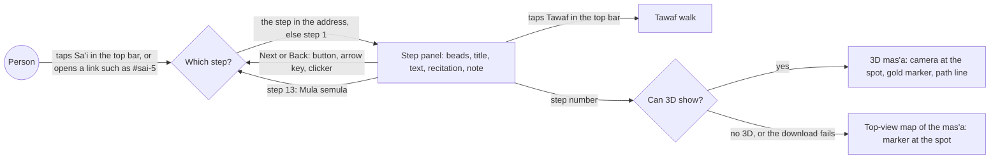
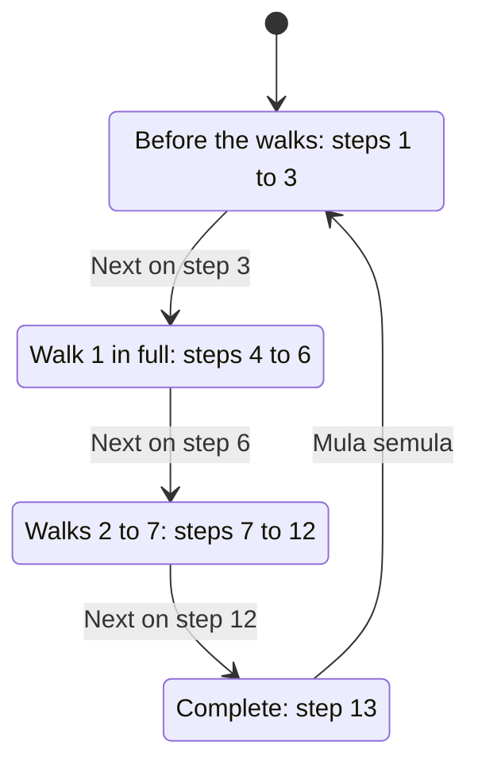

# Sa'i walk

**Version:** v1 · **Status:** Draft · **Type:** Feature · **Project type:** Web UI

**Shape doc:** docs/specs/virtual-hajj/shape.md
**Depends on:** `tawaf-walk`

The site leads a person through sa'i in 13 steps, in a 3D mas'a, from Safa to the end of walk 7 at Marwah.
Sa'i is the next rite in the real order, and it reuses the guided walk of `tawaf-walk`.

## Problem

The live site teaches tawaf only.
A first-time pilgrim still does not know where Safa and Marwah are, where the green lights start and stop, or how to count seven walks.
An ustaz has nothing to show a class for the second rite of umrah.

## Slice test

| Check                         | Result |
| ----------------------------- | ------ |
| Cuts every layer it needs     | Yes. A rite switch in the top bar, the walk screen for a second rite, the step text files, a new 3D mas'a, its top-view map, the address of each step, CI and the deploy. |
| One e2e test walks it         | Yes. One browser test walks scenarios 1 to 4. Scenario 5 is one measurement on the live site, as in `tawaf-walk`. |
| Worth shipping alone          | Yes. A first-timer walks one whole sa'i and sees where each step happens. An ustaz teaches sa'i from it. |
| Fits (≤5 scenarios, ≤2 areas) | Yes, at the limit. 5 scenarios. Two areas: the walk screen, which gains a second rite, and the 3D place, which gains the mas'a. |

**Path:** full. The slice adds a rite switch, a new 3D place and a new map.

## User story

As a first-time pilgrim, I want the site to lead me through sa'i step by step in the 3D mas'a, so that I know where each step happens and how to count the seven walks before the day.

## Flow



The rite switch or the address opens a sa'i step, the step panel shows its text, and the 3D mas'a or its map shows where the step happens.

## States

The sa'i walk is in one of four parts, and the seven beads follow it.



| Steps | Beads |
| --- | --- |
| 1 to 3 | No bead is lit. |
| 4 to 6 | Bead 1 is the current bead. |
| 7 to 12 | The bead of that walk is the current bead. Each earlier bead is done. |
| 13 | All seven beads are done. |

The 3D place keeps the four states of the skeleton: loading, shown, unsupported and failed.

## Acceptance criteria

```gherkin
Scenario: Aminah walks sa'i from the first step to the last
  Given Aminah's phone is set to Malay, and the screen is 360x800, upright
  And she is on step 1 of the tawaf walk
  When she taps "Sa'i" in the top bar
  Then the address ends with "#sai-1", and "Sa'i · Langkah 1 daripada 13" shows
  And the title is "Mas'a dan bahagiannya"
  And the 3D place shows the mas'a, the hills of Safa and Marwah, and the two green lights
  And no bead is lit, and no "Kembali" button shows
  When she taps "Seterusnya" two times
  Then the address ends with "#sai-3", and the title is "Bukit Safa"
  And the camera is at Safa, and a gold marker stands on the slope of Safa
  When she taps "Seterusnya"
  Then step 4 shows, bead 1 is the current bead, and the path line runs from Safa towards Marwah
  When she taps "Seterusnya" two times
  Then step 6 shows, with the title "Bukit Marwah", and the marker stands on the slope of Marwah
  When she taps "Seterusnya"
  Then step 7 shows, with the title "Perjalanan 2"
  And bead 1 is done, bead 2 is the current bead, and the path line runs from Marwah towards Safa
  When she taps "Seterusnya" six times
  Then step 13 shows, with the title "Sa'i selesai", and all seven beads are done
  And the marker stands at Marwah
  And a "Mula semula" button takes the place of "Seterusnya"
  When she taps "Mula semula"
  Then step 1 of sa'i shows
  And the same holds at 960x540, at 1280x720 and at 1920x1080

Scenario: Ustaz Hafiz opens a sa'i step by its link, and moves between the two rites
  Given Ustaz Hafiz's laptop is set to English, at 1920x1080
  When he opens "https://isfar-57q.pages.dev/#sai-5"
  Then step 5 shows, with the title "Between the green lights", and bead 1 is the current bead
  And the camera is between the two green lights, and "Sa'i" is the chosen rite in the top bar
  When he presses the Right arrow key
  Then step 6 shows
  When he presses the Page Up key
  Then step 5 shows
  When he taps "BM"
  Then step 5 shows in Malay, and the 3D place stays on screen and does not load again
  When he reloads the page
  Then step 5 of sa'i shows in Malay
  When he taps "Tawaf" in the top bar
  Then step 1 of the tawaf walk shows, with the 3D mataf
  When he presses the Back button of the browser
  Then step 5 of sa'i shows, with the 3D mas'a
  And on step 13 the Right arrow key and Page Down do nothing
  And the addresses "#sai-0" and "#sai-99" each open step 1 of sa'i, and "#abc" opens step 1 of tawaf

Scenario: A step shows a recitation and a note on the other schools
  Given Aminah is on step 3, "Bukit Safa", in Malay
  Then the Arabic block shows "إِنَّ الصَّفَا وَالْمَرْوَةَ مِنْ شَعَائِرِ اللَّهِ", and it reads right to left
  And the line "Innas-safa wal-marwata min sha'a'irillah" shows under it
  And the meaning shows in Malay
  When she taps "EN"
  Then the meaning shows in English, and the Arabic and the line under it stay the same
  Given she is on step 5, "Antara lampu hijau", in Malay
  Then the Arabic block shows the doa "Rabbighfir warham"
  And the step text says that men walk quickly here, and women walk at a usual pace
  Given she is on step 2, "Sebelum bermula", in Malay
  Then a closed note "Mazhab lain berbeza di sini" shows under the step text
  When she taps the note
  Then the note opens and shows "Syafi'i, Maliki dan Hanbali: sa'i ialah rukun umrah, dan umrah tidak sah tanpanya. Hanafi: sa'i wajib tetapi bukan rukun. Jika ditinggalkan, umrah sah dan dam dikenakan."
  And step 4, where no school differs, shows no note

Scenario: The sa'i walk still works when the 3D place cannot show
  Given 3D drawing is off in the browser on Aminah's phone
  When she opens "#sai-3" in Malay
  Then the step title "Bukit Safa", the step text, the beads and both notices show
  And a top-view map of the mas'a takes the place of the 3D place
  And the marker on the map is at Safa
  And the message "Peranti ini tidak dapat memaparkan tempat 3D." shows under the step panel
  When she taps "Seterusnya" two times
  Then step 5 shows, and the marker on the map is between the two green lights
  Given 3D drawing is on, and the download of the 3D mas'a fails on step 5
  Then the same map shows, with the message "Tempat 3D tidak dapat dimuatkan." and a "Cuba lagi" button
  When the connection is back and she taps "Cuba lagi"
  Then the page loads again on step 5, and the 3D mas'a shows the camera between the green lights

Scenario: The mas'a runs at old-phone speed
  Given the site is live at "isfar-57q.pages.dev", from a build whose browser test passed in CI
  And a desktop Chrome on a machine with a graphics chip is at 360x800
  And it has an empty cache, a CPU slowed 4 times and the "Fast 4G" network profile
  When the browser opens "#sai-1"
  Then the step text shows before the 3D place
  And the 3D mas'a shows within 5 seconds
  When the test goes from step 1 to step 13, one step each 2 seconds
  Then the 3D place draws 30 frames a second or more, also while the camera moves
```

Rules that hold for each scenario:

- GitHub Actions runs scenarios 1 to 4 on each push, at 360x800, 960x540, 1280x720 and 1920x1080.
- The rite switch shows on each step of both walks and in the tawaf check. It marks the rite on screen. In the check, it marks "Tawaf".
- The camera moves from the spot of one step to the spot of the next. Under reduced motion it cuts, and it does not fly.
- "Seterusnya", the Right arrow key and the Page Down key do the same thing. "Kembali", the Left arrow key and the Page Up key do the same thing.
- Each step change and each rite change adds one entry to the browser history.
- The step text of each step is 40 words or fewer, as the design brief says.
- Both notices of the walk show on each step.
- The 3D download stays under 500 KB compressed (D16), and the site stays hidden from search engines (D14).
- The walk teaches the sa'i of umrah in the Shafi'i school. The text says "for men" where a step is for men only (D23).
- The tawaf walk and the tawaf check do not change, except for the rite switch in the top bar.

### Steps in this slice

Claude drafts the words of each step at pause 2, and the user corrects them there (D24).
A step gets a note only where another school differs. Step 2 has one.

| # | Address | Title, Malay | Title, English | The marker stands | The step also has |
| --- | --- | --- | --- | --- | --- |
| 1 | `#sai-1` | Mas'a dan bahagiannya | The mas'a and its parts | Nowhere. The view is wide. | The names of the parts: Bukit Safa, Bukit Marwah, Lampu hijau |
| 2 | `#sai-2` | Sebelum bermula | Before you start | At the foot of Safa | Sa'i comes after a tawaf. Wuduk is sunat. A note on the ruling of sa'i. |
| 3 | `#sai-3` | Bukit Safa | Safa | On the slope of Safa | Niat. Face the Kaabah, raise the hands and make doa. The recitation "Innas-safa". |
| 4 | `#sai-4` | Ke arah Marwah | Towards Marwah | Between Safa and the first green light | The path line. A usual pace. |
| 5 | `#sai-5` | Antara lampu hijau | Between the green lights | Between the two green lights | Men walk quickly. The recitation "Rabbighfir warham". |
| 6 | `#sai-6` | Bukit Marwah | Marwah | On the slope of Marwah | Walk 1 is done. Face the Kaabah and make doa, as at Safa. |
| 7 | `#sai-7` | Perjalanan 2 | Walk 2 | On the slope of Safa | Marwah back to Safa counts as one walk |
| 8 | `#sai-8` | Perjalanan 3 | Walk 3 | On the slope of Marwah | The green lights again, on each walk |
| 9 | `#sai-9` | Perjalanan 4 | Walk 4 | On the slope of Safa | Doa at each hill |
| 10 | `#sai-10` | Perjalanan 5 | Walk 5 | On the slope of Marwah | What to do when the count is lost |
| 11 | `#sai-11` | Perjalanan 6 | Walk 6 | On the slope of Safa | A rest is allowed. Wuduk is not needed. |
| 12 | `#sai-12` | Perjalanan 7 | Walk 7 | On the slope of Marwah | Sa'i ends at Marwah |
| 13 | `#sai-13` | Sa'i selesai | Sa'i is complete | At Marwah, with a wide view | "Mula semula". Tahallul comes later. |

New words on the controls: "Tawaf" and "Sa'i" on the rite switch, in both languages. The label of the switch for a screen reader, "Ibadah" and "Rite".

## Scope

**In:**

- The 13 steps of the table above, in Malay and English, in the Shafi'i school.
- A rite switch, "Tawaf" and "Sa'i", in the top bar.
- Next and Back, by button, by arrow key and by Page Up and Page Down, as in the tawaf walk.
- The seven beads, which count the walks.
- The step in the address, as `#sai-5`, so a reload and a link keep the step (D30).
- Two recitations in the Arabic block: "Innas-safa" at Safa, and "Rabbighfir warham" between the green lights.
- The note on other schools, closed until the person taps it.
- A 3D mas'a: a long stylised hall, the hills of Safa and Marwah at the two ends, and the two green lights.
- A gold marker at the spot of each step, and a path line with arrows for the walk (D28).
- A camera that moves between the spots, and cuts under reduced motion.
- One top-view map of the mas'a with a marker, for a device that cannot show 3D (D29).
- The speed proof, again, for the mas'a.

**Out:**

| Left out | Picked up by |
| --- | --- |
| A self-check for sa'i | `sai-check`, a new slice after this one (O6) |
| Tahallul | `full-umrah` (O5) |
| The two rakaat, the zamzam, and the way from the mataf to Safa | `full-umrah` |
| The mas'a beside the mataf in one place, so the Kaabah shows from Safa | No slice yet. Rejected on 2026-11-24 (O3). |
| The takbir and tahlil in Arabic at Safa | No slice. Rejected on 2026-11-24 (O4). |
| A button on tawaf step 15 that opens sa'i | No slice. Rejected on 2026-11-24 (O2). `full-umrah` joins the two walks. |
| A pilgrim figure that walks on Next, and a softer look | The /shape pass of D46, for both walks at once (O7) |
| A choice of man or woman, with the text for that person | `pilgrim-choice` (D23) |
| The upper floors, the wheelchair lane and the crowd in the mas'a | No slice. Shape O6. |
| A doa for each walk | No slice. As in `tawaf-walk` (its O6). |
| Sound for the recitations | No slice. Not in the shape. |
| The site listed in search engines | `full-umrah` (D14) |

## Open items

| ID  | What | Type | Raised at | Owner | Status | Answer |
| --- | ---- | ---- | --------- | ----- | ------ | ------ |
| O1  | How does the sa'i walk show the seven walks? | question | spec p1 | user | Resolved | 13 steps: three before, walk 1 in full, one step for each later walk, one to close. The seven beads count the walks. "Each walk in full" and "one walk, then do six more" were rejected. 2026-11-24 |
| O2  | Until `full-umrah` joins the two walks, how does a person reach sa'i? | question | spec p1 | user | Resolved | A rite switch, "Tawaf" and "Sa'i", in the top bar, and the address `#sai-1`. "A button on tawaf step 15" and "a link only" were rejected. 2026-11-24 |
| O3  | How much does the sa'i 3D place show? | question | spec p1 | user | Resolved | The mas'a alone: a long stylised hall, Safa and Marwah, and the two green lights. The text says where the Kaabah is. "The mas'a beside the mataf in one place" was rejected. 2026-11-24 |
| O4  | Which recitations show in Arabic? | question | spec p1 | user | Resolved | Two: "Innas-safa wal-marwata min sha'a'irillah" at Safa, and "Rabbighfir warham" between the green lights. "Three, with the takbir and tahlil" and "one" were rejected. Pause 2 settles the exact words. 2026-11-24 |
| O5  | Where does the sa'i walk end? | question | spec p1 | user | Resolved | At Marwah, after walk 7, with a last step and "Mula semula". Tahallul stays in `full-umrah`. "A tahallul step" was rejected. 2026-11-24 |
| O6  | Does this slice include a self-check for sa'i? | question | spec p1 | user | Resolved | No. A new slice `sai-check` goes into the shape after `sai-walk`. "In this slice" and "no sa'i check" were rejected. 2026-11-24 |
| O7  | D46 planned a /shape pass after `tawaf-walk` for a pilgrim figure. It has not run. | question | spec p1 | user | Resolved | Spec `sai-walk` now, with the gold marker and the path line. The /shape pass later adds the figure to both walks. "Run the /shape pass first" was rejected. 2026-11-24 |
| O8  | When the person taps the other rite in the top bar, which step opens? | question | spec p1 | user | Resolved | Step 1 of that rite. The Back button of the browser returns to the step the person left. "The last step seen there" was rejected. 2026-11-24 |

_Never delete this section or its rows. See references/ledger.md._

## Decisions

Recorded as D64 to D71 at pause 1.

## Glossary

- **Sa'i** — seven walks between the hills of Safa and Marwah, after a tawaf.
- **Safa, Marwah** — the two small hills at the ends of the mas'a. Sa'i starts at Safa and ends at Marwah.
- **Mas'a** — the long hall between Safa and Marwah, where pilgrims do sa'i.
- **Walk** — one trip between the two hills. Safa to Marwah is one walk, and Marwah back to Safa is the next.
- **Green lights** — two bands of green lights on the mas'a ceiling. Men walk quickly between them.
- **Rukun** — a part of a rite without which the rite is not valid.
- **Wajib** — a duty. In the Hanafi school, a missed wajib is made up with a dam.
- **Dam** — a penalty for a missed duty of the pilgrimage, most often the sacrifice of an animal.
- **Sunat** — a good act that is not a duty.
- **Tahallul** — the haircut that ends ihram.
- **Rite switch** — the two buttons "Tawaf" and "Sa'i" in the top bar.
- **Mataf** — the open floor around the Kaabah, where pilgrims do tawaf.
- **Beads** — the seven counter beads of the design system. They show progress.
- **Address** — the text in the browser's address bar. The part after `#` names the step.
- **e2e** — end-to-end: one test that walks the whole slice as a person would.
- **D22, D46** — numbered entries in `DECISIONS.md`, the record of each choice.
