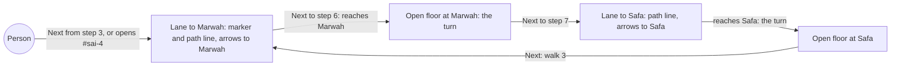
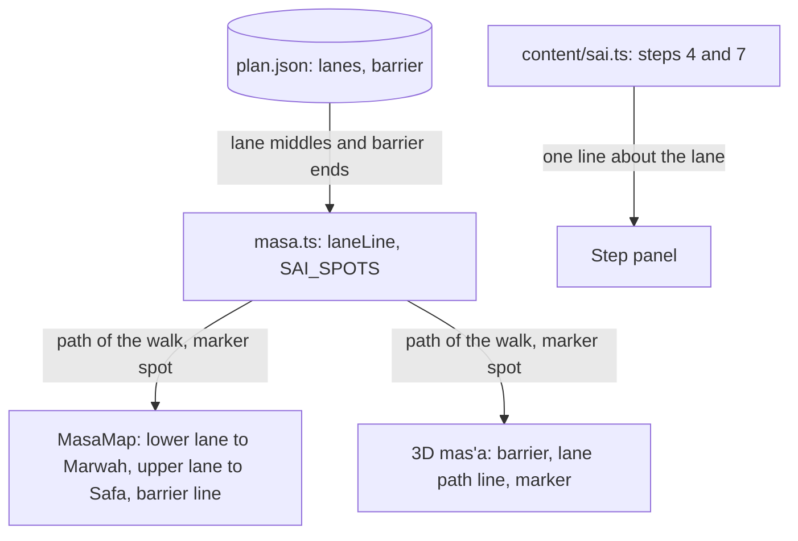
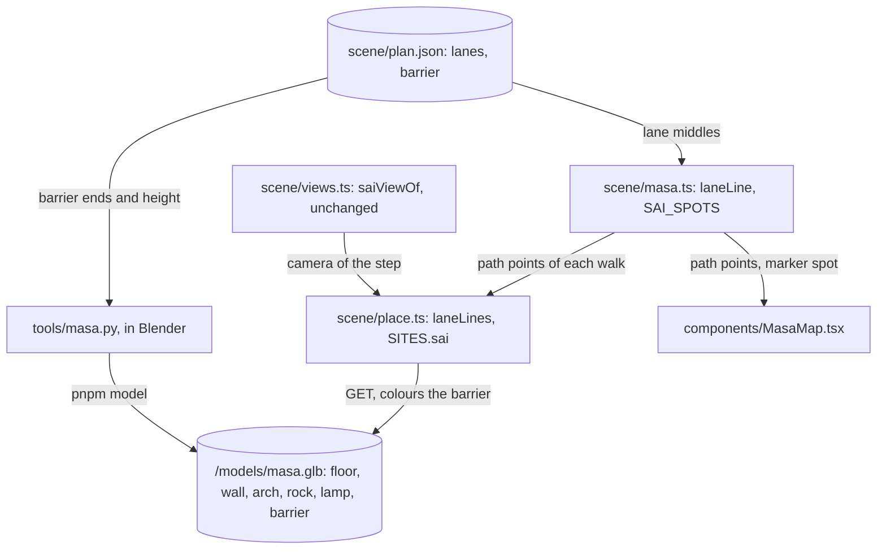
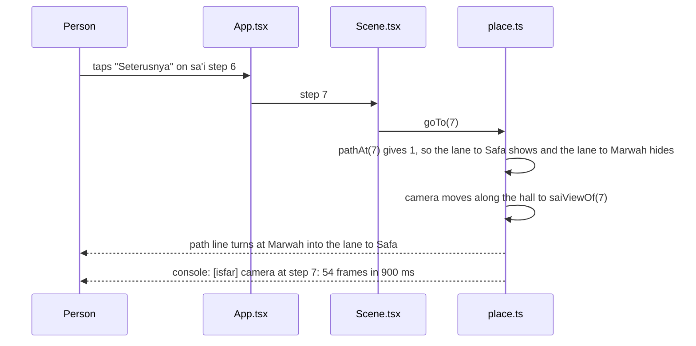

# Sa'i walk

**Version:** v2 · **Status:** Refined · **Type:** Bug · **Project type:** Web UI

**Supersedes:** archive/sai-walk-v1.md
**Shape doc:** docs/specs/virtual-hajj/shape.md
**Depends on:** `tawaf-walk`

The 3D mas'a and its map show the way to Marwah and the way back to Safa as two one-way lanes, as the real mas'a has them.
The live site draws both ways on one middle line, so a first-timer learns the wrong picture of the hall.

## Problem

The shipped mas'a draws one dashed line down the middle of the hall, and each walk uses it in both directions (`src/scene/place.ts:109`).
In the real mas'a, pilgrims go to Marwah in one lane and come back to Safa in another lane, with a barrier between them.
Each walk is still one length of the hall, so the count of seven walks does not change.
Seen from above, the route is a long thin loop: down one lane, a turn at the hill, and back up the other lane.
The user saw the mistake on the live site on 2026-11-24.

## Slice test

| Check                         | Result |
| ----------------------------- | ------ |
| Cuts every layer it needs     | Yes. The plan sizes, the Blender model, the path lines, the marker spots, the camera, the top-view map, the browser test and the deploy. |
| One e2e test walks it         | Yes. `e2e/sai.spec.ts` walks both scenarios, with the v1 scenarios it already walks. |
| Worth shipping alone          | Yes. A first-timer sees the real shape of the mas'a, and knows to keep to the lane of the walk. |
| Fits (≤5 scenarios, ≤2 areas) | Yes. 2 scenarios. One area: the sa'i place, in 3D and on the map. |

**Path:** full. The fix changes the model, the plan, the path lines, the spots, the camera and the map, which is more than three files.

## User story

As a first-time pilgrim, I want the 3D mas'a to show the lane of each walk, so that I know where to walk on the day.

## Flow



Each walk runs in its own lane, and the person turns on the open floor at each hill into the other lane.

## Acceptance criteria

```gherkin
Scenario: Aminah sees that each walk has its own lane
  Given Aminah's phone is set to Malay, and the screen is 360x800, upright
  When she opens "#sai-1"
  Then the 3D mas'a shows two lanes along the hall, with a low barrier between them
  And the barrier stops short of each hill, so the floor at Safa and at Marwah is open across the hall
  And the two green lights cross both lanes
  When she taps "Seterusnya" three times
  Then step 4 shows, and the marker stands in the lane to Marwah, on her right as she faces Marwah
  And the path line runs in that lane, with its arrows towards Marwah
  And the step text tells her to keep to the lane to Marwah
  When she taps "Seterusnya"
  Then step 5 shows, and the marker stands in the lane to Marwah, between the two green lights
  When she taps "Seterusnya"
  Then step 6 shows, and the marker stands on the slope of Marwah
  When she taps "Seterusnya"
  Then step 7 shows, with the title "Perjalanan 2"
  And the path line turns at Marwah into the lane to Safa, and its arrows point towards Safa
  And the step text tells her to turn at Marwah into the lane to Safa
  When she taps "Seterusnya"
  Then step 8 shows, and the path line is in the lane to Marwah again
  And the same holds at 960x540, at 1280x720 and at 1920x1080

Scenario: The top-view map shows the two lanes when the 3D place cannot show
  Given 3D drawing is off in the browser on Aminah's phone
  When she opens "#sai-4" in Malay
  Then the top-view map shows two lanes along the mas'a, with a line between them
  And the marker is in the lane to Marwah, and the path line has arrows towards Marwah
  When she taps "Seterusnya" three times
  Then step 7 shows, and the path line is in the lane to Safa, with arrows towards Safa
```

Rules that hold for each scenario:

- The scenarios of v1 stay as they are (`archive/sai-walk-v1.md`): the walk from step 1 to 13, the link and the rite switch, the recitations and the note, the walk with no 3D, and the speed test.
- The 13 steps, their titles, their text and the recitations stay as v1 has them, except for one new line on steps 4 and 7 (O22). Each step text stays at 40 words or fewer.
- The lane to Marwah is on the right of a person at Safa who faces Marwah (O20).
- The marker stands on the slope of the hill on steps 3, 6 to 12 and 13, as in v1. The slope is open across the hall.
- The camera stays above the walls, and each walk view stays inside the ends of the hall (O18).
- The 3D download stays under 500 KB compressed (D16).
- The tawaf walk and the tawaf check do not change.

## Scope

**In:**

- Two one-way lanes along the mas'a, with a low barrier between them, in the 3D place and on the top-view map.
- Open floor at each hill, where the barrier stops, so the turn shows.
- The path line of each walk in its lane, with a turn at the hill where the walk starts.
- The marker of steps 4 and 5 in the lane to Marwah.
- The camera of each walk step, behind and above the marker, in its lane.
- One line on step 4 and one line on step 7 about the lane, in Malay and English.

**Out:**

| Left out | Picked up by |
| --- | --- |
| The two narrow lanes for the elderly and wheelchairs | No slice (O21) |
| The upper floors and the crowd in the mas'a | No slice. Shape O6. |
| A self-check for sa'i | `sai-check`, the next slice (O6) |
| A pilgrim figure that walks on Next | The /shape pass of D46 (O7) |

## Interface

The walk screen does not change. The scene shows the lanes, in 3D or on the top-view map, and two step texts gain a line.



The plan holds the lanes once, `masa.ts` turns them into the path and the spots, and the map and the 3D place both draw from that.

| Part | What changes |
| --- | --- |
| Top-view map | A barrier line along the middle, stopping short of each hill. The lane to Marwah is the lower lane, and the lane to Safa is the upper lane, as seen from above with Safa on the left. The path line leaves the hill, runs in the lane of the walk and climbs onto the other hill. The arrows sit in that lane. |
| Marker | Steps 4 and 5 stand in the lane to Marwah. The hill steps stay on the slope, in the middle of the open floor. |
| 3D mas'a | The same lanes, barrier and path line, from the same plan numbers. /build makes it. The barrier is 1 m high, in the colour of the walls. |
| Step panel | The new lines of steps 4 and 7, below. The scene description for a screen reader names the lane on steps 4 and 5. |

**Motion tier:** 2, as in v1 (O13). Nothing new moves.

**Components used:** `MasaMap`, Step panel. No new component. `.map__barrier` in `src/app.css` uses `--vh-edge`, as `.map__guide` does.

**Preview:** `http://localhost:5199/preview/sai-walk.html`, after `pnpm dev --port 5199`. It has 9 frames, and each frame is a working sa'i screen. The top-view map stands in for the 3D mas'a.

**Built in this pause, for /build to keep:** the `lanes` and `barrier` parts of `src/scene/plan.json`, `LANES`, `BARRIER` and `laneLine` in `src/scene/masa.ts`, and the spots of steps 4 and 5. Also the lanes in `src/components/MasaMap.tsx`, `.map__barrier` in `src/app.css`, and the text of steps 4 and 7 in `src/content/sai.ts`.
**For the preview only:** `preview/sai-walk.html` and `src/preview/`. No build ships them.

**Checks:** The static drift check passes on 7 files. The rendered drift check passes on steps 4 and 7, in light and dark. `pnpm typecheck` and `pnpm test` pass. The `design-taste-frontend` skill is not installed, so its inspector did not run.

### New text

| Step | Malay | English |
| --- | --- | --- |
| 4 | Turun dari Safa dan berjalan ke arah Marwah seperti biasa. **Ikut lorong ke Marwah, bukan lorong orang yang kembali ke Safa.** Anda boleh berzikir atau berdoa dalam apa-apa bahasa sepanjang sa'i. | Come down from Safa and walk towards Marwah at a usual pace. **Keep to the lane to Marwah, not the lane back to Safa.** You can make zikir or doa in any language for the whole sa'i. |
| 7 | **Di Marwah, pusing masuk ke lorong ke Safa, dan berjalan kembali ke Safa.** Perjalanan ini dikira sebagai perjalanan kedua. Lelaki berjalan cepat lagi di antara lampu hijau. | **At Marwah, turn into the lane to Safa, and walk back to Safa.** This counts as the second walk. Men walk quickly again between the green lights. |

The new words are in bold. The text names no side, so a fix to O20 changes the plan only.

## Open items

| ID  | What | Type | Raised at | Owner | Status | Answer |
| --- | ---- | ---- | --------- | ----- | ------ | ------ |
| O1  | How does the sa'i walk show the seven walks? | question | spec p1 | user | Resolved | 13 steps: three before, walk 1 in full, one step for each later walk, one to close. The seven beads count the walks. "Each walk in full" and "one walk, then do six more" were rejected. 2026-11-24 |
| O2  | Until `full-umrah` joins the two walks, how does a person reach sa'i? | question | spec p1 | user | Resolved | A rite switch, "Tawaf" and "Sa'i", in the top bar, and the address `#sai-1`. "A button on tawaf step 15" and "a link only" were rejected. 2026-11-24 |
| O3  | How much does the sa'i 3D place show? | question | spec p1 | user | Resolved | The mas'a alone: a long stylised hall, Safa and Marwah, and the two green lights. The text says where the Kaabah is. "The mas'a beside the mataf in one place" was rejected. 2026-11-24 |
| O4  | Which recitations show in Arabic? | question | spec p1 | user | Resolved | Two: "Innas-safa wal-marwata min sha'a'irillah" at Safa, and "Rabbighfir warham" between the green lights. "Three, with the takbir and tahlil" and "one" were rejected. Pause 2 settles the exact words. 2026-11-24 |
| O5  | Where does the sa'i walk end? | question | spec p1 | user | Resolved | At Marwah, after walk 7, with a last step and "Mula semula". Tahallul stays in `full-umrah`. "A tahallul step" was rejected. 2026-11-24 |
| O6  | Does this slice include a self-check for sa'i? | question | spec p1 | user | Resolved | No. A new slice `sai-check` goes into the shape after `sai-walk`. "In this slice" and "no sa'i check" were rejected. 2026-11-24 |
| O7  | D46 planned a /shape pass after `tawaf-walk` for a pilgrim figure. It has not run. | question | spec p1 | user | Resolved | Spec `sai-walk` now, with the gold marker and the path line. The /shape pass later adds the figure to both walks. "Run the /shape pass first" was rejected. 2026-11-24 |
| O8  | When the person taps the other rite in the top bar, which step opens? | question | spec p1 | user | Resolved | Step 1 of that rite. The Back button of the browser returns to the step the person left. "The last step seen there" was rejected. 2026-11-24 |
| O9  | On a 360 px phone, the top bar is too narrow for the mark, "Isfar", the rite switch and BM and EN in one row. | flag | spec p2 | user | Resolved | A: on a phone, one row with the Kaabah mark, the rite switch and BM and EN. "Isfar" shows from 800 px wide. "The rite switch on a second row" was rejected. 2026-11-24 |
| O10 | The switch buttons have no padding on the sides, so "Tawaf" touches the edge of its button. | flag | spec p2 | user | Resolved | `.vh-switch button` gains `padding-inline: var(--vh-space-3)` in the design system. "Leave it" was rejected. 2026-11-24 |
| O11 | D35 keeps `--vh-lamp` for the green light of the tawaf start only. The sa'i green lights need a green too. | question | spec p2 | user | Resolved | Reuse `--vh-lamp`. D72 supersedes D35: the one green is for the green lights of the place. "A new token" was rejected. 2026-11-24 |
| O12 | O4 named the second recitation "Rabbighfir warham, wa antal a'azzul akram". The form that the books of manasik usually give, from Ibn Mas'ud, says "innaka antal a'azzul akram". I did not check a source. | question | spec p2 | user | Resolved | "Rabbighfir warham, innaka antal a'azzul akram". "wa antal a'azzul akram" was rejected. The user checks it against the course notes with the rest of the text. 2026-11-24 |
| O13 | Which motion tier does the sa'i walk use? | question | spec p2 | user | Resolved | Tier 2, as the tawaf walk. "Tier 1" was rejected. 2026-11-24 |
| O14 | The 3D mas'a holds 30 frames a second at phone speed. The dev machine has no graphics chip, so nothing here can measure it. | unproven | spec p3 | user | Accepted risk | The `/poc` spike could not answer it. Its speed test stopped on this computer's software renderer (SwiftShader), and no computer with a graphics chip is at hand. "Add the number to the spike page and read it on a real phone" was rejected. The cuts stay ready, in order: no antialias on a phone, a pixel ratio of 1.5, fewer arches. The first real proof comes when a person opens the site on a phone. 2026-11-24 |
| O15 | A rite change drops one 3D place and loads the other, with a new 3D context. | flag | spec p3 | user | Resolved | Swap the place: the scene starts again for the new rite, with a short loading card. "Keep both places loaded" was rejected (D77). 2026-11-24 |
| O16 | Pause 2 put the green lights across the ceiling. A camera at about 12 m cannot see under a roof. | question | spec p3 | user | Resolved | No roof. Each green light is a beam across the top of the walls, with bands down them. "A roof, with the camera inside" was rejected (D79). 2026-11-24 |
| O17 | Does the sa'i walk ship behind a feature flag? | question | spec p3 | user | Resolved | No flag. The rollback is the Cloudflare dashboard, or a `git revert`. "A flag in the address" was rejected (D80). 2026-11-24 |
| O18 | The rule "the camera stays inside the ends of the hall" cannot hold for the wide view. With a 40° view, the 120 m hall fits on screen only from about 160 m up, or from behind one of its ends. | flag | build | user | Decided alone | Chose: the wide view of steps 1 and 13 stands 40 m up, 50 m beyond the end behind Safa or Marwah, and looks along the hall. Each view and each move stays above the walls, and each walk view stays inside the ends. Other: a wide view from about 160 m above the middle of the hall, where the hall is a thin strip. Undo: change the wide branch of `saiViewOf` in `src/scene/views.ts` and its test. 2026-11-24 |
| O19 | `e2e/sai.spec.ts` needs `kaabahIsDrawn`, `expectApart` and `modelParts` from `e2e/walk.spec.ts`, which the plan did not name. | flag | build | user | Decided alone | Chose: move the three into `e2e/helpers.ts`, and give `modelParts` the model name. The tawaf tests stay the same. Other: copy them into `e2e/sai.spec.ts`. Undo: move them back into `e2e/walk.spec.ts`. 2026-11-24 |
| O20 | Which side is the lane to Marwah, for a person at Safa who faces Marwah? The sources I found name the one-way lanes, but not their sides. | question | spec v2 p1 | user | Accepted risk | The right side, as Saudi roads keep right. Nobody has checked it against a source. The user checks it against a photo or the course notes. If it is wrong, swap the side in `plan.json` and rebuild the model. "The left side" was rejected (D82). 2026-11-24 |
| O21 | How many lanes does the mas'a show? The real hall has two main lanes, and two narrow lanes for the elderly and wheelchairs. One source puts the narrow lanes in the centre, and another puts them along the sides. | question | spec v2 p1 | user | Resolved | Two lanes, one for each way, with a low barrier between them. The narrow lanes stay out, with the upper floors. "Four lanes" was rejected (D81). 2026-11-24 |
| O22 | Does the step text tell the person to keep to the lane of the walk? | question | spec v2 p1 | user | Resolved | Yes. One line on step 4, to keep to the lane to Marwah, and one line on step 7, to turn at Marwah into the lane to Safa. The user corrects the words at pause 2 (D24). "Keep the text" was rejected (D83). 2026-11-24 |

_Never delete this section or its rows. See references/ledger.md._

## Technical plan

### Approach

The lanes live once in `plan.json`, as pause 2 put them. `tools/masa.py` reads the barrier from there and adds it to `masa.glb`.
`laneLine` in `masa.ts` gives the path of each walk. The map already draws it, and `place.ts` draws the same points as gold dashes on the 3D floor.
The camera keeps its v1 views. A unit test proves that each walk step still shows 20 m or more of the lane path.

Relies on: D16, D19, D28, D29, D43, D76, D78, D79, D80, D81, D82, D83



The plan feeds the Blender script and `masa.ts`, and the 3D place and the map draw the same lane path from `masa.ts`.



A step change shows the path of that walk's lane, and the camera moves as in v1.

No data crosses a trust boundary. The fix adds no input.

### Changes

| File | What changes | Why |
| --- | --- | --- |
| `tools/masa.py:101` | After the lamps, a `barrier` mesh: one box from `barrier.from` to `barrier.to`, 0.4 m wide and `barrier.height` high, on the middle of the hall. It uses the `box` helper at `tools/masa.py:34`. | Scenario 1, D81 |
| `public/models/masa.glb` | Built again by `pnpm model`. | D19 |
| `src/scene/place.ts:46-61` | `COLOURS` gains `barrier: "--vh-sunken"`, the colour of the walls. | Scenario 1 |
| `src/scene/place.ts:107-120` | `hallLine(way)` becomes `laneLines(towards)`. It draws dashes along each segment of `laneLine(towards)`, with the arrows in the lane, as `pathLine` draws them along the circuit at `src/scene/place.ts:85-105`. `SITES.sai.paths` gives the lane to Marwah, then the lane to Safa, so `pathAt` stays as it is. | Scenario 1 |
| `src/scene/views.test.ts:127-135` | The path test counts the points along `laneLine(spot.towards)`, in place of the middle line. | Scenario 1 |
| `src/scene/masa.test.ts` | `laneLine("marwah")` starts at the foot of Safa, runs at `LANES.toMarwah` between the barrier ends, and ends at the foot of Marwah. `laneLine("safa")` is the same path in reverse, at `LANES.toSafa`. Steps 4 and 5 stand in the lane to Marwah. | Scenario 1 |
| `src/scene/place.test.ts` | The winding test reads `laneLines` for both ways. | Scenario 1 |
| `src/content/sai.test.ts` | Steps 4 and 7 name the lane, in each language. The 40-word test exists. | Scenario 1, D83 |
| `e2e/sai.spec.ts` | The model has a `barrier` part. With no 3D, the marker of step 4 is below the barrier line, and the path of step 4 runs at `LANES.toMarwah`. The path of step 7 runs at `LANES.toSafa`. The v1 checks stay. | Scenarios 1 and 2 |
| `preview/`, `src/preview/` (deleted) | The preview goes when the browser test passes. | Nothing ships it |
| `CHANGELOG.md` | One "Fixed" line. | The repo's rule |

Kept from pause 2: the `lanes` and `barrier` parts of `plan.json`, `LANES`, `BARRIER` and `laneLine` in `masa.ts`, the spots of steps 4 and 5, `MasaMap.tsx`, `.map__barrier` and the text of steps 4 and 7.

Reusing: `floorShapes` in `src/scene/place.ts:71`, the arrow corners of `pathLine`, `box` and `mesh` in `tools/masa.py`, and `markerAt`, `modelParts` and `noWebGL` in `e2e/helpers.ts`. `markerAt` already flips the map's y, as the map now does.

### Earn-it

| Added | Triggered by |
| --- | --- |
| `lanes` and `barrier` in `plan.json` | D43: one set of numbers for the model, the map and the path |
| `laneLine` in `masa.ts` | Scenarios 1 and 2: the map and the 3D place draw the same path |
| The `barrier` mesh | Scenario 1, D81 |

Cut: a curved turn at each hill, a second camera rule for the lanes, the two narrow lanes (O21).

### Non-functionals

|                      |     |
| -------------------- | --- |
| **Load**             | As in v1: a few visits a day, static files on Cloudflare's network. |
| **Breaks first**     | Nothing new. One box adds about 100 bytes to `masa.glb`, which is 10.3 KB compressed today. The 3D download stays near 176 KB, under the 500 KB of D16. `pnpm size` fails the build over the ceiling. |
| **Security surface** | No change. No new input, secret or stored value. |
| **Proof it works**   | On `#sai-7` the live site prints `[isfar] camera at step 7: 54 frames in 900 ms`, and `masa.glb` has a `barrier` part. The path line shows in the lane to Safa. |
| **Rollout**          | No flag (D80). The lanes show when the PR merges. Rollback: "Rollback to this deployment" in the Cloudflare dashboard, or `git revert` and a push. |

### Test plan

| Scenario | Test | Command |
| -------- | ---- | ------- |
| 1. Aminah sees that each walk has its own lane | `e2e/sai.spec.ts` at four sizes: the `barrier` part, and the v1 walk. `src/scene/masa.test.ts`: `laneLine` and the spots. `src/scene/views.test.ts`: 20 m or more of the lane path on each walk step. `src/scene/place.test.ts`: the lane dashes face up. `src/content/sai.test.ts`: the text of steps 4 and 7. | `pnpm e2e --project=firefox` here, `pnpm e2e --project=chromium` in CI. `pnpm test` |
| 2. The map shows the two lanes | `e2e/sai.spec.ts` with 3D off: the marker and the path of steps 4 and 7 | `pnpm e2e --project=firefox` |
| Rule: the v1 scenarios stay | `e2e/sai.spec.ts`, `e2e/walk.spec.ts` and `e2e/check.spec.ts`, as they are | `pnpm e2e --project=firefox` |
| Rule: the 3D download stays under 500 KB | `scripts/check-size.mjs` | `pnpm build && pnpm size` |

**E2E:** `e2e/sai.spec.ts` walks both scenarios with the v1 scenarios.

The other commands: `pnpm typecheck` and `pnpm model`. Stop the `pnpm dev` server on port 5199 before `pnpm e2e` (lesson `stop-preview-before-e2e`). Prove the 3D half in Firefox here (lesson `local-chromium-loses-3d`). Break `laneLine` once and watch the tests fail (lesson `break-the-guarded-code`).

### Chunks

Single chunk. The model, the path line and the tests read the same plan numbers.

Order inside the chunk:

1. `masa.test.ts` and `views.test.ts` for `laneLine`, then `place.ts` with `laneLines` and its winding test.
2. `tools/masa.py` with the barrier, `pnpm model`, and the colour in `place.ts`.
3. `e2e/sai.spec.ts`, then delete the preview.

### Risks

| Risk | Mitigation |
| ---- | ---------- |
| The lane to Marwah is on the wrong side (O20). | Accepted risk. The side is two numbers in `plan.json`, and the text names no side. A swap and `pnpm model` fix it. |
| On the hill steps, the camera at y -6 hides part of the lane to Safa. | The views test counts the lane path on each walk step, at aspect 1 and 1.5. If it fails, the walk view looks at the middle of the lane of the walk. |
| The barrier hides the marker in the 3D place on a phone. | The barrier is 1 m high, and the marker stands in its lane, 5 m from it. The views test keeps the marker on screen. |

### Decisions to record

None. The plan makes no new choice with a rejected option. D81 to D83 cover the choices of this version.

## Decisions

Recorded as D81 to D83 at pause 1.

## Glossary

- **Mas'a** — the long hall between Safa and Marwah, where pilgrims do sa'i.
- **Lane** — one side of the mas'a, for one direction of walk. A barrier separates the two lanes.
- **Walk** — one trip between the two hills. Safa to Marwah is one walk, and Marwah back to Safa is the next.
- **Path line** — the gold dashed line with arrows on the floor, which shows the walk of the step (D28).
- **e2e** — end-to-end: one browser test that walks the whole slice as a person would.
