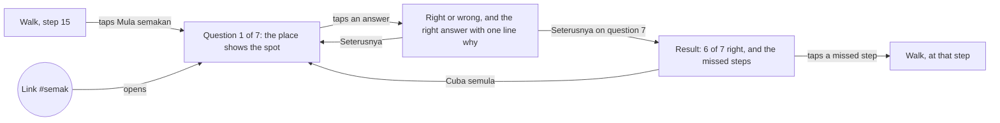
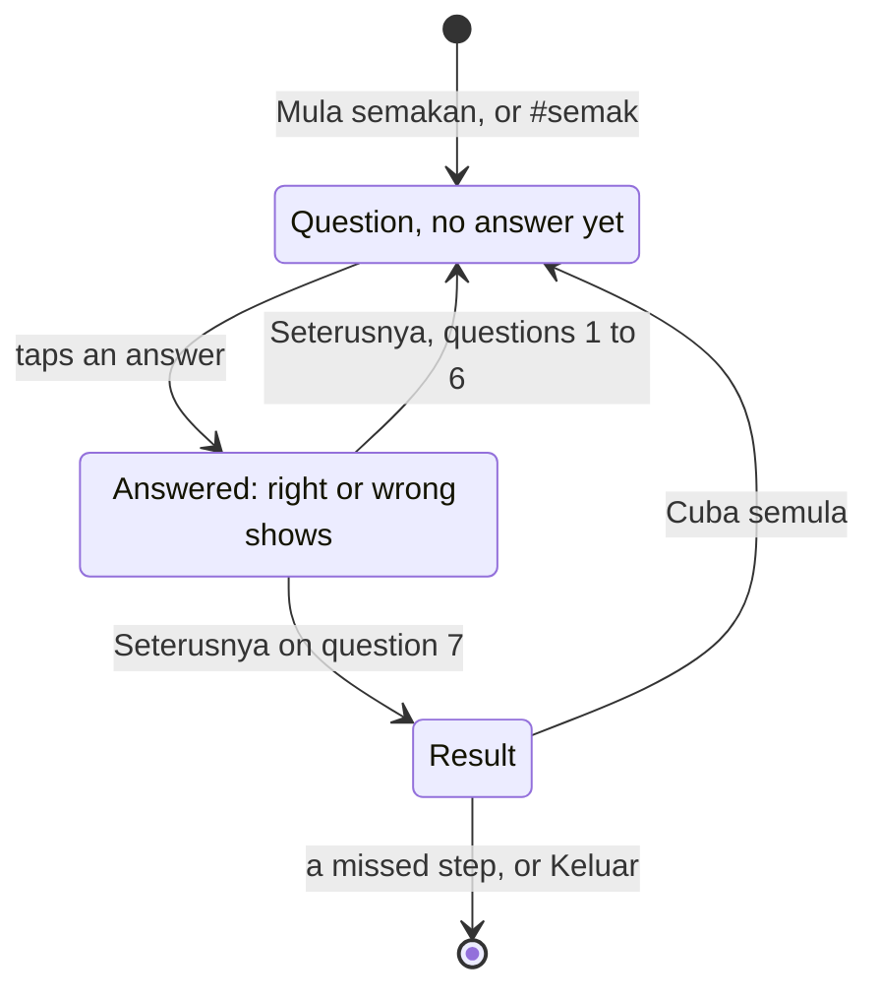
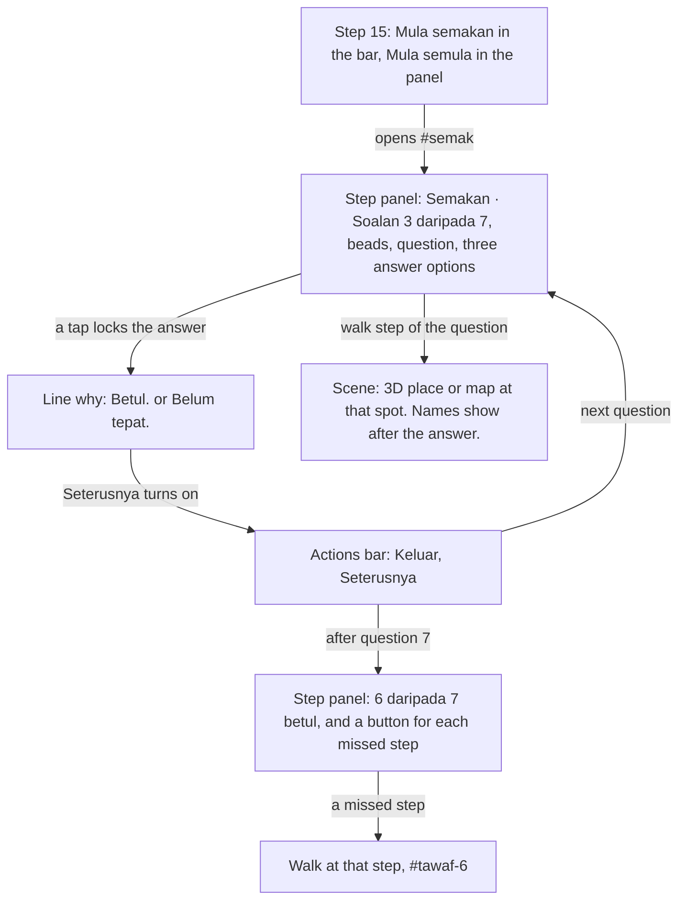

# Tawaf check

**Version:** v1 · **Status:** Draft · **Type:** Feature · **Project type:** Web UI

**Shape doc:** docs/specs/virtual-hajj/shape.md
**Depends on:** `tawaf-walk`

After the tawaf walk, the person answers seven questions on where each step happens and what to do there, and the result shows on screen.
It measures the goal of the shape (shape O12) before we build two more rites.

## Problem

The walk shows each step, but nothing tells the person if they learned it.
A first-timer finishes step 15 and does not know which places or actions they still mix up.
An ustaz has no quick way to check a class after the walk.

## Slice test

| Check                         | Result |
| ----------------------------- | ------ |
| Cuts every layer it needs     | Yes. A button on step 15, the check screen, the question text files, the 3D place or the map at each question, the address, CI and the deploy. |
| One e2e test walks it         | Yes. One browser test goes from step 15 through seven questions to the result, then runs scenarios 2 to 4. |
| Worth shipping alone          | Yes. A first-timer sees which steps they still mix up, and goes back to those steps. An ustaz checks a class from the projector. |
| Fits (≤5 scenarios, ≤2 areas) | Yes. 4 scenarios. Two areas: the check screen and its text. The 3D place and the map are reused with no change to the model. |

**Path:** full. The slice adds a new screen with the answer option and the result, and new text in two languages.

## User story

As a first-time pilgrim, I want to answer where each step of tawaf happens and what I do there, so that I know what I still mix up before the day.

## Flow



The person goes from step 15 or a link to seven questions, sees right or wrong after each answer, and ends on a result that opens the steps they missed.

## States



The answers live only in the open page. A reload starts the check again at question 1 (O7).

## Acceptance criteria

The words of each question are in "Text of the check", under Interface. The user corrects the draft there (O9).

```gherkin
Scenario: Aminah finishes the walk and checks what she learned
  Given Aminah's phone is set to Malay, and the screen is 360x800, upright
  And she is on step 15, "Tawaf selesai"
  Then a "Mula semakan" button takes the place of "Mula semula" in the bar, and "Mula semula" moves into the step panel
  When she taps "Mula semakan"
  Then the address ends with "#semak", and "Semakan · Soalan 1 daripada 7" shows
  And the 3D place shows the gold marker on the guide line at the Hajar Aswad corner
  And no name of a part shows over the place
  And the question "Di mana anda berdiri untuk memulakan tawaf?" shows with three answers, and the "Seterusnya" button is off
  When she taps "Sejajar dengan penjuru Hajar Aswad"
  Then the answer shows as right, with "Betul." and one line why
  And the names "Hajar Aswad" and "Lampu hijau" show over the place
  And the other two answers can no longer be tapped
  And the "Seterusnya" button is on
  When she answers questions 2 to 7, with a wrong answer on question 5 only
  Then the result shows "6 daripada 7 betul"
  And "Langkah 6 · Rukun Yamani" shows under "Ulang kaji langkah ini:"
  When she taps it
  Then step 6 of the walk shows, with the title "Rukun Yamani"
  And the same holds at 960x540, at 1280x720 and at 1920x1080

Scenario: Aminah picks a wrong answer
  Given Aminah is on question 3 of the check, in Malay
  And the question is "Semasa anda berjalan, di sebelah mana Kaabah?"
  When she taps "Di sebelah kanan"
  Then her answer shows as wrong, with a cross and the words "Belum tepat."
  And the right answer "Di sebelah kiri" shows as right
  And one line says why: "Kaabah sentiasa di sebelah kiri anda sepanjang tawaf."
  And the colour is never the only sign: each mark has an icon and words

Scenario: Ustaz Hafiz runs the check for a class on a projector
  Given Ustaz Hafiz's laptop is set to English, at 1920x1080
  When he opens "https://isfar-57q.pages.dev/#semak"
  Then question 1 of 7 shows in English
  When he presses Page Down on his clicker before an answer
  Then question 1 stays on screen
  When he taps the answer that the class calls out
  And he presses Page Down
  Then question 2 shows
  When he taps "BM" after the answer to question 2
  Then question 2 and its answer show in Malay, and the 3D place does not load again
  When he reloads the page
  Then question 1 shows, and no answer is chosen
  When he presses the Back button of the browser at question 1
  Then the page he came from shows

Scenario: The check still works when the 3D place cannot show
  Given 3D drawing is off in the browser on Aminah's phone
  When she opens "#semak" in Malay
  Then the top-view map shows, with the marker at the Hajar Aswad corner
  And the message "Peranti ini tidak dapat memaparkan tempat 3D." shows under the question
  When she answers question 1 and taps "Seterusnya"
  Then the marker on the map moves to the spot of question 2
  And she can finish all seven questions and see the result
```

Rules that hold for each scenario:

- GitHub Actions runs scenarios 1 to 4 on each push, at 360x800, 960x540, 1280x720 and 1920x1080.
- The seven questions come in the order of the walk. Each question has three answers in a fixed order, and one is right (O3, O8).
- An answer cannot change after the tap (O4).
- "Seterusnya", the Right arrow key and Page Down do the same thing, and only after an answer (O6).
- The result shows a plain count and the missed questions. It has no points, stars, badges or confetti (design brief, D46).
- The site keeps nothing about the answers: no storage, no server, no log (shape O5).
- Both notices of the walk show on each question and on the result.
- Each question and each line why is 40 words or fewer, as the design brief says.
- The camera moves to the spot of each question as it moves in the walk, and cuts under reduced motion.

### Questions in this slice

Each question shows the place from the camera of one walk step. The words are in "Text of the check", under Interface.

| # | Shows the place of | Asks | Right answer, in short |
| --- | --- | --- | --- |
| 1 | Step 3, the start | Where you stand | In line with the Hajar Aswad corner |
| 2 | Step 3, the start | What you do before the first circuit | Make the niat, raise a hand to Hajar Aswad and say "Bismillahi, Allahu Akbar" |
| 3 | Step 4 | On which side the Kaabah stays | On your left |
| 4 | Step 5 | Where you walk at Hijr Ismail | Outside its low wall |
| 5 | Step 6 | What you do at Rukun Yamani when it is crowded | Keep walking, and do not push |
| 6 | Step 7 | What you say between the two corners | "Rabbana atina" |
| 7 | Step 14 | When the seventh circuit ends | In line with Hajar Aswad again |

New words on the controls: "Mula semakan" and "Start the check", "Cuba semula" and "Try again", "Keluar" and "Leave", "Betul." and "Yes.", "Belum tepat." and "Not quite.".

## Scope

**In:**

- A "Mula semakan" button on step 15 of the walk.
- The check at the address `#semak`, in Malay and English.
- Seven questions, each with three answers, a mark for right or wrong, and one line why.
- The 3D place, or the map with no 3D, at the spot of each question.
- A result with a plain count, and each missed step with a button that opens it in the walk.
- "Cuba semula" and "Keluar" on the result.
- Next by button, by the Right arrow key and by Page Down, after an answer.

**Out:**

| Left out | Picked up by |
| --- | --- |
| A saved score, a history of attempts, or a score shared with others | No slice. The site keeps nothing (shape O5). |
| Points, stars, badges, streaks or confetti | No slice. The design brief bans them (D46). |
| A question for each of the 15 steps | No slice yet. The result of this slice shows if seven is enough. |
| Questions in a new order on each try, or answers in a new order | No slice yet (O8). |
| A check for sa'i | `sai-walk`, or a later check slice after it |
| A check for the whole umrah | `full-umrah` |
| A pilgrim figure and a softer look | The /shape pass after `tawaf-walk` (D46) |
| A teacher mode that shows the answers of a class | No slice. Shape O3. |
| Sound, and a timer on a question | No slice. Not in the shape. |
| A tap on a spot in the 3D place or on the map as an answer | No slice yet (O1). |

## Interface

The check uses the one walk screen, built only from the kiswah and marble design system in `docs/design/design-system/`.



Step 15 opens the check, each question sets the scene to the spot of its walk step, and a tap locks the answer and turns on Seterusnya.

**Screens**

| Screen | Header | Body | Actions bar |
| --- | --- | --- | --- |
| Step 15 of the walk | "Tawaf · Langkah 15 daripada 15", seven beads done | Title, text, and a quiet "Mula semula" button | "Kembali", and "Mula semakan" in the gold place |
| Question, no answer | "Semakan · Soalan 3 daripada 7". Beads 1 and 2 done, bead 3 current. | The question, three answer options at rest, an empty line why | "Keluar", and "Seterusnya" off |
| Question, answered | The same | The pick shows chosen. The right answer has a tick. A wrong pick has a cross. The line why fills. | "Keluar", and "Seterusnya" on |
| Result | "Semakan · Selesai", seven beads done | "6 daripada 7 betul", then "Ulang kaji langkah ini:" and a quiet button for each missed step. With none missed: "Anda tahu tempat dan amalan setiap langkah." | "Keluar", and "Cuba semula" |

The beads count the questions in the check, as they count the circuits in the walk (O10). "Keluar" goes to step 15 (O13).
Two questions on one step give one button on the result. A missed question 1 and 2 give one "Langkah 3 · Tempat mula".

**States of the scene**

| State | The scene shows | With the step panel |
| --- | --- | --- |
| Loading | The loading card of the walk | Nothing more |
| Shown | The 3D place at the camera of the question's walk step, with its marker and path line. The names hide until the answer (O11). | Nothing more |
| Unsupported | The top-view map, with the marker. The names hide until the answer. | The no-3D message card, under the step panel |
| Failed | The same map | The failed-download card with "Cuba lagi", above the step panel. "Cuba lagi" reloads, and the check starts again (D53). |

**Motion tier:** 2, as in the walk (O15).

| Move | Time | Under reduced motion |
| --- | --- | --- |
| A button or an answer presses down | 160 ms | The same |
| A new question fades in and rises 12 px | 320 ms | It fades in 160 ms and does not rise |
| The camera flies to the spot of the next question | About 1 second, on the arc of D45 | The camera cuts |
| After a tap, the page scrolls the line why into view, clear of the actions bar | The browser's scroll | An instant scroll |

**Components used:** Step panel with its header, Progress beads, Answer option (rest, chosen, right, wrong), Result, Button, quiet Button and Button off, Language switch, Notice, Scene card, and the top-view map of the walk.
The new React parts wrap system classes only: `AnswerOption.tsx` wraps `vh-option`, `CheckQuestion.tsx` wraps `vh-question`, the options and `vh-result`, and `CheckResult.tsx` wraps `vh-title` and quiet buttons.

**Added to the design system:** a `--vh-space-3` padding above and below the text of `.vh-button` and `.vh-option`, in `docs/design/design-system/styles.css`. The min-height of each drops by the same amount, so a one-line control keeps its height (O14).

**Access:** The beads carry "Soalan 3 daripada 7" as text. Each answer is a button with `aria-pressed`, and it carries `aria-disabled` after the answer. The line why is a polite live region that is on the page before the answer, so a screen reader reads it when it fills. The tick and the cross are hidden from a screen reader, and the line says "Betul." or "Belum tepat." in words. Each control is 52 px high or more.

**Preview:** `http://localhost:5199/preview/tawaf-check.html`, after `pnpm dev --port 5199`. It lists 18 frames, and each frame is a working check screen from the real components. The frames show the top-view map, so the page does not open 18 3D views. The link "Open question 1 with the real 3D place" shows the real place. Open it in Firefox on this machine. The names still show in 3D there, because `place.ts` hides them only at /build.

**Built in this pause, for /build to keep:** `src/content/check.ts`, the check words in `src/content/text.ts`, `src/components/AnswerOption.tsx`, `CheckQuestion.tsx`, `CheckResult.tsx`, an optional `title` and `text` in `StepPanel.tsx`, `off` on the Next action of `StepActions.tsx`, `showNames` on `MatafMap.tsx`, and the check rules in `src/app.css`.
**For the preview only:** `preview/tawaf-check.html` and `src/preview/`. No build ships them.

**Checks:** The static drift check passes on 10 files. The rendered drift check passes on 6 screens, in light and dark. `pnpm typecheck` and `pnpm test` pass. The `design-taste-frontend` inspector is not installed, so it did not run.
Named reference: Duolingo, for one question at a time, progress that always shows, and right or wrong just after the tap. The check leaves its points, streaks and mascot. The gap was the line why below the fold on a phone, so the page scrolls it into view after a tap.

### Text of the check

This is a draft in the Shafi'i school (D55). The user corrects it here. The right answer is in bold.

| # | Step | Malay | English |
| --- | --- | --- | --- |
| 1 | 3 | **Di mana anda berdiri untuk memulakan tawaf?** Di hadapan pintu Kaabah · **Sejajar dengan penjuru Hajar Aswad** · Di belakang Maqam Ibrahim. *Why:* Tawaf bermula sejajar dengan penjuru Hajar Aswad. Lampu hijau di dinding masjid menandakan tempatnya. | **Where do you stand to start tawaf?** In front of the door of the Kaabah · **In line with the Hajar Aswad corner** · Behind Maqam Ibrahim. *Why:* Tawaf starts in line with the Hajar Aswad corner. A green light on the mosque wall marks the place. |
| 2 | 3 | **Apa yang anda buat di sini sebelum pusingan pertama?** **Berniat, angkat tangan ke arah Hajar Aswad dan baca “Bismillahi, Allahu Akbar”** · Solat sunat dua rakaat · Minum air zamzam. *Why:* Berniat tawaf, hadap Hajar Aswad, angkat tangan ke arahnya dan baca “Bismillahi, Allahu Akbar”. Solat dua rakaat datang selepas tawaf. | **What do you do here before the first circuit?** **Make the niat, raise a hand towards Hajar Aswad and say “Bismillahi, Allahu Akbar”** · Pray two rakaat · Drink zamzam water. *Why:* Make the niat of tawaf, face Hajar Aswad, raise your hand towards it and say “Bismillahi, Allahu Akbar”. The two rakaat come after tawaf. |
| 3 | 4 | **Semasa anda berjalan, di sebelah mana Kaabah?** Di sebelah kanan · Di hadapan anda · **Di sebelah kiri**. *Why:* Kaabah sentiasa di sebelah kiri anda sepanjang tawaf. | **As you walk, on which side is the Kaabah?** On your right · In front of you · **On your left**. *Why:* The Kaabah stays on your left for the whole tawaf. |
| 4 | 5 | **Di mana anda berjalan di Hijr Ismail?** **Di luar tembok rendahnya** · Di dalam tembok, dekat Kaabah · Di mana-mana yang tidak sesak. *Why:* Kawasan di dalam tembok dikira sebahagian daripada Kaabah, jadi pusingan yang melalui dalamnya tidak dikira. | **Where do you walk at Hijr Ismail?** **Outside its low wall** · Inside the wall, near the Kaabah · Wherever it is less crowded. *Why:* The area inside the wall counts as part of the Kaabah, so a circuit that goes through it does not count. |
| 5 | 6 | **Ini Rukun Yamani, dan kawasannya sesak. Apa yang anda buat?** Tolak perlahan-lahan untuk menyentuhnya · **Teruskan berjalan** · Berhenti dan tunggu sehingga lapang. *Why:* Sentuh Rukun Yamani hanya jika mudah. Jika sesak, teruskan berjalan, dan jangan menolak orang lain. | **This is Rukun Yamani, and it is crowded. What do you do?** Push gently to touch it · **Keep walking** · Stop and wait until there is space. *Why:* Touch Rukun Yamani only if it is easy. If it is crowded, keep walking, and do not push other people. |
| 6 | 7 | **Apa yang anda baca dari Rukun Yamani ke penjuru Hajar Aswad?** Bismillahi, Allahu Akbar · Labbaik Allahumma labbaik · **Rabbana atina fid-dunya hasanah**. *Why:* Antara dua penjuru, baca “Rabbana atina fid-dunya hasanah, wa fil-akhirati hasanah, wa qina 'adhaban-nar”. | **What do you say from Rukun Yamani to the Hajar Aswad corner?** Bismillahi, Allahu Akbar · Labbaik Allahumma labbaik · **Rabbana atina fid-dunya hasanah**. *Why:* Between the two corners, say “Rabbana atina fid-dunya hasanah, wa fil-akhirati hasanah, wa qina 'adhaban-nar”. |
| 7 | 14 | **Bilakah pusingan ketujuh tamat?** **Apabila anda sampai semula sejajar dengan Hajar Aswad** · Apabila anda sampai di Rukun Yamani · Apabila anda sampai di Maqam Ibrahim. *Why:* Pusingan terakhir tamat sejajar dengan Hajar Aswad. Lalui garisan itu sepenuhnya sebelum berhenti. | **When does the seventh circuit end?** **When you are in line with Hajar Aswad again** · When you reach Rukun Yamani · When you reach Maqam Ibrahim. *Why:* The last circuit ends in line with Hajar Aswad. Pass the line fully before you stop. |

**Other words**

| Part | Malay | English |
| --- | --- | --- |
| Step 15 button, leave, try again | Mula semakan, Keluar, Cuba semula | Start the check, Leave, Try again |
| Header | Semakan · Soalan 3 daripada 7. Semakan · Selesai. | Check · Question 3 of 7. Check · Done. |
| Beads, for a screen reader | Soalan 3 daripada 7 | Question 3 of 7 |
| Right, wrong | Betul. Belum tepat. | Yes. Not quite. |
| Result | 6 daripada 7 betul. Ulang kaji langkah ini: Langkah 6 · Rukun Yamani. Anda tahu tempat dan amalan setiap langkah. | 6 of 7 right. Go over these steps: Step 6 · Rukun Yamani. You know the place and the act of each step. |

## Decisions

Recorded as D47 to D55 at pause 1, and D56 to D61 at pause 2.

## Open items

| ID  | What | Type | Raised at | Owner | Status | Answer |
| --- | ---- | -------- | --------- | ----- | ------ | ------ |
| O1  | What form does a question take? | question | spec p1 | user | Resolved | The 3D place, or the map, shows the gold marker at a spot, and the person picks one of three text answers. "Text only" and "tap a spot on the map" were rejected. 2026-11-24 |
| O2  | How many questions does the check have? | question | spec p1 | user | Resolved | Seven. "Five" and "one for each of the 15 steps" were rejected. 2026-11-24 |
| O3  | When does the person see right or wrong? | question | spec p1 | user | Resolved | After each answer, with the right answer marked and one line why. "Only at the end" was rejected. 2026-11-24 |
| O4  | What does the result show? D46 rejected points, and a count of right answers is close to a score. | question | spec p1 | user | Resolved | A plain count, "6 daripada 7 betul", and each missed question with a link to its step. Nothing is kept. "Missed list only" and "a done message only" were rejected. 2026-11-24 |
| O5  | How does the person get to the check? | question | spec p1 | user | Resolved | A "Semak kefahaman" button on step 15, and the address `#semak`. "Step 15 only" and "a button on each step" were rejected. 2026-11-24 |
| O6  | Can the person go on without an answer? A clicker has no way to pick an answer. | question | spec p1 | user | Resolved | No. Next, the Right arrow key and Page Down work only after an answer. "Skip, and count it as missed" was rejected. 2026-11-24 |
| O7  | The answers are not kept (shape O5). What does a reload during the check do? "Cuba lagi" for a failed 3D download also reloads (D20). | question | spec p1 | user | Resolved | The check starts again at question 1. "Keep the question in the address" and "keep the answers on the device" were rejected. 2026-11-24 |
| O8  | Are the order of the questions and the order of the answers fixed, or new on each try? | question | spec p1 | user | Resolved | Both fixed. The right answer is in a different place from question to question. "Answers in a new order" and "both in a new order" were rejected. 2026-11-24 |
| O9  | Who writes the questions, the answers and the line why? D24 covers only the step text. | question | spec p1 | user | Resolved | Claude drafts them from the step text at pause 2, and the user corrects them. "The user writes them" was rejected. 2026-11-24 |
| O10 | The beads count the circuits in the walk. What do they show in the check? | question | spec p2 | user | Resolved | The beads count the questions: the done beads are the answered questions, and the current bead is this question. They show progress, not right or wrong. "A label only" was rejected. 2026-11-24 |
| O11 | The names of the parts can give an answer away, such as "Hajar Aswad" on question 1. When do they show? | question | spec p2 | user | Resolved | The names hide until the answer, then show with the line why. "Never in the check" and "always" were rejected. 2026-11-24 |
| O12 | Step 15 has "Kembali" and "Mula semula" in the bar. Where does the check button go? Two gold buttons on one screen break "one act here". | question | spec p2 | user | Resolved | "Mula semakan" takes the gold place in the bar, and "Mula semula" moves into the step panel as a quiet button. The Right arrow key and Page Down on step 15 open the check. This changes O26 of `tawaf-walk`. "A gold button in the panel" was rejected. 2026-11-24 |
| O13 | What does the left button of the bar do in the check? "Kembali ke tawaf" was too long and wrapped at 360 px. | question | spec p2 | user | Resolved | "Keluar" goes to step 15 and drops the answers. "No left button" and "Kembali to the last question" were rejected. 2026-11-24 |
| O14 | The answer option and the button have no padding above and below the text. A two-line answer, such as question 2, touches the edge. | flag | spec p2 | user | Resolved | Added to the design system: `.vh-button` and `.vh-option` get a `--vh-space-3` padding above and below, and their min-height drops by the same amount. A one-line control keeps its height. "Keep each answer to one line" was rejected. 2026-11-24 |
| O15 | Which motion tier does the check use? | question | spec p2 | user | Resolved | Tier 2, as in the walk. Tier 1 was rejected. 2026-11-24 |
| O16 | Is the draft text of the check right? | question | spec p2 | user | Resolved | Right as drafted. The "not yet reviewed" notice stays, and a qualified person reviews the text before a public launch (shape O1). 2026-11-24 |

_Never delete this section or its rows. See references/ledger.md._

## Glossary

- **Tawaf** — seven circuits on foot around the Kaabah.
- **Self-check** — a short set of questions after the walk. It shows the person what they know, and keeps nothing.
- **Hajar Aswad** — the Black Stone, set in one corner of the Kaabah. Each circuit starts and ends in line with it.
- **Hijr Ismail** — the low curved wall on one side of the Kaabah. The area inside it counts as part of the Kaabah.
- **Rukun Yamani** — the corner of the Kaabah before the Hajar Aswad corner, on the path of the circuit.
- **Niat** — the intention that a person makes before a rite.
- **Ustaz** — a male religious teacher.
- **Presenter clicker** — a small remote for slides. It sends the Page Up and Page Down keys.
- **Address** — the text in the browser's address bar. The part after `#` names the screen.
- **Answer option** — the design system's part for one answer. It shows at rest, chosen, right or wrong.
- **Reduced motion** — a device setting for people who want less movement on screen.
- **e2e** — end-to-end: one test that walks the whole slice as a person would.
- **CI** — a service that runs the tests on each push.
- **D46, D24** — numbered entries in `DECISIONS.md`, the record of each choice.
