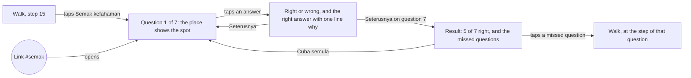
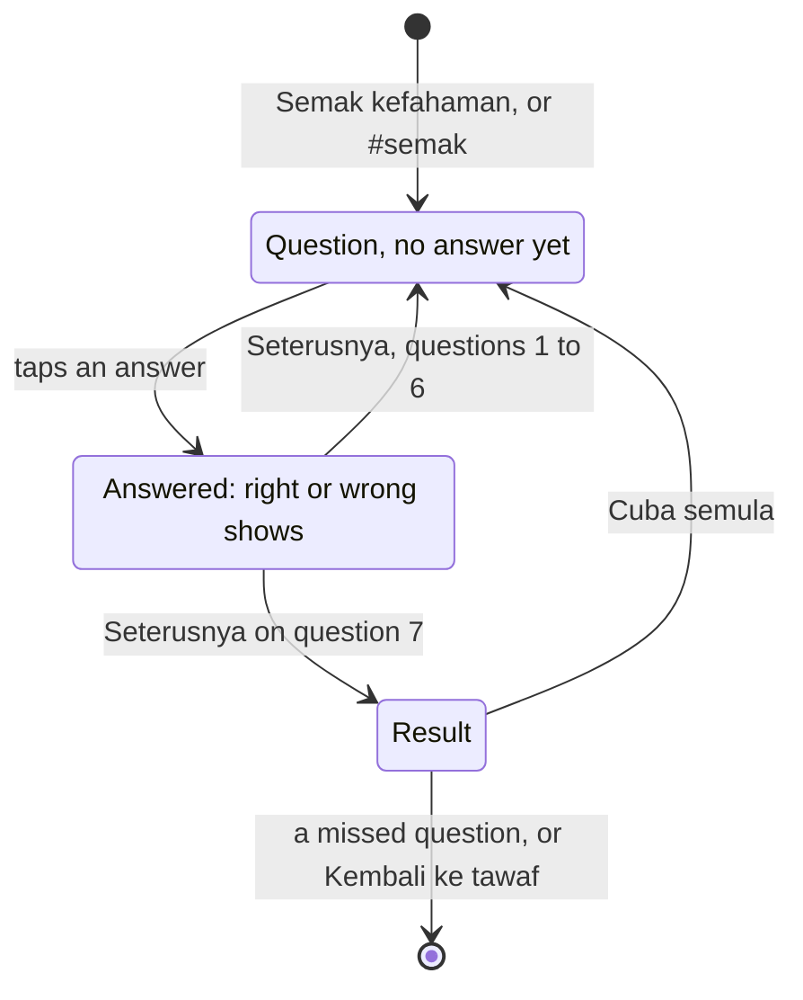

# Tawaf check

**Version:** v1 · **Status:** Draft · **Type:** Feature · **Project type:** Web UI

**Shape doc:** docs/specs/virtual-hajj/shape.md
**Depends on:** `tawaf-walk`

After the tawaf walk, the person answers seven questions on where each step happens and what to do there, and the result shows on screen.
It measures the goal of the shape (shape O12) before we build two more rites.

## Problem

The walk shows each step, but nothing tells the person if they learned it.
A first-timer finishes step 15 and does not know which places or actions they still mix up.
An ustaz has no quick way to check a class after the walk.

## Slice test

| Check                         | Result |
| ----------------------------- | ------ |
| Cuts every layer it needs     | Yes. A button on step 15, the check screen, the question text files, the 3D place or the map at each question, the address, CI and the deploy. |
| One e2e test walks it         | Yes. One browser test goes from step 15 through seven questions to the result, then runs scenarios 2 to 4. |
| Worth shipping alone          | Yes. A first-timer sees which steps they still mix up, and goes back to those steps. An ustaz checks a class from the projector. |
| Fits (≤5 scenarios, ≤2 areas) | Yes. 4 scenarios. Two areas: the check screen and its text. The 3D place and the map are reused with no change to the model. |

**Path:** full. The slice adds a new screen with the answer option and the result, and new text in two languages.

## User story

As a first-time pilgrim, I want to answer where each step of tawaf happens and what I do there, so that I know what I still mix up before the day.

## Flow



The person goes from step 15 or a link to seven questions, sees right or wrong after each answer, and ends on a result that links back to the steps they missed.

## States



The answers live only in the open page. A reload starts the check again at question 1 (O7).

## Acceptance criteria

The words below are a draft. Pause 2 settles the exact words of each question and answer (O9).

```gherkin
Scenario: Aminah finishes the walk and checks what she learned
  Given Aminah's phone is set to Malay, and the screen is 360x800, upright
  And she is on step 15, "Tawaf selesai"
  Then a "Semak kefahaman" button shows beside "Mula semula"
  When she taps "Semak kefahaman"
  Then the address ends with "#semak", and "Semakan · Soalan 1 daripada 7" shows
  And the 3D place shows the gold marker on the guide line at the Hajar Aswad corner
  And the question "Di mana anda berdiri?" shows with three answers, and no "Seterusnya" button
  When she taps "Sejajar dengan penjuru Hajar Aswad"
  Then the answer shows as right, with "Betul." and one line why
  And the other two answers can no longer be tapped
  And a "Seterusnya" button shows
  When she answers questions 2 to 7, with a wrong answer on question 5 only
  Then the result shows "6 daripada 7 betul"
  And question 5, "Rukun Yamani", shows as missed, with a link to "#tawaf-6"
  When she taps that link
  Then step 6 of the walk shows, with the title "Rukun Yamani"
  And the same holds at 960x540, at 1280x720 and at 1920x1080

Scenario: Aminah picks a wrong answer
  Given Aminah is on question 3 of the check, in Malay
  And the question asks on which side the Kaabah stays as she walks
  When she taps "Di sebelah kanan"
  Then her answer shows as wrong, with a cross and the words "Belum tepat."
  And the right answer "Di sebelah kiri" shows as right
  And one line says why: "Kaabah sentiasa di sebelah kiri anda sepanjang tawaf."
  And the colour is never the only sign: each mark has an icon and words

Scenario: Ustaz Hafiz runs the check for a class on a projector
  Given Ustaz Hafiz's laptop is set to English, at 1920x1080
  When he opens "https://isfar-57q.pages.dev/#semak"
  Then question 1 of 7 shows in English
  When he presses Page Down on his clicker before an answer
  Then question 1 stays on screen
  When he taps the answer that the class calls out
  And he presses Page Down
  Then question 2 shows
  When he taps "BM" after the answer to question 2
  Then question 2 and its answer show in Malay, and the 3D place does not load again
  When he reloads the page
  Then question 1 shows, and no answer is chosen
  When he presses the Back button of the browser at question 1
  Then the page he came from shows

Scenario: The check still works when the 3D place cannot show
  Given 3D drawing is off in the browser on Aminah's phone
  When she opens "#semak" in Malay
  Then the top-view map shows, with the marker at the Hajar Aswad corner
  And the message "Peranti ini tidak dapat memaparkan tempat 3D." shows under the question
  When she answers question 1 and taps "Seterusnya"
  Then the marker on the map moves to the spot of question 2
  And she can finish all seven questions and see the result
```

Rules that hold for each scenario:

- GitHub Actions runs scenarios 1 to 4 on each push, at 360x800, 960x540, 1280x720 and 1920x1080.
- The seven questions come in the order of the walk. Each question has three answers in a fixed order, and one is right (O3, O8).
- An answer cannot change after the tap (O4).
- "Seterusnya", the Right arrow key and Page Down do the same thing, and only after an answer (O6).
- The result shows a plain count and the missed questions. It has no points, stars, badges or confetti (design brief, D46).
- The site keeps nothing about the answers: no storage, no server, no log (shape O5).
- Both notices of the walk show on each question and on the result.
- Each question and each line why is 40 words or fewer, as the design brief says.
- The camera moves to the spot of each question as it moves in the walk, and cuts under reduced motion.

### Questions in this slice

Each question shows the place from the camera of one walk step. Pause 2 writes the words, and the user corrects them (O9).

| # | Shows the place of | Asks | Right answer, in short |
| --- | --- | --- | --- |
| 1 | Step 3, the start | Where you stand | In line with the Hajar Aswad corner |
| 2 | Step 3, the start | What you do before the first circuit | Make the niat, raise a hand to Hajar Aswad and say "Bismillahi, Allahu Akbar" |
| 3 | Step 4 | On which side the Kaabah stays | On your left |
| 4 | Step 5 | Where you walk at Hijr Ismail | Outside its low wall |
| 5 | Step 6 | What you do at Rukun Yamani when it is crowded | Keep walking, and do not push |
| 6 | Step 7 | What you say between the two corners | "Rabbana atina" |
| 7 | Step 14 | When the seventh circuit ends | In line with Hajar Aswad again |

New words on the controls: "Semak kefahaman" and "Check what you learned", "Cuba semula" and "Try again", "Kembali ke tawaf" and "Back to tawaf", "Betul." and "Right.", "Belum tepat." and "Not quite.".

## Scope

**In:**

- A "Semak kefahaman" button on step 15 of the walk.
- The check at the address `#semak`, in Malay and English.
- Seven questions, each with three answers, a mark for right or wrong, and one line why.
- The 3D place, or the map with no 3D, at the spot of each question.
- A result with a plain count, and each missed question with a link to its step in the walk.
- "Cuba semula" and "Kembali ke tawaf" on the result.
- Next by button, by the Right arrow key and by Page Down, after an answer.

**Out:**

| Left out | Picked up by |
| --- | --- |
| A saved score, a history of attempts, or a score shared with others | No slice. The site keeps nothing (shape O5). |
| Points, stars, badges, streaks or confetti | No slice. The design brief bans them (D46). |
| A question for each of the 15 steps | No slice yet. The result of this slice shows if seven is enough. |
| Questions in a new order on each try, or answers in a new order | No slice yet (O8). |
| A check for sa'i | `sai-walk`, or a later check slice after it |
| A check for the whole umrah | `full-umrah` |
| A pilgrim figure and a softer look | The /shape pass after `tawaf-walk` (D46) |
| A teacher mode that shows the answers of a class | No slice. Shape O3. |
| Sound, and a timer on a question | No slice. Not in the shape. |
| A tap on a spot in the 3D place or on the map as an answer | No slice yet (O1). |

## Decisions

Recorded as D47 to D55 at pause 1.

## Open items

| ID  | What | Type | Raised at | Owner | Status | Answer |
| --- | ---- | -------- | --------- | ----- | ------ | ------ |
| O1  | What form does a question take? | question | spec p1 | user | Resolved | The 3D place, or the map, shows the gold marker at a spot, and the person picks one of three text answers. "Text only" and "tap a spot on the map" were rejected. 2026-11-24 |
| O2  | How many questions does the check have? | question | spec p1 | user | Resolved | Seven. "Five" and "one for each of the 15 steps" were rejected. 2026-11-24 |
| O3  | When does the person see right or wrong? | question | spec p1 | user | Resolved | After each answer, with the right answer marked and one line why. "Only at the end" was rejected. 2026-11-24 |
| O4  | What does the result show? D46 rejected points, and a count of right answers is close to a score. | question | spec p1 | user | Resolved | A plain count, "6 daripada 7 betul", and each missed question with a link to its step. Nothing is kept. "Missed list only" and "a done message only" were rejected. 2026-11-24 |
| O5  | How does the person get to the check? | question | spec p1 | user | Resolved | A "Semak kefahaman" button on step 15, and the address `#semak`. "Step 15 only" and "a button on each step" were rejected. 2026-11-24 |
| O6  | Can the person go on without an answer? A clicker has no way to pick an answer. | question | spec p1 | user | Resolved | No. Next, the Right arrow key and Page Down work only after an answer. "Skip, and count it as missed" was rejected. 2026-11-24 |
| O7  | The answers are not kept (shape O5). What does a reload during the check do? "Cuba lagi" for a failed 3D download also reloads (D20). | question | spec p1 | user | Resolved | The check starts again at question 1. "Keep the question in the address" and "keep the answers on the device" were rejected. 2026-11-24 |
| O8  | Are the order of the questions and the order of the answers fixed, or new on each try? | question | spec p1 | user | Resolved | Both fixed. The right answer is in a different place from question to question. "Answers in a new order" and "both in a new order" were rejected. 2026-11-24 |
| O9  | Who writes the questions, the answers and the line why? D24 covers only the step text. | question | spec p1 | user | Resolved | Claude drafts them from the step text at pause 2, and the user corrects them. "The user writes them" was rejected. 2026-11-24 |

_Never delete this section or its rows. See references/ledger.md._

## Glossary

- **Tawaf** — seven circuits on foot around the Kaabah.
- **Self-check** — a short set of questions after the walk. It shows the person what they know, and keeps nothing.
- **Hajar Aswad** — the Black Stone, set in one corner of the Kaabah. Each circuit starts and ends in line with it.
- **Hijr Ismail** — the low curved wall on one side of the Kaabah. The area inside it counts as part of the Kaabah.
- **Rukun Yamani** — the corner of the Kaabah before the Hajar Aswad corner, on the path of the circuit.
- **Niat** — the intention that a person makes before a rite.
- **Ustaz** — a male religious teacher.
- **Presenter clicker** — a small remote for slides. It sends the Page Up and Page Down keys.
- **Address** — the text in the browser's address bar. The part after `#` names the screen.
- **Answer option** — the design system's part for one answer. It shows at rest, chosen, right or wrong.
- **Reduced motion** — a device setting for people who want less movement on screen.
- **e2e** — end-to-end: one test that walks the whole slice as a person would.
- **CI** — a service that runs the tests on each push.
- **D46, D24** — numbered entries in `DECISIONS.md`, the record of each choice.
