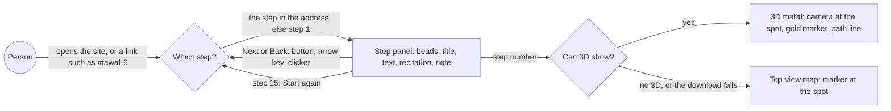
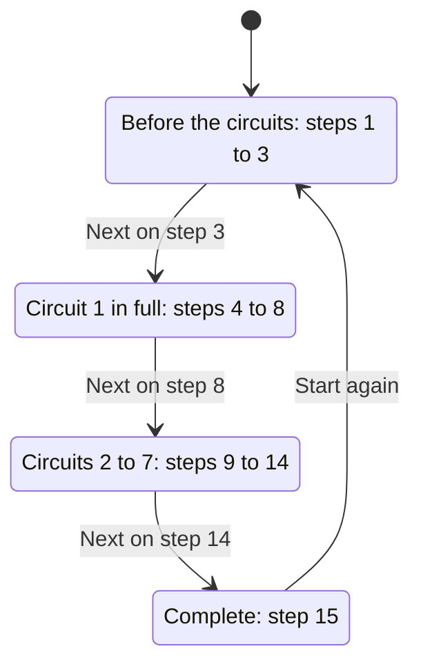

# Tawaf walk

**Version:** v1 · **Status:** Draft · **Type:** Feature · **Project type:** Web UI

**Shape doc:** docs/specs/virtual-hajj/shape.md
**Depends on:** `walking-skeleton`

The site leads a person through tawaf in 15 steps, in a 3D mataf, from the Kaabah and its parts to the end of circuit 7.
The skeleton proved the rails, and tawaf is the smallest piece that removes the pain alone.

## Problem

The live site shows one place and one step of text.
A first-time pilgrim still cannot see where each step of tawaf happens, or in which order.
An ustaz has nothing to show a class beyond one view of the Kaabah.

## Slice test

| Check                         | Result |
| ----------------------------- | ------ |
| Cuts every layer it needs     | Yes. The walk screen, the step text files, the fuller 3D place, the address of each step, CI and the deploy. |
| One e2e test walks it         | Yes. One browser test walks scenarios 1 to 4. Scenario 5 is one measurement on the live site, as in the skeleton. |
| Worth shipping alone          | Yes. A first-timer walks one whole tawaf and sees where each step happens. An ustaz teaches tawaf from it. |
| Fits (≤5 scenarios, ≤2 areas) | Yes, at the limit. 5 scenarios. Two areas: the walk screen and the 3D place. The text of 15 steps is the largest part, and it is data. |

**Path:** full. The slice adds the walk controls, the Arabic block, the note, a fuller model and camera moves.

## User story

As a first-time pilgrim, I want the site to lead me through tawaf step by step in the 3D mataf, so that I know where each step happens and what to do there before the day.

## Flow



The address names the step, the step panel shows its text, and the 3D mataf or the top-view map shows where the step happens.

## States

The walk is in one of four parts, and the seven beads follow it.



| Steps | Beads |
| --- | --- |
| 1 to 3 | No bead is lit. |
| 4 to 8 | Bead 1 is the current bead. |
| 9 to 14 | The bead of that circuit is the current bead. Each earlier bead is done. |
| 15 | All seven beads are done. |

The 3D place keeps the four states of the skeleton: loading, shown, unsupported and failed.

## Acceptance criteria

```gherkin
Scenario: Aminah walks tawaf from the first step to the last
  Given Aminah's phone is set to Malay, and the screen is 360x800, upright
  When she opens the site
  Then step 1 shows, with the title "Kaabah dan bahagiannya"
  And the 3D place shows the Kaabah, Hijr Ismail, Maqam Ibrahim and the ring of arcades
  And no bead is lit, and no "Kembali" button shows
  When she taps "Seterusnya" two times
  Then the address ends with "#tawaf-3", and the title is "Tempat mula"
  And the camera is at the Hajar Aswad corner
  And a gold marker stands on the guide line, and the green light shows on the arcade wall
  When she taps "Seterusnya"
  Then step 4 shows, bead 1 is the current bead, and the path line shows the walk with the Kaabah on her left
  When she taps "Seterusnya" five times
  Then step 9 shows, with the title "Pusingan 2"
  And bead 1 is done, and bead 2 is the current bead
  When she taps "Seterusnya" six times
  Then step 15 shows, with the title "Tawaf selesai", and all seven beads are done
  And a "Mula semula" button takes the place of "Seterusnya"
  When she taps "Mula semula"
  Then step 1 shows
  And the same holds at 960x540, at 1280x720 and at 1920x1080

Scenario: Ustaz Hafiz opens a step by its link, and the step holds
  Given Ustaz Hafiz's laptop is set to English, at 1920x1080
  When he opens "https://isfar-57q.pages.dev/#tawaf-6"
  Then step 6 shows, with the title "Rukun Yamani", and bead 1 is the current bead
  And the camera is at Rukun Yamani
  When he presses the Right arrow key
  Then step 7 shows
  When he presses the Page Up key
  Then step 6 shows
  When he taps "BM"
  Then step 6 shows in Malay, and the 3D place stays on screen and does not load again
  When he reloads the page
  Then step 6 shows in Malay
  When he taps "Seterusnya", and then the Back button of the browser
  Then step 6 shows
  And the addresses "#tawaf-99" and "#abc" each open step 1

Scenario: A step shows a recitation and a note on the other schools
  Given Aminah is on step 7, "Antara dua penjuru", in Malay
  Then the Arabic block shows "رَبَّنَا آتِنَا فِي الدُّنْيَا حَسَنَةً وَفِي الْآخِرَةِ حَسَنَةً وَقِنَا عَذَابَ النَّارِ", and it reads right to left
  And the line "Rabbana atina fid-dunya hasanah, wa fil-akhirati hasanah, wa qina 'adhaban-nar" shows under it
  And the meaning shows in Malay
  When she taps "EN"
  Then the meaning shows in English, and the Arabic and the line under it stay the same
  Given she is on step 2, "Sebelum bermula", in Malay
  Then a closed note "Mazhab lain berbeza di sini" shows under the step text
  When she taps the note
  Then the note opens and says how the Hanafi school differs on wuduk
  And step 5, where no school differs, shows no note

Scenario: The walk still works when the 3D place cannot show
  Given 3D drawing is off in the browser on Aminah's phone
  When she opens "#tawaf-5" in Malay
  Then the step title "Hijr Ismail", the step text, the beads and both notices show
  And a top-view map of the mataf takes the place of the 3D place
  And the marker on the map is outside the wall of Hijr Ismail
  And the message "Peranti ini tidak dapat memaparkan tempat 3D." shows
  When she taps "Seterusnya"
  Then step 6 shows, and the marker on the map is at Rukun Yamani
  Given 3D drawing is on, and the download of the 3D place fails on step 5
  Then the same map shows, with the message "Tempat 3D tidak dapat dimuatkan." and a "Cuba lagi" button
  When the connection is back and she taps "Cuba lagi"
  Then the page loads again on step 5, and the 3D place shows the camera at Hijr Ismail

Scenario: The fuller place runs at old-phone speed
  Given the site is live at "isfar-57q.pages.dev", from a build whose browser test passed in CI
  And a desktop Chrome on a machine with a graphics chip is at 360x800
  And it has an empty cache, a CPU slowed 4 times and the "Fast 4G" network profile
  When the browser opens the site
  Then the step text shows before the 3D place
  And the 3D place shows within 5 seconds
  When the test goes from step 1 to step 15, one step each 2 seconds
  Then the 3D place draws 30 frames a second or more, also while the camera moves
```

Rules that hold for each scenario:

- GitHub Actions runs scenarios 1 to 4 on each push, at 360x800, 960x540, 1280x720 and 1920x1080.
- The camera moves from the spot of one step to the spot of the next. Under reduced motion it cuts, and it does not fly.
- A tap on "Seterusnya" during a camera move shows the next step at once, and the camera goes to the newest step.
- "Seterusnya", the Right arrow key and the Page Down key do the same thing. "Kembali", the Left arrow key and the Page Up key do the same thing.
- Each step change adds one entry to the browser history, so the Back button of the browser goes one step back.
- The step text of each step is 40 words or fewer, as the design brief says.
- Both notices of the skeleton show on each step.
- The 3D download stays under 500 KB compressed (D16), and the site stays hidden from search engines (D14).
- The walk teaches the tawaf of umrah in the Shafi'i school. The text says "for men" where a step is for men only.

### Steps in this slice

I draft the words of each step, and the user corrects them at pause 2 (O5).
A step gets a note only where another school differs, and pause 2 names those steps.

| # | Address | Title, Malay | Title, English | The marker stands | The step also has |
| --- | --- | --- | --- | --- | --- |
| 1 | `#tawaf-1` | Kaabah dan bahagiannya | The Kaabah and its parts | Nowhere. The view is wide. | The names of the parts |
| 2 | `#tawaf-2` | Sebelum bermula | Before you start | At the edge of the mataf | Wuduk, aurat, idtiba' for men. A note. |
| 3 | `#tawaf-3` | Tempat mula | The start | On the guide line, at the Hajar Aswad corner | Niat and istilam. The recitation "Bismillahi, Allahu Akbar". The green light. |
| 4 | `#tawaf-4` | Kaabah di sebelah kiri | The Kaabah on your left | Past the door, near Maqam Ibrahim | The path line. Raml for men. |
| 5 | `#tawaf-5` | Hijr Ismail | Hijr Ismail | Outside the wall of Hijr Ismail | The path goes around the wall. |
| 6 | `#tawaf-6` | Rukun Yamani | Rukun Yamani | At Rukun Yamani | What to do at this corner |
| 7 | `#tawaf-7` | Antara dua penjuru | Between the two corners | Between Rukun Yamani and the Hajar Aswad corner | The recitation "Rabbana atina" |
| 8 | `#tawaf-8` | Satu pusingan selesai | One circuit is done | On the guide line again | Istilam again. Bead 1. |
| 9 | `#tawaf-9` | Pusingan 2 | Circuit 2 | On the guide line | Raml for men |
| 10 | `#tawaf-10` | Pusingan 3 | Circuit 3 | On the guide line | The last circuit with raml |
| 11 | `#tawaf-11` | Pusingan 4 | Circuit 4 | On the guide line | A usual walk from here |
| 12 | `#tawaf-12` | Pusingan 5 | Circuit 5 | On the guide line | What to do when the count is lost |
| 13 | `#tawaf-13` | Pusingan 6 | Circuit 6 | On the guide line | What to do when wuduk breaks |
| 14 | `#tawaf-14` | Pusingan 7 | Circuit 7 | On the guide line | Where the last circuit ends |
| 15 | `#tawaf-15` | Tawaf selesai | Tawaf is complete | Nowhere. The view is wide. | "Mula semula" |

New words on the controls: "Seterusnya" and "Next", "Kembali" and "Back", "Mula semula" and "Start again", "Mazhab lain berbeza di sini" and "Other schools differ here".

## Scope

**In:**

- The 15 steps of the table above, in Malay and English, in the Shafi'i school.
- Next and Back, by button, by arrow key and by Page Up and Page Down.
- The seven beads, which count the circuits.
- The step in the address, so a reload and a link keep the step.
- Two recitations in the Arabic block: Arabic, transliteration and meaning.
- The note on other schools, closed until the person taps it.
- A fuller 3D place: the Kaabah with the Hajar Aswad corner, the door, Hijr Ismail, Rukun Yamani and Maqam Ibrahim, the mataf, and a simple ring of arcades with the green light.
- A guide line on the floor at the start. The step text says that the real floor has no line.
- A gold marker at the spot of each step, and a path line with arrows for the circuit.
- A camera that moves between the spots, and cuts under reduced motion.
- One top-view map with a marker, for a device that cannot show 3D.
- The speed proof of the skeleton, again, for the fuller place.

**Out:**

| Left out | Picked up by |
| --- | --- |
| The two rakaat behind Maqam Ibrahim, and the zamzam | `full-umrah` |
| A choice of man or woman, with the text for that person | `pilgrim-choice`, a new slice after `full-umrah` (O4) |
| A pilgrim figure in the 3D place | No slice. Rejected on 2026-11-23 (O9). `pilgrim-choice` can ask again. |
| The niat in Arabic, and a doa for each circuit | No slice. Rejected on 2026-11-23 (O6). |
| Sound for the recitations | No slice. Not in the shape. |
| The self-check | `tawaf-check` |
| Sa'i | `sai-walk` |
| A tap on a bead to jump to a circuit, and a list of steps | No slice. A link opens a step. |
| A swipe to change the step | No slice. Not in the shape. |
| A drag to look around | No slice. D2 leads the person. |
| Minarets and the upper floors in the model | No slice. Rejected on 2026-11-23 (O8). |
| A drawn picture for each step, for a device with no 3D | No slice. Rejected on 2026-11-23 (O10). |
| The other kinds of tawaf: qudum, ifadah, wada' and sunat | The hajj shape (shape O7) |
| A crowd in the mataf | No slice. Shape O6. |
| The site listed in search engines | `full-umrah` (D14) |
| A test on a real 5-year-old Android | No slice. Accepted risk in the skeleton (O9 there). |

## Decisions

### Decisions to record

Recorded as D22, D23, D24, D25, D26, D27, D28, D29, D30 and D31.

## Open items

| ID  | What | Type | Raised at | Owner | Status | Answer |
| --- | ---- | ---- | --------- | ----- | ------ | ------ |
| O1  | How does the walk show the seven circuits? | question | spec p1 | user | Resolved | Circuit 1 in full, then one step for each later circuit. The seven beads count the circuits. "One circuit, then repeat" and "each circuit in full" were rejected. 2026-11-23 |
| O2  | Where does the tawaf walk end? | question | spec p1 | user | Resolved | At the end of circuit 7, with a last step and "Start again". The two rakaat and the zamzam go to `full-umrah`. 2026-11-23 |
| O3  | What does the walk show before the first circuit? | question | spec p1 | user | Resolved | Three steps: the place, get ready, the start. "Start only" was rejected. 2026-11-23 |
| O4  | Idtiba' and raml are for men only. How does the walk handle men and women? | question | spec p1 | user | Resolved | In the text: the step says "for men". The user asked for a later slice where the person chooses a man or a woman. It is `pilgrim-choice`, after `full-umrah`. 2026-11-23 |
| O5  | Who writes the step text? Shape O1 says the user writes it from course notes. | question | spec p1 | user | Resolved | Claude drafts each step in the Shafi'i school, and the user corrects it at pause 2. "Notes first" and "the user writes it" were rejected. 2026-11-23 |
| O6  | Which recitations show in Arabic? | question | spec p1 | user | Resolved | Two: "Bismillahi, Allahu Akbar" and "Rabbana atina". The niat in Arabic and a doa for each circuit were rejected. Pause 2 settles the exact words. 2026-11-23 |
| O7  | The real mataf has no floor line today. How does the 3D place show the start? | question | spec p1 | user | Resolved | The green light on the wall, and a guide line on the floor. The text says that the real floor has no line. 2026-11-23 |
| O8  | How much of the mosque does the 3D place show? | question | spec p1 | user | Resolved | The Kaabah with its parts, the mataf and a simple ring of arcades. "Mataf only" and "with minarets" were rejected. 2026-11-23 |
| O9  | How does the 3D place show where the person stands and walks? | question | spec p1 | user | Resolved | A gold marker at the spot, and a path line with arrows. A pilgrim figure and a view through the pilgrim's eyes were rejected. 2026-11-23 |
| O10 | Which still picture does each step get when 3D cannot show? | question | spec p1 | user | Resolved | One top-view map of the mataf, with a marker at the spot of the step. A picture for each step and one picture for all were rejected. 2026-11-23 |
| O11 | D20 says the walk must keep its step across a reload. Where does the step live? | question | spec p1 | user | Resolved | In the address, as `#tawaf-6`. "On the device" was rejected. 2026-11-23 |
| O12 | Do the keyboard and a presenter clicker move the walk? | question | spec p1 | user | Resolved | Yes. Right arrow and Page Down go on. Left arrow and Page Up go back. 2026-11-23 |
| O13 | Where does the slice `pilgrim-choice` go in the shape's order? | question | spec p1 | user | Resolved | After `full-umrah`, as slice 5. "After `tawaf-walk`" was rejected. 2026-11-23 |

_Never delete this section or its rows. See references/ledger.md._

## Glossary

- **Tawaf** — seven circuits on foot around the Kaabah.
- **Circuit** — one full walk around the Kaabah, from the Hajar Aswad corner back to it.
- **Mataf** — the open marble floor around the Kaabah, where pilgrims do tawaf.
- **Hajar Aswad** — the Black Stone, set in one corner of the Kaabah. Each circuit starts and ends in line with it.
- **Hijr Ismail** — the low curved wall on one side of the Kaabah. The area inside it counts as part of the Kaabah.
- **Rukun Yamani** — the corner of the Kaabah before the Hajar Aswad corner, on the path of the circuit.
- **Maqam Ibrahim** — the small glass and metal case near the door of the Kaabah.
- **Arcades** — the rows of arches around the mataf.
- **Istilam** — the greeting of the Hajar Aswad: a touch, a kiss, or a raised hand from far.
- **Niat** — the intention that a person makes before a rite.
- **Wuduk** — the wash before prayer. The Shafi'i school needs it for tawaf.
- **Aurat** — the parts of the body that a person must cover.
- **Idtiba'** — the way a man wears the ihram cloth in tawaf, with the right shoulder bare.
- **Raml** — a brisk walk with short steps, which men do in the first three circuits.
- **Rakaat** — one unit of prayer.
- **Zamzam** — the water of the well in Masjidil Haram.
- **Doa** — a prayer of request.
- **Mazhab, school** — a school of Islamic rulings. The four are Shafi'i, Hanafi, Maliki and Hanbali.
- **Ustaz** — a male religious teacher.
- **Umrah** — the shorter pilgrimage to Makkah, done at any time of year.
- **Transliteration** — Arabic words written in Latin letters.
- **Beads** — the seven counter beads of the design system. They show progress.
- **Arabic block** — the design system's part for a recitation: Arabic, transliteration and meaning.
- **Note** — the design system's part for "other schools differ here". It opens on a tap.
- **Address** — the text in the browser's address bar. The part after `#` names the step.
- **Presenter clicker** — a small remote for slides. It sends the Page Up and Page Down keys.
- **Reduced motion** — a device setting for people who want less movement on screen.
- **e2e** — end-to-end: one test that walks the whole slice as a person would.
- **Browser test** — a test that opens the real site in a browser and uses it like a person.
- **CI** — a service that runs the tests on each push.
- **Graphics chip** — the part of a computer that draws 3D fast. The dev machine has none.
- **Fast 4G** — a network profile in Chrome that limits the speed to about 9 Mbps.
- **D22, D14** — numbered entries in `DECISIONS.md`, the record of each choice.
