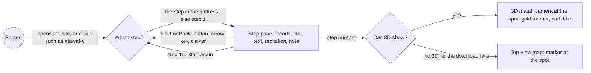
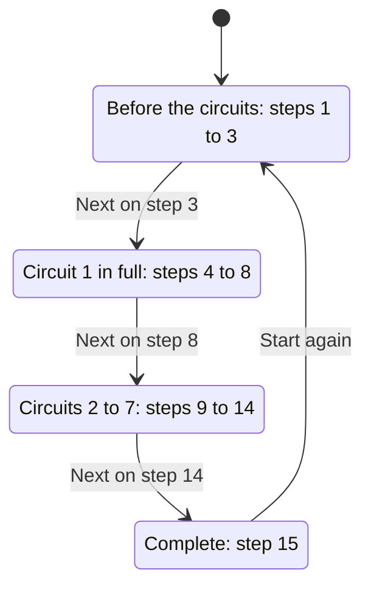
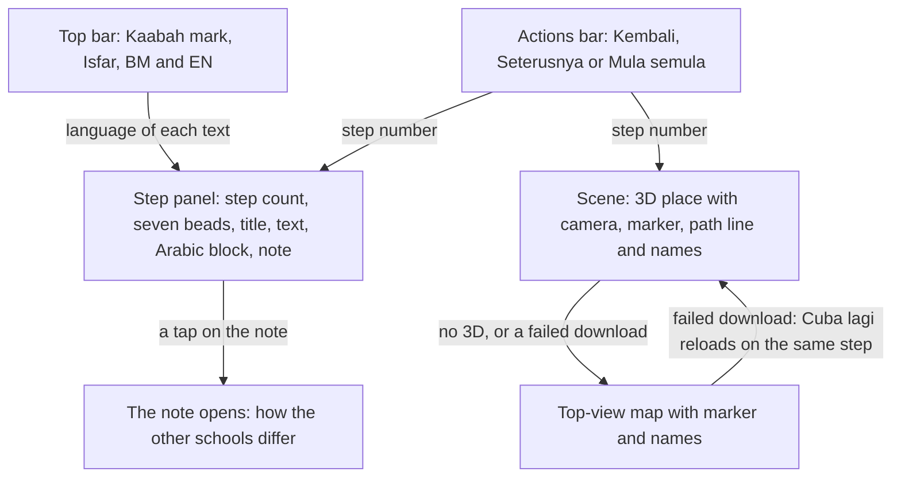
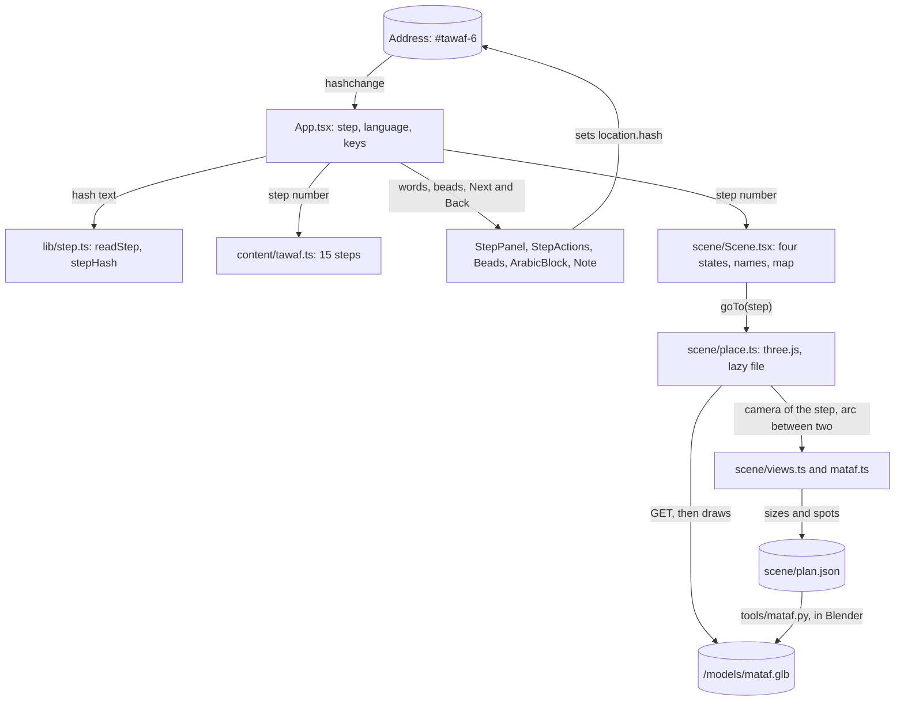
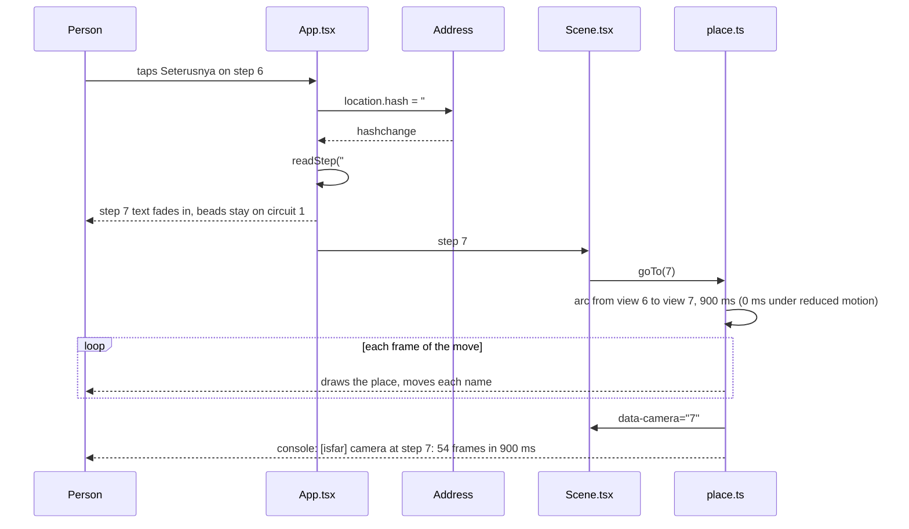

# Tawaf walk

**Version:** v1 · **Status:** Shipped · **Type:** Feature · **Project type:** Web UI

**Shape doc:** docs/specs/virtual-hajj/shape.md
**Depends on:** `walking-skeleton`

The site leads a person through tawaf in 15 steps, in a 3D mataf, from the Kaabah and its parts to the end of circuit 7.
The skeleton proved the rails, and tawaf is the smallest piece that removes the pain alone.

## Problem

The live site shows one place and one step of text.
A first-time pilgrim still cannot see where each step of tawaf happens, or in which order.
An ustaz has nothing to show a class beyond one view of the Kaabah.

## Slice test

| Check                         | Result |
| ----------------------------- | ------ |
| Cuts every layer it needs     | Yes. The walk screen, the step text files, the fuller 3D place, the address of each step, CI and the deploy. |
| One e2e test walks it         | Yes. One browser test walks scenarios 1 to 4. Scenario 5 is one measurement on the live site, as in the skeleton. |
| Worth shipping alone          | Yes. A first-timer walks one whole tawaf and sees where each step happens. An ustaz teaches tawaf from it. |
| Fits (≤5 scenarios, ≤2 areas) | Yes, at the limit. 5 scenarios. Two areas: the walk screen and the 3D place. The text of 15 steps is the largest part, and it is data. |

**Path:** full. The slice adds the walk controls, the Arabic block, the note, a fuller model and camera moves.

## User story

As a first-time pilgrim, I want the site to lead me through tawaf step by step in the 3D mataf, so that I know where each step happens and what to do there before the day.

## Flow



The address names the step, the step panel shows its text, and the 3D mataf or the top-view map shows where the step happens.

## States

The walk is in one of four parts, and the seven beads follow it.



| Steps | Beads |
| --- | --- |
| 1 to 3 | No bead is lit. |
| 4 to 8 | Bead 1 is the current bead. |
| 9 to 14 | The bead of that circuit is the current bead. Each earlier bead is done. |
| 15 | All seven beads are done. |

The 3D place keeps the four states of the skeleton: loading, shown, unsupported and failed.

## Acceptance criteria

```gherkin
Scenario: Aminah walks tawaf from the first step to the last
  Given Aminah's phone is set to Malay, and the screen is 360x800, upright
  When she opens the site
  Then step 1 shows, with the title "Kaabah dan bahagiannya"
  And the 3D place shows the Kaabah, Hijr Ismail, Maqam Ibrahim and the ring of arcades
  And no bead is lit, and no "Kembali" button shows
  When she taps "Seterusnya" two times
  Then the address ends with "#tawaf-3", and the title is "Tempat mula"
  And the camera is at the Hajar Aswad corner
  And a gold marker stands on the guide line, and the green light shows on the arcade wall
  When she taps "Seterusnya"
  Then step 4 shows, bead 1 is the current bead, and the path line shows the walk with the Kaabah on her left
  When she taps "Seterusnya" five times
  Then step 9 shows, with the title "Pusingan 2"
  And bead 1 is done, and bead 2 is the current bead
  When she taps "Seterusnya" six times
  Then step 15 shows, with the title "Tawaf selesai", and all seven beads are done
  And a "Mula semula" button takes the place of "Seterusnya"
  When she taps "Mula semula"
  Then step 1 shows
  And the same holds at 960x540, at 1280x720 and at 1920x1080

Scenario: Ustaz Hafiz opens a step by its link, and the step holds
  Given Ustaz Hafiz's laptop is set to English, at 1920x1080
  When he opens "https://isfar-57q.pages.dev/#tawaf-6"
  Then step 6 shows, with the title "Rukun Yamani", and bead 1 is the current bead
  And the camera is at Rukun Yamani
  When he presses the Right arrow key
  Then step 7 shows
  When he presses the Page Up key
  Then step 6 shows
  When he taps "BM"
  Then step 6 shows in Malay, and the 3D place stays on screen and does not load again
  When he reloads the page
  Then step 6 shows in Malay
  When he taps "Seterusnya", and then the Back button of the browser
  Then step 6 shows
  And the addresses "#tawaf-99" and "#abc" each open step 1

Scenario: A step shows a recitation and a note on the other schools
  Given Aminah is on step 7, "Antara dua penjuru", in Malay
  Then the Arabic block shows "رَبَّنَا آتِنَا فِي الدُّنْيَا حَسَنَةً وَفِي الْآخِرَةِ حَسَنَةً وَقِنَا عَذَابَ النَّارِ", and it reads right to left
  And the line "Rabbana atina fid-dunya hasanah, wa fil-akhirati hasanah, wa qina 'adhaban-nar" shows under it
  And the meaning shows in Malay
  When she taps "EN"
  Then the meaning shows in English, and the Arabic and the line under it stay the same
  Given she is on step 2, "Sebelum bermula", in Malay
  Then a closed note "Mazhab lain berbeza di sini" shows under the step text
  When she taps the note
  Then the note opens and shows "Syafi'i, Maliki dan Hanbali: wuduk ialah syarat sah tawaf. Hanafi: wuduk wajib tetapi bukan syarat. Tawaf tanpa wuduk sah, dan dam dikenakan."
  And step 4, where no school differs, shows no note

Scenario: The walk still works when the 3D place cannot show
  Given 3D drawing is off in the browser on Aminah's phone
  When she opens "#tawaf-5" in Malay
  Then the step title "Hijr Ismail", the step text, the beads and both notices show
  And a top-view map of the mataf takes the place of the 3D place
  And the marker on the map is outside the wall of Hijr Ismail
  And the message "Peranti ini tidak dapat memaparkan tempat 3D." shows
  When she taps "Seterusnya"
  Then step 6 shows, and the marker on the map is at Rukun Yamani
  Given 3D drawing is on, and the download of the 3D place fails on step 5
  Then the same map shows, with the message "Tempat 3D tidak dapat dimuatkan." and a "Cuba lagi" button
  When the connection is back and she taps "Cuba lagi"
  Then the page loads again on step 5, and the 3D place shows the camera at Hijr Ismail

Scenario: The fuller place runs at old-phone speed
  Given the site is live at "isfar-57q.pages.dev", from a build whose browser test passed in CI
  And a desktop Chrome on a machine with a graphics chip is at 360x800
  And it has an empty cache, a CPU slowed 4 times and the "Fast 4G" network profile
  When the browser opens the site
  Then the step text shows before the 3D place
  And the 3D place shows within 5 seconds
  When the test goes from step 1 to step 15, one step each 2 seconds
  Then the 3D place draws 30 frames a second or more, also while the camera moves
```

Rules that hold for each scenario:

- GitHub Actions runs scenarios 1 to 4 on each push, at 360x800, 960x540, 1280x720 and 1920x1080.
- The camera moves from the spot of one step to the spot of the next. Under reduced motion it cuts, and it does not fly.
- A tap on "Seterusnya" during a camera move shows the next step at once, and the camera goes to the newest step.
- "Seterusnya", the Right arrow key and the Page Down key do the same thing. "Kembali", the Left arrow key and the Page Up key do the same thing.
- Each step change adds one entry to the browser history, so the Back button of the browser goes one step back.
- The step text of each step is 40 words or fewer, as the design brief says.
- Both notices of the skeleton show on each step.
- The 3D download stays under 500 KB compressed (D16), and the site stays hidden from search engines (D14).
- The walk teaches the tawaf of umrah in the Shafi'i school. The text says "for men" where a step is for men only.

### Steps in this slice

The words of each step are in "Text of the steps", under Interface. The user corrects the draft there (O5).
A step gets a note only where another school differs. Steps 2, 5 and 13 have one.

| # | Address | Title, Malay | Title, English | The marker stands | The step also has |
| --- | --- | --- | --- | --- | --- |
| 1 | `#tawaf-1` | Kaabah dan bahagiannya | The Kaabah and its parts | Nowhere. The view is wide. | The names of the parts |
| 2 | `#tawaf-2` | Sebelum bermula | Before you start | At the edge of the mataf | Wuduk, aurat, idtiba' for men. A note on wuduk. |
| 3 | `#tawaf-3` | Tempat mula | The start | On the guide line, at the Hajar Aswad corner | Niat and istilam. The recitation "Bismillahi, Allahu Akbar". The green light. |
| 4 | `#tawaf-4` | Kaabah di sebelah kiri | The Kaabah on your left | Past the door, near Maqam Ibrahim | The path line. Raml for men. |
| 5 | `#tawaf-5` | Hijr Ismail | Hijr Ismail | Outside the wall of Hijr Ismail | The path goes around the wall. A note on a circuit through it. |
| 6 | `#tawaf-6` | Rukun Yamani | Rukun Yamani | At Rukun Yamani | What to do at this corner |
| 7 | `#tawaf-7` | Antara dua penjuru | Between the two corners | Between Rukun Yamani and the Hajar Aswad corner | The recitation "Rabbana atina" |
| 8 | `#tawaf-8` | Satu pusingan selesai | One circuit is done | On the guide line again | Istilam again. Bead 1. |
| 9 | `#tawaf-9` | Pusingan 2 | Circuit 2 | On the guide line | Raml for men |
| 10 | `#tawaf-10` | Pusingan 3 | Circuit 3 | On the guide line | The last circuit with raml |
| 11 | `#tawaf-11` | Pusingan 4 | Circuit 4 | On the guide line | A usual walk from here |
| 12 | `#tawaf-12` | Pusingan 5 | Circuit 5 | On the guide line | What to do when the count is lost |
| 13 | `#tawaf-13` | Pusingan 6 | Circuit 6 | On the guide line | What to do when wuduk breaks. A note on what breaks it. |
| 14 | `#tawaf-14` | Pusingan 7 | Circuit 7 | On the guide line | Where the last circuit ends |
| 15 | `#tawaf-15` | Tawaf selesai | Tawaf is complete | Nowhere. The view is wide. | "Mula semula" |

New words on the controls: "Seterusnya" and "Next", "Kembali" and "Back", "Mula semula" and "Start again", "Mazhab lain berbeza di sini" and "Other schools differ here".

## Scope

**In:**

- The 15 steps of the table above, in Malay and English, in the Shafi'i school.
- Next and Back, by button, by arrow key and by Page Up and Page Down.
- The seven beads, which count the circuits.
- The step in the address, so a reload and a link keep the step.
- Two recitations in the Arabic block: Arabic, transliteration and meaning.
- The note on other schools, closed until the person taps it.
- A fuller 3D place: the Kaabah with the Hajar Aswad corner, the door, Hijr Ismail, Rukun Yamani and Maqam Ibrahim, the mataf, and a simple ring of arcades with the green light.
- A guide line on the floor at the start. The step text says that the real floor has no line.
- A gold marker at the spot of each step, and a path line with arrows for the circuit.
- A camera that moves between the spots, and cuts under reduced motion.
- One top-view map with a marker, for a device that cannot show 3D.
- The speed proof of the skeleton, again, for the fuller place.

**Out:**

| Left out | Picked up by |
| --- | --- |
| The two rakaat behind Maqam Ibrahim, and the zamzam | `full-umrah` |
| A choice of man or woman, with the text for that person | `pilgrim-choice`, a new slice after `full-umrah` (O4) |
| A pilgrim figure that walks the path on Next, and a softer look for the place | A /shape pass after this slice (O25, D46) |
| The niat in Arabic, and a doa for each circuit | No slice. Rejected on 2026-11-23 (O6). |
| Sound for the recitations | No slice. Not in the shape. |
| The self-check | `tawaf-check` |
| Sa'i | `sai-walk` |
| A tap on a bead to jump to a circuit, and a list of steps | No slice. A link opens a step. |
| A swipe to change the step | No slice. Not in the shape. |
| A drag to look around | No slice yet. The /shape pass of O25 can ask again. |
| Minarets and the upper floors in the model | No slice. Rejected on 2026-11-23 (O8). |
| A drawn picture for each step, for a device with no 3D | No slice. Rejected on 2026-11-23 (O10). |
| The other kinds of tawaf: qudum, ifadah, wada' and sunat | The hajj shape (shape O7) |
| A crowd in the mataf | No slice. Shape O6. |
| The site listed in search engines | `full-umrah` (D14) |
| A test on a real 5-year-old Android | No slice. Accepted risk in the skeleton (O9 there). |

## Interface

One screen, built only from the kiswah and marble design system in `docs/design/design-system/`.



The actions bar sets the step, the step panel shows its words, and the scene shows its place in 3D or on the map.

**Layout**

| Screen | Order |
| --- | --- |
| Upright phone | Top bar, scene (240 px high, O18), step panel, message card for no 3D, two notices. The actions bar stays at the bottom edge of the screen. The page scrolls under it. |
| Landscape, 800 px wide or more | Top bar across the top. The scene fills the left side. The step panel, message card and notices stack in a column on the right, 480 px wide at most. The actions bar stays at the bottom of that column. |

On a 360x800 phone, about five lines of step text show without a scroll. A long step and a recitation still scroll.
The failed-download card sits above the step panel, because it has the "Cuba lagi" button. The no-3D card sits under the step panel (O19).

**The step panel**

| Part | What it shows |
| --- | --- |
| Header, on kiswah | "Tawaf · Langkah 9 daripada 15", and the seven beads. The label is the step count, and the beads are the circuits (O15). |
| Title and text | The words of the step. They fade in on a step change. |
| Arabic block | Steps 3 and 7 only. Arabic, then the sound in Latin letters, then the meaning. |
| Note | Steps 2, 5 and 13 only. "Mazhab lain berbeza di sini", closed until a tap. |

**States of the scene**

| State | The scene shows | With the step panel |
| --- | --- | --- |
| Loading | The loading card of the skeleton | Nothing more |
| Shown | The 3D place: the camera at the spot, the gold marker, the path line from step 4 to step 14, and the names of the parts in focus | Nothing more |
| Unsupported | The top-view map, with the marker and the same names | The no-3D message card, under the step panel |
| Failed | The same map | The failed-download card with "Cuba lagi", above the step panel |

The names of the parts are scene content. They use the system's label type, cloth and edge colours, and they are not a new primitive (O16).
Step 1 shows five names. Step 3 shows "Hajar Aswad" and "Lampu hijau". Each later step shows the part in focus.

**Motion tier:** 2 (O14).

| Move | Time | Under reduced motion |
| --- | --- | --- |
| A button presses down | 160 ms | The same |
| The step text fades in and rises 12 px | 320 ms | It fades in 160 ms and does not rise |
| The camera flies to the spot of the new step | About 1 second, with an ease-out curve | The camera cuts |
| The note's arrow turns | 160 ms | The same |

A new step during a camera move sends the camera to the newest spot at once.

**3D budget**

| Part | Budget |
| --- | --- |
| Download | 500 KB compressed at most, for three.js plus the model (D16). The skeleton uses 150 KB. |
| Frame rate | 30 frames a second or more, also during a camera move, on a desktop Chrome with the CPU slowed 4 times |
| On a phone | The same scene. It is built for the phone first. |
| Reduced motion | The camera cuts. Nothing else in the scene moves. |
| Lazy load | The text shows first. The 3D code and the model load after it. |

**Components used:** Step panel with its header, Progress beads, Kaabah mark, Language switch, Button and quiet Button, Arabic block, Note, Notice, Scene card (loading and message), and the marble, cloth and kiswah materials.

**Added to the design system:** one colour token, `--vh-lamp`, for the green light of the start. No interface part uses it (O17).

**Not used yet:** Answer option and result. `tawaf-check` uses them.

**Access:** The scene carries a text description of each step's view. The beads carry the circuit as text. The step panel tells a screen reader about a new step. Each control is 52 px high. The arrow keys and Page Up and Page Down move the walk. Each Arabic line carries `lang="ar"` and reads right to left.

**Preview:** `http://localhost:5199/preview/tawaf-walk.html`, after `pnpm dev --port 5199`. It lists 17 frames, and each frame is a working walk screen from the real components.
A drawing stands in for the 3D place, from the camera of each step. The camera cuts in the preview and does not fly.

**Built in this pause, for /build to keep:** `src/content/tawaf.ts`, `src/scene/mataf.ts` (the plan of the place and the spot of each step), `src/components/Beads.tsx`, `ArabicBlock.tsx`, `Note.tsx`, `StepActions.tsx`, `MatafMap.tsx`, the new props of `StepPanel.tsx`, and the walk rules in `src/app.css`.
**For the preview only:** `preview/tawaf-walk.html` and `src/preview/`. No build ships them.

**Checks:** The static drift check passes on 15 files. The rendered drift check passes on 8 pages, in light and dark. `pnpm typecheck`, `pnpm test` and `pnpm e2e --project=firefox` pass. The `design-taste-frontend` inspector is not installed, so it did not run.

### Text of the steps

This is a draft in the Shafi'i school (D24). The user corrects it here.

| # | Malay | English |
| --- | --- | --- |
| 1 | **Kaabah dan bahagiannya.** Tawaf ialah tujuh pusingan mengelilingi Kaabah. Kenali lima tempat ini dahulu: Hajar Aswad, pintu Kaabah, Hijr Ismail, Rukun Yamani dan Maqam Ibrahim. | **The Kaabah and its parts.** Tawaf is seven circuits around the Kaabah. First learn these five places: Hajar Aswad, the door of the Kaabah, Hijr Ismail, Rukun Yamani and Maqam Ibrahim. |
| 2 | **Sebelum bermula.** Pastikan anda berwuduk dan menutup aurat. Lelaki dalam ihram memakai kain secara idtiba': bahu kanan terbuka, dan hujung kain di atas bahu kiri. | **Before you start.** Make sure that you have wuduk and that your aurat is covered. A man in ihram wears the cloth in idtiba': the right shoulder bare, and the end of the cloth over the left shoulder. |
| 3 | **Tempat mula.** Berdiri sejajar dengan penjuru Hajar Aswad. Lampu hijau di dinding masjid menandakan tempatnya, dan lantai sebenar tiada garisan. Berniat tawaf, hadap Hajar Aswad, angkat tangan ke arahnya dan baca: | **The start.** Stand in line with the Hajar Aswad corner. A green light on the mosque wall marks the place, and the real floor has no line. Make the niat of tawaf, face Hajar Aswad, raise your hand towards it and say: |
| 4 | **Kaabah di sebelah kiri.** Pusing supaya Kaabah berada di sebelah kiri anda, dan mula berjalan. Anda melalui pintu Kaabah dan Maqam Ibrahim. Lelaki berjalan pantas dengan langkah pendek (raml) dalam tiga pusingan pertama. | **The Kaabah on your left.** Turn so that the Kaabah is on your left, and start to walk. You pass the door of the Kaabah and Maqam Ibrahim. Men walk briskly with short steps (raml) in the first three circuits. |
| 5 | **Hijr Ismail.** Jalan di luar tembok rendah Hijr Ismail. Kawasan di dalamnya dikira sebahagian daripada Kaabah, jadi pusingan yang melalui dalamnya tidak dikira. | **Hijr Ismail.** Walk outside the low wall of Hijr Ismail. The area inside it counts as part of the Kaabah, so a circuit that goes through it does not count. |
| 6 | **Rukun Yamani.** Di penjuru ini, sentuh Rukun Yamani dengan tangan kanan jika mudah. Jika sesak, teruskan berjalan. Jangan menolak orang lain untuk sampai kepadanya. | **Rukun Yamani.** At this corner, touch Rukun Yamani with your right hand if it is easy. If it is crowded, keep walking. Do not push other people to reach it. |
| 7 | **Antara dua penjuru.** Dari Rukun Yamani ke penjuru Hajar Aswad, baca doa ini sambil berjalan: | **Between the two corners.** From Rukun Yamani to the Hajar Aswad corner, say this doa as you walk: |
| 8 | **Satu pusingan selesai.** Apabila anda sampai semula sejajar dengan Hajar Aswad, satu pusingan selesai. Angkat tangan ke arahnya, baca “Bismillahi, Allahu Akbar”, dan teruskan pusingan kedua. | **One circuit is done.** When you are in line with Hajar Aswad again, one circuit is done. Raise your hand towards it, say “Bismillahi, Allahu Akbar”, and go on to the second circuit. |
| 9 | **Pusingan 2.** Ikut jalan yang sama: lalu pintu Kaabah, di luar Hijr Ismail, Rukun Yamani, dan kembali ke garisan Hajar Aswad. Lelaki masih berjalan pantas (raml). | **Circuit 2.** Follow the same path: past the door of the Kaabah, outside Hijr Ismail, Rukun Yamani, and back to the line of Hajar Aswad. Men still walk briskly (raml). |
| 10 | **Pusingan 3.** Ini pusingan terakhir dengan raml bagi lelaki. Wanita berjalan seperti biasa sepanjang tawaf. Anda boleh berzikir atau berdoa dalam apa-apa bahasa. | **Circuit 3.** This is the last circuit with raml for men. Women walk at a usual pace for the whole tawaf. You can make zikir or doa in any language. |
| 11 | **Pusingan 4.** Mulai pusingan ini, semua orang berjalan seperti biasa. Pastikan Kaabah sentiasa di sebelah kiri anda, dan jangan menghadap atau membelakanginya semasa berjalan. | **Circuit 4.** From this circuit, everyone walks at a usual pace. Keep the Kaabah on your left at all times, and do not face it or turn your back to it as you walk. |
| 12 | **Pusingan 5.** Jika anda ragu tentang bilangan pusingan, ambil bilangan yang lebih sedikit. Contohnya, jika ragu antara empat dan lima, kira sebagai empat. | **Circuit 5.** If you are not sure of the count, take the lower number. For example, if you are not sure between four and five, count four. |
| 13 | **Pusingan 6.** Jika wuduk terbatal, keluar, ambil wuduk semula, dan sambung dari tempat anda berhenti. Pusingan yang sudah selesai tetap dikira. | **Circuit 6.** If your wuduk breaks, leave, renew it, and go on from the place where you stopped. The circuits that you finished still count. |
| 14 | **Pusingan 7.** Pusingan terakhir tamat apabila anda sampai semula sejajar dengan Hajar Aswad. Lalui garisan itu sepenuhnya sebelum berhenti. | **Circuit 7.** The last circuit ends when you are in line with Hajar Aswad again. Pass the line fully before you stop. |
| 15 | **Tawaf selesai.** Anda telah melengkapkan tujuh pusingan. Selepas ini ialah solat sunat tawaf dua rakaat di belakang Maqam Ibrahim. Bahagian itu akan datang kemudian. | **Tawaf is complete.** You have completed seven circuits. Next come the two rakaat of solat sunat tawaf behind Maqam Ibrahim. That part of the site comes later. |

**Recitations**

| Step | Arabic | Sound | Meaning, Malay | Meaning, English |
| --- | --- | --- | --- | --- |
| 3 | بِسْمِ اللهِ، اللهُ أَكْبَرُ | Bismillahi, Allahu Akbar | Dengan nama Allah. Allah Maha Besar. | In the name of Allah. Allah is the Greatest. |
| 7 | رَبَّنَا آتِنَا فِي الدُّنْيَا حَسَنَةً وَفِي الْآخِرَةِ حَسَنَةً وَقِنَا عَذَابَ النَّارِ | Rabbana atina fid-dunya hasanah, wa fil-akhirati hasanah, wa qina 'adhaban-nar | Wahai Tuhan kami, berilah kami kebaikan di dunia dan kebaikan di akhirat, dan peliharalah kami daripada azab neraka. | Our Lord, give us good in this world and good in the hereafter, and protect us from the punishment of the Fire. |

**Notes on the other schools**

| Step | Malay | English |
| --- | --- | --- |
| 2 | Syafi'i, Maliki dan Hanbali: wuduk ialah syarat sah tawaf. Hanafi: wuduk wajib tetapi bukan syarat. Tawaf tanpa wuduk sah, dan dam dikenakan. | Shafi'i, Maliki and Hanbali: wuduk is a condition of a valid tawaf. Hanafi: wuduk is required but is not a condition. A tawaf without wuduk is valid, and a dam is due. |
| 5 | Syafi'i, Maliki dan Hanbali: pusingan yang melalui dalam Hijr Ismail tidak sah. Hanafi: berjalan di luarnya wajib. Pusingan itu sah, tetapi perlu diulang atau dam dikenakan. | Shafi'i, Maliki and Hanbali: a circuit that goes through Hijr Ismail is not valid. Hanafi: the walk outside it is required. The circuit is valid, but you repeat it or a dam is due. |
| 13 | Syafi'i: bersentuhan kulit dengan bukan mahram yang berlainan jantina membatalkan wuduk. Hanafi: tidak batal. Maliki dan Hanbali: batal jika dengan syahwat. | Shafi'i: skin contact with a non-mahram of the other sex breaks wuduk. Hanafi: it does not. Maliki and Hanbali: only if there is desire. |

**Other words**

| Part | Malay | English |
| --- | --- | --- |
| Next, Back, Start again | Seterusnya, Kembali, Mula semula | Next, Back, Start again |
| Note label | Mazhab lain berbeza di sini | Other schools differ here |
| Step count | Tawaf · Langkah 9 daripada 15 | Tawaf · Step 9 of 15 |
| Beads, for a screen reader | Pusingan 2 daripada 7. Pusingan belum bermula. Tujuh pusingan selesai. | Circuit 2 of 7. No circuit has started. Seven circuits are done. |
| Names of the parts | Hajar Aswad, Pintu Kaabah, Hijr Ismail, Rukun Yamani, Maqam Ibrahim, Lampu hijau | Hajar Aswad, The door, Hijr Ismail, Rukun Yamani, Maqam Ibrahim, Green light |
| Map, for a screen reader | Peta mataf dari atas | Map of the mataf from above |

## Technical plan

### Approach

`App.tsx` reads the step from the address, and it gives the step to the step panel and to `Scene.tsx`.
`Scene.tsx` hands the step to `place.ts`, which moves the camera on an arc to the view of that step. The place draws only while something changes.
The model is a new `mataf.glb`. A Blender script builds it from the same plan file that the map and the camera read.

Relies on: D2, D5, D8, D11, D13, D16, D18, D19, D20, D22, D26, D27, D28, D29, D30, D31, D32, D34, D36, D37, D39, D40, D41, D42, D43, D44, D45, D46



The address holds the step, `App.tsx` turns it into words and a step number, and `place.ts` draws the model at the camera of that step.



A tap changes the address, the address changes the step, and the camera flies while the text is already on screen.

No data crosses a trust boundary. The address is the only input, and `readStep` accepts only `#tawaf-1` to `#tawaf-15`.

### Changes

| File | What changes | Why |
| --- | --- | --- |
| `src/lib/step.ts` (new) | `readStep(hash, total)` gives the step of `#tawaf-6`, and 1 for each other text. `stepHash(step)` gives the address part. | Scenario 2, D30 |
| `src/App.tsx:11-38` | Holds the step: reads `location.hash` at the start, and listens to `hashchange`. Next, Back and "Mula semula" set `location.hash`. A `keydown` listener does the same for the arrow keys and Page Up and Page Down. The layout comes from `Walk()` in `src/preview/tawaf-walk.tsx`. | Scenarios 1 and 2, D31 |
| `src/scene/Scene.tsx:8`, `:20-56` | Takes `step`. Calls `goTo(step)` in its own effect, so a step change and a language change do not load the place again. `MatafMap` takes the place of `StillPicture` at line 51. Holds one `scene__name` element for each part, which `place.ts` moves. Sets `data-camera` and `data-moving`. | Scenarios 1, 2 and 4, D29, D44 |
| `src/scene/place.ts:22-28` | The colour map gains the new mesh names: `hijr`, `maqam`, `stone`, `arcade`, `arch`, `guide`, `lamp`. | Scenario 1, D27, D35 |
| `src/scene/place.ts:31-64` | Loads `/models/mataf.glb`. `showPlace` takes the first step and the name elements, and it returns `{ stop, goTo }`. The camera starts at the view of the first step, with no move. Adds the marker, its pole and the path line with arrows as three.js meshes. | Scenarios 1 and 2, D28 |
| `src/scene/place.ts:80-98` | Draws on change: during a camera move, after a resize, and on the first frame. On each drawn frame it puts each name at the screen point of its part. It logs one line for each move. | D40, D44, scenario 5 |
| `src/scene/views.ts` (new) | `viewOf(step)` moves here from `camera()` in `src/preview/Standin.tsx:25`. `between(from, to, t)` gives the camera on an arc around the Kaabah. `namePlace(part, view)` holds the offsets of `WIDE_PUSH`. | Scenario 1, D45 |
| `src/scene/plan.json` (new), `src/scene/mataf.ts:6-20` | The sizes of the Kaabah, Hijr Ismail, Maqam Ibrahim, the ring and the path move to `plan.json`. `mataf.ts` imports it. `tsconfig.json` gains `resolveJsonModule`. | D43 |
| `tools/mataf.py` (new), `tools/kaabah.py` (deleted) | A Blender script that reads `plan.json`. It builds the Kaabah as before, the Hajar Aswad stone, the wall of Hijr Ismail, Maqam Ibrahim, a floor disc, 40 arcade walls with arches and a roof, the guide line and the lamp. Each mesh has a name, and the file has no materials. | D19, D26, D27 |
| `public/models/mataf.glb` (new), `kaabah.glb` (deleted) | The exported model, committed. | D19 |
| `package.json:19` | `model` runs `blender -b -P tools/mataf.py`. | D19 |
| `src/content/text.ts:7-9`, `:39-41` | The skeleton's `scene`, `title` and `text` go. The loading title stays "Memuatkan Kaabah". | Scenario 1 |
| `src/components/StillPicture.tsx` (deleted), `src/app.css:25-34` | The map takes its place. Its fill rules go with it. | D29 |
| `src/app.css:50`, `:76-78` | The `:has(.walk__actions)` guards go, because each page is now the walk. | D36 |
| `preview/`, `src/preview/` (deleted) | The stand-in drawing and the preview page go when the real place passes the browser test. | Nothing ships them |
| `e2e/walk.spec.ts` (new), `e2e/skeleton.spec.ts` (deleted) | Scenarios 1 to 4. It keeps four cases of the skeleton with the new words: a lost 3D context during the download, the stored language, an Indonesian device, and one model download across a language switch. | Scenarios 1 to 4 |
| `e2e/speed.spec.ts:36-50` | After the place shows, it presses the Right arrow key 14 times, one press each 2 seconds. It reads the console line of each move and fails under 30 frames a second. | Scenario 5 |
| `src/lib/step.test.ts`, `src/content/tawaf.test.ts`, `src/scene/views.test.ts` (new) | Unit tests, listed in the test plan. | Scenarios 1 to 3, D45 |
| `CHANGELOG.md` | One "Added" line for the walk. | The repo's rule |

Reusing: `pickLanguage` and `storeLanguage` in `src/lib/language.ts:9-28`, the `token()` colour reader in `src/scene/place.ts:18`, the lost-context path in `src/scene/place.ts:36` and `:77`, `canDraw3D` in `src/scene/Scene.tsx:10`, `kaabahIsDrawn` and the WebGL-off script in `e2e/skeleton.spec.ts:38` and `:69`, and `scripts/check-size.mjs`, which already counts each file in `dist/models`.
Each component of pause 2 stays as it is: `Beads`, `ArabicBlock`, `Note`, `StepActions`, `MatafMap`, `StepPanel`.

### Earn-it

| Added | Triggered by |
| --- | --- |
| `src/lib/step.ts` | Scenario 2: five address cases need a unit test |
| `src/scene/views.ts` | Scenario 1 and D45: the arc needs a unit test, and three.js cannot load in Vitest without a canvas |
| `src/scene/plan.json` | D43: the Blender script and the TypeScript code must read the same numbers |
| `goTo` on the place | Scenario 2: a step change must not load the place again |
| Draw on change | D40 |
| `data-camera` and `data-moving` | Scenarios 1, 2 and 4: the browser test must know where the camera is |
| Names as HTML elements | D34, D44 |
| The marker and path line as three.js meshes | D28: they move or hide by step, and the model file is still |
| Three unit test files | The test plan |

Cut: a router, a state library, an animation library, three.js `OrbitControls`, text inside the 3D scene, a feature flag, a second model file, a draw loop that never stops.

### Non-functionals

|                      |     |
| -------------------- | --- |
| **Load**             | A few visits a day: the user and a few testers. The site is static files on Cloudflare's network. |
| **Breaks first**     | Nothing at 10 times the visits: the site has no server. The nearest limit is the 500 KB ceiling of D16. The skeleton uses 150 KB, and I expect the new model to add under 60 KB. `pnpm size` fails the build over the ceiling. |
| **Security surface** | Anyone can open the site. Its inputs are the device language, one stored value and the address. `readStep` accepts only `#tawaf-1` to `#tawaf-15`, and the page never writes the address into its HTML. React escapes the step text. No new secret, and the site stores nothing new. |
| **Proof it works**   | The smoke step prints `smoke: https://isfar-57q.pages.dev ok`. The browser console prints `[isfar] place shown in 2140 ms`, and `[isfar] camera at step 7: 54 frames in 900 ms` after each move. No number comes from real visitors (shape O5). |
| **Rollout**          | No flag (D42). The walk takes the place of the one-step page when the PR merges. Rollback: "Rollback to this deployment" on the earlier deployment in the Cloudflare dashboard, or `git revert` and a push. |

### Test plan

| Scenario | Test | Command |
| -------- | ---- | ------- |
| 1. Aminah walks tawaf from the first step to the last | `e2e/walk.spec.ts`, at four sizes. `src/content/tawaf.test.ts`: 15 steps in each language, the beads of steps 1, 3, 4, 8, 9, 14 and 15. | `pnpm e2e --project=firefox` here, `pnpm e2e --project=chromium` in CI. `pnpm test` |
| 2. Ustaz Hafiz opens a step by its link | `e2e/walk.spec.ts`. `src/lib/step.test.ts`: `#tawaf-6`, `#tawaf-15`, `#tawaf-0`, `#tawaf-99`, `#abc` and an empty address. | `pnpm e2e --project=firefox`, `pnpm test` |
| 3. A recitation and a note | `e2e/walk.spec.ts`. `src/content/tawaf.test.ts`: recitations on steps 3 and 7, notes on steps 2, 5 and 13, in each language. | `pnpm e2e --project=firefox`, `pnpm test` |
| 4. The walk works with no 3D | `e2e/walk.spec.ts`: 3D off, then a failed download of `mataf.glb` | `pnpm e2e --project=firefox` |
| 5. The fuller place runs at old-phone speed | `e2e/speed.spec.ts`, run by the user after the deploy, on a computer with a graphics chip | `SPEED_URL=https://isfar-57q.pages.dev pnpm e2e:speed` |
| Rule: each step text is 40 words or fewer | `src/content/tawaf.test.ts` | `pnpm test` |
| Rule: the camera cuts under reduced motion | `e2e/walk.spec.ts`, with reduced motion set in Playwright | `pnpm e2e --project=firefox` |
| Rule: the camera never passes through the Kaabah | `src/scene/views.test.ts`: on each move between two neighbour steps, the camera stays 9 m or more from the centre | `pnpm test` |
| Rule: the 3D download stays under 500 KB | `scripts/check-size.mjs` | `pnpm build && pnpm size` |

**E2E:** `e2e/walk.spec.ts` walks scenarios 1 to 4. The Playwright setup exists, and CI on `main` is green with it.

The other commands: `pnpm typecheck`, `pnpm model`. Stop any `vite preview` server before `pnpm e2e` (a lesson of the skeleton).

### Chunks

Single chunk. `Scene.tsx` and `place.ts` share one contract, and the one browser test needs both.

Order inside the chunk:

1. The user merges `fix/speed-renderer-probe`. Rebase `feat/tawaf-walk` on `main` (D41).
2. `step.ts` and the two content tests. Then `App.tsx` with the address, the keys and the layout. `Scene.tsx` shows the map for each step. Scenarios 2, 3 and the no-3D half of 4 pass.
3. `plan.json`, `views.ts` and its test.
4. `tools/mataf.py` and `mataf.glb`. Then `place.ts`: the new model, the marker, the path line, `goTo`, the names, and draw on change.
5. `e2e/walk.spec.ts` in full, then `e2e/speed.spec.ts`. Delete the preview.

### Risks

| Risk | Mitigation |
| ---- | ---------- |
| The fuller place does not hold 30 frames a second at phone speed. Nothing on the dev machine can measure it. | Scenario 5 at /ship, on a computer with a graphics chip (O21). The first cuts, in order: no antialias on a phone, a pixel ratio of 1.5, fewer arcade walls. |
| A real old phone is still untested. | Accepted in the skeleton (O9 there). Draw on change lowers the work between steps. |
| Draw on change leaves a blank or old frame after a resize, a theme change or a restored tab. | The place draws on each resize and when the page becomes visible. The browser test resizes once and checks the pixel. |
| The names overlap on a view that the preview did not show. | Fixed offsets for the wide view, from the preview. The browser test checks that the five names of step 1 do not overlap at four sizes. |
| The model and the code read different numbers. | One `plan.json` (D43). |
| The step text has a mistake in a ruling. | The "not yet reviewed" notice stays on each step, and the site stays hidden from search engines (D14). A qualified person reviews it before a public launch (shape O1). |
| `fix/speed-renderer-probe` is not merged when /build starts. | /build stops at step 1 and says so. |

### Decisions to record

Recorded as D22 to D31 at pause 1, D32 to D38 at pause 2, and D39 to D46 at /build.

## Review

2026-11-23 · 12 raw findings, 4 survived, 4 fixed, 1 lead needs validation.

- correctness · `e2e/walk.spec.ts:341` · the resize test waits for the canvas to shrink below its old width · `22ccdd3`
- correctness · `e2e/speed.spec.ts:56` · the speed test divides the gaps between frames, not the frames, by the time · `202969b`
- correctness · `src/scene/views.ts:26` · the step 2 camera stands closer and higher, so the arcade roof no longer hides the marker · `677ea9b`
- correctness · `src/app.css:36` · the side column gets the scroll padding, so the Back and Next bar no longer hides a focused control at 960x540 · `8925796`
- needs validation · `src/components/StepPanel.tsx:22` · whether VoiceOver, NVDA and TalkBack announce a polite live region that is inserted with its content already present · with VoiceOver or NVDA on, open `#tawaf-1`, focus "Seterusnya", press Enter, and listen for the step 2 title

## Open items

| ID  | What | Type | Raised at | Owner | Status | Answer |
| --- | ---- | ---- | --------- | ----- | ------ | ------ |
| O1  | How does the walk show the seven circuits? | question | spec p1 | user | Resolved | Circuit 1 in full, then one step for each later circuit. The seven beads count the circuits. "One circuit, then repeat" and "each circuit in full" were rejected. 2026-11-23 |
| O2  | Where does the tawaf walk end? | question | spec p1 | user | Resolved | At the end of circuit 7, with a last step and "Start again". The two rakaat and the zamzam go to `full-umrah`. 2026-11-23 |
| O3  | What does the walk show before the first circuit? | question | spec p1 | user | Resolved | Three steps: the place, get ready, the start. "Start only" was rejected. 2026-11-23 |
| O4  | Idtiba' and raml are for men only. How does the walk handle men and women? | question | spec p1 | user | Resolved | In the text: the step says "for men". The user asked for a later slice where the person chooses a man or a woman. It is `pilgrim-choice`, after `full-umrah`. 2026-11-23 |
| O5  | Who writes the step text? Shape O1 says the user writes it from course notes. | question | spec p1 | user | Resolved | Claude drafts each step in the Shafi'i school, and the user corrects it at pause 2. "Notes first" and "the user writes it" were rejected. 2026-11-23 |
| O6  | Which recitations show in Arabic? | question | spec p1 | user | Resolved | Two: "Bismillahi, Allahu Akbar" and "Rabbana atina". The niat in Arabic and a doa for each circuit were rejected. Pause 2 settles the exact words. 2026-11-23 |
| O7  | The real mataf has no floor line today. How does the 3D place show the start? | question | spec p1 | user | Resolved | The green light on the wall, and a guide line on the floor. The text says that the real floor has no line. 2026-11-23 |
| O8  | How much of the mosque does the 3D place show? | question | spec p1 | user | Resolved | The Kaabah with its parts, the mataf and a simple ring of arcades. "Mataf only" and "with minarets" were rejected. 2026-11-23 |
| O9  | How does the 3D place show where the person stands and walks? | question | spec p1 | user | Resolved | A gold marker at the spot, and a path line with arrows. A pilgrim figure and a view through the pilgrim's eyes were rejected. 2026-11-23 |
| O10 | Which still picture does each step get when 3D cannot show? | question | spec p1 | user | Resolved | One top-view map of the mataf, with a marker at the spot of the step. A picture for each step and one picture for all were rejected. 2026-11-23 |
| O11 | D20 says the walk must keep its step across a reload. Where does the step live? | question | spec p1 | user | Resolved | In the address, as `#tawaf-6`. "On the device" was rejected. 2026-11-23 |
| O12 | Do the keyboard and a presenter clicker move the walk? | question | spec p1 | user | Resolved | Yes. Right arrow and Page Down go on. Left arrow and Page Up go back. 2026-11-23 |
| O13 | Where does the slice `pilgrim-choice` go in the shape's order? | question | spec p1 | user | Resolved | After `full-umrah`, as slice 5. "After `tawaf-walk`" was rejected. 2026-11-23 |
| O14 | Which motion tier does the walk use? | question | spec p2 | user | Resolved | Tier 2. The step text fades in over 320 ms, and the camera flies in about 1 second. Tier 1 was rejected. 2026-11-23 |
| O15 | The beads count the circuits. What does the label beside them say? | question | spec p2 | user | Resolved | The step count: "Tawaf · Langkah 9 daripada 15". A label for the circuit was rejected. 2026-11-23 |
| O16 | The design system has no label that sits over the 3D place. How do the names of the parts show? | question | spec p2 | user | Resolved | In the place, as scene content in the system's label type and colours. A new primitive first and no names were rejected. 2026-11-23 |
| O17 | The green light needs a green, and the design system has none. | flag | spec p2 | user | Resolved | One token, `--vh-lamp`, in the colour tokens, for the green light only. A gold light and a full /design-system pass were rejected. 2026-11-23 |
| O18 | On a 360x800 phone, the step text starts under the actions bar. The skeleton kept the place at 320 px (its O28). | flag | spec p2 | user | Resolved | In the walk, the place is 240 px high on a phone. "Keep 320 px" was rejected. 2026-11-23 |
| O19 | With no 3D, the skeleton's message card sits above the step text, on each of 15 steps. | flag | spec p2 | user | Resolved | The no-3D card sits under the step panel. The failed-download card stays above it. 2026-11-23 |
| O20 | D25 names the first recitation "Bismillahi, Allahu Akbar". The design system's sample says "Bismillahi wallahu akbar". | question | spec p2 | user | Resolved | "Bismillahi, Allahu Akbar", without "wa". 2026-11-23 |
| O21 | The fuller 3D place holds 30 frames a second at phone speed. The dev machine has no graphics chip, so nothing here can measure it. | unproven | spec p3 | user | Accepted risk | The slice proves it: the user runs scenario 5 against the live site at /ship, on a computer with a graphics chip. A fail sends the slice back to /build. `/poc` first was rejected. 2026-11-23 |
| O22 | The skeleton draws the place about 60 times a second, also when nothing moves. | flag | spec p3 | user | Resolved | The place draws only on a change. "Draw always" was rejected. 2026-11-23 |
| O23 | Scenario 5 needs the fix on `fix/speed-renderer-probe`, which is not on `main`. | question | spec p3 | user | Resolved | The user merges the fix first, and /build rebases on `main`. "Carry it in this branch" was rejected. 2026-11-23 |
| O24 | Does the walk ship behind a feature flag? | question | spec p3 | user | Resolved | No flag. The rollback is the Cloudflare dashboard, or a `git revert`. 2026-11-23 |
| O25 | The user asked for an interactive, gamified walk with Animal Crossing textures. | question | spec p3 | user | Resolved | This slice does not change. A /shape pass after it plans a pilgrim figure that walks on Next, with a softer look. Points, a hand-steered character and Nintendo's own art were rejected. 2026-11-23 |
| O26 | The rules say that "Seterusnya", the Right arrow key and Page Down do the same thing. Step 15 has no "Seterusnya". | flag | build | user | Decided alone | Chose: on step 15, the Right arrow key and Page Down do nothing, so a clicker cannot restart the walk by mistake. Keys with Alt, Ctrl, Shift or Meta are left to the browser, so Alt+Left goes back one step, not two. Other: the keys do "Mula semula" on step 15. Undo: in `src/App.tsx`, call `goTo(1)` when the step is 15. 2026-11-23 |

_Never delete this section or its rows. See references/ledger.md._

## Glossary

- **Tawaf** — seven circuits on foot around the Kaabah.
- **Circuit** — one full walk around the Kaabah, from the Hajar Aswad corner back to it.
- **Mataf** — the open marble floor around the Kaabah, where pilgrims do tawaf.
- **Hajar Aswad** — the Black Stone, set in one corner of the Kaabah. Each circuit starts and ends in line with it.
- **Hijr Ismail** — the low curved wall on one side of the Kaabah. The area inside it counts as part of the Kaabah.
- **Rukun Yamani** — the corner of the Kaabah before the Hajar Aswad corner, on the path of the circuit.
- **Maqam Ibrahim** — the small glass and metal case near the door of the Kaabah.
- **Arcades** — the rows of arches around the mataf.
- **Istilam** — the greeting of the Hajar Aswad: a touch, a kiss, or a raised hand from far.
- **Niat** — the intention that a person makes before a rite.
- **Wuduk** — the wash before prayer. The Shafi'i school needs it for tawaf.
- **Aurat** — the parts of the body that a person must cover.
- **Idtiba'** — the way a man wears the ihram cloth in tawaf, with the right shoulder bare.
- **Raml** — a brisk walk with short steps, which men do in the first three circuits.
- **Rakaat** — one unit of prayer.
- **Zamzam** — the water of the well in Masjidil Haram.
- **Doa** — a prayer of request.
- **Mazhab, school** — a school of Islamic rulings. The four are Shafi'i, Hanafi, Maliki and Hanbali.
- **Ustaz** — a male religious teacher.
- **Umrah** — the shorter pilgrimage to Makkah, done at any time of year.
- **Transliteration** — Arabic words written in Latin letters.
- **Beads** — the seven counter beads of the design system. They show progress.
- **Arabic block** — the design system's part for a recitation: Arabic, transliteration and meaning.
- **Note** — the design system's part for "other schools differ here". It opens on a tap.
- **Address** — the text in the browser's address bar. The part after `#` names the step.
- **Presenter clicker** — a small remote for slides. It sends the Page Up and Page Down keys.
- **Reduced motion** — a device setting for people who want less movement on screen.
- **Motion tier** — zuko's scale for how much the interface moves. Tier 2 allows planned moves between steps.
- **Design system** — the one set of colours, sizes and parts that each screen reuses.
- **Token** — a named design value, such as a colour or a size, that each screen reuses.
- **Primitive** — a basic part of the interface, such as a button.
- **Drift check** — a script that fails a screen which uses a value from outside the design system.
- **Stand-in** — the drawing that takes the place of the 3D place in the preview.
- **Dam** — a penalty for a missed duty of the pilgrimage, most often the sacrifice of an animal.
- **Mahram** — a close relative whom a person can never marry.
- **Zikir** — short words that remember Allah, said again and again.
- **Solat sunat tawaf** — the prayer of two rakaat after tawaf.
- **e2e** — end-to-end: one test that walks the whole slice as a person would.
- **Browser test** — a test that opens the real site in a browser and uses it like a person.
- **CI** — a service that runs the tests on each push.
- **Graphics chip** — the part of a computer that draws 3D fast. The dev machine has none.
- **Fast 4G** — a network profile in Chrome that limits the speed to about 9 Mbps.
- **D22, D14** — numbered entries in `DECISIONS.md`, the record of each choice.
- **three.js** — a library that draws 3D in the browser.
- **`.glb`** — one file that holds a 3D model.
- **Blender** — a free program that makes 3D models. A script can drive it.
- **Lazy file** — code that the browser fetches only when the page asks for it.
- **JSON** — a plain text format for data, which Blender and the site both read.
- **Arc** — a curved path. The camera keeps its distance from the Kaabah on it.
- **Feature flag** — a switch that hides new code until someone turns it on.
- **PR** — a pull request: a set of commits that waits for a merge on GitHub.
- **Rebase** — to move a branch so that it starts from the newest `main`.
- **Smoke step** — one quick check in CI that the live site answers.
- **Unit test** — a test of one small piece of code, with no browser.
- **Vitest, Playwright** — the unit test runner, and the tool that drives browsers for the browser tests.
- **Antialias, pixel ratio** — two settings of the 3D drawing. Each one trades sharpness for speed.
