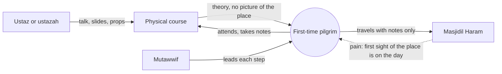
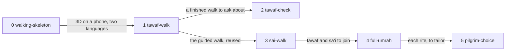

# Virtual Hajj

**Project type:** web UI, greenfield · **Status:** Shaped

## Problem

A first-time pilgrim finishes a hajj or umrah course without a picture of the places, because the course is a talk with a few props.
They leave worried, and on site they get lost, depend on the group leader for each step, and make mistakes.

## Today

The pilgrim learns the steps from a talk, and sees the place for the first time on the day they must do the steps there.

## Slices

This shape covers umrah only.
The site leads the person step by step through a 3D place, in Malay and English.
The same site serves a pilgrim on a phone and an ustaz on a projector.

Slice 0 proves the rails, slice 1 is the first thing worth using, and slices 2 and 3 each work without the other.

| # | Slice | What ships | Why this order |
|---|-------|-----------|----------------|
| 0 | walking-skeleton | A person opens the deployed site on a phone or a projector and sees one 3D place. They read one placeholder step in Malay or English. One browser test walks it, and CI runs that test. | The repo is empty. This slice settles the stack and proves O4: a 3D place runs on an ordinary phone. |
| 1 | tawaf-walk | The site leads the person through tawaf in 3D, from the start line to the end of the seventh circuit. Each step shows where to stand and what to do. Each step notes where the other schools differ. | Tawaf is the smallest piece that removes the pain alone. Hajj reuses it later. |
| 2 | tawaf-check | After the tawaf walk, the person answers where each step happens and what to do there. The result shows on screen and is not kept. | It measures "they can explain it back" before we build two more rites. |
| 3 | sai-walk | The site leads the person through sa'i in 3D, between Safa and Marwah. | Sa'i is the next rite in the real order. It reuses the guided walk from slice 1. |
| 4 | full-umrah | The walk starts with ihram at the miqat and ends with tahallul. A person walks one whole umrah, first step to last. | The first and last steps are the least about a place. They join the two walks into one journey. |
| 5 | pilgrim-choice | The person chooses a man or a woman at the start. Each step then shows the text for that person. | The steps differ for men and women in each rite. After full-umrah, one slice covers them all at once. |

Each slice must look right at phone size and at projector size.
Each slice ships its text in Malay and English.

## Not doing

- **Hajj.** Mina, Arafah, Muzdalifah and the jamarat get their own shape after umrah ships (O7). Umrah alone is six slices.
- **Free walk in 3D.** The person must find the place of each step alone, and a free walk does not show the order.
- **360-degree photos.** The person stands at fixed spots, with no path between the steps.
- **Map and pictures.** It has no look-around.
- **A teacher mode.** The ustaz uses the same next and back steps as the pilgrim (O3).
- **Accounts and saved progress.** The site is free and public, and it keeps nothing about the person (O5).
- **Upper floors and crowd routes.** The model teaches the standard ground-level route (O6).
- **The October build.** An earlier three.js viewer lived in this folder. This shape decides nothing from it (O8).

## Open items

| ID | What | Type | Raised at | Owner | Status | Answer |
| -- | ---- | ---- | --------- | ----- | ------ | ------ |
| O1 | Who confirms that the religious content is correct: the steps, their order, the rulings, and the notes on other schools? | question | shape | user | Accepted risk | The user writes it from course notes. A qualified person reviews it before a public launch, and the site says so until then. 2026-11-21 |
| O2 | Which school of rulings (mazhab) does the content follow? | question | shape | user | Resolved | Shafi'i is the main text. Each step notes where Hanafi, Maliki and Hanbali differ. 2026-11-21 |
| O3 | Assuming "pilgrim alone and ustaz in class, both from day one" means one site that fits a phone and a projector, with no separate teacher mode. | assumption | shape | user | Resolved | Yes. One site, the same next and back steps. 2026-11-21 |
| O4 | A 3D model of Masjidil Haram, good enough to teach from, can be made or obtained, and it runs on an ordinary phone. | unproven | shape | user | Handed to walking-skeleton | The skeleton proves it, and its spec decides where the model comes from. 2026-11-21 |
| O5 | Assuming no accounts: the site is free and public, and it saves nothing about the person. | assumption | shape | user | Resolved | Yes. The self-check shows a result on screen and does not keep it. 2026-11-21 |
| O6 | The real mosque changes: building works, closed floors, crowd routes. The model shows one layout. | flag | shape | user | Accepted risk | The site says the layout on the day may differ, and that the pilgrim follows the mutawwif and the signs. 2026-11-21 |
| O7 | Does hajj belong in this shape? | question | shape | user | Resolved | No. Hajj gets its own shape after umrah ships. 2026-11-21 |
| O8 | How do we treat the October build that lived in this folder? | question | shape | user | Resolved | Fresh start. Decide nothing from it. 2026-11-21 |
| O9 | Which journey comes first? | question | shape | user | Resolved | Umrah. Hajj first and both together were rejected. 2026-11-21 |
| O10 | What does the person do to see a place? | question | shape | user | Resolved | The site leads them step by step through a 3D place. 2026-11-21 |
| O11 | Which language does the first version use? | question | shape | user | Resolved | Malay and English, from day one. 2026-11-21 |
| O12 | How do we know it worked? | question | shape | user | Resolved | After the walk, a first-timer can say where each step happens and what to do there, without notes. 2026-11-21 |
| O13 | Does the person choose a man or a woman? | question | spec tawaf-walk p1 | user | Resolved | Yes, in the new slice `pilgrim-choice`, after `full-umrah`. Until then one walk serves both, and the text says "for men". 2026-11-23 |
| O14 | O1 says the user writes the content from course notes. Who drafts it? | question | spec tawaf-walk p1 | user | Resolved | Claude drafts the step text, and the user corrects it against the course notes. The review of O1 stays. 2026-11-23 |
| O15 | The user asked for a gamified walk: interactive, with the feel of Animal Crossing. | question | spec tawaf-walk p3 | user | Resolved | A /shape pass after `tawaf-walk` plans a pilgrim figure that walks on Next, a softer look, and where `pilgrim-choice` fits. Points, a hand-steered character and Nintendo's own art were rejected (D46). 2026-11-23 |

## Glossary

- **Hajj** — the main pilgrimage to Makkah, done on fixed days of the Islamic year.
- **Umrah** — the shorter pilgrimage to Makkah, done at any time of year.
- **Ustaz, ustazah** — a male or female religious teacher.
- **Masjidil Haram** — the great mosque in Makkah. The Kaabah stands in its centre.
- **Kaabah** — the cube-shaped building that pilgrims walk around.
- **Ihram** — the state a pilgrim enters before the rites, with its clothing and its rules.
- **Miqat** — the boundary where a pilgrim must enter ihram.
- **Tawaf** — seven circuits on foot around the Kaabah.
- **Sa'i** — seven walks between the hills of Safa and Marwah.
- **Tahallul** — the haircut that ends ihram.
- **Mutawwif** — the group leader who guides pilgrims on site.
- **Mazhab** — a school of Islamic rulings. The four are Shafi'i, Hanafi, Maliki and Hanbali.
- **Greenfield** — a project that starts from an empty repo.
- **Walking skeleton** — the thinnest version that touches each layer and is deployed.
- **CI** — a service that runs the tests on each push.
- **Browser test** — a test that opens the real site in a browser and uses it like a person.
- **3D model** — a file that holds the shape of a place, which the browser draws.
