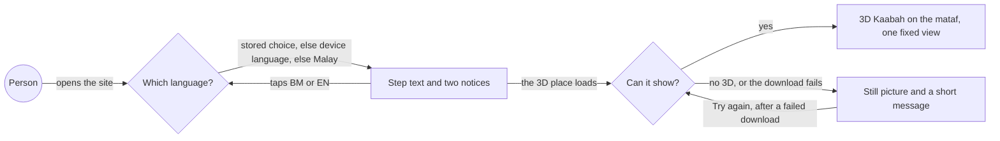
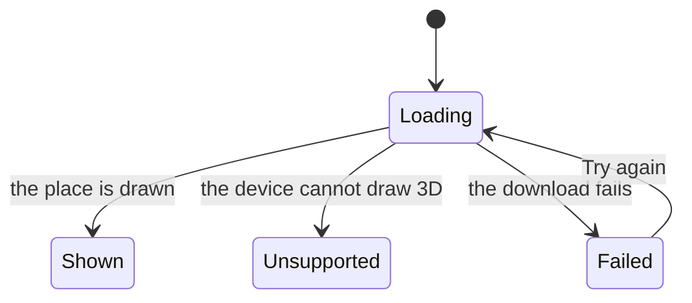
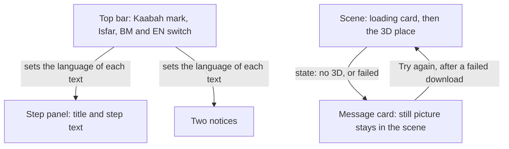
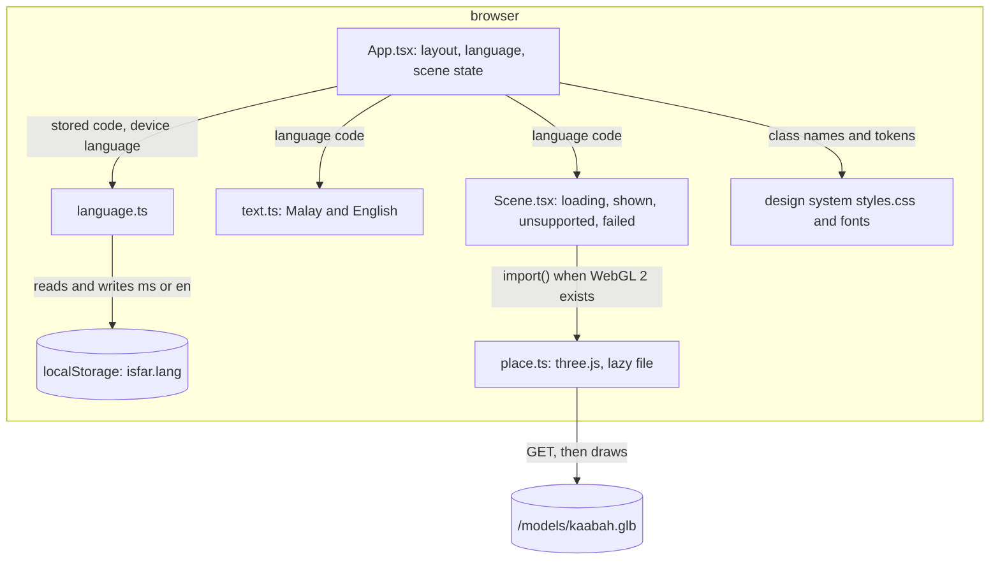
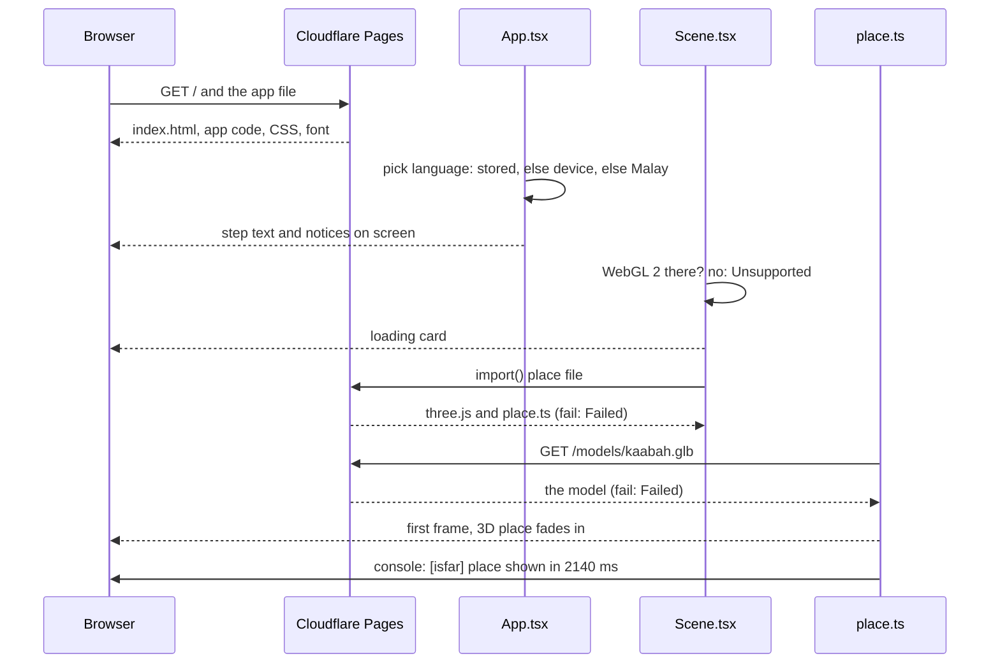
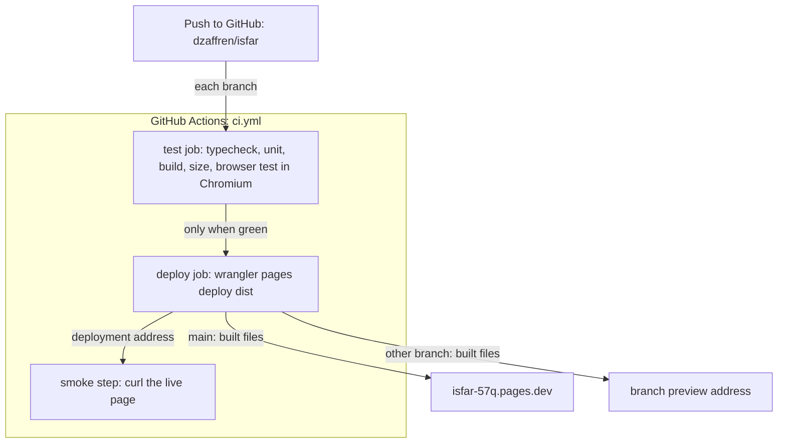

# Walking skeleton

**Version:** v1 · **Status:** Shipped · **Type:** Skeleton · **Project type:** Web UI

**Shape doc:** docs/specs/virtual-hajj/shape.md
**Depends on:** None

A person opens the deployed site and sees one 3D place, with one step of text in Malay or English.
The repo is empty, so this slice settles the stack and proves that a 3D place runs at phone speed.

## Problem

A first-time pilgrim has no picture of the places before the day.
The site that fixes this does not exist yet: there is no code, no test, no CI and no deploy.
Nobody has proved that a 3D place runs on an ordinary phone (shape O4).

## Stack

The user chose each line on 2026-11-21.

| Part | Choice |
| --- | --- |
| Language and framework | TypeScript, Vite and React, with three.js for the 3D scene |
| Database | None. The step text lives in files in the repo. |
| Host | Cloudflare Pages, at its free `.pages.dev` address |
| CI | GitHub Actions, on a new public GitHub repo. A red run never deploys. |
| Unit tests | Vitest |
| Browser tests | Playwright, at 360x800, 960x540, 1280x720 and 1920x1080 |
| Package manager | pnpm |
| 3D layer | three.js directly, with no React wrapper |
| 3D model | One `.glb` file, exported by a Blender script in the repo |
| Fonts | Font files inside the site. No request to Google. |
| Names | GitHub repo `dzaffren/isfar`. Cloudflare project `isfar`, so the address is `isfar.pages.dev` if that name is free. It was not: the address is `isfar-57q.pages.dev` (O44). |

## Slice test

| Check                         | Result |
| ----------------------------- | ------ |
| Cuts every layer it needs     | Yes. The screen, the step text files, the 3D model, CI and the deploy. The site has no endpoint and no table. |
| One e2e test walks it         | Yes. One browser test walks scenarios 1 to 4. Scenario 5 is one measurement on the live site. |
| Worth shipping alone          | Yes, as slice 0. A person sees the Kaabah and reads about it in two languages. Each later slice starts from rails that work. |
| Fits (≤5 scenarios, ≤2 areas) | Yes. 5 scenarios. Two areas: the one page, and the pipeline from push to live site. |

**Path:** full. The slice adds the first interface, the first dependencies and the deploy.

## User story

As a first-time pilgrim, I want to open the site on my phone and see the Kaabah with a short text in my language, so that I know the site works for me.

## Flow



The site picks a language and shows the step text first, then it shows the 3D place, or a still picture when the 3D place cannot show.

## States

The 3D place has four states.



The step text and the notices show in each state.

## Acceptance criteria

```gherkin
Scenario: A person sees the place and reads the step in Malay
  Given Aminah's phone is set to Malay, and it has no stored language
  And the screen is 360x800, upright
  When she opens the site
  Then the top bar shows the name "Isfar"
  And the step title is "Kaabah"
  And the step text is "Inilah Kaabah, di tengah-tengah Masjidil Haram. Lantai marmar yang lapang di sekelilingnya dipanggil mataf."
  And the 3D place shows the Kaabah on the mataf, from one fixed view
  And the notice "Kandungan ini belum disemak oleh orang yang bertauliah." shows
  And the notice "Susun atur pada hari sebenar mungkin berbeza. Ikut mutawwif anda dan papan tanda." shows
  And the page tells search engines not to list it
  And the same holds at 960x540, at 1280x720 and at 1920x1080

Scenario: A person switches language and the site remembers it
  Given Ustaz Hafiz's laptop is set to English, and it has no stored language
  And he opens the site at 1920x1080
  And the step text is "This is the Kaabah, in the centre of Masjidil Haram. The open marble floor around it is the mataf."
  When he taps "BM"
  Then the step title, the step text and both notices change to Malay
  And the 3D place stays on screen and does not load again
  When he reloads the page
  Then the site opens in Malay
  And a device set to Indonesian, with no stored language, opens the site in Malay

Scenario: The device cannot draw 3D
  Given 3D drawing is off in the browser on Aminah's phone
  When she opens the site in Malay
  Then the step title, the step text and both notices show
  And a still picture of the same view takes the place of the 3D place
  And the message "Peranti ini tidak dapat memaparkan tempat 3D." shows
  And no "Cuba lagi" button shows

Scenario: The download of the 3D place fails
  Given Aminah opens the site in Malay on a train
  And the connection drops before the 3D place arrives
  Then the step title, the step text and both notices show
  And a still picture of the same view takes the place of the 3D place
  And the message "Tempat 3D tidak dapat dimuatkan." shows with a "Cuba lagi" button
  When the connection is back and she taps "Cuba lagi"
  Then the loading card "Memuatkan Kaabah" shows
  And then the 3D place shows the Kaabah on the mataf

Scenario: The place runs at old-phone speed
  Given the site is live at its `.pages.dev` address, from a build whose browser test passed in CI
  And a desktop Chrome at 360x800 has an empty cache, a CPU slowed 4 times and the "Fast 4G" network profile
  When the browser opens the site
  Then the step text shows before the 3D place
  And the 3D place shows within 5 seconds
  And the 3D place draws 30 frames a second or more for 10 seconds
```

Rules that hold for each scenario:

- GitHub Actions runs scenarios 1 to 4 on each push, at 360x800, 960x540, 1280x720 and 1920x1080.
- 960x540 is a 1920x1080 projector with the browser zoomed to 200%.
- A push with a red run never reaches the live address.
- A stored language choice wins. Without one, a device set to English gets English, and each other device gets Malay.

### Text in this slice

Pause 2 settled these words.

| Part | Malay | English |
| --- | --- | --- |
| Site name | Isfar | Isfar |
| Step title | Kaabah | The Kaabah |
| Step text | Inilah Kaabah, di tengah-tengah Masjidil Haram. Lantai marmar yang lapang di sekelilingnya dipanggil mataf. | This is the Kaabah, in the centre of Masjidil Haram. The open marble floor around it is the mataf. |
| Notice, review (shape O1) | Kandungan ini belum disemak oleh orang yang bertauliah. | A qualified person has not yet reviewed this content. |
| Notice, layout (shape O6) | Susun atur pada hari sebenar mungkin berbeza. Ikut mutawwif anda dan papan tanda. | The layout on the day may differ. Follow your mutawwif and the signs. |
| Loading card, title | Memuatkan Kaabah | Loading the Kaabah |
| Loading card, hint | Ini mungkin mengambil sedikit masa dengan data mudah alih. | This can take a moment on mobile data. |
| Message, no 3D | Peranti ini tidak dapat memaparkan tempat 3D. | This device cannot show the 3D place. |
| Message, failed download | Tempat 3D tidak dapat dimuatkan. | The 3D place did not load. |
| Button | Cuba lagi | Try again |
| Scene, for a screen reader | Kaabah di atas mataf, dari satu sudut pandang | The Kaabah on the mataf, from one fixed view |
| Language switch, for a screen reader | Bahasa | Language |

## Scope

**In:**

- One page with one placeholder step, in Malay and English. The step describes the place and gives no ruling.
- The language switch, the first-visit rule, and the choice stored on the device.
- A simple stylised 3D model, made for this project: the Kaabah with its gold band, on the marble mataf. One fixed view.
- The two notices from the shape (O1 and O6).
- The still picture and the two messages for when the 3D place cannot show.
- A mark that tells search engines not to list the site.
- The stack in the table above, a public GitHub repo, CI on each push, and the deploy to Cloudflare Pages.
- The design system's primitives as components in code, for the parts this page uses.

**Out:**

| Left out | Picked up by |
| --- | --- |
| More steps, camera moves between steps, the rulings, the notes on other schools | `tawaf-walk` |
| Recitations in Arabic | `tawaf-walk` |
| The rest of the mosque: arcades, minarets, the start line | `tawaf-walk` |
| Proof that a teach-quality model of the mosque also meets the 5 second and 30 frames bar | `tawaf-walk` |
| The self-check | `tawaf-check` |
| The site listed in search engines | `full-umrah` |
| A test on a real 5-year-old Android | No slice. Accepted risk (O1, O9). |
| A custom domain | No slice. It needs no code change later. |
| Larger text for a projector | No slice. The ustaz zooms the browser (O26). |
| A drag to look around, or a camera that turns alone | No slice. D2 leads the person. |
| `/ms` and `/en` addresses | No slice. Rejected on 2026-11-21. |
| Offline use, and install as an app | No slice. Not in the shape. |

## Interface

One screen, built only from the kiswah and marble design system in `docs/design/design-system/`.



The top bar sets the language, the scene loads the 3D place, and a message card joins the step panel when the 3D place cannot show.

**Layout**

| Screen | Order |
| --- | --- |
| Upright phone | Top bar, scene (320 px high), message card, step panel, two notices. The page scrolls. |
| Landscape, 800 px wide or more | Top bar across the top. The scene fills the left side. The message card, step panel and notices stack in a column on the right, 480 px wide at most. |

On a 360x800 phone, the step text fits on the first screen, and the second notice needs a short scroll (O28).
A projector at 1920x1080 reads by browser zoom. At 200% the screen is 960x540, and the landscape layout holds (O26).

**States of the scene**

| State | The scene shows | Beside the step panel |
| --- | --- | --- |
| Loading | The loading card on marble: "Memuatkan Kaabah", seven beads, and the hint | Nothing more |
| Shown | The 3D place, from one fixed view | Nothing more |
| Unsupported | The still picture of the same view | The message card, with no button |
| Failed | The still picture of the same view | The message card, with "Cuba lagi" |

The beads of the loading card light one by one in a loop, as a busy sign (O38). Under reduced motion they stay still and unlit. The preview shows them still.

**Motion tier:** 1. A button presses down in 160 ms. The loading beads light in a loop. The 3D place fades in over 160 ms when it is ready. The fade changes opacity only, so it stays under reduced motion.

**3D budget** (the design brief asks this spec for it)

| Part | Budget |
| --- | --- |
| Download | 500 KB compressed at most, for three.js plus the model |
| Frame rate | 30 frames a second or more, on a desktop Chrome with the CPU slowed 4 times |
| On a phone | The same scene. It is built for the phone first. |
| Reduced motion | Nothing in the scene moves in this slice. |
| Lazy load | The text shows first. The 3D code and the model load after it. Until they arrive, the scene holds the loading card. |

**Components used:** Step panel (its header is the top bar), Kaabah mark, Language switch, Button, Notice, Scene card (loading and message), Progress beads (inside the loading card only), and the marble, cloth and kiswah materials.

**Not used yet:** Progress beads as step progress, Back and Next, Arabic block, Note, Answer option. `tawaf-walk` and `tawaf-check` use them.

**Access:** The scene carries a text description for a screen reader. The language switch is two toggle buttons. Each control is 44 px high or more, and the focus ring comes from the design system.

**Preview:** `docs/design/walking-skeleton/preview.html`. A drawing stands in for the 3D place and for the still picture.

**Checks:** The static drift check and the rendered drift check pass, on 5 pages in light and dark. The `design-taste-frontend` inspector is not installed, so it did not run.

## Technical plan

### Approach

The site is one static page. React draws the top bar, the step panel and the notices at once, in the language that `language.ts` picks.
The 3D code is a separate file that loads after the text. It loads one model file and draws it with three.js.
GitHub Actions tests each push and uploads the built files to Cloudflare Pages only when the tests pass.

Relies on: D2, D3, D4, D5, D6, D7, D8, D9, D10, D11, D12, D13, D14, D15, D16, D17, D18, D19, D20, D21



`App.tsx` picks the language and shows the text, and `Scene.tsx` loads `place.ts`, which fetches the model and draws it.



The text is on screen before the 3D file is asked for, and each failed download ends in the Failed state.



A push runs the test job, and the deploy job uploads the built files only after a green test job.

No data crosses a trust boundary. The language code stays in the visitor's browser, so this plan has no data flow diagram.

### Changes

The repo has no code. Each file below is new, except where the table says "edit".

| File | What changes | Why |
| --- | --- | --- |
| `package.json`, `pnpm-lock.yaml`, `.nvmrc` | Scripts and dependencies: `react`, `react-dom`, `three`, `vite`, `typescript`, `vitest`, `@playwright/test`, and their types. Node 24, `packageManager: pnpm@9.15.9`. /build takes the latest stable version of each, and the lockfile records it. | D4, D8, D9 |
| `vite.config.ts`, `tsconfig.json` | The Vite build and the Vitest setup. `place.ts` builds to its own file. | Scenario 5, D16 |
| `index.html` | Title "Isfar", `<meta name="robots" content="noindex">`, the root element | Scenario 1, D14 |
| `public/_headers` | `X-Robots-Tag: noindex` on each path, the model file included | D14 |
| `src/main.tsx` | Imports `docs/design/design-system/styles.css` once and mounts `App` | Scenario 1 |
| `src/App.tsx`, `src/app.css` | The layout from the preview: top bar, scene, column. Holds the language and passes it down. `app.css` holds layout rules only, with the system's tokens. | Scenarios 1 and 2, D17 |
| `src/content/text.ts` | The text table of this spec as one typed object, Malay and English. A missing key fails the type check. | Scenarios 1 to 4, D5 |
| `src/lib/language.ts` | `pickLanguage(stored, deviceLanguage)`: a stored `ms` or `en` wins, a device language that starts with `en` gives English, each other case gives Malay. Reads and writes `isfar.lang` in `localStorage`, and works when storage is blocked. | Scenario 2, D12 |
| `src/components/TopBar.tsx`, `StepPanel.tsx`, `Notice.tsx`, `LoadingCard.tsx`, `MessageCard.tsx`, `StillPicture.tsx` | The system's primitives as components, for the parts this page uses. `StillPicture` is the drawing from the preview, as inline SVG that follows light and dark. | Scenarios 1, 3, 4, D13 |
| `src/scene/Scene.tsx` | The four states. Checks for WebGL 2 before any download. Calls `import("./place")`. A rejected import, a failed model fetch or a lost WebGL context gives Failed. "Cuba lagi" calls `location.reload()`. Sets `data-state` on the scene for the tests. | Scenarios 1, 3, 4, D20 |
| `src/scene/place.ts` | three.js only: a renderer on the canvas, one fixed camera that matches the still picture, `GLTFLoader` for `/models/kaabah.glb`, colours read from the design tokens, a pixel ratio of 2 at most, a render loop. Marks `isfar:place-shown` and logs the two lines of "Proof it works". | Scenarios 1 and 5, D18 |
| `tools/kaabah.py`, `public/models/kaabah.glb` | A Blender script that builds the Kaabah, its band, its door, its foot and the floor as named meshes, and exports one `.glb`. The file is committed, so CI needs no Blender. | D10, D19 |
| `scripts/check-size.mjs` | Adds the gzip size of the `place` file and the `.glb`. Fails over 500 KB. | D16 |
| `playwright.config.ts` | Projects `chromium` and `firefox` against `vite preview`, and a project `speed` that drives real Chrome with a window against `SPEED_URL`. | D8, D11 |
| `e2e/skeleton.spec.ts` | Scenarios 1 to 4. Sets the device language with Playwright's `locale`. Turns WebGL off with an init script. Fails the download with `page.route`. Checks the drawn place by a dark pixel at the centre of a screenshot. | Scenarios 1 to 4 |
| `e2e/speed.spec.ts` | Scenario 5. Clears the cache, slows the CPU 4 times and sets "Fast 4G" through Chrome's debug protocol, then reads the place-shown mark and counts frames for 10 seconds. | Scenario 5 |
| `src/lib/language.test.ts` | Unit tests for `pickLanguage`: `ms-MY`, `en-GB`, `id-ID`, a stored code, a bad stored value. | Scenario 2 |
| `.github/workflows/ci.yml` | The test job and the deploy job from the diagram. The deploy job runs on push only, so a fork's pull request never gets the secrets. | D7 |
| `.gitignore` (edit) | Adds `node_modules`, `dist`, `test-results`, `playwright-report` | The new tools |
| `docs/design/design-system/tokens/fonts.css` (edit), `docs/design/design-system/fonts/` | `@font-face` rules for Nunito 500 and 800 and Amiri 400, with the font files and their licence beside them. The Google import goes. | D21 |
| `docs/design/design-system/styles.css` (edit), `guidelines/primitives.html` (edit) | A `vh-beads--busy` class: the beads light in turn, by opacity, and stop under reduced motion. The guideline page shows it. | O38 |
| `docs/design/design-system/readme.md` (edit) | The "Hosted fonts" and "Components in code" lines say what this slice did. | D21 |

Reusing: the classes and tokens of `docs/design/design-system/styles.css`, and the markup and layout rules of `docs/design/walking-skeleton/preview.html`. No lint tool is added: `pnpm typecheck` is the lint command.

### Earn-it

| Added | Triggered by |
| --- | --- |
| React, Vite, TypeScript | D4 |
| three.js and its `GLTFLoader` | Scenario 1, D18, D19 |
| A separate lazy file for the 3D code | Scenario 5: the text shows before the place. D16. |
| The `.glb` file and the Blender script | D19: prove the model file path now |
| Vitest | Scenario 2: the language rule has five cases. D8. |
| Playwright, with three projects | Scenarios 1 to 5, D8, D11 |
| `check-size.mjs` | D16: the 500 KB ceiling needs a gate |
| `localStorage` | D12 |
| `public/_headers` | D14: the meta tag does not cover the model file |
| Font files in the repo | D21 |
| `vh-beads--busy` in the design system | O38 |
| The lost-context path to Failed | Risk: an old phone drops the WebGL context and leaves a blank scene |

Cut: a router, a state library, a translation library, React Three Fiber, a lint tool, a service worker, analytics, a security policy header.

### Non-functionals

|                      |     |
| -------------------- | --- |
| **Load**             | A few visits a day: the user and a few testers. The site is static files on Cloudflare's network. |
| **Breaks first**     | I found no limit that 10 times the visits meets: the Cloudflare Pages limits page lists no bandwidth limit. The nearest limit is 25 MiB for one file, and the model is a few KB. |
| **Security surface** | Anyone can open the site. It takes no input: it reads the device language and one stored value, and it accepts only `ms` or `en`. The secrets are `CLOUDFLARE_API_TOKEN` (Pages edit only) and `CLOUDFLARE_ACCOUNT_ID`, held as GitHub Actions secrets. The site stores the language code in the visitor's browser, and nothing on a server. |
| **Proof it works**   | The smoke step prints `smoke: https://isfar-57q.pages.dev ok` after it finds `<title>Isfar</title>` in the live page. The browser console prints `[isfar] place shown in 2140 ms` and `[isfar] 58 frames a second over 10 s`. No number comes from real visitors, because the site collects nothing (shape O5). |
| **Rollout**          | No flag: nothing exists to protect, and search engines do not list the site. Rollback: "Rollback to this deployment" on the earlier deployment in the Cloudflare dashboard, or `git revert` and a push. |

### Test plan

| Scenario | Test | Command |
| -------- | ---- | ------- |
| 1. A person sees the place and reads the step in Malay | `e2e/skeleton.spec.ts`, at 360x800, 960x540, 1280x720 and 1920x1080 | `pnpm e2e --project=firefox` here, `pnpm e2e --project=chromium` in CI |
| 2. A person switches language and the site remembers it | `e2e/skeleton.spec.ts`, and `src/lib/language.test.ts` | `pnpm e2e --project=firefox`, `pnpm test` |
| 3. The device cannot draw 3D | `e2e/skeleton.spec.ts` | `pnpm e2e --project=firefox` |
| 4. The download of the 3D place fails | `e2e/skeleton.spec.ts` | `pnpm e2e --project=firefox` |
| 5. The place runs at old-phone speed | `e2e/speed.spec.ts`, run by hand after the deploy | `SPEED_URL=https://isfar-57q.pages.dev pnpm e2e:speed` |
| Rule: the 3D download stays under 500 KB | `scripts/check-size.mjs` | `pnpm build && pnpm size` |
| Rule: a red run never deploys | `needs: test` on the deploy job in `ci.yml` | A push to GitHub |

**E2E:** `e2e/skeleton.spec.ts` walks scenarios 1 to 4. The repo has no e2e harness, so the Playwright setup is work in this plan: the dependency, `playwright.config.ts`, and the browser install step in CI.

The hand check for scenario 5, when scripted Chrome cannot draw 3D: open the live site in Chrome, open DevTools, set "CPU: 4x slowdown" and "Fast 4G", tick "Disable cache", reload, and read the two console lines.

The other commands: `pnpm install`, `pnpm dev`, `pnpm typecheck`, `pnpm model` (runs `blender -b -P tools/kaabah.py`).

### Chunks

Single chunk. The repo is empty, so two builders would both write `package.json` and the lockfile.

Order inside the chunk:

1. Rename the branch to `main`, and commit the docs that exist there once (O36). Then work on `feat/walking-skeleton`.
2. Scaffold: `package.json`, Vite, TypeScript, Vitest, Playwright.
3. `language.ts` with its unit tests, then `text.ts`.
4. The components and the layout, from the preview. The fonts and the busy beads in the design system.
5. `tools/kaabah.py` and the `.glb`, then `place.ts` and `Scene.tsx`.
6. `e2e/skeleton.spec.ts`, `check-size.mjs`, `ci.yml`, `e2e/speed.spec.ts`.

/ship does the steps that need the user: the GitHub repo `dzaffren/isfar`, the Cloudflare project `isfar`, the API token, the two secrets, the first push, and scenario 5 on the live site.

### Risks

| Risk | Mitigation |
| ---- | ---------- |
| The phone proof is a slowed desktop Chrome, not a phone. A real old Android can be slower in ways that the slow-down does not copy. | Accepted (O1, O9). The first person who opens the link on an old phone reports what they see. `tawaf-walk` repeats the proof with the fuller model. |
| Chromium in CI stops drawing WebGL. Chrome is retiring its software fallback, as far as I remember, and the browser test needs a drawn place. | Add the launch flag `--enable-unsafe-swiftshader`. If that fails, run the CI project in Firefox. |
| Scripted Chrome on this machine cannot draw 3D, so `e2e:speed` cannot run. | The hand check in DevTools, written in the test plan (O37). |
| three.js plus the loader is larger than I remember. | `pnpm size` fails the build over 500 KB, before the deploy. |
| The 3D view and the still picture look different. | One fixed camera, set to match the drawing. /build compares a screenshot of each. |
| An old phone drops the WebGL context and leaves a blank scene. | A lost context gives the Failed state, with the still picture and "Cuba lagi". |
| The name `isfar` is taken on `pages.dev`. | Cloudflare adds a suffix. /ship writes the real address into `OVERVIEW.md` and into the smoke step. |
| Cloudflare adds no new features to Pages. | Accepted (O33). Cloudflare documents the move from Pages to Workers. |
| The "Fast 4G" numbers in `speed.spec.ts` are wrong. I remember 9 Mbps down, 1.5 Mbps up and 60 ms delay. | /build copies the numbers from Chrome's DevTools, not from this spec. |

### Decisions to record

Recorded as D4, D5, D6, D7, D8, D9, D10, D11, D12, D13, D14, D15, D16, D17, D18, D19, D20, D21.

## Review

2026-11-23 · 5 raw findings, 3 survived, 3 fixed, 1 lead needs validation.

- correctness · `src/scene/place.ts:36` · check the WebGL context after the model download, so a loss during the download gives the failed state · `e0428d8`
- correctness · `.github/workflows/ci.yml:10` · one concurrency group for the whole run, so a newer push cancels the older run before it can deploy · `b37ff3f`
- A03 Software Supply Chain Failures · `package.json:22` · `pnpm audit --prod --audit-level high` in the test job · `ad2a81c`
- needs validation · `.github/workflows/ci.yml:25` · whether headless Chromium on the GitHub ubuntu-latest runner keeps the WebGL context, as this VM with no GPU does not · after the first push at /ship, open the test job log and look for `Received: "failed"` under `e2e/skeleton.spec.ts:64`

## Open items

| ID  | What | Type | Raised at | Owner | Status | Answer |
| --- | ---- | ---- | --------- | ----- | ------ | ------ |
| O1  | A 3D model of Masjidil Haram, good enough to teach from, can be made or obtained, and it runs on an ordinary phone. (from shape O4) | unproven | shape | user | Accepted risk | The skeleton is the proof: scenario 5, on a slowed desktop Chrome. `/poc` first was rejected. The skeleton's model is the Kaabah and the mataf only, so `tawaf-walk` must prove the same bar for the fuller model. No real old phone checks it. 2026-11-21 |
| O2  | Which language and framework? | question | spec p1 | user | Resolved | TypeScript, Vite and React, with three.js for 3D. Svelte, no UI framework and Astro were rejected. 2026-11-21 |
| O3  | Which database? | question | spec p1 | user | Resolved | None. The step text lives in repo files. A headless CMS and hosted Postgres were rejected. 2026-11-21 |
| O4  | Where does the site deploy? | question | spec p1 | user | Resolved | Cloudflare Pages. GitHub Pages, Vercel and Netlify were rejected. 2026-11-21 |
| O5  | Which CI? | question | spec p1 | user | Resolved | GitHub Actions on a new public repo. A private repo and Cloudflare's own build were rejected. 2026-11-21 |
| O6  | Which test runner and browser-test tool? | question | spec p1 | user | Resolved | Vitest and Playwright. Cypress and Playwright alone were rejected. 2026-11-21 |
| O7  | Which package manager? | question | spec p1 | user | Resolved | pnpm. npm and Bun were rejected. 2026-11-21 |
| O8  | Where does the 3D place come from, and how much does it show? | question | spec p1 | user | Resolved | Simple and stylised, made for this project: the Kaabah and the mataf. A free library model and a detailed model built now were rejected. 2026-11-21 |
| O9  | Which device stands for the "ordinary phone" in the proof? | question | spec p1 | user | Accepted risk | No real old phone is at hand. A slowed desktop Chrome stands for it. The first real-phone result comes when a person opens the link on one. 2026-11-21 |
| O10 | What result counts as "it runs"? | question | spec p1 | user | Resolved | The 3D place within 5 seconds on 4G, at 30 frames a second or more. 2026-11-21 |
| O11 | What can the person do with the 3D place in this slice? | question | spec p1 | user | Resolved | Look only, from one fixed view. A drag to look around and a slow automatic turn were rejected. 2026-11-21 |
| O12 | What does the placeholder step say, and do the two notices show? | question | spec p1 | user | Resolved | The step describes the place and gives no ruling. Both notices show. 2026-11-21 |
| O13 | Which language shows on a first visit? | question | spec p1 | user | Resolved | The device language, else Malay. 2026-11-21 |
| O14 | How does the site hold the language choice? | question | spec p1 | user | Resolved | The browser stores it on the device. `/ms` and `/en` addresses were rejected. 2026-11-21 |
| O15 | What does the person see when the 3D place cannot show? | question | spec p1 | user | Resolved | The step text, a still picture and a short message. A failed download also gets "Try again". 2026-11-21 |
| O16 | Who can find the deployed skeleton? | question | spec p1 | user | Resolved | Anyone with the link. The site tells search engines not to list it. 2026-11-21 |
| O17 | Which address does the site use? | question | spec p1 | user | Resolved | Cloudflare's free `.pages.dev` address. A custom domain now was rejected. 2026-11-21 |
| O18 | Which screen sizes does the browser test use? | question | spec p1 | user | Resolved | 360x800, 1280x720 and 1920x1080. O26 added 960x540 at pause 2. 2026-11-21 |
| O19 | Does a push with a failed browser test reach the live site? | question | spec p1 | user | Resolved | No. A red run never deploys. 2026-11-21 |
| O20 | Which slice lists the site in search engines again? | question | spec p1 | user | Resolved | `full-umrah`. 2026-11-21 |
| O21 | What does "slowed to old-phone speed" mean? | question | spec p1 | user | Resolved | A CPU slowed 4 times and Chrome's "Fast 4G" network profile. 2026-11-21 |
| O22 | Which motion tier does the screen use? | question | spec p2 | user | Resolved | Tier 1. Tier 2 and tier 0 were rejected. 2026-11-21 |
| O23 | Which walk controls show with one step? | question | spec p2 | user | Resolved | None: no step beads, no Back, no Next. `tawaf-walk` adds them. 2026-11-21 |
| O24 | Which name does the site show? | question | spec p2 | user | Resolved | "Isfar", the same in both languages. An Arabic reader has not checked the meaning yet. 2026-11-21 |
| O25 | What is the size ceiling for the 3D download? | question | spec p2 | user | Resolved | 500 KB compressed, for three.js plus the model. 300 KB and no ceiling were rejected. 2026-11-21 |
| O26 | The body text is 18px on a 1920x1080 projector, which is small from the back of a classroom. | flag | spec p2 | user | Resolved | The ustaz zooms the browser. The wide layout holds from 800 px, and 960x540 is a fourth test size. Larger text in the design system was rejected. 2026-11-21 |
| O27 | What does the person see while the 3D place loads? | question | spec p2 | user | Resolved | The loading card on marble, with no picture. The still picture first was rejected. 2026-11-21 |
| O28 | On a 360x800 phone, the second notice needs a scroll. | flag | spec p2 | user | Resolved | Fine. The scene keeps 320 px, and the person scrolls for the notices. 2026-11-21 |
| O29 | Which layer drives three.js from React? | question | spec p3 | user | Resolved | three.js directly. React Three Fiber was rejected. 2026-11-23 |
| O30 | How is the simple Kaabah model made? | question | spec p3 | user | Resolved | A `.glb` file from a Blender script in the repo. Shapes in code and a hand-made file were rejected. 2026-11-23 |
| O31 | A browser may refuse to fetch a failed code file again without a reload. Nobody has checked it. | unproven | spec p3 | user | Resolved | The plan does not use that path: "Try again" reloads the page. `/poc` was rejected. 2026-11-23 |
| O32 | How does the site host its fonts? | question | spec p3 | user | Resolved | Font files inside the site. Google Fonts was rejected. 2026-11-23 |
| O33 | Cloudflare's docs steer new projects from Pages to Workers. | flag | spec p3 | user | Accepted risk | Stay on Pages. It may get no new features, and Cloudflare documents the move to Workers. 2026-11-23 |
| O34 | The deploy needs a Cloudflare account, an API token and two GitHub secrets, which only the user can make. | question | spec p3 | user | Resolved | The user has an account and adds the secrets at /ship. /build needs no secret. 2026-11-23 |
| O35 | Which name do the GitHub repo and the Cloudflare project get? | question | spec p3 | user | Resolved | `isfar` for both. 2026-11-23 |
| O36 | The repo has no commits, and /build needs one to branch from. | question | spec p3 | user | Resolved | /build renames the branch to `main` and commits the docs there once. The slice goes on `feat/walking-skeleton`. 2026-11-23 |
| O37 | A scripted desktop Chrome on the dev machine draws 3D with the CPU slowed, so scenario 5 can run as a script. | unproven | spec p3 | user | Accepted risk | /build writes the script. If scripted Chrome cannot draw 3D, the hand check in DevTools replaces it. `/poc` was rejected. 2026-11-23 |
| O38 | What moves the seven beads in the loading card? | question | spec p3 | user | Resolved | They light one by one in a loop. Under reduced motion they stay still and unlit. No beads and still beads were rejected. 2026-11-23 |
| O39 | O36 said /build makes one commit on `main` with the existing docs. The zuko hook `block-dangerous.sh` blocks each commit on `main`. | flag | build | user | Decided alone | Chose: the docs commit `55178e7` is the first commit on `feat/walking-skeleton`, and no local `main` exists yet. Other: a docs commit on `main`, then a branch. Undo: at /ship, push `55178e7` as `main` before the PR, so the PR holds only the slice. 2026-11-23 |
| O40 | Scenario 5 said "a desktop Chrome" proves 30 frames a second. The dev machine is a cloud VM with no graphics chip. Its Chrome draws with SwiftShader, at 18 frames a second with or without the CPU slow-down, so its frame rate says nothing about a phone. | flag | build | user | Decided alone | Chose: `e2e/speed.spec.ts` measures the load time, then fails on a software renderer and names it. The frame-rate half needs a machine with a graphics chip at /ship. The load-time half passed here: 1293 ms against a local build. Other: accept the software frame rate as the proof. Undo: delete the renderer check in `e2e/speed.spec.ts`. 2026-11-23 |
| O41 | O37 said scripted Chrome on the dev machine may not draw 3D. | flag | build | user | Decided alone | Chose: no change. Scripted Chrome draws 3D here, but only in software (O40). Headless Chromium here still loses the WebGL context, so the Chromium project runs in CI only. Other: run the Chromium project here with launch flags. Undo: none needed. 2026-11-23 |
| O42 | The loading card said the beads light "about half a second apart". | flag | build | user | Decided alone | Chose: 320 ms apart, the `--vh-dur-step` token, so no new token. Other: a new 500 ms token through /design-system. Undo: add the token and use it in `.vh-beads--busy` in `styles.css`. 2026-11-23 |
| O43 | The review found three new runtime packages (react, react-dom, three) with no check on known advisories. | flag | review | user | Decided alone | Chose: the test job runs `pnpm audit --prod --audit-level high`, so only a high or critical advisory stops the deploy. Other: fail on an advisory of any level, which can block each deploy on a low advisory that has no fix. Undo: remove `--audit-level high` in `.github/workflows/ci.yml`. 2026-11-23 |
| O44 | The spec said the address is `isfar.pages.dev`. Cloudflare gave the project `isfar` the address `isfar-57q.pages.dev`, because the name was taken on pages.dev. | flag | ship | user | Decided alone | Chose: keep `isfar-57q.pages.dev`, and use it in the spec. Other: a new project with a free name, or a custom domain, which D6 rejected for now. Undo: create a Pages project with a free name, and change `--project-name` in `.github/workflows/ci.yml`. 2026-11-23 |

_Never delete this section or its rows. See references/ledger.md._

## Glossary

- **Walking skeleton** — the thinnest version that touches each layer and is deployed.
- **e2e** — end-to-end: one test that walks the whole slice as a person would.
- **Browser test** — a test that opens the real site in a browser and uses it like a person.
- **CI** — a service that runs the tests on each push.
- **Red run** — a CI run in which a test failed.
- **Vite** — the tool that builds the site's files and serves them while we work.
- **React** — a library that draws the panels and buttons from the site's state.
- **TypeScript** — JavaScript with types, which catch mistakes before the code runs.
- **three.js** — a library that draws 3D in the browser.
- **Vitest** — a unit test runner made for Vite.
- **Playwright** — a tool that drives real browsers for the browser tests.
- **pnpm** — a package manager: it installs the libraries that the site uses.
- **Cloudflare Pages** — a host for static sites.
- **GitHub Actions** — the CI service of GitHub.
- **Headless** — a browser that runs with no window, as it does in CI.
- **Lockfile** — the file that pins the exact version of each library.
- **`.glb`** — one file that holds a 3D model.
- **Blender** — a free program that makes 3D models. A script can drive it.
- **WebGL 2** — the browser feature that draws 3D. three.js needs it.
- **WebGL context** — the browser's link to the graphics chip. An old phone can drop it.
- **Lazy file** — code that the browser fetches only when the page asks for it.
- **gzip** — the common way to compress files for download.
- **wrangler** — Cloudflare's command-line tool. It uploads the built files.
- **Smoke step** — one quick check that the live site answers.
- **Preview address** — a separate address that shows one branch before it merges.
- **Secret** — a value such as an API token, held by GitHub and hidden from the logs.
- **SwiftShader** — Chrome's software renderer. It draws 3D on the CPU when there is no graphics chip.
- **Cloud VM** — a computer that runs inside a data centre, often with no graphics chip.
- **Fast 4G** — a network profile in Chrome that limits the speed to about 9 Mbps.
- **Frames a second** — how many times a second the browser draws the 3D place. 30 looks smooth.
- **Kaabah** — the cube-shaped building that pilgrims walk around.
- **Mataf** — the open marble floor around the Kaabah.
- **Masjidil Haram** — the great mosque in Makkah. The Kaabah stands in its centre.
- **Mutawwif** — the group leader who guides pilgrims on site.
- **Kiswah** — the black cloth that covers the Kaabah. A band of gold writing runs around it.
- **Tawaf** — seven circuits on foot around the Kaabah.
- **Umrah** — the shorter pilgrimage to Makkah, done at any time of year.
- **Isfar** — the site's name. Arabic for dawn growing bright.
- **Design system** — the one set of colours, sizes and parts that each screen reuses.
- **Motion tier** — zuko's scale for how much the interface moves. Tier 1 is small moves such as a button press.
- **Reduced motion** — a device setting for people who want less movement on screen.
- **Drift check** — a script that fails a screen which uses a value from outside the design system.
- **Ruling** — what a school of Islamic law says a pilgrim must or must not do.
